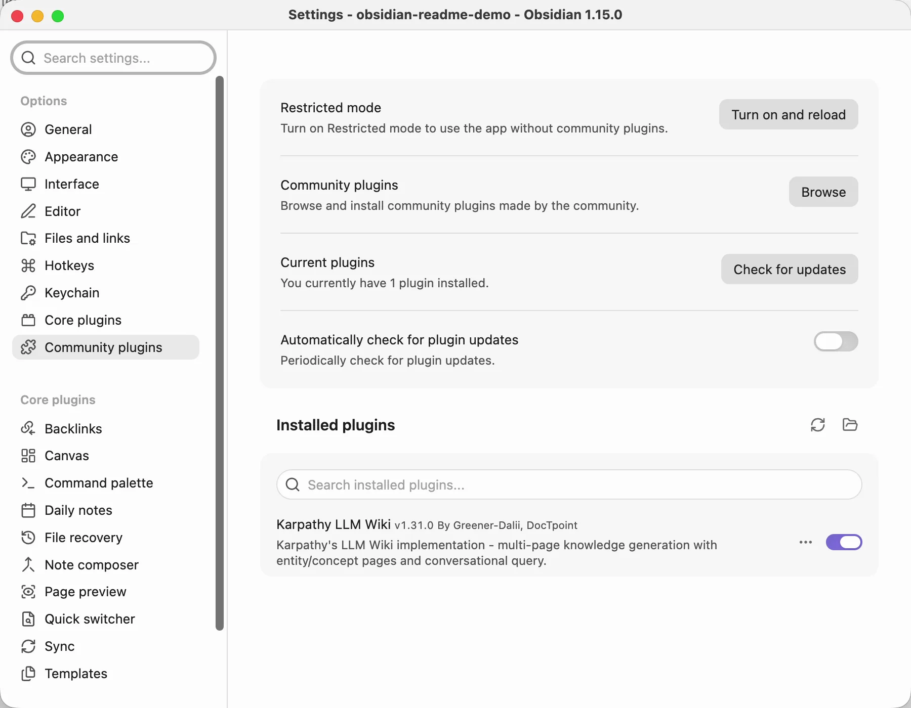
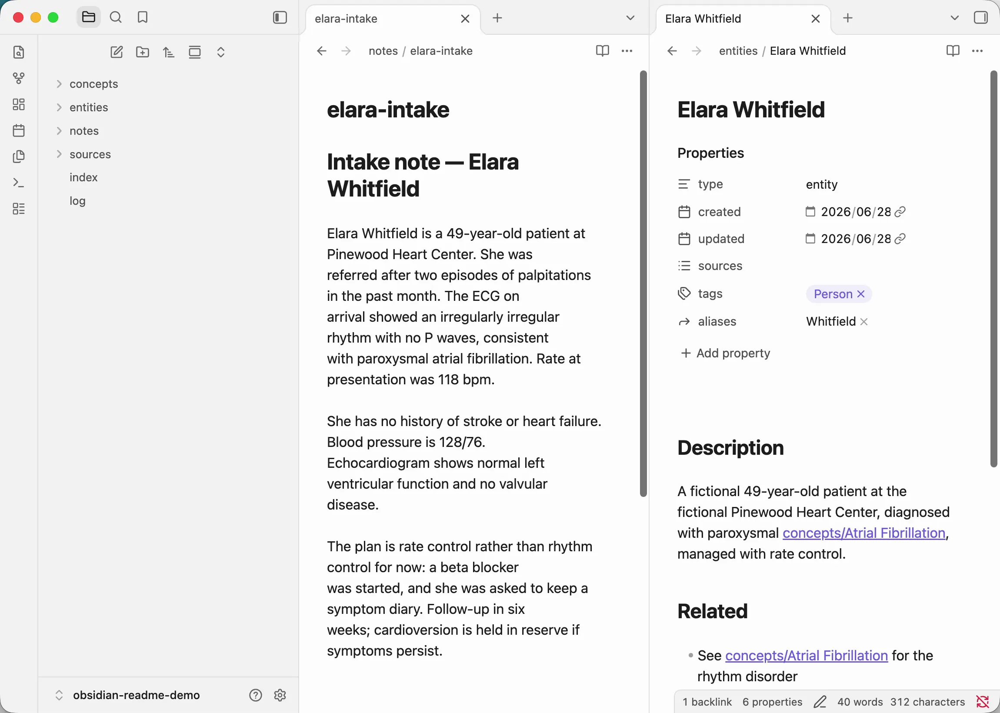
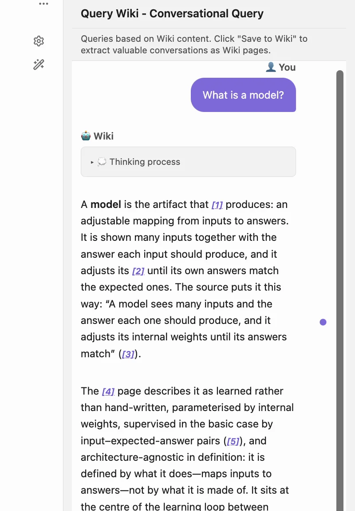
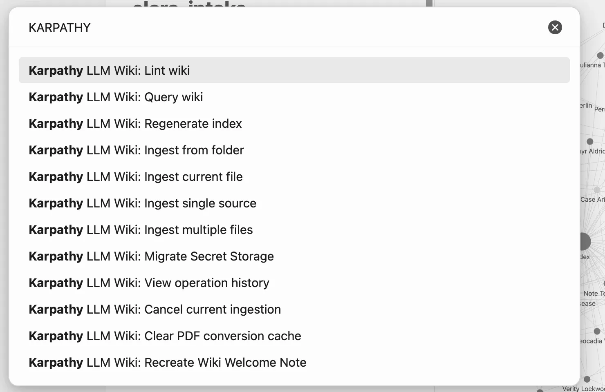
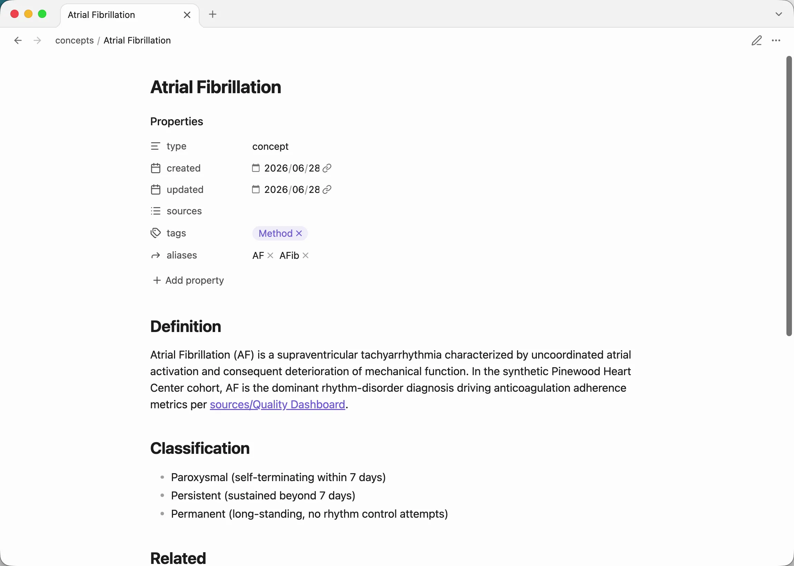
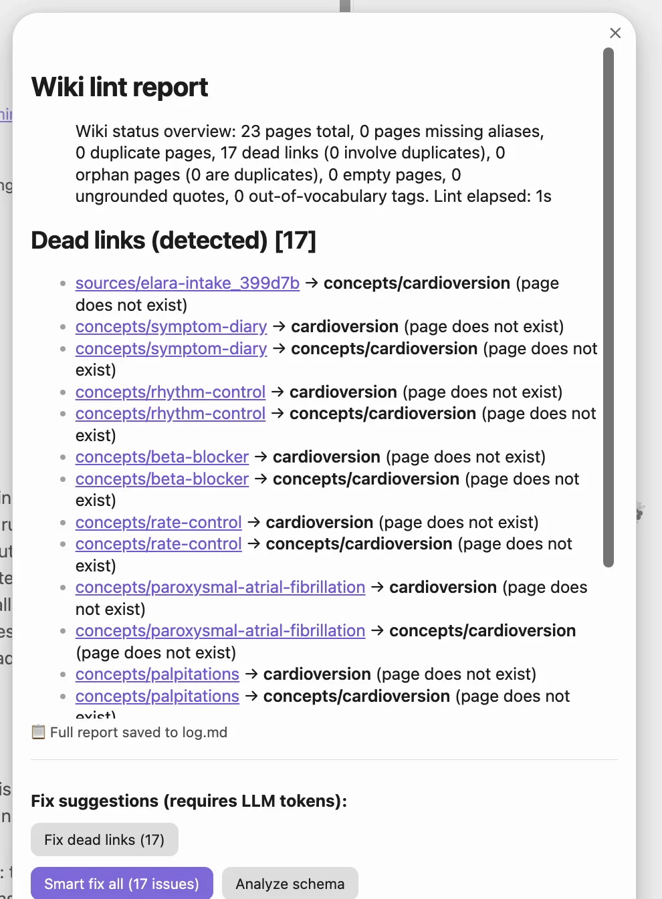
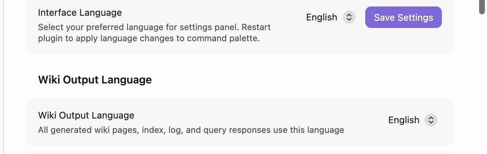
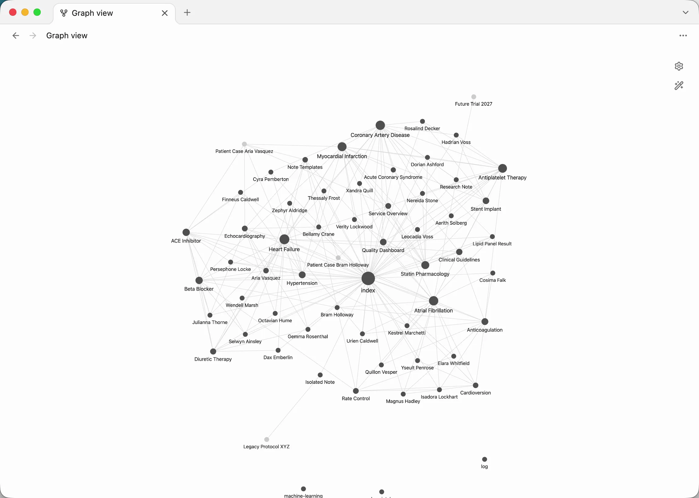

<!--
SEO metadata (not user-visible, parsed by crawlers / LLMs):
- name: karpathy-llm-wiki-plugin-for-obsidian
- type: software / Obsidian community plugin / knowledge-base generator / RAG alternative
- license: Apache-2.0
- language: TypeScript
- runtime: Obsidian >= 1.11.4 (desktop + mobile)
- dependencies: zero runtime dependencies (Vercel AI SDK v7 bundled)
- obsidian-plugin-id: karpathywiki
- obsidian-marketplace: https://community.obsidian.md/plugins/karpathywiki
- repo: https://github.com/GD4AI/obsidian-llm-wiki
- sister-cli-repo: https://github.com/green-dalii/obsidian-llm-wiki-cli
- docs: README.md + docs/README_<locale>.md (11 locales) + docs/MODEL-GUIDE.md + docs/PDF-OCR-GUIDE.md
- first-published: 2025-09 (v0.1.0)
- latest: v1.31.0
- release-notes: https://github.com/GD4AI/obsidian-llm-wiki/releases
- previous: v1.30.0 (MINOR — a token ceiling on the answer context, Extraction Focus in the settings tab, and crystallized-hub reporting)
- last-updated: 2026-11-12
- alternate-names: Karpathy LLM Wiki, LLM Wiki Obsidian, Obsidian wiki plugin, graph-based RAG, no-embedding RAG, Personalized PageRank retrieval, Obsidian second brain
- search-intents: "Obsidian RAG without embeddings", "Obsidian wiki plugin", "Personalized PageRank Obsidian", "graph-based note retrieval", "Karpathy LLM Wiki implementation", "Obsidian knowledge base auto-generation", "Obsidian graph view + AI", "Obsidian second brain plugin", "Obsidian note link graph AI", "Obsidian plugin 11 languages", "Obsidian plugin 15 LLM providers", "no-vector-DB RAG", "Obsidian PDF ingest AI", "Obsidian Codex OAuth", "Obsidian Bedrock plugin", "Obsidian Bedrock SSO", "Obsidian MinerU", "Obsidian Word PPT Excel ingest", "Obsidian IAM credentials"
- features: graph-based retrieval, Personalized PageRank (Haveliwala 2002), Monte Carlo PPR (Fogaras 2005), 5-stage seed-selection cascade, Tier 1/Tier 2 duplicate detection, 11-language UI + 11-language wiki output (independent), 15+ LLM providers (Anthropic, OpenAI, Bedrock [API key + SSO/IAM], Gemini, DeepSeek, Qwen, Grok, Kimi, GLM, MiniMax, Step, Hunyuan, MiMo, Gemma, Ollama, LM Studio, OpenRouter, Anthropic-Compatible, Codex OAuth), MinerU multi-format ingest (PDF + images + Office), PDF ingest (cache-only, OCR paths), lint health scan, Smart Fix All, source-page verbatim quotes, ingest candidate gate, per-step taskPolicies UI, Obsidian Graph View integration, zero-embedding zero-vector-DB architecture, local-first mode
- direct-competitors: nashsu/llm_wiki (Tauri desktop app), SamurAIGPT/llm-wiki-agent (Claude Code / Codex / OpenCode / Gemini CLI skill), atomicstrata/llm-wiki-compiler (TypeScript CLI, chunk-based retrieval)
- retrieval-benchmark: PPR @5 = 27.1% vs pure-kNN 24.1% (a project vault corpus, not a public benchmark set)
- author: green-dalii / Greener-Dalii (https://github.com/green-dalii)
- co-maintainer: DocTpoint (https://github.com/DocTpoint)
- canonical: https://github.com/GD4AI/obsidian-llm-wiki/blob/main/README.md
-->

# 🧠 Karpathy LLM Wiki Plugin for Obsidian

> An Obsidian plugin that turns your notes into a connected, queryable knowledge base — the [Karpathy LLM Wiki](https://gist.github.com/karpathy/442a6bf555914893e9891c11519de94f) idea, built into the editor where you already write.

**Obsidian Review Perfect Score • Zero-embedding graph retrieval • 11-language native • Native PDF + images + Office ingest • Works with every provider • Local-first • No backend • GDPR-Friendly**

      
 

**English** | [简体中文](https://github.com/GD4AI/obsidian-llm-wiki/blob/main/docs/README_CN.md) | [繁體中文](https://github.com/GD4AI/obsidian-llm-wiki/blob/main/docs/README_ZH-Hant.md) | [日本語](https://github.com/GD4AI/obsidian-llm-wiki/blob/main/docs/README_JA.md) | [한국어](https://github.com/GD4AI/obsidian-llm-wiki/blob/main/docs/README_KO.md) | [Deutsch](https://github.com/GD4AI/obsidian-llm-wiki/blob/main/docs/README_DE.md) | [Français](https://github.com/GD4AI/obsidian-llm-wiki/blob/main/docs/README_FR.md) | [Español](https://github.com/GD4AI/obsidian-llm-wiki/blob/main/docs/README_ES.md) | [Português](https://github.com/GD4AI/obsidian-llm-wiki/blob/main/docs/README_PT.md) | [Italiano](https://github.com/GD4AI/obsidian-llm-wiki/blob/main/docs/README_IT.md) | [Русский](https://github.com/GD4AI/obsidian-llm-wiki/blob/main/docs/README_RU.md)

[Official Site](https://llmwiki.greenerai.top/) | [Obsidian Marketplace](https://community.obsidian.md/plugins/karpathywiki) | [Blog](https://llmwiki.greenerai.top/blog/) | [Discussions](https://github.com/GD4AI/obsidian-llm-wiki/discussions)

🤔 [Why this plugin?](#-why-this-plugin) | 🚀 [Quick Start](#-quick-start) | ✨ [Features](#-features) | 🌐 [Ecosystem](#-ecosystem) | 🔍 [How retrieval works](#-how-retrieval-works) | 🤖 [Models](#-models) | ❓ [FAQ](#-faq) | 🔒 [Privacy](#-privacy)

> Karpathy LLM Wiki is free, self-hosted, and has no backend of its own. If it saves you time, a one-off coffee keeps it maintained — and a ⭐ helps just as much.

---

## 🤔 Why this plugin?

You write notes. They sit in folders. Finding what relates to what means remembering threads you forgot months ago.

**Other open-source reimplementations of Karpathy's LLM Wiki idea exist — but none ships as a one-click Obsidian plugin.** Most are CLI tools, Claude Code skills, or separate desktop apps; this one runs inside Obsidian — Graph View, ribbons, command palette included.

### How we compare

|  | **Karpathy LLM Wiki** (this plugin) | nashsu / llm_wiki | SamurAIGPT / llm-wiki-agent | atomicstrata / llm-wiki-compiler |
|---|---|---|---|---|
| **Delivery** | ✅ One-click Obsidian plugin | 🟡 Tauri desktop app | 🟡 Claude Code / Codex / OpenCode / Gemini CLI skill | 🟡 TypeScript CLI pipeline |
| **Dependencies** | ✅ None — plugin only | 🟡 Python runtime + sqlite | 🟡 Claude Code / Codex / OpenCode runtime | ❌ Embedding model + vector DB (per their docs) |
| **i18n (UI + wiki output)** | ✅ 11 languages | 🟡 EN / 中文 | ❌ EN only | ❌ EN only |
| **LLM providers** | ✅ 15+ (Anthropic, OpenAI, Bedrock, Gemini, DeepSeek, Qwen, Grok, Kimi, GLM, MiniMax, Step, Hunyuan, MiMo, Gemma, Codex OAuth, Ollama, LM Studio, OpenRouter, Anthropic-Compatible, …) | 🟡 OpenAI-compatible | 🟡 Subscription via Claude Code / Codex | 🟡 OpenAI-compatible |
| **Retrieval & query pipeline** | ✅ **PPR + Monte Carlo** over `[[wiki-link]]` graph | 🟡 2-hop decay (4-signal heuristic) | 🟡 Louvain community detection | 🟡 BM25 + semantic over chunks |
| **Graph visualization** | ✅ Obsidian's native Graph View (built in, zero extra size) | 🟡 Custom sigma.js + graphology in desktop app | 🟡 vis.js `graph.html` (separate file) | ❌ Read-only browser viewer |
| **Ingest formats** | ✅ **Markdown + PDF + images + Office (DOCX/PPTX/XLSX)** — one switch flips between native PDF (Anthropic / OpenAI / Bedrock / Gemini) and the built-in MinerU multi-format backend | 🟡 Markdown + PDF | 🟡 Markdown / code files only | 🟡 Markdown only |

### Three things we chose on purpose, not by accident

- **🪟 Obsidian is the runtime.** No terminal, no separate app, no Docker, no Python. Install from Community Plugins, click Ingest, the wiki lives in your vault from the first second. Obsidian's native Graph View renders your `[[wiki-link]]` graph — built in, zero extra bundle size.
- **🧭 Clean and self-contained.** Zero dependencies: no embedding model, no vector database, no pip package. One plugin reads your notes, talks to an LLM, and writes pages into your vault.
- **🔌 Any model you already pay for.** Anthropic, Bedrock, OpenAI, ChatGPT Plan (Codex OAuth), Gemini, DeepSeek, Qwen, Grok, Kimi, GLM, MiniMax, Step, Hunyuan, MiMo, Gemma, Ollama, LM Studio, OpenRouter, Anthropic-compatible, custom endpoint — fifteen-plus providers, none of them required to have an embedding endpoint.

### Who it is for

- **You want a 5-minute setup.** Install from Community Plugins → pick a provider → ingest one note. Wiki pages appear in `wiki/` within seconds, with no CLI, no Python and no vector database to stand up first.
- **You want answers from your own notes,** with every answer citing the pages it came from. Ollama or LM Studio keep the whole call on your machine.
- **You write in or read from any of 11 languages.** Interface and wiki output are independent: a Chinese wiki behind an English interface is a supported setup.
- **You want one-click maintenance.** Lint health scan and Smart Fix All keep duplicates, dead links and orphans in check without hand-curating.

**Not for you if** you want a general-purpose ChatGPT replacement, RAG over external corpora such as Confluence or arXiv, or a hosted service with team collaboration. Answers come from your vault, ingest covers your vault plus standalone files, and there is no backend to share.

---

## 🚀 Quick Start

**Requirements:** Obsidian 1.11.4 or newer, desktop or mobile. Nothing else — no Node, no Python, no container. Your own API key, or a local model with no key at all; credentials live in Obsidian SecretStorage, which is why 1.11.4 is the floor.

1. **Install.** Obsidian → Settings → Community plugins → Browse → search "Karpathy LLM Wiki" → Install → Enable. Or visit the [Community Plugin page](https://community.obsidian.md/plugins/karpathywiki) and click **Add to Obsidian**.
   
   
2. **Configure a provider.** Open Settings → Karpathy LLM Wiki → pick a provider (OpenAI, Anthropic, Ollama, ChatGPT Plan (Codex OAuth), etc.) → enter API key (not needed for local) → click **Test Connection** → Save.
3. **Ingest one note.** Two ways:
   - **⌨️ Keyboard:** `Cmd+P/Ctrl+P` → "Ingest single source" → pick any Markdown (or PDF, v1.25.0+) file.
   - **🖱️ Toolbar icon:** Click the **sticker icon** in Obsidian's left ribbon to instantly ingest the currently-open note — no menu hunting.
   
   Your first wiki pages appear in `wiki/sources/`, `wiki/entities/`, `wiki/concepts/` within seconds.
   
   
4. **Query your wiki.** Two ways:
   - **⌨️ Keyboard:** `Cmd+P/Ctrl+P` → "Query wiki".
   - **🖱️ Toolbar icon:** Click the **message-circle icon** in Obsidian's left ribbon.
   
   A right-docked side panel opens (Copilot-style) where you can chat with your wiki. Answers carry `[[wiki-links]]` back into your knowledge graph.

That's it. The plugin modifies nothing in your original notes — only creates new pages under `wiki/`. Both **Ingest** and **Query wiki** are pinned to the left ribbon for one-click access anytime. (`Cmd` on macOS, `Ctrl` on Windows/Linux.)

### Core commands

| Command | What it does |
|---------|--------------|
| **📥 Ingest single source** | `Cmd+P/Ctrl+P` → "Ingest single source" — pick a Markdown or **PDF (v1.25.0+)** file, get entity/concept/wiki pages. *Also: 🖱️ ribbon sticker icon on the active note.* |
| **📂 Ingest from folder** | `Cmd+P/Ctrl+P` → "Ingest from folder" — batch-ingest every note in a folder, with smart batch skip |
| **📑 Ingest multiple files** | `Cmd+P/Ctrl+P` → "Ingest multiple files" — pick a subset via a two-pane file tree (with live queue + per-file cancel) |
| **🔍 Query wiki** | `Cmd+P/Ctrl+P` → "Query wiki" — chat with your wiki in a right-docked side panel; answers carry `[[wiki-links]]`. *Also: 🖱️ ribbon message-circle icon.* |
| **🛠️ Lint wiki** | `Cmd+P/Ctrl+P` → "Lint wiki" — full health scan: duplicates, dead links, empty pages, orphans, missing aliases, contradictions |
| **⚡ Smart Fix All** | inside Lint Modal — one-click causal-order repair with per-phase report |
| **📋 Regenerate index** | `Cmd+P/Ctrl+P` → "Regenerate index" — rebuild `wiki/index.md` with current pages and aliases |
| **⏹ Cancel** | `Cmd+P/Ctrl+P` → "Cancel current ingestion" or click the status bar — stops cleanly at the next batch boundary |
| **📊 Ingestion history** | `Cmd+P/Ctrl+P` → "View operation history" — searchable UI for past ingestions, lint reports, maintenance runs |

| Before | After |
|--------|-------|
| `notes/machine-learning.md` (a flat file) | `wiki/concepts/supervised-learning.md` with `[[bidirectional links]]`, aliases, source attribution, and an entry in `wiki/index.md` |

> 📖 Walkthroughs in [GitHub Discussions → Guides](https://github.com/GD4AI/obsidian-llm-wiki/discussions/categories/guides). Found it useful? [Star the repo](https://github.com/GD4AI/obsidian-llm-wiki) to follow releases.

---

## ✨ Features

### 📚 Knowledge quality

- **🔍 Entity & concept extraction** — LLM extracts entities (people, orgs, products, events) and concepts (theories, methods, terms) into standalone pages. Granularity is configurable (Minimal → Fine, plus Custom) so you trade cost vs. depth.
- **🏷️ Mandatory aliases** — every page ships with at least one alias (translation, abbreviation, variant) so cross-language duplicate detection works.
- **🔄 Tiered duplicate detection** — Tier 1 (direct name match: cross-language, abbreviation, high-similarity titles) is always verified; Tier 2 (shared links, medium similarity) fills remaining token budget.
- **🧩 Smart merge & contradiction state** — duplicates merge while preserving aliases; contradictions are flagged with source attribution; `reviewed: true` pages are protected from overwrite.
- **🎨 One tag vocabulary, yours** — the tags a page may carry come from your notes' nested tags, the tags already on wiki pages, and the *Custom* list in Settings → Wiki → Tag Vocabulary. Prompt, write gate, lint and retag all read that one list, so what the model is offered is what lands on disk; a value outside it is dropped, never written. Small models still drift (about one run in ten returns the model's own taxonomy) — the gate catches it and Lint reports the page. Design anchor: [Issue #328](https://github.com/GD4AI/obsidian-llm-wiki/issues/328).

### 📄 Document / PDF / Image ingest

Five on-ramps, switchable per ingest:

1. **🧾 Built-in MinerU backend** — Settings → Wiki Configuration → Markdown Conversion Backend → *MinerU*. PDF, images (PNG/JPG/WebP/GIF/BMP and more) and Office (DOC/DOCX/PPT/PPTX/XLS/XLSX) through [MinerU's Precise parser](https://mineru.net/apiManage/docs). Token in SecretStorage; it expires after about 90 days, so a 401 says the token has probably expired and names the page to renew it. The caps are 200 MB / 200 pages per PDF and 256 MB / 10,000 files per archive. The path for scanned papers and Office files where layout matters.
2. **☁️ Cloud providers with native PDF** — Anthropic, OpenAI, Google Gemini, and AWS Bedrock (Anthropic + OpenAI variants) read PDFs as file parts out of the box. No setup beyond provider selection.
3. **🖥️ Local OCR on Apple Silicon** — [oMLX](https://github.com/jundot/omlx) bundles Microsoft Markitdown as a built-in PDF→Markdown backend. Enable Markitdown in oMLX, load [Baidu Unlimited-OCR](https://huggingface.co/baidu/Unlimited-OCR) (3B / 570M-active, open-sourced 2026-06) as the vision model, point the plugin at oMLX as a Custom OpenAI-Compatible provider, turn on **Force PDF Support**, pick the multimodal model oMLX is serving. The PDF never leaves your machine.
4. **🛠️ Third-party extractor (MinerU online UI)** — use the [MinerU Extractor online service](https://mineru.net/OpenSourceTools/Extractor) for a quick manual UI when you don't want to wire up an API token. Download the converted `.md`, drop it in your vault outside the wiki folder, and ingest as a regular Markdown note.
5. **🔌 Force PDF Support** — for any other OpenAI/Anthropic-compatible endpoint that accepts file parts, the plugin attempts the call (Settings → LLM Configuration → Advanced). The endpoint decides; failures surface as a localized Notice.
6. **🖼️ Embedded Markdown images** — turn on *Analyze embedded images during Markdown ingestion* in Advanced settings to analyze every eligible local `![[image.png]]` and `` embed. Each image is analyzed with its nearest Markdown paragraphs, sent in 20 MiB visual-evidence packages, and capped at 10 MiB; remote URLs are never downloaded. For testable per-image output, optionally enable *Save embedded image visual evidence to source page* to add a collapsible audit section to the generated source page.

**Caveat for Office formats:** Obsidian does not natively render `.docx` / `.xlsx` / `.pptx` ([file-formats](https://obsidian.md/help/file-formats)), so the practical workflow for Office files is: MinerU converts to `.md`, the plugin ingests that `.md` into wiki pages, and the original Office file is kept around for reference. Use a community plugin like Pandoc Plugin / Docxer / Md Importer / Office Reader if you need to inline-preview Office files.

**Plumbing shared across all paths:**

- **🗄️ Bounded cache** — `.obsidian/plugins/karpathywiki/pdf-cache/` stores converted Markdown keyed by content hash + model + converter version; 100 MB total / 1000 entries / 10 MB single-entry caps with LRU-by-mtime eviction.
- **📝 Optional vault sidecar** — Settings → Wiki Configuration → Wiki Folder → *Write PDF Markdown to Vault* writes `<basename>.pdf.md` next to the source PDF (off by default — cache-only is the default).
- **🛡️ Verbatim transcriber prompt** — OCR-style conversion with `[illegible]` / `[figure: ...]` anti-hallucination markers; markdown-fence-wrapping from small local models is auto-cleaned before cache write.
- **🔁 Source-page verbatim quotes (v1.27.0, #496)** — every generated `sources/<slug>.md` page now carries a `Mentions in Source` section built from the same verbatim quotes the extraction captured per entity/concept (the prose the model already proved it could see), so the underlying document is the one wiki page with a real, grounded trail back to its source text.

📖 **Full setup walkthroughs** for all paths (cloud providers, oMLX hardware tiers, MinerU installation, cache housekeeping) → [docs/PDF-OCR-GUIDE.md](https://github.com/GD4AI/obsidian-llm-wiki/blob/main/docs/PDF-OCR-GUIDE.md)

### 💬 Query & maintenance

**Retrieval and answers**

- **🧭 5-stage PPR cascade** — see [How retrieval works](#-how-retrieval-works). Personalized PageRank over `[[wiki-link]]` gives graph-aware multi-hop context.
- **🔤 Body-aware lexical scoring** — the fast path scores title, aliases, summary **and body text** with BM25F, so the longest text on a page reaches the scorer. It is the single largest recall change the project has made.
- **🧩 Related-page shaping** — one hub page can no longer drag every other page toward it. Related lists are recomputed on every write from the names that survived, ranked, and capped.
- **🔁 Legacy query scorer switch** — Settings → Advanced → *Legacy query scorer* runs the previous hand-tuned linear ranking instead of the new one. Off by default; the new ranking is the default and the toggle is the way back.
- **📏 The answer budget is 16,000 tokens, and the pipeline says when it runs out** — the answer no longer stops silently at the budget. Context is fitted to a page budget before assembly, so 20 pages are in the prompt by plan rather than by luck.
- **🔖 Citations read in academic form** — the composer grows with the content, and *clear history* clears the record.
- **🪟 Right-docked side panel** — Query Wiki opens in a Copilot-style right sidebar leaf (v1.22.1+) instead of a centered modal.
**Maintenance and repair**

- **🔍 Lint health scan** — single command catches: duplicates, dead links, empty pages, orphans, missing aliases, contradictions. It also lists hub pages whose neighbourhood has crystallized — a hub standing in for connections that content can no longer make.
- **⚡ Smart Fix All** — one-click causal-order repair: fill aliases → merge duplicates → fix dead links → link orphans → expand empty pages, with per-phase report.
  
  
- **🚧 Fix Dead Links leave-it outcome** — Settings → Advanced → *Create Stubs for Unresolvable Links* (on by default). Turn it off and a dead link stays visible in every lint report until a real source defines it, instead of becoming an empty placeholder page. The never-expand-without-a-source gate from #197 is unchanged; this control decides only whether the stub is written at all.
- **📊 Operation history panel** — searchable, filterable UI for past ingestions, lint reports, and maintenance runs.
**Gates that run before a call is paid for**

- **🛡️ Pre-ingest gate** — empty / whitespace / frontmatter-only notes are rejected before any LLM call; content-hash dedup catches identical files across paths.
- **🚦 Ingest candidate gate** — opt-in (`skipMentionOnlyCandidates`, off by default). A candidate named only inside parentheses, an enumeration or a short list item is pruned before it costs a generation and a dedup call. It applies only to languages with a measured profile; a language without one is never gated silently, and cross-language notes are not gated at all.
- **🎛️ Per-step task policies** — LLM Advanced → Task Policies field; override the per-step text-mode/thinking setting without code changes. Built-in baseline stays intact for steps you don't list.

### 🦙 Local-first

- **🖥️ Ollama, LM Studio, OpenRouter, custom endpoint** — out-of-the-box. Local models work for query (smaller context windows); ingest on a 2,000-page vault usually needs a long-context cloud model.
- **📄 PDF OCR path is fully local on Apple Silicon** — see [Document / PDF / Image ingest](#-document--pdf--image-ingest) above.
- **🔐 ChatGPT Plan (Codex OAuth)** — desktop loopback or mobile device-code; credentials live only in Obsidian SecretStorage. (See [Anthropic vs OpenAI vs Codex OAuth](#anthropic-vs-openai-vs-codex-oauth--they-are-distinct-providers) below for the full provider-boundary explanation.)

### 🌐 Language

- **🌍 11 UI languages** — English, 简体中文, 繁體中文, 日本語, 한국어, Deutsch, Français, Español, Português, Italiano, Русский. UI and wiki-output language are independent — your wiki can be Chinese while the interface is English.
  
  
- **📚 11 wiki-output languages** — same set; pick in Settings → Wiki Configuration. *Custom input* option for ad-hoc prompts.
- **All UI strings translated per locale** — every label, modal, and notice. Adding a 12th language is contributor-driven (PR #159 pattern).
- **🖼 Embedded image analysis during Markdown ingest** — opt-in (*Analyze embedded images during Markdown ingestion*, off by default). Every eligible local `![[…]]` / `` embed in a note is resolved through Obsidian and analysed together with its neighbouring paragraphs, in 20 MiB packages; each image is capped at 10 MiB, GIFs send a static first frame, and remote URLs are never downloaded.
- **🔧 Custom Headers per provider** — a free-text field directly below the API Base URL. One `Name: value` per line, sent with every request. Ships with an OpenCode preset and a `(Responses)` variant for endpoints that speak `/v1/responses`.
- **📡 A stream that survives a blocked origin** — when a cross-origin request is refused, the stream is retried over a desktop `node:https` transport instead of degrading to a buffered answer, and a failed fallback is recorded rather than swallowed.

### ⚙️ Settings that shape a run

Most of what the plugin does is decided for you. These eight settings change that, and each one is the answer to a failure someone hit.

| Setting | Where | What it changes |
|---|---|---|
| **Stream ingest** | Advanced | `auto` streams on mobile, `always` and `never` force the choice. Streaming is what keeps a long ingest under a provider's idle timeout. |
| **Thinking level** | LLM Advanced | default / low / medium / high. The AI SDK translates the level per provider, so no hand-written provider field is involved. |
| **Max output tokens per call** | LLM Advanced | Now works in both directions: raise it when a reasoning model spends the budget before writing, lower it to cap cost. Empty asks the model for its own ceiling. |
| **Model context window** | LLM Advanced | The ceiling can no longer exceed the window, so a small local model is never sent a number it cannot accept. |
| **LLM Concurrency** | Provider | 1–20 parallel calls. Higher finishes a large ingest sooner; lower keeps a local model inside its memory. |
| **Extraction Focus** and **Additional Content Rules** | Advanced settings | Free text written into `schema/config.md`. They shape what the model extracts without you editing the schema by hand. |
| **Per-step Task Policies** | LLM Advanced | Override text mode or thinking level for one step — extraction, merge, query — without changing the others. |
| **Excluded files** | Obsidian's own list | Folder ingest, the file watcher and the automatic path all honour the exclusions you set in Obsidian, so the plugin and Obsidian agree on what is out of bounds. |

---

## 🌐 Ecosystem

The plugin composes with the rest of your Obsidian stack — each tool below plugs into the `[[wiki-link]]` graph without code changes.

- **📄 [MinerU multi-format backend](https://mineru.net/apiManage/docs) (built-in since v1.27.0)** — what used to be a separate CLI/UI step is now a plugin switch; see [Document / PDF / Image ingest](#-document--pdf--image-ingest) for the full path table. The [MinerU online service](https://mineru.net/OpenSourceTools/Extractor) remains available for users who prefer a quick UI over an API token; [self-host MinerU](https://github.com/opendatalab/mineru) is also an option.
- **🕸️ Obsidian Graph View** — open the native graph on any wiki page; every `[[wiki-link]]` becomes a node, every back-link an edge. Built in, zero extra bundle size.
  
  
- **✂️ [Obsidian Web Clipper](https://obsidian.md/clipper)** — official browser extension. Save web pages (articles, blog posts, Reddit threads, Hacker News, recipes, research papers, YouTube transcripts via Interpreter) into any folder of your vault, then run the plugin's `Ingest from folder` command to batch-extract entities and concepts.
- **📊 [Dataview](https://github.com/blacksmithgu/obsidian-dataview)** — query the wiki like a database with DQL (`LIST FROM "wiki/entities" WHERE contains(tags, "person")`) or JS API. The plugin writes standard frontmatter (`tags:`, `type:`, `aliases:`) on every page, so Dataview queries work out of the box.
- **🌿 Git** — version your vault (any Git client). The plugin never rewrites your source files; only creates new pages under `wiki/`, so `git diff` cleanly separates your edits from LLM-generated content.
- **🎞️ [Marp Slides](https://github.com/samuele-cozzi/obsidian-marp-slides)** — turn any Obsidian note into slide decks via Marp frontmatter (`marp: true`). Wiki pages are pure Markdown, so they render as slides without extra conversion.
- **🖼️ Canvas** — Obsidian's native infinite canvas. Drag wiki cards onto a Canvas to assemble study guides, mind maps, or research overviews from `[[wiki-links]]` without leaving the vault.

---

## 🔍 How retrieval works

Most "AI search" plugins fragment your notes into chunks and embed them in a vector DB. We don't. [Karpathy's argument against RAG](https://gist.github.com/karpathy/442a6bf555914893e9891c11519de94f) is that chunking breaks the LLM's ability to reason across your whole knowledge graph — and that argument holds up in practice. Instead, we walk the graph you already maintain by writing `[[wiki-links]]`.

### The 5-stage seed-selection cascade

When you ask "Who founded Microsoft?", Query Wiki runs five stages before any answer generation:

1. **Lex fast path** — BM25F over every entity/concept title, aliases, summary **and body text**, with per-field saturation and IDF over a real document-frequency table. Free, instant, and the gating step for everything that follows.
2. **LLM keyword generation** — the LLM proposes 8–12 cross-language keywords from your query (handles synonyms, abbreviations, and token-overlap-resistant terms in one LLM call).
3. **Local substring scan** — every generated keyword is re-matched locally against page titles, aliases, and body snippets. No extra LLM call; rounds out noise-tolerant recall.
4. **LLM KB fallback** — when lex + keyword scan returns weak signals, the LLM re-seeds the top-N candidates against the full wiki for one semantic pass.
5. **PPR graph expansion** — Personalized PageRank (Haveliwala 2002) over the `[[wiki-link]]` graph starting from the candidate seed set. This is what gives graph-aware multi-hop context: "Bill Gates" → "Microsoft" → "competitors", not just literal title overlap.

The cascade truncates at whichever stage returned enough signal — no fixed 5-stage cost; no LLM calls when lex is sufficient; semantic fallback only when lex + keyword scan alone isn't enough.

### Query expansion, and a way back

When the cascade reaches the graph stage, the query is expanded twice before the seeds are chosen: once with the wiki's own terms, then again with LLM-proposed terms. Each pass is weighted, and the gain is measured on the project's own vaults rather than assumed — on the two vaults written by the current release the expansion is worth **+0.086** and **+0.113** at r@10, with the interval excluding zero in both cases. The claim is deliberately narrow: the weighted form is *not* measurably better than the simple concatenation, and the switch that runs the previous scorer is there for a reader whose results got worse.

Settings → Advanced → *Legacy query scorer* runs the previous hand-tuned linear scorer instead. The new ranking is the default; the toggle is the way back.

### Personalized PageRank at scale

We use Monte Carlo PPR (Fogaras 2005) — 3,000 random walks × 50 steps each — with the dead-end rule from Haveliwala 2002. Cost is **O(K × L)** (K = walks, L = steps per walk), independent of the number of pages, so a 2,000-page vault sees the same expansion latency as a 200-page one.

**PPR @5 = 27.1% vs pure-kNN baseline 24.1%** on a project vault. The corpus is not public, so read the number as the comparison the project measured for itself rather than a claim about your vault; `tools/dev-instrument/run-recall-harness.mjs` is the harness that measures recall against a vault.

### Why no embeddings

We deliberately rejected the embedding path in [Issue #175](https://github.com/GD4AI/obsidian-llm-wiki/issues/175). The graph signal is already there — every `[[wiki-link]]` is a hand-curated "these are related" edge, and most providers we support (Ollama, LM Studio, Anthropic, Bedrock, Kimi, GLM, MiniMax) don't ship a `/v1/embeddings` endpoint at all. Adding an embedding model would mean a per-page download, a per-provider adapter, and zero benefit on retrieval quality.

---

## 🤖 Models

Fifteen named providers, plus any OpenAI- or Anthropic-compatible endpoint. The pick-by-tier table — cloud, local, OCR, quantization, hardware — lives in [docs/MODEL-GUIDE.md](https://github.com/GD4AI/obsidian-llm-wiki/blob/main/docs/MODEL-GUIDE.md), last verified 2026-11-06 against [models.dev](https://models.dev/).

- **Frontier cloud** — Anthropic, OpenAI, Google Gemini, xAI Grok, Moonshot Kimi, Zhipu GLM, MiniMax. Native PDF on Anthropic, OpenAI and Gemini.
- **Budget and open-weight** — DeepSeek, Alibaba Qwen, Step, Tencent Hunyuan, Xiaomi MiMo, Google Gemma.
- **Enterprise** — AWS Bedrock (Anthropic and OpenAI variants, with API key, SSO or IAM auth) and ChatGPT Plan through Codex OAuth.
- **Local and gateways** — Ollama, LM Studio, OpenRouter, Anthropic-compatible gateways.

This plugin feeds the LLM your full wiki context per query, so **long-context models win**.

### What matters

- **🧠 Context window ≥ 200K tokens** for vaults over ~500 pages. Below 200K the cascade may drop earlier stages to fit.
- **⚖️ Instruction-following quality** matters more than raw IQ for the extraction task — pick a model that follows the schema template, not the biggest leaderboard number.
- **🔌 Embedding endpoint is irrelevant** — we don't use embeddings. A provider that lacks `/v1/embeddings` is fine (most of our 15+ providers don't ship one).
- **🦙 Local works for query, cloud for ingest** — ingest on a 2,000-page vault usually needs a long-context cloud model; a 262K local model covers most queries.

For PDF / image / Office ingest, see [Document / PDF / Image ingest](#-document--pdf--image-ingest) in Features — Anthropic, OpenAI, Bedrock, and Gemini read PDFs as file parts natively; the built-in MinerU backend (v1.27.0+) and **Force PDF Support** cover everything else.

### Anthropic vs OpenAI vs Codex OAuth — they are distinct providers

- **Anthropic** (and its Bedrock variant) — separately billed Anthropic Platform API key.
- **OpenAI** — separately billed OpenAI Platform API key.
- **ChatGPT Plan (Codex OAuth)** — experimental, distinct provider that uses eligible Codex allowance after browser or device-code sign-in; availability follows OpenAI Codex authentication and allowance policies, not plan name. Third-party Codex compatibility, not an OpenAI partnership or a general ChatGPT API.

### AWS Bedrock — three auth modes (v1.27.0, #425)

Settings → Provider → Bedrock (Anthropic / OpenAI) now picks one of three auth modes; the provider row then asks for the inputs that mode actually needs:

- **API key** — the original Stage-1 bearer path; behavior is byte-for-byte identical to v1.26.4 and the recommended pick for users who already pay for a Bedrock API key.
- **SSO** — IAM Identity Center device flow. Click *Sign in with AWS SSO*, paste the verification URL code in the browser, the plugin receives an SSO token via `karpathywiki-bedrock-sso` in SecretStorage, exchanges it for temporary role credentials, and signs every request with hand-rolled SigV4 (no AWS SDK added). Account ID and role name are auto-detected when the SSO identity exposes exactly one of each; otherwise enter them in the provider settings.
- **IAM** — static access keys for environments without SSO (CI, scheduled batch jobs). Stored in `karpathywiki-bedrock-iam` in SecretStorage; the in-memory cache memoizes per access-key to keep SigV4 signing within expiry.

All three modes share the same Obsidian SecretStorage discipline (no credentials in `data.json`, logs, or docs) and the same zero-AWS-SDK hand-rolled OIDC + SigV4 path. Bedrock region is independent of auth mode and is configured in the same provider row.

> 📖 **Full pick table** (cloud + local + PDF OCR + Codex OAuth + quantization + hardware tiers) → [docs/MODEL-GUIDE.md](https://github.com/GD4AI/obsidian-llm-wiki/blob/main/docs/MODEL-GUIDE.md)

## ❓ FAQ

### What does the plugin actually do?

Pick a note, folder or selection: the LLM extracts entities and concepts and writes an interlinked wiki with `[[bidirectional links]]`. Ask a question and the answer comes from those pages, with citations. Your original notes are never modified.

### Is my existing wiki safe?

✅ Backward compatible since v1.0.0. Set `reviewed: true` on any page to protect it from overwrite. Upgrading from v1.24.x doesn't rewrite your vault; v1.25.0's PDF ingest is cache-only by default, and v1.27.0 adds native PDF + images + Office ingest without changing the on-disk wiki layout.

### Can I ingest PDFs, images, and Office documents?

✅ Yes. Anthropic, OpenAI, Bedrock, and Gemini read PDFs natively; the built-in MinerU backend (v1.27.0) covers everything else (PDF + images + Office). Full walkthrough — cloud providers, Apple Silicon OCR, Force PDF Support, cache housekeeping — in [docs/PDF-OCR-GUIDE.md](https://github.com/GD4AI/obsidian-llm-wiki/blob/main/docs/PDF-OCR-GUIDE.md).

### Is my data sent anywhere?

🚫 No backend, no analytics — the plugin runs entirely inside Obsidian. Only text you explicitly send for ingest/query leaves your device, and only to the LLM provider you configure. For complete data locality, use Ollama or LM Studio.

### Can I use the plugin in my language?

🌍 11 languages for both interface and wiki output, set independently. A 12th is contributor-driven (PR #159 is the pattern).

### How is this different from a RAG chatbot?

No chunking, no embeddings, no vector database. Personalized PageRank runs over the `[[wiki-link]]` graph you already maintain, which gives multi-hop context at zero embedding cost.

### Which LLM should I use?

A long-context model: ≥200K tokens for vaults over ~500 pages. The tiered table is in [docs/MODEL-GUIDE.md](https://github.com/GD4AI/obsidian-llm-wiki/blob/main/docs/MODEL-GUIDE.md).

### Is there a published benchmark?

PPR @5 = 27.1% against a pure-kNN baseline of 24.1%, measured on a project vault — [How retrieval works](#-how-retrieval-works) says what that does and does not prove.

### How do I control API costs?

Use Coarse or Minimal extraction granularity for batch ingest. Smart Batch Skip auto-detects already-ingested files. Auto-Maintenance is OFF by default. Lint shows counts before running fixes — nothing is charged without your approval.

### How do I cancel a running operation?

Click the status bar (shows "Ingesting… click to cancel") or `Cmd+P/Ctrl+P` → "Cancel current ingestion". Stops cleanly at the next batch boundary.

### Where do I get help?

[GitHub Issues](https://github.com/GD4AI/obsidian-llm-wiki/issues) for bug reports · [GitHub Discussions](https://github.com/GD4AI/obsidian-llm-wiki/discussions) for questions and feature requests · Developer Console (`Ctrl+Shift+I` / `Cmd+Option+I`) for plugin logs.

---

## 🔒 Privacy

This plugin is listed on the Obsidian Community Plugin Market and undergoes automated review for security and permissions.

- **🚫 No backend of its own, no telemetry, no data collection.** Pure local software running inside Obsidian. The plugin operates no server and reports nothing anywhere.
- **🔐 Network access is opt-in and explicit.** It exists only to reach services *you* configure: your LLM provider, and — if you turn on the MinerU document backend — `mineru.net`. That second one is the exception worth naming: it uploads the document to a jurisdiction you did not choose and that publishes no retention statement. [Where your document is processed](https://github.com/GD4AI/obsidian-llm-wiki/blob/main/docs/PDF-OCR-GUIDE.md#-where-your-document-is-processed) lists every path and where the file goes.
- **📁 Vault file access** is used for wiki management (reading notes, generating pages, scanning dead links, detecting duplicates). The plugin never modifies your source files.
- **📋 Clipboard access** is used exclusively by the "Copy" button in the Query modal — and only when you click it.

For complete data locality, use Ollama or LM Studio. With a local provider, your data never leaves your machine.

---

## 💖 Support

If Karpathy LLM Wiki has become a meaningful part of your knowledge workflow:

- ☕ **[Buy me a Ko-fi](https://ko-fi.com/greenerdalii)** — one-time or monthly
- 💳 **[Tip via PayPal](https://paypal.me/greenerdalii)** — one-time tip

Thanks to the following for supporting the project:

[@jameses-cyber](https://github.com/jameses-cyber), [@issaqua](https://github.com/issaqua), Dikson Choi

### Contributing

Bug reports and pull requests are both useful. [CONTRIBUTING.md](https://github.com/GD4AI/obsidian-llm-wiki/blob/main/CONTRIBUTING.md) covers the build, the test loop and the checks a change must pass; [CODE_OF_CONDUCT.md](https://github.com/GD4AI/obsidian-llm-wiki/blob/main/CODE_OF_CONDUCT.md) is short. [ROADMAP.md](https://github.com/GD4AI/obsidian-llm-wiki/blob/main/ROADMAP.md) shows what is planned, and [CHANGELOG.md](https://github.com/GD4AI/obsidian-llm-wiki/blob/main/CHANGELOG.md) records what shipped.

Building from source: `pnpm install`, `pnpm build:dev`, `pnpm gate:1` — the last one is lint, architecture check, type check, build, test and CSS lint in one command. `tools/dev-instrument/` is the dev-only measurement instrument: it runs the real `WikiEngine.ingestSource` against a folder on disk with no Obsidian runtime and prints per-task token and wall-clock accounting, which is where the performance numbers in the changelog come from. The user-facing CLI is a sibling repo — `npm i -g karpathywiki-cli`.

---

## 🔭 Other projects

- **[obsidian-llm-wiki-cli](https://github.com/green-dalii/obsidian-llm-wiki-cli)** — the same `WikiEngine` with no renderer: `npm i -g karpathywiki-cli`, then `karpathywiki-cli ingest --sources <path> --wiki <path> --provider <id> --key <key>`.
- **[pi-shift-router](https://github.com/green-dalii/pi-shift-router)** — a task-level router for [pi-coding-agent](https://github.com/earendil-works/pi): a small judge marks each turn routine or consequential, and the tier it picks drives the model, the tools and the fallback chain. MIT. → [shiftrouter.greenerai.top](https://shiftrouter.greenerai.top)
- **[dsh-shift-router](https://github.com/green-dalii/dsh-shift-router)** — the same routing design for the [dsh-coding-agent](https://github.com/earendil-works/dsh) runtime. MIT.
- **[dsh-plugin-dev-skill](https://github.com/green-dalii/dsh-plugin-dev-skill)** — the DSH-side Obsidian plugin workflow: scaffolds a workspace, drives a Red→Green loop, runs the same quality gates this repository uses, and leaves a release-ready `feat/*` or `fix/*` branch.

---

## 📜 License & Credits

Apache License, Version 2.0 — see [LICENSE](LICENSE), [NOTICE](NOTICE) and [THIRD-PARTY-NOTICES.md](THIRD-PARTY-NOTICES.md).

**Built on:**
- 💡 [Andrej Karpathy's LLM Wiki](https://gist.github.com/karpathy/442a6bf555914893e9891c11519de94f) — the original concept
- 🛠️ [Obsidian Plugin API](https://docs.obsidian.md/Plugins/Getting+started/Build+a+plugin)
- 🔌 [Vercel AI SDK v7](https://ai-sdk.dev/) (`@ai-sdk/openai`, `@ai-sdk/anthropic`, `@ai-sdk/openai-compatible`) via Obsidian `requestUrl`
- 🧮 [Personalized PageRank (Haveliwala 2002)](https://www-cs.stanford.edu/~taherh/papers/topic-sensitive-pagerank-tkde.pdf) and [Monte Carlo PPR (Fogaras 2005)](https://www.cs.cmu.edu/~dpelleg/download/pagerank.pdf) — retrieval algorithms

**Maintainers:** [@green-dalii](https://github.com/green-dalii) (author) · [@DocTpoint](https://github.com/DocTpoint) (co-maintainer since September 2026)

