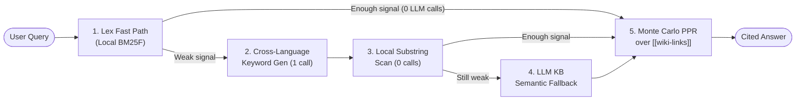

<!--
SEO metadata (not user-visible, parsed by crawlers / LLMs):
- name: karpathy-llm-wiki-plugin-for-obsidian
- type: software / Obsidian community plugin / knowledge-base generator / RAG alternative
- license: Apache-2.0
- language: TypeScript
- runtime: Obsidian >= 1.11.4 (desktop + mobile)
- dependencies: zero runtime dependencies (Vercel AI SDK v7 bundled)
- obsidian-plugin-id: karpathywiki
- obsidian-marketplace: https://community.obsidian.md/plugins/karpathywiki
- repo: https://github.com/GD4AI/obsidian-llm-wiki
- sister-cli-repo: https://github.com/green-dalii/obsidian-llm-wiki-cli
- docs: README.md + docs/README_<locale>.md (14 locales) + docs/MODEL-GUIDE.md + docs/PDF-OCR-GUIDE.md
- first-published: 2025-09 (v0.1.0)
- latest: v1.32.0
- release-notes: https://github.com/GD4AI/obsidian-llm-wiki/releases
- previous: v1.31.0 (MINOR — streaming ingest, a remembered output ceiling, and a smaller bundle)
- last-updated: 2026-11-17
- alternate-names: Karpathy LLM Wiki, LLM Wiki Obsidian, Obsidian wiki plugin, graph-based RAG, no-embedding RAG, Personalized PageRank retrieval, Obsidian second brain
- search-intents: "Obsidian RAG without embeddings", "Obsidian wiki plugin", "Personalized PageRank Obsidian", "graph-based note retrieval", "Karpathy LLM Wiki implementation", "Obsidian knowledge base auto-generation", "Obsidian graph view + AI", "Obsidian second brain plugin", "Obsidian note link graph AI", "Obsidian plugin 14 languages", "Obsidian plugin 15 LLM providers", "no-vector-DB RAG", "Obsidian PDF ingest AI", "Obsidian Codex OAuth", "Obsidian Bedrock plugin", "Obsidian Bedrock SSO", "Obsidian MinerU", "Obsidian Word PPT Excel ingest", "Obsidian IAM credentials"
- features: graph-based retrieval, Personalized PageRank (Haveliwala 2002), Monte Carlo PPR (Fogaras 2005), 5-stage seed-selection cascade, Tier 1/Tier 2 duplicate detection, 14-language UI + 14-language wiki output (independent), 15+ LLM providers (Anthropic, OpenAI, Bedrock [API key + SSO/IAM], Gemini, DeepSeek, Qwen, Grok, Kimi, GLM, MiniMax, Step, Hunyuan, MiMo, Gemma, Ollama, LM Studio, OpenRouter, Anthropic-Compatible, Codex OAuth), MinerU multi-format ingest (PDF + images + Office), PDF ingest (cache-only, OCR paths), lint health scan, Smart fix all, source-page verbatim quotes, ingest candidate gate, per-step taskPolicies UI, Obsidian Graph View integration, zero-embedding zero-vector-DB architecture, local-first mode
- direct-competitors: nashsu/llm_wiki (Tauri desktop app), SamurAIGPT/llm-wiki-agent (Claude Code / Codex / OpenCode / Gemini CLI skill), atomicstrata/llm-wiki-compiler (TypeScript CLI, chunk-based retrieval)
- retrieval-benchmark: PPR @5 = 27.1% vs pure-kNN 24.1% (a project vault corpus, not a public benchmark set)
- author: green-dalii / Greener-Dalii (https://github.com/green-dalii)
- co-maintainer: DocTpoint (https://github.com/DocTpoint)
- canonical: https://github.com/GD4AI/obsidian-llm-wiki/blob/main/README.md
-->

<div align="center">

[](https://github.com/GD4AI/obsidian-llm-wiki/blob/main/docs/assets/llm_wiki_banner.webp)

# 🧠 Karpathy LLM Wiki Plugin für Obsidian

Ein Obsidian-Plugin, das deine Notizen und Dokumente in eine vernetzte, abfragbare Wissensbasis verwandelt — die Idee des [Karpathy LLM Wiki](https://gist.github.com/karpathy/442a6bf555914893e9891c11519de94f), eingebaut in den Editor, in dem du ohnehin schreibst.

**Null-Embedding-Graph-Suche • Nativer PDF-, Bild- und Office-Ingest • 15+ LLM-Anbieter • 14 Sprachen • Lokal zuerst & Kein Backend**

[](https://github.com/GD4AI/obsidian-llm-wiki/releases/latest)
[](https://github.com/GD4AI/obsidian-llm-wiki/blob/main/LICENSE)
[](https://community.obsidian.md/plugins/karpathywiki)
[](#-sprache)
[](#-modelle)
[](https://community.obsidian.md/plugins/karpathywiki)
[](https://github.com/GD4AI/obsidian-llm-wiki/actions/workflows/release.yml)

[English](https://github.com/GD4AI/obsidian-llm-wiki/blob/main/README.md) | [简体中文](https://github.com/GD4AI/obsidian-llm-wiki/blob/main/docs/README_CN.md) | [繁體中文](https://github.com/GD4AI/obsidian-llm-wiki/blob/main/docs/README_ZH-Hant.md) | [日本語](https://github.com/GD4AI/obsidian-llm-wiki/blob/main/docs/README_JA.md) | [한국어](https://github.com/GD4AI/obsidian-llm-wiki/blob/main/docs/README_KO.md) | **Deutsch** | [Français](https://github.com/GD4AI/obsidian-llm-wiki/blob/main/docs/README_FR.md) | [Español](https://github.com/GD4AI/obsidian-llm-wiki/blob/main/docs/README_ES.md) | [Português](https://github.com/GD4AI/obsidian-llm-wiki/blob/main/docs/README_PT.md) | [Italiano](https://github.com/GD4AI/obsidian-llm-wiki/blob/main/docs/README_IT.md) | [Русский](https://github.com/GD4AI/obsidian-llm-wiki/blob/main/docs/README_RU.md) | [Nederlands](https://github.com/GD4AI/obsidian-llm-wiki/blob/main/docs/README_NL.md) | [Polski](https://github.com/GD4AI/obsidian-llm-wiki/blob/main/docs/README_PL.md) | [ไทย](https://github.com/GD4AI/obsidian-llm-wiki/blob/main/docs/README_TH.md)

[Offizielle Website](https://llmwiki.greenerai.top/) | [Obsidian-Marktplatz](https://community.obsidian.md/plugins/karpathywiki) | [Blog](https://llmwiki.greenerai.top/blog/) | [Diskussionen](https://github.com/GD4AI/obsidian-llm-wiki/discussions)

🤔 [Warum dieses Plugin?](#-warum-dieses-plugin) | 🚀 [Schnellstart](#-schnellstart) | ✨ [Funktionen](#-funktionen) | 🌐 [Ökosystem](#-ökosystem) | 🔍 [Wie die Suche funktioniert](#-wie-die-suche-funktioniert) | 🤖 [Modelle](#-modelle) | ❓ [FAQ](#-faq) | 🔒 [Privatsphäre](#-privatsphäre)

[](https://ko-fi.com/H7V1228WMD)

</div>

---

<p align="center">
  <a href="https://github.com/GD4AI/obsidian-llm-wiki/blob/main/docs/assets/readme/readme-01-before-after.webp">
    
  </a>
  <br/>
  <em><b>Links:</b> deine unberührte Originalnotiz. <b>Rechts:</b> die daraus erzeugte, vernetzte Wiki-Seite — Eigenschaften, Aliase, Beschreibung und verwandte Konzepte.</em>
</p>

## 🤔 Warum dieses Plugin?

Du schreibst Notizen. Sie liegen in Ordnern. Um zu finden, was zusammengehört, musst du dich an Fäden erinnern, die du vor Monaten verloren hast.

Es gibt andere Open-Source-Umsetzungen von Karpathys LLM-Wiki-Idee — aber keine davon ist ein Obsidian-Plugin für einen Klick. Die meisten sind CLI-Tools, Claude-Code-Skills oder eigene Desktop-Apps. Dieses Plugin läuft in Obsidian: Graph View, Ribbon und Befehlspalette inklusive.

### Drei Dinge, die wir bewusst gewählt haben

- 🪟 **Obsidian ist die Laufzeit.** Kein Terminal, keine separate App, kein Docker, kein Python. Aus den Community-Plugins installieren, auf Aufnehmen klicken, und das Wiki lebt ab der ersten Sekunde in deinem Vault. Obsidians nativer Graph View rendert deinen `[[wiki-link]]`-Graphen — eingebaut, ohne zusätzliche Bundle-Größe.
- 🧭 **Sauber und autark.** Keine Abhängigkeiten: kein Embedding-Modell, keine Vektor-Datenbank, kein pip-Paket. Ein einziges Plugin liest deine Notizen, spricht mit einem LLM und schreibt Seiten in deinen Vault.
- 🔌 **Jedes Modell, für das du ohnehin bezahlst.** Anthropic, Bedrock, OpenAI, ChatGPT Plan (Codex OAuth), Gemini, DeepSeek, Qwen, Grok, Kimi, GLM, MiniMax, Step, Hunyuan, MiMo, Gemma, Ollama, LM Studio, OpenRouter, Anthropic-kompatibel, eigener Endpunkt — mehr als fünfzehn Anbieter, und keiner davon braucht einen Embedding-Endpunkt.

### Deine ursprünglichen Notizen bleiben unangetastet

Das Plugin behandelt deine vorhandenen Ordner als strikt **schreibgeschützt**. Alles, was es erzeugt, liegt in einem eigenen `wiki/`-Ordner — leicht zu prüfen, mit Dataview abzufragen oder in `git diff` sauber abzugrenzen:

```text
your-vault/
├── notes/                       # 🔒 Strikt schreibgeschützt — nie verändert oder neu geschrieben
│   ├── machine-learning.md
│   └── attention-paper.pdf
└── wiki/                        # ✨ Vom Plugin erzeugt und gepflegt
    ├── index.md                 # Automatisch gepflegtes Verzeichnis der Seiten und Aliase
    ├── sources/                 # Quellenzusammenfassungen + belegte Wortlaute
    ├── entities/                # Personen, Organisationen, Produkte, Ereignisse
    └── concepts/                # Theorien, Methoden & Begriffe, verknüpft über [[wiki-links]]
```

### Für wen es gedacht ist

- **Du willst in fünf Minuten eingerichtet sein.** Aus den Community-Plugins installieren → Anbieter wählen → eine Notiz aufnehmen. Wiki-Seiten stehen in Sekunden in `wiki/`, ohne CLI, ohne Python und ohne Vektor-Datenbank, die du vorher aufbauen musst.
- **Du willst Antworten aus deinen eigenen Notizen,** und jede Antwort nennt die Seiten, aus denen sie stammt. Ollama oder LM Studio halten den ganzen Aufruf auf deinem Rechner.
- **Du schreibst oder liest in einer von 14 Sprachen.** Oberfläche und Wiki-Ausgabe sind unabhängig: ein chinesisches Wiki hinter einer englischen Oberfläche ist eine unterstützte Kombination.
- **Du willst Wartung mit einem Klick.** Lint-Gesundheitsscan und Intelligente Gesamtbehebung halten Duplikate, tote Links und verwaiste Seiten in Schach, ohne dass du von Hand kuratierst.

*Nicht dafür gedacht*, wenn du einen allgemeinen ChatGPT-Ersatz willst, RAG über fremde Korpora wie Confluence oder arXiv, oder einen gehosteten Dienst mit Team-Zusammenarbeit. Antworten kommen aus deinem Vault, die Aufnahme deckt ihn plus einzelne Dateien ab, und es gibt kein Backend, das du teilen könntest.

<details>
<summary>📊 <strong>Wie wir uns mit CLI- und Desktop-Umsetzungen von LLM Wiki vergleichen</strong></summary>
<br/>

| | Karpathy LLM Wiki (dieses Plugin) | nashsu / llm_wiki | SamurAIGPT / llm-wiki-agent | atomicstrata / llm-wiki-compiler |
| --- | --- | --- | --- | --- |
| **Bereitstellung** | ✅ Obsidian-Plugin, ein Klick | 🟡 Tauri-Desktop-App | 🟡 Skill für Claude Code / Codex / OpenCode / Gemini CLI | 🟡 TypeScript-CLI-Pipeline |
| **Abhängigkeiten** | ✅ Keine — nur das Plugin | 🟡 Python-Laufzeit + sqlite | 🟡 Claude-Code-/Codex-/OpenCode-Laufzeit | ❌ Embedding-Modell + Vektor-DB (laut deren Doku) |
| **i18n (UI + Wiki-Ausgabe)** | ✅ 14 Sprachen | 🟡 EN / 中文 | ❌ Nur EN | ❌ Nur EN |
| **LLM-Anbieter** | ✅ 15+ (Anthropic, OpenAI, Bedrock, Gemini, DeepSeek, Qwen, Grok, Kimi, GLM, MiniMax, Step, Hunyuan, MiMo, Gemma, Codex OAuth, Ollama, LM Studio, OpenRouter, Anthropic-kompatibel, …) | 🟡 OpenAI-kompatibel | 🟡 Abo über Claude Code / Codex | 🟡 OpenAI-kompatibel |
| **Suche und Abfrage-Pipeline** | ✅ PPR + Monte Carlo über den `[[wiki-link]]`-Graphen | 🟡 2-Hop-Decay (4-Signal-Heuristik) | 🟡 Louvain-Community-Erkennung | 🟡 BM25 + semantisch über Chunks |
| **Graph-Visualisierung** | ✅ Obsidians nativer Graph View (eingebaut, keine zusätzliche Bundle-Größe) | 🟡 Eigenes sigma.js + graphology in der Desktop-App | 🟡 vis.js graph.html (separate Datei) | ❌ Browser-Viewer ohne Schreibzugriff |
| **Ingest-Formate** | ✅ Markdown + PDF + Bilder + Office (DOCX/PPTX/XLSX) — ein Schalter wechselt zwischen nativem PDF (Anthropic / OpenAI / Bedrock / Gemini) und dem eingebauten MinerU-Backend für mehrere Formate | 🟡 Markdown + PDF | 🟡 Nur Markdown und Codedateien | 🟡 Nur Markdown |

</details>

---

## 🚀 Schnellstart

**Voraussetzungen:** Obsidian 1.11.4 oder neuer, Desktop oder Mobil. Sonst nichts — kein Node, kein Python, kein Container. Dein eigener API-Schlüssel, oder ein lokales Modell ganz ohne Schlüssel. Anmeldeinformationen liegen in Obsidian SecretStorage; deshalb ist 1.11.4 die Untergrenze.

1. **Installieren.** Obsidian → Einstellungen → Community-Plugins → Durchsuchen → „Karpathy LLM Wiki“ suchen → Installieren → Aktivieren. Oder öffne die [Community-Plugin-Seite](https://community.obsidian.md/plugins/karpathywiki) und klicke auf **Zu Obsidian hinzufügen**.

   [](https://github.com/GD4AI/obsidian-llm-wiki/blob/main/docs/assets/readme/readme-02-install.webp)

2. **Anbieter einrichten.** Einstellungen → Karpathy LLM Wiki → Anbieter wählen (OpenAI, Anthropic, Ollama, ChatGPT Plan (Codex OAuth) und weitere) → API-Schlüssel eintragen (bei lokalen Anbietern nicht nötig) → **Verbindung testen** → Speichern.

3. **Eine Notiz aufnehmen.** Zwei Wege:
   - ⌨️ **Tastatur:** `Cmd+P` / `Ctrl+P` → „Einzelne Quelle aufnehmen“ → eine beliebige Markdown- oder PDF-Datei wählen.
   - 🖱️ **Symbol in der Werkzeugleiste:** Klicke auf das Sticker-Symbol im linken Ribbon von Obsidian, um die geöffnete Notiz sofort aufzunehmen — ohne Menüsuche.

   Deine ersten Wiki-Seiten erscheinen in Sekunden in `wiki/sources/`, `wiki/entities/` und `wiki/concepts/`.

4. **Dein Wiki abfragen.** Zwei Wege:
   - ⌨️ **Tastatur:** `Cmd+P` / `Ctrl+P` → „Wiki anfragen“.
   - 🖱️ **Symbol in der Werkzeugleiste:** Klicke auf das Sprechblasen-Symbol im linken Ribbon von Obsidian.

   Ein rechts angedocktes Seitenpanel im Copilot-Stil öffnet sich, in dem du mit deinem Wiki chatten kannst. Antworten tragen `[[wiki-links]]` zurück in deinen Wissensgraphen.

   [](https://github.com/GD4AI/obsidian-llm-wiki/blob/main/docs/assets/readme/readme-07-query-citations.webp)

Das war es. **Aufnehmen** und **Wiki anfragen** liegen beide im linken Ribbon und sind jederzeit mit einem Klick erreichbar. (`Cmd` auf macOS, `Ctrl` unter Windows und Linux.)

### Kernbefehle

| Befehl | Was er tut |
| --- | --- |
| 📥 **Einzelne Quelle aufnehmen** | `Cmd+P` / `Ctrl+P` → „Einzelne Quelle aufnehmen“ — wähle eine Markdown- oder PDF-Datei, und du bekommst Entity-, Concept- und Wiki-Seiten. Ebenfalls: 🖱️ Sticker-Symbol im Ribbon, wirkt auf die aktive Notiz. |
| 📂 **Aus Ordner aufnehmen** | `Cmd+P` / `Ctrl+P` → „Aus Ordner aufnehmen“ — jede Notiz eines Ordners stapelweise aufnehmen, mit intelligentem Überspringen. |
| 📑 **Mehrere Dateien aufnehmen** | `Cmd+P` / `Ctrl+P` → „Mehrere Dateien aufnehmen“ — eine Teilmenge über einen zweigeteilten Dateibaum wählen (mit Live-Warteschlange und Abbruch pro Datei). |
| 🔍 **Wiki anfragen** | `Cmd+P` / `Ctrl+P` → „Wiki anfragen“ — chatte mit deinem Wiki in einem rechts angedockten Seitenpanel; Antworten tragen `[[wiki-links]]`. Ebenfalls: 🖱️ Sprechblasen-Symbol im Ribbon. |
| 🛠️ **Wiki prüfen** | `Cmd+P` / `Ctrl+P` → „Wiki prüfen“ — vollständiger Gesundheitsscan: Duplikate, tote Links, leere Seiten, verwaiste Seiten, fehlende Aliase, Widersprüche. |
| ⚡ **Intelligente Gesamtbehebung** | im Lint-Modal — Reparatur in kausaler Reihenfolge mit einem Klick, mit Bericht pro Phase. |
| 📋 **Index neu generieren** | `Cmd+P` / `Ctrl+P` → „Index neu generieren“ — baut `wiki/index.md` mit den aktuellen Seiten und Aliasen neu auf. |
| ⏹ **Abbrechen** | `Cmd+P` / `Ctrl+P` → „Aktuelle Aufnahme abbrechen“ oder Klick auf die Statusleiste — hält sauber an der nächsten Stapelgrenze an. |
| 📊 **Betriebsverlauf** | `Cmd+P` / `Ctrl+P` → „Ingestionsverlauf anzeigen“ — durchsuchbare Oberfläche für vergangene Aufnahmen, Lint-Berichte und Wartungsläufe. |

[](https://github.com/GD4AI/obsidian-llm-wiki/blob/main/docs/assets/readme/readme-03-commands.webp)

| Vorher | Nachher |
| --- | --- |
| `notes/machine-learning.md` (eine flache Datei) | `wiki/concepts/supervised-learning.md` mit `[[bidirectional links]]`, Aliasen, Quellenangabe und einem Eintrag in `wiki/index.md` |

📖 Schritt-für-Schritt-Anleitungen in [GitHub Discussions → Guides](https://github.com/GD4AI/obsidian-llm-wiki/discussions/categories/guides). Hat es dir geholfen? [Gib dem Repo einen Stern](https://github.com/GD4AI/obsidian-llm-wiki), um Releases zu verfolgen.

---

## ✨ Funktionen

### 📚 Wissensqualität

- 🔍 **Entity- und Concept-Extraktion** — das LLM zieht Entitäten (Personen, Organisationen, Produkte, Ereignisse) und Konzepte (Theorien, Methoden, Begriffe) in eigenständige Seiten. Die Granularität ist einstellbar (Minimal → Fein, dazu Benutzerdefiniert), sodass du Kosten gegen Tiefe abwägst.
- 🏷️ **Pflicht-Aliase** — jede Seite kommt mit mindestens einem Alias (Übersetzung, Kürzel, Variante), damit die sprachübergreifende Duplikaterkennung greift.
- 🔄 **Duplikaterkennung in zwei Stufen** — Stufe 1 (direkter Namensgleichklang: sprachübergreifend, Kürzel, sehr ähnliche Titel) wird immer geprüft; Stufe 2 (gemeinsame Links, mittlere Ähnlichkeit) füllt das restliche Token-Budget.
- 🧩 **Intelligentes Zusammenführen und Widerspruchsstatus** — Duplikate werden zusammengeführt und behalten ihre Aliase; Widersprüche werden mit Quellenangabe markiert; Seiten mit `reviewed: true` sind vor dem Überschreiben geschützt.
- 🎨 **Ein Tag-Vokabular, das dir gehört** — welche Tags eine Seite tragen darf, kommt aus den verschachtelten Tags deiner Notizen, aus den Tags, die schon auf Wiki-Seiten stehen, und aus der Liste *Benutzerdefiniert (eigene)* unter Einstellungen → Wiki-Konfiguration → Tag-Vokabular-Konfiguration. Prompt, Schreibtor, Lint und Retag lesen dieselbe Liste; was dem Modell angeboten wird, landet auch auf der Platte. Ein Wert außerhalb der Liste wird verworfen und nie geschrieben. Kleine Modelle driften trotzdem (etwa ein Lauf von zehn liefert die eigene Taxonomie des Modells) — das Tor fängt es ab, und Lint meldet die Seite. Design-Anker: [Issue #328](https://github.com/GD4AI/obsidian-llm-wiki/issues/328).

[](https://github.com/GD4AI/obsidian-llm-wiki/blob/main/docs/assets/readme/readme-04-entity-page.webp)

### 📄 Dokument-, PDF- und Bild-Ingest

Sechs Wege, pro Aufnahme umschaltbar:

| Weg | Formate | Wie er funktioniert |
| --- | --- | --- |
| **1. 🧾 Eingebautes MinerU-Backend** | PDF, Bilder (PNG/JPG/WebP/GIF/BMP), Office (DOC/DOCX/PPT/PPTX/XLS/XLSX) | Einstellungen → Wiki-Konfiguration → Markdown-Konvertierungs-Backend → **MinerU-Online-API**. Getrieben vom [Precise-Parser von MinerU](https://mineru.net/apiManage/docs). Ideal für gescannte Arbeiten und Office-Dateien, bei denen das Layout zählt. |
| **2. ☁️ Cloud-Anbieter mit nativem PDF** | PDF | Anthropic, OpenAI, Google Gemini und AWS Bedrock (Anthropic- und OpenAI-Variante) lesen PDFs ohne weitere Einrichtung als Datei-Parts. |
| **3. 🖥️ Lokale OCR auf Apple Silicon** | PDF | [oMLX](https://github.com/jundot/omlx) bringt Microsoft Markitdown und lokale Vision-OCR ([Baidu Unlimited-OCR](https://huggingface.co/baidu/Unlimited-OCR)) mit. Richte das Plugin auf oMLX als benutzerdefinierten OpenAI-kompatiblen Anbieter aus und schalte **PDF-Unterstützung erzwingen** ein. Das PDF verlässt deinen Rechner nie. |
| **4. 🛠️ Fremder Extraktor (MinerU-Weboberfläche)** | PDF, Office, Bilder | Nimm den [MinerU-Extractor als Onlinedienst](https://mineru.net/OpenSourceTools/Extractor), wenn du eine schnelle Oberfläche willst und kein API-Token einrichten möchtest. Lege die heruntergeladene `.md` in deinem Vault ab und nimm sie als gewöhnliche Markdown-Notiz auf. |
| **5. 🔌 PDF-Unterstützung erzwingen** | PDF | Für jeden anderen OpenAI- oder Anthropic-kompatiblen Endpunkt, der Datei-Parts annimmt (Einstellungen → LLM-Konfiguration → LLM-erweiterte Parameter). Ein Fehlschlag erscheint als lokalisierter Hinweis. |
| **6. 🖼️ Eingebettete Markdown-Bilder** | lokale `![[image.png]]` und `` in `.md` | Schalte **Eingebettete Bilder bei der Markdown-Aufnahme analysieren** in den erweiterten Einstellungen ein. Jedes lokale Bild wird zusammen mit seinen nächsten Markdown-Absätzen analysiert. |

<details>
<summary>🔧 <strong>Infrastruktur, begrenzter Cache, Token-Limits und Vorbehalte bei Office-Formaten</strong></summary>
<br/>

- **MinerU-Grenzen und Token-Lebenszyklus** — das Token liegt in SecretStorage und läuft nach etwa 90 Tagen ab (ein 401-Hinweis nennt die Seite zum Erneuern). Die Grenzen liegen bei 200 MB / 200 Seiten pro PDF und 256 MB / 10.000 Dateien pro Archiv.
- **Grenzen für eingebettete Bilder und Prüfspur** — Bilder gehen in Paketen zu 20 MiB visueller Evidenz raus, gedeckelt bei 10 MiB pro Bild; entfernte URLs werden nie heruntergeladen. Optional kannst du **Visuelle Evidenz eingebetteter Bilder auf Quellseite speichern** einschalten; das hängt einen einklappbaren Prüfabschnitt an die erzeugte Quellseite.
- **🗄️ Begrenzter Cache** — `.obsidian/plugins/karpathywiki/pdf-cache/` hält konvertiertes Markdown, indexiert nach Inhalts-Hash + Modell + Konverter-Version; Grenzen bei 100 MB gesamt, 1.000 Einträgen und 10 MB pro Eintrag, mit LRU-Verdrängung nach Änderungszeit.
- **📝 Optionaler Sidecar im Vault** — Einstellungen → Wiki-Konfiguration → Wiki-Ordner → **Konvertiertes Markdown in Vault schreiben** legt `<basename>.pdf.md` neben das Quell-PDF (standardmäßig aus — nur der Cache ist der Standard).
- **🛡️ Prompt für wortgetreue Transkription** — Konvertierung im OCR-Stil mit den Anti-Halluzinations-Markern `[illegible]` und `[figure: ...]`; ein Markdown-Fence, den kleine lokale Modelle um die Ausgabe legen, wird vor dem Schreiben in den Cache entfernt.
- **🔁 Wortgetreue Zitate auf der Quellseite** — jede erzeugte Seite `sources/<slug>.md` trägt einen Abschnitt *Mentions in Source*, gebaut aus denselben wortgetreuen Zitaten, die die Extraktion pro Entity und Concept festgehalten hat. So trägt das zugrunde liegende Dokument eine belegte Spur zurück in seinen Quelltext.
- **Vorbehalt zu Office-Formaten** — Obsidian rendert `.docx`, `.xlsx` und `.pptx` nicht selbst ([file-formats](https://obsidian.md/help/file-formats)). Der praktische Weg für Office-Dateien ist deshalb: MinerU konvertiert nach `.md`, das Plugin nimmt diese `.md` in Wiki-Seiten auf, und die ursprüngliche Office-Datei bleibt als Referenz liegen. Für eine Vorschau direkt in Obsidian brauchst du ein Community-Plugin wie Pandoc Plugin, Docxer, Md Importer oder Office Reader.

</details>

📖 Vollständige Einrichtungsanleitungen für alle Wege (Cloud-Anbieter, oMLX-Hardwarestufen, MinerU-Installation, Cache-Pflege) → **[docs/PDF-OCR-GUIDE.md](https://github.com/GD4AI/obsidian-llm-wiki/blob/main/docs/PDF-OCR-GUIDE.md)**

### 💬 Abfrage und Wartung

**Suche und Antworten**

- 🧭 **PPR-Kaskade in fünf Stufen** — Personalized PageRank über `[[wiki-link]]` liefert graphbewussten Multi-Hop-Kontext (siehe [Wie die Suche funktioniert](#-wie-die-suche-funktioniert)).
- 🔤 **Lexikales Scoring, das den Fließtext liest** — der Schnellpfad bewertet Titel, Aliase, Zusammenfassung und Fließtext mit BM25F, sodass der längste Text einer Seite den Scorer erreicht. Das ist die größte Recall-Änderung, die dieses Projekt je gemacht hat.
- 🧩 **Zugeschnittene Verwandte Listen** — eine Hub-Seite zieht nicht mehr jede andere Seite zu sich. Verwandte Listen werden bei jedem Schreiben aus den verbliebenen Namen neu berechnet, sortiert und begrenzt.
- 📏 **Antwortbudget von 16.000 Tokens** — die Pipeline sagt ausdrücklich, wenn das Budget aufgebraucht ist, statt still zu halten. Der Kontext wird vor dem Zusammenbau auf ein Seitenbudget gepasst, sodass 20 Seiten planmäßig im Prompt stehen und nicht durch Zufall.
- 🔖 **Zitate stehen in akademischer Form** — jede Aussage trägt die Wiki-Seiten, aus denen sie stammt. Das Eingabefeld wächst mit dem Inhalt, und *Verlauf leeren* leert die Aufzeichnung.
- 🪟 **Rechts angedocktes Seitenpanel** — Query Wiki öffnet sich in einem rechten Sidebar-Blatt im Copilot-Stil statt in einem zentrierten Modal.

**Wartung und Reparatur**

- 🔍 **Lint-Gesundheitsscan** — ein einziger Befehl erfasst Duplikate, tote Links, leere Seiten, verwaiste Seiten, fehlende Aliase und Widersprüche. Er listet außerdem Hub-Seiten, deren Nachbarschaft sich kristallisiert hat: ein Hub, der für Verbindungen einsteht, die der Inhalt nicht mehr herstellen kann.
- ⚡ **Intelligente Gesamtbehebung** — Reparatur in kausaler Reihenfolge mit einem Klick: Aliase füllen → Duplikate zusammenführen → tote Links reparieren → verwaiste Seiten verlinken → leere Seiten erweitern, mit Bericht pro Phase.
- 📊 **Betriebsverlauf** — durchsuchbare, filterbare Oberfläche für vergangene Aufnahmen, Lint-Berichte und Wartungsläufe.

[](https://github.com/GD4AI/obsidian-llm-wiki/blob/main/docs/assets/readme/readme-08-lint-report.webp)

<details>
<summary>⚙️ <strong>Tore, die laufen, bevor ein Aufruf bezahlt wird, und Einstellungen, die einen Lauf prägen</strong></summary>
<br/>

**Tore vor dem Aufruf und Ausweichsteuerungen**

- 🛡️ **Gate vor der Aufnahme** — leere Notizen, reine Whitespace-Notizen und Notizen mit nichts als Frontmatter werden abgelehnt, bevor ein LLM-Aufruf passiert; die Dedup über den Inhalts-Hash erkennt identische Dateien auf verschiedenen Pfaden.
- 🚦 **Gate für Ingest-Kandidaten** — optional (`skipMentionOnlyCandidates`, standardmäßig aus). Ein Kandidat, der nur in einer Klammer, in einer Aufzählung oder in einem kurzen Listenpunkt vorkommt, fliegt raus, bevor er eine Generierung und einen Dedup-Aufruf kostet. Das gilt nur für Sprachen mit gemessenem Profil; eine Sprache ohne Profil wird nie stillschweigend gefiltert, und sprachübergreifende Notizen werden gar nicht gefiltert.
- 🚧 **Ergebnis „stehen lassen“ bei defekten Links** — Einstellungen → Erweiterte Einstellungen anzeigen → **Stub-Seiten für nicht auflösbare Links anlegen** (standardmäßig an). Schaltest du es aus, bleibt ein toter Link in jedem Lint-Bericht sichtbar, bis eine echte Quelle ihn definiert, statt zu einer leeren Platzhalterseite zu werden.
- 🔁 **Umschalter für den alten Abfrage-Scorer** — Einstellungen → Erweiterte Einstellungen anzeigen → **Älterer Such-Scorer** fährt das frühere handabgestimmte lineare Ranking statt des BM25F-Scorers.

**Acht Einstellungen, die einen Lauf prägen**

Das meiste entscheidet das Plugin für dich. Diese acht Einstellungen ändern das, und jede ist die Antwort auf einen Fehler, den jemand erlebt hat:

| Einstellung | Wo | Was sie ändert |
| --- | --- | --- |
| **Streaming für Ingest-Anfragen** | Erweiterte Einstellungen anzeigen | `auto` streamt auf Mobilgeräten; `always` und `never` erzwingen die Wahl. Streaming hält eine lange Aufnahme unter der Leerlaufgrenze eines Anbieters. |
| **Denkstufe** | LLM-erweiterte Parameter | `default` / `low` / `medium` / `high`. Das AI SDK übersetzt die Stufe je Anbieter, deshalb ist kein handgeschriebenes Anbieterfeld im Spiel. |
| **Max. Ausgabe-Token pro Aufruf** | LLM-erweiterte Parameter | Wirkt in beide Richtungen: erhöhen, wenn ein Reasoning-Modell das Budget vor dem Schreiben verbraucht; senken, um Kosten zu deckeln. Leer überlässt dem Modell seine eigene Obergrenze. |
| **Kontextfenster des Modells** | LLM-erweiterte Parameter | Die Obergrenze kann das Fenster nicht mehr überschreiten, sodass ein kleines lokales Modell nie eine Zahl bekommt, die es nicht annehmen kann. |
| **LLM-Parallelität** | LLM-Konfiguration | 1–20 gleichzeitige Aufrufe. Höher bringt eine große Aufnahme früher zu Ende; niedriger hält ein lokales Modell in seinem Speicher. |
| **Extraktionsschwerpunkt und Inhaltsanforderungen** | Erweiterte Einstellungen | Freitext, der in `schema/config.md` geschrieben wird. Beides formt, was das Modell extrahiert, ohne dass du das Schema von Hand bearbeitest. |
| **Ausgabemodus und Reasoning je Schritt** | LLM-erweiterte Parameter | Überschreibt Textmodus oder Denkstufe für einen Schritt — Extraktion, Zusammenführen, Abfrage —, ohne die anderen zu ändern. |
| **Ausgeschlossene Dateien** | Obsidians eigene Liste | Ordner-Aufnahme, Dateiwächter und der automatische Pfad halten sich an die Ausschlüsse, die du in Obsidian setzt. |

</details>

### 🦙 Lokal zuerst

- 🖥️ **Ollama, LM Studio, OpenRouter, eigener Endpunkt** — sofort einsatzbereit. Lokale Modelle tragen die Abfrage gut (mit kleinerem Kontextfenster); die Aufnahme eines Vaults mit 2.000 Seiten braucht in der Regel ein Cloud-Modell mit langem Kontext.
- 📄 **Der PDF-OCR-Weg ist auf Apple Silicon vollständig lokal** — siehe [Dokument-, PDF- und Bild-Ingest](#-dokument--pdf--und-bild-ingest) oben.
- 🔐 **ChatGPT Plan (Codex OAuth)** — Desktop-Loopback oder Gerätecode auf Mobilgeräten; Anmeldeinformationen liegen nur in Obsidian SecretStorage.

### 🌐 Sprache

- 🌍 **14 Sprachen für die Oberfläche** — English, 简体中文, 繁體中文, 日本語, 한국어, Deutsch, Français, Español, Português, Italiano, Русский, Nederlands, Polski, ไทย. Oberflächensprache und Ausgabesprache des Wikis sind unabhängig — dein Wiki kann auf Chinesisch laufen, während die Oberfläche Englisch ist.
- 📚 **14 Ausgabesprachen für das Wiki** — dieselbe Auswahl; einzustellen unter Einstellungen → Wiki-Konfiguration, dazu die Option *Benutzerdefinierte Eingabe* für Ad-hoc-Prompts.
- **Alle Oberflächentexte je Sprache übersetzt** — jedes Label, jedes Modal, jeder Hinweis. Weitere Sprachen kommen aus der Community (Muster: PR #159).

[](https://github.com/GD4AI/obsidian-llm-wiki/blob/main/docs/assets/readme/readme-06-language-settings.webp)

---

## 🌐 Ökosystem

Das Plugin fügt sich in den Rest deines Obsidian-Stacks — jedes Werkzeug unten hängt sich ohne Codeänderung in den `[[wiki-link]]`-Graphen.

- 📄 **[MinerU-Backend für mehrere Formate](https://mineru.net/apiManage/docs)** — was früher ein eigener CLI- oder UI-Schritt war, ist jetzt ein Schalter im Plugin; siehe [Dokument-, PDF- und Bild-Ingest](#-dokument--pdf--und-bild-ingest). Der [MinerU-Onlinedienst](https://mineru.net/OpenSourceTools/Extractor) und [selbst gehostetes MinerU](https://github.com/opendatalab/mineru) werden ebenfalls unterstützt.
- 🕸️ **Obsidian Graph View** — öffne den nativen Graphen auf jeder Wiki-Seite; jeder `[[wiki-link]]` wird ein Knoten, jeder Rücklink eine Kante. Eingebaut, ohne zusätzliche Bundle-Größe.

  [](https://github.com/GD4AI/obsidian-llm-wiki/blob/main/docs/assets/readme/readme-05-graph-view.webp)

- ✂️ **[Obsidian Web Clipper](https://obsidian.md/clipper)** — die offizielle Browser-Erweiterung. Speichere Webseiten (Artikel, Blogbeiträge, Reddit-Threads, Hacker News, Facharbeiten, YouTube-Transkripte) in einen beliebigen Ordner deines Vaults und führe danach den Befehl „Aus Ordner aufnehmen“ aus, um Entitäten und Konzepte stapelweise zu ziehen.
- 📊 **[Dataview](https://github.com/blacksmithgu/obsidian-dataview)** — frag das Wiki wie eine Datenbank ab, mit DQL (`LIST FROM "wiki/entities" WHERE contains(tags, "person")`) oder über die JS-API. Das Plugin schreibt auf jeder Seite Standard-Frontmatter (`tags:`, `type:`, `aliases:`), deshalb laufen Dataview-Abfragen sofort.
- 🌿 **Git** — versioniere deinen Vault mit einem beliebigen Git-Client. Weil das Plugin deine Quelldateien nie neu schreibt und nur unter `wiki/` anlegt, trennt `git diff` deine Änderungen sauber von der LLM-Ausgabe.
- 🎞️ **[Marp Slides](https://github.com/samuele-cozzi/obsidian-marp-slides)** — mach aus jeder Wiki-Seite einen Foliensatz, über Marp-Frontmatter (`marp: true`).
- 🖼️ **Canvas** — Obsidians unendliche Leinwand. Zieh Wiki-Karten darauf, um Lerneinheiten, Mindmaps oder Forschungsübersichten aus `[[wiki-links]]` zusammenzustellen.

---

## 🔍 Wie die Suche funktioniert

Die meisten „KI-Suche“-Plugins zerlegen deine Notizen in Chunks und betten sie in einer Vektor-DB ein. Wir nicht. [Karpathys Argument gegen RAG](https://gist.github.com/karpathy/442a6bf555914893e9891c11519de94f) lautet, dass Chunking dem LLM die Fähigkeit nimmt, über den ganzen Wissensgraphen hinweg zu schließen — und das Argument hält der Praxis stand. Stattdessen gehen wir den Graphen ab, den du ohnehin pflegst, indem du `[[wiki-links]]` schreibst.



### Die Kaskade mit fünf Stufen

Wenn du fragst „*Wer hat Microsoft gegründet?*“, läuft Query Wiki fünf Stufen durch, bevor eine Antwort generiert wird:

1. **Lexikaler Schnellpfad** — BM25F über jeden Entity- und Concept-Titel, die Aliase, die Zusammenfassung und den Fließtext, mit Sättigung pro Feld und IDF aus einer echten Dokumentfrequenztabelle. Kostenlos, sofort da, und das Tor für alles, was folgt.
2. **Keyword-Generierung durch das LLM** — das LLM schlägt 8–12 sprachübergreifende Keywords aus deiner Abfrage vor; Synonyme, Kürzel und Begriffe, die gegen Token-Überlappung resistent sind, erledigt ein einziger LLM-Aufruf.
3. **Lokaler Substring-Scan** — jedes erzeugte Keyword wird lokal erneut gegen Seitentitel, Aliase und Textausschnitte geprüft. Kein weiterer LLM-Aufruf; rundet den Recall gegen Rauschen ab.
4. **Rückfall auf die Wissensbasis des LLM** — liefern Lex und Keyword-Scan nur schwache Signale, setzt das LLM die Top-N-Kandidaten in einem semantischen Durchlauf gegen das ganze Wiki neu.
5. **Graph-Expansion mit PPR** — Personalized PageRank (Haveliwala 2002) über den `[[wiki-link]]`-Graphen, gestartet aus der Kandidatenmenge. Das liefert graphbewussten Multi-Hop-Kontext: „Bill Gates“ → „Microsoft“ → „Wettbewerber“, nicht nur wörtliche Titelüberlappung.

Die Kaskade bricht bei der Stufe ab, die genug Signal geliefert hat — keine festen Kosten über fünf Stufen, keine LLM-Aufrufe, wenn Lex reicht, und ein semantischer Rückfallweg nur dann, wenn Lex plus Keyword-Scan allein nicht reichen.

### Query-Erweiterung, und ein Weg zurück

Erreicht die Kaskade die Graphstufe, wird die Abfrage zweimal erweitert, bevor die Seeds gewählt werden: einmal mit den Begriffen des Wikis, dann mit Begriffen, die das LLM vorschlägt. Jeder Durchgang ist gewichtet, und der Zugewinn ist auf den eigenen Vaults des Projekts gemessen statt angenommen — auf den beiden Vaults, die die aktuelle Version geschrieben hat, ist die Erweiterung bei r@10 **+0.086** und **+0.113** wert, und in beiden Fällen schließt das Intervall die Null aus. Die Aussage ist bewusst eng: Die gewichtete Form ist **nicht** messbar besser als die schlichte Verkettung, und der Umschalter auf den früheren Scorer steht für alle bereit, deren Ergebnisse schlechter geworden sind.

### Personalized PageRank in großem Maßstab

Wir verwenden Monte-Carlo-PPR (Fogaras 2005) — 3.000 zufällige Läufe zu je 50 Schritten — mit der Dead-End-Regel aus Haveliwala 2002. Die Kosten sind $O(K \times L)$ ($K$ = Läufe, $L$ = Schritte pro Lauf) und unabhängig von der Seitenzahl; ein Vault mit 2.000 Seiten sieht also dieselbe Expansionslatenz wie einer mit 200.

`PPR @5 = 27.1%` gegenüber einer reinen kNN-Baseline von `24.1%` auf einem Vault des Projekts. Der Korpus ist nicht öffentlich; lies die Zahl deshalb als den Vergleich, den das Projekt für sich selbst gemessen hat, und nicht als Aussage über deinen Vault. `tools/dev-instrument/run-recall-harness.mjs` ist das Messwerkzeug, das den Recall gegen einen Vault misst.

### Warum keine Embeddings

Wir haben den Embedding-Weg in [Issue #175](https://github.com/GD4AI/obsidian-llm-wiki/issues/175) bewusst verworfen. Das Graph-Signal ist schon da — jeder `[[wiki-link]]` ist eine von Hand kuratierte Kante „diese beiden gehören zusammen“ —, und die meisten Anbieter, die wir unterstützen (Ollama, LM Studio, Anthropic, Bedrock, Kimi, GLM, MiniMax), haben gar keinen `/v1/embeddings`-Endpunkt. Ein Embedding-Modell hieße: ein Download pro Seite, ein Adapter pro Anbieter und null Gewinn bei der Suchqualität.

---

## 🤖 Modelle

Fünfzehn namentlich genannte Anbieter, dazu jeder OpenAI- oder Anthropic-kompatible Endpunkt. Die vollständige Tabelle nach Stufe — Cloud, lokal, OCR, Quantisierung, Hardware — steht in **[docs/MODEL-GUIDE.md](https://github.com/GD4AI/obsidian-llm-wiki/blob/main/docs/MODEL-GUIDE.md)**, geprüft gegen [models.dev](https://models.dev/).

- **Frontier-Cloud** — Anthropic, OpenAI, Google Gemini, xAI Grok, Moonshot Kimi, Zhipu GLM, MiniMax. Natives PDF bei Anthropic, OpenAI und Gemini.
- **Günstig und Open Weight** — DeepSeek, Alibaba Qwen, Step, Tencent Hunyuan, Xiaomi MiMo, Google Gemma.
- **Enterprise** — AWS Bedrock (Anthropic- und OpenAI-Variante, mit API-Schlüssel, SSO oder IAM) und ChatGPT Plan über Codex OAuth.
- **Lokal und Gateways** — Ollama, LM Studio, OpenRouter, Anthropic-kompatible Gateways.

### Worauf es ankommt

- 🧠 **Kontextfenster ≥ 200K Tokens** für Vaults über rund 500 Seiten. Darunter lässt die Kaskade womöglich frühere Stufen weg, damit es passt.
- ⚖️ **Qualität bei der Befehlsbefolgung** zählt für die Extraktion mehr als rohe Intelligenz — wähle ein Modell, das der Schema-Vorlage folgt, nicht die größte Zahl auf dem Leaderboard.
- 🔌 **Ein Embedding-Endpunkt ist irrelevant** — wir verwenden keine Embeddings. Ein Anbieter ohne `/v1/embeddings` funktioniert einwandfrei.
- 🦙 **Lokal für die Abfrage, Cloud für die Aufnahme** — die Aufnahme eines Vaults mit 2.000 Seiten braucht in der Regel ein Cloud-Modell mit langem Kontext; ein lokales Modell mit 262K deckt die meisten Abfragen ab.
- 🔧 **Eigene Header und robuster Streaming** — jeder Anbieter hat ein Freitextfeld für eigene Header unterhalb der Basis-URL (mit einem OpenCode-Preset und einer `/v1/responses`-Variante). Wird eine Cross-Origin-Anfrage auf dem Desktop abgelehnt, versucht der Stream den Lauf über den `node:https`-Transport erneut, statt zu einer gepufferten Antwort zu verkommen.

<details>
<summary>🔐 <strong>Anbietergrenzen bei der Anmeldung: Codex OAuth und AWS Bedrock (API-Schlüssel / SSO / IAM)</strong></summary>
<br/>

### Anthropic vs. OpenAI vs. Codex OAuth — es sind unterschiedliche Anbieter

- **Anthropic (und die Bedrock-Variante)** — ein eigener, separat abgerechneter API-Schlüssel der Anthropic Platform.
- **OpenAI** — ein eigener, separat abgerechneter API-Schlüssel der OpenAI Platform.
- **ChatGPT Plan (Codex OAuth)** — ein experimenteller, eigener Anbieter, der nach der Anmeldung im Browser oder per Gerätecode das berechtigte Codex-Kontingent nutzt; die Verfügbarkeit folgt der Authentifizierungs- und Kontingentrichtlinie von OpenAI Codex, nicht dem Namen des Tarifs. Kompatibilität mit Codex von Dritter Seite, keine Partnerschaft mit OpenAI und keine allgemeine ChatGPT-API.

### AWS Bedrock — drei Arten der Anmeldung

Einstellungen → LLM-Konfiguration → Bedrock (Anthropic / OpenAI) unterstützt drei Anmeldearten und fragt jeweils nur die Eingaben ab, die diese Art braucht:

- **API-Schlüssel** — der Bearer-Weg; die empfohlene Wahl für alle, die bereits einen Bedrock-API-Schlüssel verwenden.
- **SSO** — Geräteablauf im IAM Identity Center. Klicke auf **Mit AWS SSO anmelden**, gib den Bestätigungscode im Browser ein, und das Plugin tauscht das SSO-Token in SecretStorage gegen temporäre Rollen-Anmeldeinformationen und signiert jede Anfrage mit selbst geschriebenem SigV4 (kein AWS-SDK kommt hinzu).
- **IAM** — statische Zugriffsschlüssel für Umgebungen ohne SSO (CI, geplante Stapelaufträge), gespeichert in SecretStorage mit Zwischenspeicher der Anmeldeinformationen im Arbeitsspeicher.

Alle drei Arten teilen dieselbe Disziplin von Obsidian SecretStorage (keine Anmeldeinformationen in `data.json`, in Logs oder in der Doku) und denselben Weg ohne AWS-SDK, mit selbst geschriebenem OIDC und SigV4.

</details>

📖 Vollständige Auswahltabelle (Cloud + lokal + PDF-OCR + Codex OAuth + Quantisierung + Hardwarestufen) → **[docs/MODEL-GUIDE.md](https://github.com/GD4AI/obsidian-llm-wiki/blob/main/docs/MODEL-GUIDE.md)**

---

## ❓ FAQ

### Was macht das Plugin eigentlich?

Wähle eine Notiz, einen Ordner oder eine Auswahl: Das LLM zieht Entitäten und Konzepte heraus und schreibt ein vernetztes Wiki mit `[[bidirectional links]]` unter `wiki/`. Stell eine Frage, und die Antwort kommt aus diesen Seiten, mit Zitaten. Deine ursprünglichen Notizen bleiben unverändert.

### Ist mein bestehendes Wiki über Updates hinweg sicher?

✅ Rückwärtskompatibel seit v1.0.0. Setze `reviewed: true` auf einer Seite, um sie vor dem Überschreiben zu schützen. Updates schreiben deinen Vault nie um, und die PDF-Konvertierung arbeitet standardmäßig nur im Cache, außer du meldest dich für Sidecars im Vault an.

### Worin unterscheidet sich das von einem RAG-Chatbot?

Kein Chunking, keine Embeddings, keine Vektor-Datenbank. Personalized PageRank läuft über den `[[wiki-link]]`-Graphen, den du ohnehin pflegst, und liefert Multi-Hop-Kontext ohne Embedding-Kosten.

### Wie halte ich die API-Kosten im Griff?

Nimm für die Stapelaufnahme die Granularität Grob oder Minimal. Smart Batch Skip erkennt bereits aufgenommene Dateien von selbst. Auto-Maintenance ist standardmäßig AUS, und Lint zeigt die genauen Zahlen, bevor es repariert — ohne deine Zustimmung wird nichts berechnet.

### Wie breche ich einen laufenden Vorgang ab?

Klicke auf die Statusleiste (sie zeigt „*Aufnahme läuft... zum Abbrechen klicken*“) oder führe `Cmd+P` / `Ctrl+P` → „Aktuelle Aufnahme abbrechen“ aus. Der Lauf hält sauber an der nächsten Stapelgrenze an.

### Wo bekomme ich Hilfe?

[GitHub Issues](https://github.com/GD4AI/obsidian-llm-wiki/issues) für Fehlerberichte · [GitHub Discussions](https://github.com/GD4AI/obsidian-llm-wiki/discussions) für Fragen und Funktionswünsche · Entwicklerkonsole (`Ctrl+Shift+I` / `Cmd+Option+I`) für die Logs des Plugins.

---

## 🔒 Privatsphäre

Dieses Plugin steht im Obsidian Community Plugin Market und durchläuft eine automatische Prüfung auf Sicherheit und Berechtigungen.

- 🚫 **Kein eigenes Backend, keine Telemetrie, keine Datensammlung.** Reine lokale Software, die in Obsidian läuft. Das Plugin betreibt keinen Server und meldet nirgendwohin etwas.
- 🔐 **Netzwerkzugriff ist optional und ausdrücklich.** Er besteht nur, um Dienste zu erreichen, die *du* einstellst: deinen LLM-Anbieter und — wenn du das MinerU-Backend einschaltest — `mineru.net`. Der zweite Fall ist die Ausnahme, die man benennen muss: Er lädt das Dokument in eine Rechtsordnung hoch, die du nicht gewählt hast und die keine Aussage zur Aufbewahrung veröffentlicht. [Wo dein Dokument verarbeitet wird](https://github.com/GD4AI/obsidian-llm-wiki/blob/main/docs/PDF-OCR-GUIDE.md#-where-your-document-is-processed) listet jeden Weg und nennt, wohin die Datei geht.
- 📁 **Zugriff auf Vault-Dateien** dient ausschließlich der Wiki-Verwaltung: Notizen lesen, Seiten unter `wiki/` erzeugen, tote Links suchen, Duplikate erkennen. Das Plugin ändert deine Quelldateien nie.
- 📋 **Zugriff auf die Zwischenablage** nutzt ausschließlich die Schaltfläche „Kopieren“ im Abfrage-Panel — und nur, wenn du sie anklickst.

Für vollständige Datenlokalität nimm **Ollama** oder **LM Studio**. Mit einem lokalen Anbieter verlassen deine Daten deinen Rechner nie.

---

## 💖 Unterstützung

Karpathy LLM Wiki ist kostenlos, selbst gehostet und hat kein eigenes Backend. Wenn es zu einem wichtigen Teil deines Wissens-Workflows geworden ist:

- ☕ **[Kauf mir einen Ko-fi](https://ko-fi.com/greenerdalii)** — einmalig oder monatlich
- 💳 **[Trinkgeld über PayPal](https://paypal.me/greenerdalii)** — einmalig
- ⭐ **[Gib dem Repo einen Stern](https://github.com/GD4AI/obsidian-llm-wiki)** — hilft anderen, das Projekt zu finden

Danke an die Folgenden für die Unterstützung des Projekts:

[@jameses-cyber](https://github.com/jameses-cyber), [@issaqua](https://github.com/issaqua), Dikson Choi

---

### 🛠️ Mitmachen

Fehlerberichte und Pull Requests sind beide nützlich. [CONTRIBUTING.md](https://github.com/GD4AI/obsidian-llm-wiki/blob/main/CONTRIBUTING.md) beschreibt den Build, die Testschleife und die Prüfungen, die eine Änderung bestehen muss; [CODE_OF_CONDUCT.md](https://github.com/GD4AI/obsidian-llm-wiki/blob/main/CODE_OF_CONDUCT.md) ist kurz. [ROADMAP.md](https://github.com/GD4AI/obsidian-llm-wiki/blob/main/ROADMAP.md) zeigt, was geplant ist, und [CHANGELOG.md](https://github.com/GD4AI/obsidian-llm-wiki/blob/main/CHANGELOG.md) hält fest, was ausgeliefert wurde.

**Bauen aus dem Quelltext:** `pnpm install`, `pnpm build:dev`, `pnpm gate:1` — der letzte Befehl ist Lint, Architekturprüfung, Typprüfung, Build, Tests und CSS-Lint in einem Durchgang. `tools/dev-instrument/` ist das reine Messwerkzeug für die Entwicklung: Es führt das echte `WikiEngine.ingestSource` gegen einen Ordner auf der Festplatte aus, ohne Obsidian-Laufzeit, und gibt Token- und Laufzeitabrechnung pro Aufgabe aus — daher stammen die Performance-Zahlen im Changelog. Die CLI für Anwender liegt im Schwester-Repo: `npm i -g karpathywiki-cli`.

## 🔭 Weitere Projekte

- **[obsidian-llm-wiki-cli](https://github.com/green-dalii/obsidian-llm-wiki-cli)** — dieselbe `WikiEngine` ohne Renderer: `npm i -g karpathywiki-cli`, dann `karpathywiki-cli ingest --sources <path> --wiki <path> --provider <id> --key <key>`.
- **[pi-shift-router](https://github.com/green-dalii/pi-shift-router)** — ein Router auf Aufgabenebene für [pi-coding-agent](https://github.com/earendil-works/pi): Ein kleiner Judge stuft jeden Zug als Routine oder als folgenreich ein, und die gewählte Stufe bestimmt Modell, Werkzeuge und Rückfallkette. MIT. → [shiftrouter.greenerai.top](https://shiftrouter.greenerai.top/)
- **[dsh-shift-router](https://github.com/green-dalii/dsh-shift-router)** — dasselbe Routing-Design für die Laufzeit [dsh-coding-agent](https://github.com/earendil-works/dsh). MIT.
- **[dsh-plugin-dev-skill](https://github.com/green-dalii/dsh-plugin-dev-skill)** — der Obsidian-Plugin-Workflow auf der DSH-Seite: einen Workspace aufsetzen, die Red→Green-Schleife fahren, dieselben Qualitätsgates wie dieses Repo laufen lassen und einen releasefähigen Branch `feat/*` oder `fix/*` hinterlassen.

---

## 📜 Lizenz & Danksagungen

Apache License, Version 2.0 — siehe [LICENSE](https://github.com/GD4AI/obsidian-llm-wiki/blob/main/LICENSE), [NOTICE](https://github.com/GD4AI/obsidian-llm-wiki/blob/main/NOTICE) und [THIRD-PARTY-NOTICES.md](https://github.com/GD4AI/obsidian-llm-wiki/blob/main/THIRD-PARTY-NOTICES.md).

**Aufgebaut auf:**

- 💡 [Andrej Karpathys LLM Wiki](https://gist.github.com/karpathy/442a6bf555914893e9891c11519de94f) — die ursprüngliche Idee
- 🛠️ [Obsidian Plugin API](https://docs.obsidian.md/Plugins/Getting+started/Build+a+plugin)
- 🔌 [Vercel AI SDK v7](https://ai-sdk.dev/) (`@ai-sdk/openai`, `@ai-sdk/anthropic`, `@ai-sdk/openai-compatible`) über Obsidians `requestUrl`
- 🧮 [Personalized PageRank (Haveliwala 2002)](https://www-cs.stanford.edu/~taherh/papers/topic-sensitive-pagerank-tkde.pdf) und [Monte Carlo PPR (Fogaras 2005)](https://www.cs.cmu.edu/~dpelleg/download/pagerank.pdf) — die Suchalgorithmen

**Betreuer:** [@green-dalii](https://github.com/green-dalii) (Autor) · [@DocTpoint](https://github.com/DocTpoint) (Mitbetreuer seit September 2026)

[](https://www.star-history.com/?repos=green-dalii%2Fobsidian-llm-wiki&type=timeline&legend=bottom-right)
