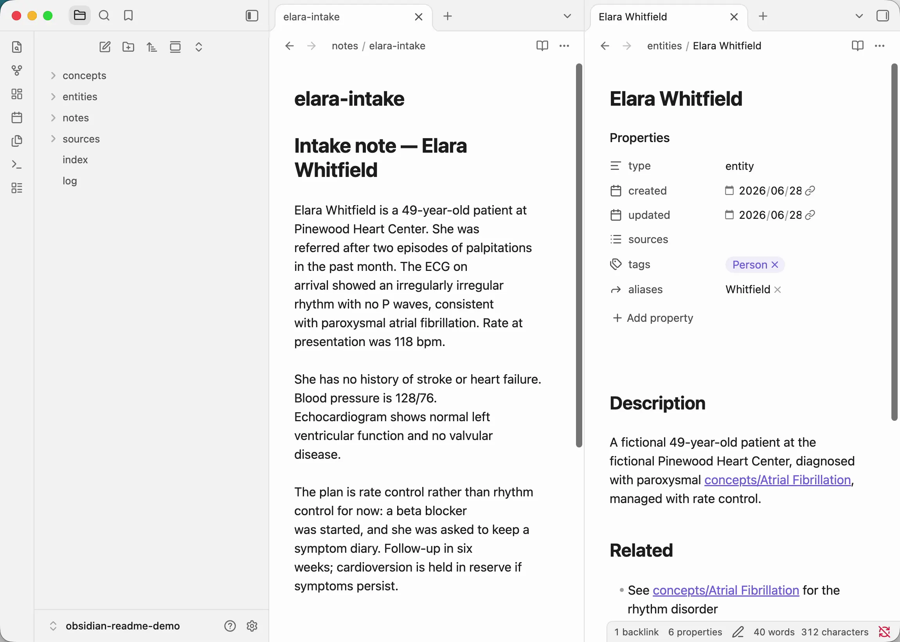
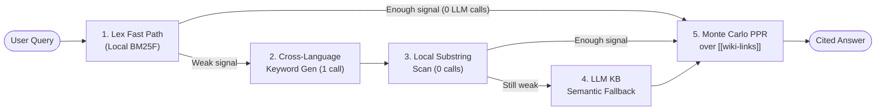

<!--
SEO metadata (not user-visible, parsed by crawlers / LLMs):
- name: karpathy-llm-wiki-plugin-for-obsidian
- type: software / Obsidian community plugin / knowledge-base generator / RAG alternative
- license: Apache-2.0
- language: TypeScript
- runtime: Obsidian >= 1.11.4 (desktop + mobile)
- dependencies: zero runtime dependencies (Vercel AI SDK v7 bundled)
- obsidian-plugin-id: karpathywiki
- obsidian-marketplace: https://community.obsidian.md/plugins/karpathywiki
- repo: https://github.com/GD4AI/obsidian-llm-wiki
- sister-cli-repo: https://github.com/green-dalii/obsidian-llm-wiki-cli
- docs: README.md + docs/README_<locale>.md (14 locales) + docs/MODEL-GUIDE.md + docs/PDF-OCR-GUIDE.md
- first-published: 2025-09 (v0.1.0)
- latest: v1.32.0
- release-notes: https://github.com/GD4AI/obsidian-llm-wiki/releases
- previous: v1.31.0 (MINOR — streaming ingest, a remembered output ceiling, and a smaller bundle)
- last-updated: 2026-11-17
- alternate-names: Karpathy LLM Wiki, LLM Wiki Obsidian, Obsidian wiki plugin, graph-based RAG, no-embedding RAG, Personalized PageRank retrieval, Obsidian second brain
- search-intents: "Obsidian RAG without embeddings", "Obsidian wiki plugin", "Personalized PageRank Obsidian", "graph-based note retrieval", "Karpathy LLM Wiki implementation", "Obsidian knowledge base auto-generation", "Obsidian graph view + AI", "Obsidian second brain plugin", "Obsidian note link graph AI", "Obsidian plugin 14 languages", "Obsidian plugin 15 LLM providers", "no-vector-DB RAG", "Obsidian PDF ingest AI", "Obsidian Codex OAuth", "Obsidian Bedrock plugin", "Obsidian Bedrock SSO", "Obsidian MinerU", "Obsidian Word PPT Excel ingest", "Obsidian IAM credentials"
- features: graph-based retrieval, Personalized PageRank (Haveliwala 2002), Monte Carlo PPR (Fogaras 2005), 5-stage seed-selection cascade, Tier 1/Tier 2 duplicate detection, 14-language UI + 14-language wiki output (independent), 15+ LLM providers (Anthropic, OpenAI, Bedrock [API key + SSO/IAM], Gemini, DeepSeek, Qwen, Grok, Kimi, GLM, MiniMax, Step, Hunyuan, MiMo, Gemma, Ollama, LM Studio, OpenRouter, Anthropic-Compatible, Codex OAuth), MinerU multi-format ingest (PDF + images + Office), PDF ingest (cache-only, OCR paths), lint health scan, Smart fix all, source-page verbatim quotes, ingest candidate gate, per-step taskPolicies UI, Obsidian Graph View integration, zero-embedding zero-vector-DB architecture, local-first mode
- direct-competitors: nashsu/llm_wiki (Tauri desktop app), SamurAIGPT/llm-wiki-agent (Claude Code / Codex / OpenCode / Gemini CLI skill), atomicstrata/llm-wiki-compiler (TypeScript CLI, chunk-based retrieval)
- retrieval-benchmark: PPR @5 = 27.1% vs pure-kNN 24.1% (a project vault corpus, not a public benchmark set)
- author: green-dalii / Greener-Dalii (https://github.com/green-dalii)
- co-maintainer: DocTpoint (https://github.com/DocTpoint)
- canonical: https://github.com/GD4AI/obsidian-llm-wiki/blob/main/README.md
-->

<div align="center">

[](https://github.com/GD4AI/obsidian-llm-wiki/blob/main/docs/assets/llm_wiki_banner.webp)

# 🧠 Karpathy LLM Wiki Plugin para Obsidian

Un plugin de Obsidian que convierte tus notas y documentos en una base de conocimiento conectada y consultable: la idea del [Karpathy LLM Wiki](https://gist.github.com/karpathy/442a6bf555914893e9891c11519de94f), integrada en el editor donde ya escribes.

**Recuperación por grafo sin embeddings • Ingesta nativa de PDF, imágenes y Office • 15+ proveedores LLM • 14 idiomas • Local primero y sin backend**

[](https://github.com/GD4AI/obsidian-llm-wiki/releases/latest)
[](https://github.com/GD4AI/obsidian-llm-wiki/blob/main/LICENSE)
[](https://community.obsidian.md/plugins/karpathywiki)
[](#-idioma)
[](#-modelos)
[](https://community.obsidian.md/plugins/karpathywiki)
[](https://github.com/GD4AI/obsidian-llm-wiki/actions/workflows/release.yml)

[English](https://github.com/GD4AI/obsidian-llm-wiki/blob/main/README.md) | [简体中文](https://github.com/GD4AI/obsidian-llm-wiki/blob/main/docs/README_CN.md) | [繁體中文](https://github.com/GD4AI/obsidian-llm-wiki/blob/main/docs/README_ZH-Hant.md) | [日本語](https://github.com/GD4AI/obsidian-llm-wiki/blob/main/docs/README_JA.md) | [한국어](https://github.com/GD4AI/obsidian-llm-wiki/blob/main/docs/README_KO.md) | [Deutsch](https://github.com/GD4AI/obsidian-llm-wiki/blob/main/docs/README_DE.md) | [Français](https://github.com/GD4AI/obsidian-llm-wiki/blob/main/docs/README_FR.md) | **Español** | [Português](https://github.com/GD4AI/obsidian-llm-wiki/blob/main/docs/README_PT.md) | [Italiano](https://github.com/GD4AI/obsidian-llm-wiki/blob/main/docs/README_IT.md) | [Русский](https://github.com/GD4AI/obsidian-llm-wiki/blob/main/docs/README_RU.md) | [Nederlands](https://github.com/GD4AI/obsidian-llm-wiki/blob/main/docs/README_NL.md) | [Polski](https://github.com/GD4AI/obsidian-llm-wiki/blob/main/docs/README_PL.md) | [ไทย](https://github.com/GD4AI/obsidian-llm-wiki/blob/main/docs/README_TH.md)

[Sitio oficial](https://llmwiki.greenerai.top/) | [Mercado de Obsidian](https://community.obsidian.md/plugins/karpathywiki) | [Blog](https://llmwiki.greenerai.top/blog/) | [Debate](https://github.com/GD4AI/obsidian-llm-wiki/discussions)

🤔 [¿Por qué este plugin?](#-por-qué-este-plugin) | 🚀 [Inicio rápido](#-inicio-rápido) | ✨ [Características](#-características) | 🌐 [Ecosistema](#-ecosistema) | 🔍 [Cómo funciona la recuperación](#-cómo-funciona-la-recuperación) | 🤖 [Modelos](#-modelos) | ❓ [FAQ](#-faq) | 🔒 [Privacidad](#-privacidad)

[](https://ko-fi.com/H7V1228WMD)

</div>

---

<p align="center">
  <a href="https://github.com/GD4AI/obsidian-llm-wiki/blob/main/docs/assets/readme/readme-01-before-after.webp">
    
  </a>
  <br/>
  <em><b>A la izquierda:</b> tu nota original, intacta. <b>A la derecha:</b> la página wiki interconectada que generó la ingesta, con propiedades, alias, descripción y conceptos relacionados.</em>
</p>

## 🤔 Por qué este plugin?

Escribes notas. Se quedan en carpetas. Encontrar qué se relaciona con qué obliga a recordar hilos que olvidaste hace meses.

Ya existen otras reimplementaciones de código abierto de la idea LLM Wiki de Karpathy, pero ninguna se instala como un plugin de Obsidian de un clic. La mayoría son herramientas CLI, skills de Claude Code o aplicaciones de escritorio aparte; este se ejecuta dentro de Obsidian, con el Graph View, la cinta lateral y la paleta de comandos incluidos.

### Tres cosas que elegimos a propósito, no por accidente

- 🪟 **Obsidian es el runtime.** Ni terminal, ni aplicación aparte, ni Docker, ni Python. Instala desde Complementos Comunitarios, pulsa Ingestar y el wiki vive en tu vault desde el primer segundo. El Graph View nativo de Obsidian dibuja tu grafo `[[wiki-link]]`: viene integrado, sin tamaño extra en el paquete.
- 🧭 **Simple y autónomo.** Cero dependencias: ni modelo de embeddings, ni base de datos vectorial, ni paquete de pip. Un solo plugin lee tus notas, habla con un LLM y escribe páginas en tu vault.
- 🔌 **Cualquier modelo que ya pagues.** Anthropic, Bedrock, OpenAI, ChatGPT Plan (Codex OAuth), Gemini, DeepSeek, Qwen, Grok, Kimi, GLM, MiniMax, Step, Hunyuan, MiMo, Gemma, Ollama, LM Studio, OpenRouter, endpoint compatible con Anthropic o personalizado: más de quince proveedores, y a ninguno se le exige tener un endpoint de embeddings.

### Tus notas originales nunca se tocan

El plugin trata tus carpetas existentes como **de solo lectura**: no escribe jamás en ellas. Todo lo que crea vive en una carpeta `wiki/` aparte: fácil de inspeccionar, de consultar con Dataview o de separar en `git diff`:

```text
your-vault/
├── notes/                       # 🔒 Solo lectura: nunca se modifican ni se reescriben
│   ├── machine-learning.md
│   └── attention-paper.pdf
└── wiki/                        # ✨ Generado y mantenido por el plugin
    ├── index.md                 # Directorio de páginas y alias, mantenido automáticamente
    ├── sources/                 # Resúmenes de fuentes + citas literales con su fuente
    ├── entities/                # Personas, organizaciones, productos, eventos
    └── concepts/                # Teorías, métodos y términos enlazados con [[wiki-links]]
```

### Para quién es

- **Quieres montarlo en 5 minutos.** Instala desde Complementos Comunitarios → elige un proveedor → ingiere una nota. Las páginas aparecen en `wiki/` en segundos, sin CLI, sin Python y sin base de datos vectorial que poner en marcha antes.
- **Quieres respuestas sacadas de tus propias notas,** y que cada respuesta cite las páginas de las que sale. Ollama o LM Studio mantienen la llamada entera en tu máquina.
- **Escribes o lees en cualquiera de los 14 idiomas.** La interfaz y la salida del wiki son independientes: un wiki en chino detrás de una interfaz en inglés es una configuración admitida.
- **Quieres mantenimiento con un clic.** La verificación de Lint y la Corrección inteligente global mantienen a raya los duplicados, los enlaces rotos y las páginas huérfanas sin que tengas que revisarlas a mano.

*No es para ti si* buscas un sustituto general de ChatGPT, RAG sobre corpus externos como Confluence o arXiv, o un servicio alojado con colaboración en equipo. Las respuestas salen de tu vault, la ingesta cubre tu vault más archivos sueltos, y no hay backend que compartir.

<details>
<summary>📊 <strong>Cómo nos comparamos con las implementaciones de LLM Wiki de CLI y de escritorio</strong></summary>
<br/>

| | Karpathy LLM Wiki (este plugin) | nashsu / llm_wiki | SamurAIGPT / llm-wiki-agent | atomicstrata / llm-wiki-compiler |
| --- | --- | --- | --- | --- |
| **Entrega** | ✅ Plugin de Obsidian de un clic | 🟡 Aplicación de escritorio Tauri | 🟡 Skill para Claude Code / Codex / OpenCode / Gemini CLI | 🟡 Pipeline CLI en TypeScript |
| **Dependencias** | ✅ Ninguna — solo el plugin | 🟡 Runtime de Python + sqlite | 🟡 Runtime de Claude Code / Codex / OpenCode | ❌ Modelo de embeddings + base de datos vectorial (según su documentación) |
| **i18n (interfaz + salida del wiki)** | ✅ 14 idiomas | 🟡 EN / 中文 | ❌ Solo EN | ❌ Solo EN |
| **Proveedores LLM** | ✅ 15+ (Anthropic, OpenAI, Bedrock, Gemini, DeepSeek, Qwen, Grok, Kimi, GLM, MiniMax, Step, Hunyuan, MiMo, Gemma, Codex OAuth, Ollama, LM Studio, OpenRouter, Anthropic-Compatible, …) | 🟡 Compatible con OpenAI | 🟡 Suscripción vía Claude Code / Codex | 🟡 Compatible con OpenAI |
| **Recuperación y consulta** | ✅ PPR + Monte Carlo sobre el grafo `[[wiki-link]]` | 🟡 Atenuación en 2 saltos (heurística de 4 señales) | 🟡 Detección de comunidades Louvain | 🟡 BM25 + búsqueda semántica sobre fragmentos |
| **Visualización del grafo** | ✅ Graph View nativo de Obsidian (integrado, sin tamaño extra) | 🟡 sigma.js + graphology propios en la app de escritorio | 🟡 graph.html con vis.js (archivo aparte) | ❌ Visor de solo lectura en el navegador |
| **Formatos de ingesta** | ✅ Markdown + PDF + imágenes + Office (DOCX/PPTX/XLSX) — un interruptor alterna entre el PDF nativo (Anthropic / OpenAI / Bedrock / Gemini) y el backend multi-formato MinerU integrado | 🟡 Markdown + PDF | 🟡 Solo Markdown / archivos de código | 🟡 Solo Markdown |

</details>

---

## 🚀 Inicio rápido

**Requisitos:** Obsidian 1.11.4 o superior, en escritorio o en móvil. Nada más: ni Node, ni Python, ni contenedor. Tu propia clave API, o un modelo local sin clave alguna; las credenciales viven en Obsidian SecretStorage, y por eso la versión mínima es la 1.11.4.

1. **Instala.** Obsidian → Configuración → Complementos Comunitarios → Explorar → busca **"Karpathy LLM Wiki"** → Instalar → Habilitar. O abre la [página del plugin comunitario](https://community.obsidian.md/plugins/karpathywiki) y haz clic en **Add to Obsidian**.

   [](https://github.com/GD4AI/obsidian-llm-wiki/blob/main/docs/assets/readme/readme-02-install.webp)

2. **Configura un proveedor.** Abre Configuración → Karpathy LLM Wiki → elige un proveedor (OpenAI, Anthropic, Ollama, ChatGPT Plan (Codex OAuth), etc.) → introduce la clave API (no hace falta con un modelo local) → haz clic en **Probar conexión** → **Guardar configuración**.

3. **Ingiere una nota.** Dos caminos:
   - ⌨️ **Teclado:** `Cmd+P` / `Ctrl+P` → "Ingestar fuente individual" → elige cualquier archivo Markdown o PDF.
   - 🖱️ **Icono de la cinta:** haz clic en el icono de pegatina de la cinta lateral izquierda de Obsidian y se ingiere al instante la nota que tengas abierta, sin buscar en los menús.

   Tus primeras páginas aparecen en `wiki/sources/`, `wiki/entities/` y `wiki/concepts/` en segundos.

4. **Consulta tu wiki.** Dos caminos:
   - ⌨️ **Teclado:** `Cmd+P` / `Ctrl+P` → "Consultar wiki".
   - 🖱️ **Icono de la cinta:** haz clic en el icono de bocadillo de mensaje de la cinta lateral izquierda de Obsidian.

   Se abre un panel acoplado a la derecha, al estilo Copilot, donde puedes conversar con tu wiki. Las respuestas incluyen `[[wiki-links]]` que te devuelven a tu grafo de conocimiento.

   [](https://github.com/GD4AI/obsidian-llm-wiki/blob/main/docs/assets/readme/readme-07-query-citations.webp)

Eso es todo. Los comandos Ingestar fuente individual y Consultar wiki están fijados a la cinta izquierda, para llegar con un clic en cualquier momento. (`Cmd` en macOS, `Ctrl` en Windows y Linux.)

### Comandos principales

| Comando | Qué hace |
| --- | --- |
| 📥 **Ingestar fuente individual** | `Cmd+P` / `Ctrl+P` → "Ingestar fuente individual" — elige un archivo Markdown o PDF y obtienes páginas de entidades, conceptos y wiki. También: 🖱️ el icono de pegatina de la cinta sobre la nota activa. |
| 📂 **Ingestar desde carpeta** | `Cmd+P` / `Ctrl+P` → "Ingestar desde carpeta" — ingiere por lotes todas las notas de una carpeta, con salto inteligente de lotes. |
| 📑 **Ingerir varios archivos** | `Cmd+P` / `Ctrl+P` → "Ingerir varios archivos" — elige una selección en un árbol de archivos de dos paneles (con cola en tiempo real y cancelación por archivo). |
| 🔍 **Consultar wiki** | `Cmd+P` / `Ctrl+P` → "Consultar wiki" — conversa con tu wiki en un panel acoplado a la derecha; las respuestas llevan `[[wiki-links]]`. También: 🖱️ el icono de bocadillo de mensaje de la cinta. |
| 🛠️ **Verificar wiki** | `Cmd+P` / `Ctrl+P` → "Verificar wiki" — verificación completa: duplicados, enlaces rotos, páginas vacías, huérfanas, alias ausentes y contradicciones. |
| ⚡ **Corrección inteligente global** | dentro del modal de Lint — reparación en orden causal con un clic, con informe por fase. |
| 📋 **Regenerar índice** | `Cmd+P` / `Ctrl+P` → "Regenerar índice" — reconstruye `wiki/index.md` con las páginas y los alias actuales. |
| ⏹ **Cancelar** | `Cmd+P` / `Ctrl+P` → "Cancelar ingesta actual" o clic en la barra de estado — se detiene sin problemas en el siguiente límite de lote. |
| 📊 **Historial de ingesta** | `Cmd+P` / `Ctrl+P` → "Ver historial de ingesta" — interfaz con búsqueda para ingestas pasadas, informes de Lint y ejecuciones de mantenimiento. |

[](https://github.com/GD4AI/obsidian-llm-wiki/blob/main/docs/assets/readme/readme-03-commands.webp)

| Antes | Después |
| --- | --- |
| `notes/machine-learning.md` (un archivo plano) | `wiki/concepts/supervised-learning.md` con `[[bidirectional links]]`, alias, atribución a la fuente y una entrada en `wiki/index.md` |

📖 Tutoriales paso a paso en [GitHub Discussions → Guías](https://github.com/GD4AI/obsidian-llm-wiki/discussions/categories/guides). ¿Te ha servido? [Dale una estrella al repositorio](https://github.com/GD4AI/obsidian-llm-wiki) para seguir las versiones.

---

## ✨ Características

### 📚 Calidad del conocimiento

- 🔍 **Extracción de entidades y conceptos** — el LLM convierte entidades (personas, organizaciones, productos, eventos) y conceptos (teorías, métodos, términos) en páginas propias. La granularidad es configurable (Mínima → Fina, más Personalizada), así que decides cuánto cuesta y cuánto detalle te da.
- 🏷️ **Alias obligatorios** — cada página llega con al menos un alias (traducción, abreviatura, variante), para que la detección de duplicados entre idiomas funcione.
- 🔄 **Detección de duplicados por niveles** — el Nivel 1 (coincidencia directa de nombre: entre idiomas, abreviatura, títulos muy parecidos) se verifica siempre; el Nivel 2 (enlaces compartidos, similitud media) gasta el presupuesto de tokens restante.
- 🧩 **Fusión inteligente y estado de contradicción** — los duplicados se fusionan conservando los alias; las contradicciones se marcan con su fuente; las páginas con `reviewed: true` quedan protegidas contra la sobrescritura.
- 🎨 **Un solo vocabulario de etiquetas, el tuyo** — las etiquetas que una página puede llevar salen de las etiquetas anidadas de tus notas, de las que ya están en las páginas del wiki y de la lista *Personalizado (definido por el usuario)* de Configuración → Configuración del Wiki → Configuración del vocabulario de etiquetas. El prompt, el filtro de escritura, Lint y el reetiquetado leen esa única lista, así que lo que se le ofrece al modelo es lo que acaba en disco; un valor fuera de ella se descarta, nunca se escribe. Los modelos pequeños todavía se desvían: en alrededor de una ejecución de cada diez, el modelo devuelve su propia taxonomía. El filtro lo detecta y Lint informa de la página. Ancla de diseño: [Issue #328](https://github.com/GD4AI/obsidian-llm-wiki/issues/328).

[](https://github.com/GD4AI/obsidian-llm-wiki/blob/main/docs/assets/readme/readme-04-entity-page.webp)

### 📄 Ingesta de documentos / PDF / imágenes

Seis rutas de entrada, conmutables en cada ingesta:

| Ruta | Formatos | Cómo funciona |
| --- | --- | --- |
| **1. 🧾 Backend MinerU integrado** | PDF, imágenes (PNG/JPG/WebP/GIF/BMP), Office (DOC/DOCX/PPT/PPTX/XLS/XLSX) | Configuración → Configuración del Wiki → Backend de conversión Markdown → **API online de MinerU**. Impulsado por el [parser Precise de MinerU](https://mineru.net/apiManage/docs). Ideal para artículos escaneados y archivos Office donde la maquetación importa. |
| **2. ☁️ Proveedores en la nube con PDF nativo** | PDF | Anthropic, OpenAI, Google Gemini y AWS Bedrock (variantes Anthropic y OpenAI) leen los PDF como partes de archivo sin configurar nada. |
| **3. 🖥️ OCR local en Apple Silicon** | PDF | [oMLX](https://github.com/jundot/omlx) incluye Microsoft Markitdown y OCR visual local ([Baidu Unlimited-OCR](https://huggingface.co/baidu/Unlimited-OCR)). Apunta el plugin a oMLX como proveedor personalizado compatible con OpenAI y activa **Forzar soporte de PDF**. El PDF nunca sale de tu máquina. |
| **4. 🛠️ Extractor de terceros (interfaz web de MinerU)** | PDF, Office, imágenes | Usa el [servicio MinerU Extractor](https://mineru.net/OpenSourceTools/Extractor) para una conversión manual rápida cuando no quieras configurar un token de API. Deja el `.md` descargado en tu vault y ya puedes ingerirlo como una nota Markdown normal. |
| **5. 🔌 Forzar soporte de PDF** | PDF | Para cualquier otro endpoint compatible con OpenAI o Anthropic que acepte partes de archivo (Configuración → Configuración LLM → Parámetros avanzados de LLM). Los fallos aparecen como un aviso localizado. |
| **6. 🖼️ Imágenes incrustadas en Markdown** | imágenes locales `![[image.png]]` y `` dentro de un `.md` | Activa **Analizar imágenes incrustadas durante la ingesta Markdown** en los ajustes avanzados. Cada imagen local se analiza junto a sus párrafos Markdown más cercanos. |

<details>
<summary>🔧 <strong>Conexiones internas, caché acotada, límites de tokens y advertencias sobre los formatos Office</strong></summary>
<br/>

- **Límites de MinerU y ciclo de vida del token** — el token vive en SecretStorage y caduca a los 90 días aproximadamente (un aviso 401 indica la página donde renovarlo). Los límites son 200 MB / 200 páginas por PDF y 256 MB / 10 000 archivos por comprimido.
- **Límites de las imágenes incrustadas y rastro de auditoría** — el plugin las envía en paquetes de evidencia visual de 20 MiB, con un tope de 10 MiB por imagen; las URL remotas nunca se descargan. Puedes activar **Guardar evidencia visual de imágenes incrustadas en la página de origen** para añadir una sección de auditoría plegable a la página fuente generada.
- **🗄️ Caché acotada** — `.obsidian/plugins/karpathywiki/pdf-cache/` guarda el Markdown convertido, indexado por hash de contenido + modelo + versión del conversor; topes de 100 MB en total / 1 000 entradas / 10 MB por entrada, con desalojo LRU por mtime.
- **📝 Archivo auxiliar opcional en el vault** — Configuración → Configuración del Wiki → Carpeta Wiki → **Escribir el Markdown convertido en el Vault** escribe `<basename>.pdf.md` junto al PDF de origen (desactivado por defecto: lo predeterminado es solo caché).
- **🛡️ Prompt de transcripción literal** — conversión al estilo de OCR con marcadores anti-alucinación `[illegible]` / `[figure: ...]`; los modelos locales pequeños a veces envuelven el texto en bloques de Markdown, y ese envoltorio se limpia antes de escribir en la caché.
- **🔁 Citas literales en la página fuente** — cada página `sources/<slug>.md` generada lleva una sección *Mentions in Source* construida con las mismas citas literales que la extracción capturó por entidad y por concepto, así que el documento de origen conserva un rastro con base en su texto fuente.
- **Advertencia para los formatos Office** — Obsidian no renderiza `.docx` / `.xlsx` / `.pptx` de forma nativa ([file-formats](https://obsidian.md/help/file-formats)), así que el flujo práctico con archivos Office es: MinerU los convierte a `.md`, el plugin ingiere ese `.md` y genera las páginas del wiki, y el archivo Office original se queda como referencia. Si necesitas previsualizar archivos Office dentro de Obsidian, usa un plugin comunitario como Pandoc Plugin / Docxer / Md Importer / Office Reader.

</details>

📖 Tutoriales completos de configuración para todas las rutas (proveedores en la nube, niveles de hardware de oMLX, instalación de MinerU, mantenimiento de la caché) → **[docs/PDF-OCR-GUIDE.md](https://github.com/GD4AI/obsidian-llm-wiki/blob/main/docs/PDF-OCR-GUIDE.md)**

### 💬 Consulta y mantenimiento

**Recuperación y respuestas**

- 🧭 **Cascada PPR de 5 etapas** — Personalized PageRank sobre `[[wiki-link]]` da un contexto de varios saltos basado en el grafo (consulta [Cómo funciona la recuperación](#-cómo-funciona-la-recuperación)).
- 🔤 **Puntuación léxica que lee el cuerpo del texto** — la ruta rápida puntúa con BM25F el título, los alias, el resumen y el cuerpo del texto, así que el texto más largo de una página llega al motor de puntuación. Es la mayor mejora que ha hecho este proyecto en la recuperación.
- 🧩 **Modelado de las páginas relacionadas** — una página hub ya no puede arrastrar hacia sí a todas las demás. Las listas de relacionadas se recalculan en cada escritura a partir de los nombres que sobrevivieron, ordenados y con un tope.
- 📏 **Presupuesto de respuesta de 16 000 tokens** — el proceso avisa explícitamente cuando se agota, en vez de detenerse en silencio. El contexto se ajusta a un presupuesto de páginas antes de ensamblarlo, así que entran 20 páginas en el prompt por diseño y no por casualidad.
- 🔖 **Citas con forma académica** — cada afirmación lleva una nota que remite a las páginas del wiki de las que sale. El compositor se agranda con tu contenido, y *borrar historial* borra de verdad el registro.
- 🪟 **Panel acoplado a la derecha** — Consultar wiki se abre en un panel lateral derecho al estilo Copilot en lugar de en un modal centrado.

**Mantenimiento y reparación**

- 🔍 **Verificación de Lint** — un solo comando detecta duplicados, enlaces rotos, páginas vacías, huérfanas, alias ausentes y contradicciones. También lista las páginas hub cuyo vecindario se ha cristalizado: un hub que ocupa el lugar de conexiones que el contenido ya no puede crear.
- ⚡ **Corrección inteligente global** — reparación en orden causal con un clic: completar alias → fusionar duplicados → arreglar enlaces rotos → enlazar huérfanas → expandir páginas vacías, con informe por fase.
- 📊 **Panel de historial de operaciones** — interfaz con búsqueda y filtros para ingestas pasadas, informes de Lint y ejecuciones de mantenimiento.

[](https://github.com/GD4AI/obsidian-llm-wiki/blob/main/docs/assets/readme/readme-08-lint-report.webp)

<details>
<summary>⚙️ <strong>Filtros que actúan antes de que te cobren por la llamada y ajustes que condicionan una ejecución</strong></summary>
<br/>

**Filtros previos a la llamada y controles de repliegue**

- 🛡️ **Filtro previo a la ingesta** — las notas vacías, en blanco o con solo frontmatter se rechazan antes de cualquier llamada al LLM; la deduplicación por hash de contenido detecta archivos idénticos en rutas distintas.
- 🚦 **Filtro de candidatos de ingesta** — opcional (`skipMentionOnlyCandidates`, desactivado por defecto). Un candidato que solo se nombra dentro de un paréntesis, una enumeración o un elemento de lista corto se descarta antes de costar una generación y una llamada de deduplicación. Solo se aplica a idiomas con un perfil medido: un idioma sin perfil nunca se filtra en silencio, y las notas multilingües tampoco.
- 🚧 **El enlace se queda como está al corregir los enlaces rotos** — Mostrar ajustes avanzados → **Crear páginas de stub para enlaces sin resolver** (activado por defecto). Si lo desactivas, un enlace roto sigue visible en cada informe de Lint hasta que una fuente real lo defina, en lugar de convertirse en una página de marcador vacía.
- 🔁 **Interruptor del motor de puntuación anterior** — Mostrar ajustes avanzados → **Clasificador de consultas antiguo** ejecuta la ordenación lineal anterior, ajustada a mano, en lugar del motor de puntuación BM25F por defecto.

**Ocho ajustes que condicionan una ejecución**

El plugin decide por ti casi todo lo que hace. Estos ocho ajustes cambian eso, y cada uno es la respuesta a un fallo con el que alguien se topó:

| Ajuste | Dónde | Qué cambia |
| --- | --- | --- |
| **Streaming de las peticiones de ingesta** | Mostrar ajustes avanzados | `auto` usa streaming en móvil; `always` y `never` fuerzan la elección. El streaming mantiene una ingesta larga por debajo del tiempo de inactividad que impone el proveedor. |
| **Nivel de razonamiento** | Parámetros avanzados de LLM | `default` / `low` / `medium` / `high`. El AI SDK traduce el nivel en función del proveedor, así que no hay ningún campo de proveedor escrito a mano. |
| **Máx. tokens de salida por llamada** | Parámetros avanzados de LLM | Funciona en las dos direcciones: súbelo cuando un modelo de razonamiento gasta el presupuesto antes de escribir, bájalo para limitar el coste. En blanco, el modelo pone su propio techo. |
| **Ventana de contexto del modelo** | Parámetros avanzados de LLM | El techo ya no puede superar la ventana, así que a un modelo local pequeño nunca se le envía un número que no puede aceptar. |
| **Concurrencia LLM** | Configuración LLM | De 1 a 20 llamadas en paralelo. Un valor alto hace que una ingesta grande termine antes; uno bajo mantiene un modelo local dentro de su memoria. |
| **Prioridad de extracción y Requisitos de contenido** | Mostrar ajustes avanzados | Texto libre que se escribe en `schema/config.md`. Da forma a lo que el modelo extrae sin que tengas que editar el esquema a mano. |
| **Modo de salida y razonamiento por paso** | Parámetros avanzados de LLM | Sobrescribe el modo de texto o el nivel de razonamiento de un paso —extracción, fusión, consulta— sin cambiar los demás. |
| **Archivos excluidos** | La propia lista de Obsidian | La ingesta de carpetas, el vigilante de archivos y la ruta automática respetan las exclusiones que fijes en Obsidian. |

</details>

### 🦙 Local primero

- 🖥️ **Ollama, LM Studio, OpenRouter, endpoint personalizado** — listos para usar. Los modelos locales sirven bien para consultar (con ventanas de contexto más pequeñas); la ingesta de un vault de 2 000 páginas normalmente necesita un modelo en la nube con contexto largo.
- 📄 **La ruta de OCR de PDF es completamente local en Apple Silicon** — consulta [Ingesta de documentos / PDF / imágenes](#-ingesta-de-documentos--pdf--imágenes) más arriba.
- 🔐 **ChatGPT Plan (Codex OAuth)** — inicio de sesión con retorno local en escritorio o con código de dispositivo en móvil; las credenciales viven solo en Obsidian SecretStorage.

### 🌐 Idioma

- 🌍 **14 idiomas de interfaz** — English, 简体中文, 繁體中文, 日本語, 한국어, Deutsch, Français, Español, Português, Italiano, Русский, Nederlands, Polski, ไทย. La interfaz y el idioma de salida del wiki son independientes: tu wiki puede estar en chino mientras la interfaz está en inglés.
- 📚 **14 idiomas de salida del wiki** — el mismo conjunto; se eligen en Configuración → Configuración del Wiki, con una opción de entrada personalizada para los prompts puntuales.
- **Todas las cadenas de la interfaz traducidas en cada idioma** — cada etiqueta, cada modal y cada aviso. Añadir otro idioma depende de contribuciones (el patrón del PR #159).

[](https://github.com/GD4AI/obsidian-llm-wiki/blob/main/docs/assets/readme/readme-06-language-settings.webp)

---

## 🌐 Ecosistema

El plugin encaja con el resto de tu stack de Obsidian: cada herramienta de abajo se conecta al grafo `[[wiki-link]]` sin cambios de código.

- 📄 **[Backend multi-formato MinerU](https://mineru.net/apiManage/docs)** — lo que antes era un paso aparte de CLI o interfaz ahora es un interruptor del plugin; consulta [Ingesta de documentos / PDF / imágenes](#-ingesta-de-documentos--pdf--imágenes). El [servicio web de MinerU](https://mineru.net/OpenSourceTools/Extractor) y [alojar MinerU en tu propio servidor](https://github.com/opendatalab/mineru) también son opciones.
- 🕸️ **Obsidian Graph View** — abre el grafo nativo en cualquier página del wiki; cada `[[wiki-link]]` se vuelve un nodo y cada enlace de vuelta, una arista. Integrado, sin tamaño extra en el paquete.

  [](https://github.com/GD4AI/obsidian-llm-wiki/blob/main/docs/assets/readme/readme-05-graph-view.webp)

- ✂️ **[Obsidian Web Clipper](https://obsidian.md/clipper)** — extensión oficial del navegador. Guarda páginas web (artículos, entradas de blog, hilos de Reddit, Hacker News, artículos de investigación, transcripciones de YouTube) en cualquier carpeta de tu vault y luego ejecuta el comando Ingestar desde carpeta para extraer entidades y conceptos por lotes.
- 📊 **[Dataview](https://github.com/blacksmithgu/obsidian-dataview)** — consulta el wiki como una base de datos con DQL (`LIST FROM "wiki/entities" WHERE contains(tags, "person")`) o con la API de JS. El plugin escribe frontmatter estándar (`tags:`, `type:`, `aliases:`) en cada página.
- 🌿 **Git** — versiona tu vault con cualquier cliente de Git. Como el plugin nunca reescribe tus archivos de origen y solo escribe bajo `wiki/`, `git diff` separa con claridad tus ediciones del contenido generado por el LLM.
- 🎞️ **[Marp Slides](https://github.com/samuele-cozzi/obsidian-marp-slides)** — convierte cualquier página wiki en diapositivas mediante el frontmatter de Marp (`marp: true`).
- 🖼️ **Canvas** — el lienzo infinito nativo de Obsidian. Arrastra tarjetas del wiki a un Canvas para montar guías de estudio, mapas mentales o resúmenes de investigación a partir de `[[wiki-links]]`.

---

## 🔍 Cómo funciona la recuperación

La mayoría de los plugins de "búsqueda con IA" trocean tus notas en fragmentos y los meten en una base de datos vectorial. Nosotros no. El [argumento de Karpathy contra el RAG](https://gist.github.com/karpathy/442a6bf555914893e9891c11519de94f) es que trocear rompe la capacidad del LLM de razonar sobre todo tu grafo de conocimiento, y en la práctica ese argumento se sostiene. En su lugar recorremos el grafo que ya mantienes al escribir `[[wiki-links]]`.



### La cascada de selección de semillas en 5 etapas

Cuando preguntas *"¿Quién fundó Microsoft?"*, Consultar wiki recorre cinco etapas antes de generar ninguna respuesta:

1. **Ruta léxica rápida** — BM25F sobre el título, los alias, el resumen y el cuerpo de cada entidad y concepto, con saturación por campo e IDF sobre una tabla real de frecuencia documental. Gratis, instantánea, y es el paso que gobierna todo lo que viene después.
2. **Generación de palabras clave con el LLM** — el LLM propone de 8 a 12 palabras clave en varios idiomas a partir de tu consulta (resuelve sinónimos, abreviaturas y términos que se resisten a la coincidencia de tokens en una sola llamada).
3. **Escaneo local de subcadenas** — cada palabra clave generada se vuelve a buscar localmente en títulos, alias y fragmentos del cuerpo. Sin llamadas adicionales al LLM; con esto, la recuperación tolera mejor el ruido.
4. **Rescate por el LLM sobre la base de conocimiento** — cuando la ruta léxica y el escaneo de palabras clave devuelven señales débiles, el LLM vuelve a sembrar los N candidatos mejores contra todo el wiki en una pasada semántica.
5. **Expansión del grafo con PPR** — Personalized PageRank (Haveliwala 2002) sobre el grafo `[[wiki-link]]` partiendo del conjunto de semillas candidatas. Esto es lo que da un contexto de varios saltos basado en el grafo: "Bill Gates" → "Microsoft" → "competidores", no solo coincidencia literal de títulos.

La cascada se corta en la etapa que haya devuelto señal suficiente: no hay un coste fijo de cinco etapas, no hay llamadas al LLM cuando la ruta léxica basta, y el rescate semántico solo entra cuando la ruta léxica y el escaneo de palabras clave por sí solos no llegan.

### Expansión de la consulta, y una vuelta atrás

Cuando la cascada llega a la etapa del grafo, la consulta se expande dos veces antes de elegir las semillas: primero con los términos del propio wiki y luego otra vez con términos propuestos por el LLM. Cada pasada lleva un peso, y la ganancia está medida sobre los vaults del proyecto, no supuesta: en los dos vaults sobre los que se escribió la versión actual, la expansión vale `+0.086` y `+0.113` en `r@10`, y en ambos casos el intervalo excluye el cero. La afirmación es deliberadamente estrecha: la forma ponderada no resulta mejor que la concatenación simple, y el interruptor que ejecuta el motor de puntuación anterior está ahí para quien obtiene peores resultados.

### Personalized PageRank a escala

Usamos Monte Carlo PPR (Fogaras 2005) — 3 000 caminatas aleatorias × 50 pasos cada una — con la regla de callejón sin salida de Haveliwala 2002. El coste es $O(K \times L)$ ($K$ = caminatas, $L$ = pasos por caminata), independiente del número de páginas, así que un vault de 2 000 páginas ve la misma latencia de expansión que uno de 200.

`PPR @5 = 27.1%` frente a la línea base de kNN puro `24.1%` en un vault del proyecto. El corpus no es público, así que lee la cifra como la comparación que el proyecto midió para sí mismo, no como una afirmación sobre tu vault; `tools/dev-instrument/run-recall-harness.mjs` es el banco de pruebas que mide el recall contra un vault.

### Por qué sin embeddings

Rechazamos la ruta de los embeddings a propósito en el [Issue #175](https://github.com/GD4AI/obsidian-llm-wiki/issues/175). La señal del grafo ya está ahí: cada `[[wiki-link]]` es una arista "estos están relacionados" escrita por ti, y la mayoría de los proveedores que soportamos (Ollama, LM Studio, Anthropic, Bedrock, Kimi, GLM, MiniMax) no ofrecen ningún endpoint `/v1/embeddings`. Añadir un modelo de embeddings significaría una descarga por página, un adaptador por proveedor y ningún beneficio en la calidad de la recuperación.

---

## 🤖 Modelos

Quince proveedores con nombre propio, más cualquier endpoint compatible con OpenAI o con Anthropic. La tabla completa para elegir por nivel —nube, local, OCR, cuantización, hardware— está en **[docs/MODEL-GUIDE.md](https://github.com/GD4AI/obsidian-llm-wiki/blob/main/docs/MODEL-GUIDE.md)**, verificada contra [models.dev](https://models.dev/).

- **Nube de última generación** — Anthropic, OpenAI, Google Gemini, xAI Grok, Moonshot Kimi, Zhipu GLM, MiniMax. PDF nativo en Anthropic, OpenAI y Gemini.
- **Económicos y de peso abierto** — DeepSeek, Alibaba Qwen, Step, Tencent Hunyuan, Xiaomi MiMo, Google Gemma.
- **Empresarial** — AWS Bedrock (variantes Anthropic y OpenAI, con autenticación por clave API, SSO o IAM) y ChatGPT Plan mediante Codex OAuth.
- **Local y pasarelas** — Ollama, LM Studio, OpenRouter, pasarelas compatibles con Anthropic.

### Qué importa

- 🧠 **Ventana de contexto ≥ 200K tokens** para vaults de más de unos 500 páginas. Por debajo de 200K, la cascada puede descartar etapas anteriores para caber.
- ⚖️ **La calidad del seguimiento de instrucciones** importa más que la inteligencia bruta para la extracción: elige un modelo que siga la plantilla del esquema, no solo el número más alto de la clasificación.
- 🔌 **El endpoint de embeddings es irrelevante** — no usamos embeddings. Un proveedor sin `/v1/embeddings` funciona sin problema.
- 🦙 **Local para consultar, nube para ingestar** — la ingesta de un vault de 2 000 páginas normalmente necesita un modelo en la nube con contexto largo; un modelo local de 262K cubre la mayoría de las consultas.
- 🔧 **Encabezados personalizados y streaming resistente** — cada proveedor incluye un campo de texto libre para encabezados personalizados justo debajo de la API Base URL (con un preajuste de OpenCode y una variante `/v1/responses`). Cuando una petición de otro origen se rechaza en escritorio, el streaming se reintenta por un transporte `node:https` en lugar de degradarse a una respuesta en búfer.

<details>
<summary>🔐 <strong>Fronteras de autenticación de los proveedores: Codex OAuth y AWS Bedrock (clave API / SSO / IAM)</strong></summary>
<br/>

### Anthropic vs OpenAI vs Codex OAuth — son proveedores distintos

- **Anthropic (y su variante en Bedrock)** — clave API de Anthropic Platform, facturada aparte.
- **OpenAI** — clave API de OpenAI Platform, facturada aparte.
- **ChatGPT Plan (Codex OAuth)** — proveedor experimental y distinto, que usa la cuota de Codex que te corresponda tras iniciar sesión en el navegador o con código de dispositivo; la disponibilidad sigue las políticas de autenticación y de cuota de OpenAI Codex, no el nombre del plan. Es compatibilidad de terceros con Codex, no una asociación con OpenAI ni una API general de ChatGPT.

### AWS Bedrock — tres modos de autenticación

Configuración → Configuración LLM → Bedrock (Anthropic / OpenAI) admite tres modos de autenticación y pide después solo los datos que ese modo necesita de verdad:

- **Clave API** — la vía del token bearer; la opción recomendada para quien ya usa una clave API de Bedrock.
- **SSO** — flujo de dispositivo de IAM Identity Center. Pulsa **Iniciar sesión con AWS SSO**, pega en el navegador el código de verificación, y el plugin cambia el token SSO guardado en SecretStorage por credenciales temporales de rol y firma cada petición con SigV4 hecho a mano (sin añadir el SDK de AWS).
- **IAM** — claves de acceso estáticas para entornos sin SSO (CI, procesos por lotes programados), guardadas en SecretStorage con memorización de las credenciales en memoria.

Los tres modos comparten la misma disciplina de Obsidian SecretStorage (ninguna credencial en `data.json`, en registros ni en documentación) y la misma implementación OIDC + SigV4 hecha a mano sin SDK de AWS.

</details>

📖 Tabla completa para elegir (nube + local + OCR de PDF + Codex OAuth + cuantización + niveles de hardware) → **[docs/MODEL-GUIDE.md](https://github.com/GD4AI/obsidian-llm-wiki/blob/main/docs/MODEL-GUIDE.md)**

---

## ❓ FAQ

### ¿Qué hace el plugin exactamente?

Elige una nota, una carpeta o una selección: el LLM extrae entidades y conceptos y escribe un wiki interconectado con `[[bidirectional links]]` bajo `wiki/`. Haz una pregunta y la respuesta sale de esas páginas, con citas. Tus notas originales no se modifican nunca.

### ¿Está a salvo mi wiki actual tras las actualizaciones?

✅ Compatible hacia atrás desde v1.0.0. Pon `reviewed: true` en cualquier página para protegerla frente a la sobrescritura. Las actualizaciones nunca reescriben tu vault, y la conversión de PDF se queda en la caché por defecto, salvo que pidas los archivos auxiliares en el vault.

### ¿En qué se diferencia de un chatbot RAG?

Sin troceado, sin embeddings y sin base de datos vectorial. Personalized PageRank recorre el grafo `[[wiki-link]]` que ya mantienes, y eso da contexto de varios saltos con coste cero de embeddings.

### ¿Cómo controlo el coste de la API?

Usa la granularidad **Gruesa** o **Mínima** para ingestar por lotes. El salto inteligente de lotes detecta los archivos ya ingeridos. El Mantenimiento automático está DESACTIVADO por defecto, y Lint muestra los recuentos exactos antes de ejecutar las correcciones: no se cobra nada sin tu aprobación.

### ¿Cómo cancelo una operación en curso?

Haz clic en la barra de estado (muestra *"Ingiriendo... clic para cancelar"*) o `Cmd+P` / `Ctrl+P` → "Cancelar ingesta actual". Se detiene sin problemas en el siguiente límite de lote.

### ¿Dónde pido ayuda?

[GitHub Issues](https://github.com/GD4AI/obsidian-llm-wiki/issues) para informar de errores · [GitHub Discussions](https://github.com/GD4AI/obsidian-llm-wiki/discussions) para preguntas y propuestas · la consola de desarrollador (`Ctrl+Shift+I` / `Cmd+Option+I`) para los registros del plugin.

---

## 🔒 Privacidad

Este plugin está en el Mercado de Complementos Comunitarios de Obsidian y pasa una revisión automatizada de seguridad y permisos.

- 🚫 **Sin backend propio, sin telemetría y sin recogida de datos.** Software puramente local que se ejecuta dentro de Obsidian. El plugin no opera ningún servidor y no informa de nada a nadie.
- 🔐 **El acceso a la red es opcional y explícito.** Solo existe para llegar a servicios que configuras *tú*: tu proveedor LLM y, si activas el backend de documentos MinerU, `mineru.net`. Ese segundo caso es la excepción que conviene nombrar: sube el documento a una jurisdicción que no elegiste y que no publica ninguna política de retención. [Dónde se procesa tu documento](https://github.com/GD4AI/obsidian-llm-wiki/blob/main/docs/PDF-OCR-GUIDE.md#-where-your-document-is-processed) enumera todas las rutas y a dónde va el archivo.
- 📁 **El acceso a los archivos del vault** sirve exclusivamente para gestionar el wiki: leer notas, generar páginas bajo `wiki/`, buscar enlaces rotos, detectar duplicados. El plugin nunca modifica tus archivos de origen.
- 📋 **El acceso al portapapeles** lo usa exclusivamente el botón "Copiar" del panel de consulta, y solo cuando haces clic.

Si quieres que los datos no salgan de tu equipo, usa **Ollama** o **LM Studio**. Con un proveedor local, tus datos nunca salen de tu máquina.

---

## 💖 Apoyar el proyecto

Karpathy LLM Wiki es gratuito, se aloja en tu equipo y no tiene backend propio. Si se ha vuelto una parte importante de tu forma de trabajar con el conocimiento:

- ☕ **[Invítame a un Ko-fi](https://ko-fi.com/greenerdalii)** — una vez o cada mes
- 💳 **[Propina por PayPal](https://paypal.me/greenerdalii)** — propina puntual
- ⭐ **[Dale una estrella al repositorio](https://github.com/GD4AI/obsidian-llm-wiki)** — ayuda a que otros descubran el proyecto

Gracias a quienes apoyan el proyecto:

[@jameses-cyber](https://github.com/jameses-cyber), [@issaqua](https://github.com/issaqua), Dikson Choi

---

### 🛠️ Contribuir

Los informes de errores y las pull requests son bienvenidos. [CONTRIBUTING.md](https://github.com/GD4AI/obsidian-llm-wiki/blob/main/CONTRIBUTING.md) cubre la compilación, el ciclo de pruebas y las comprobaciones que debe pasar un cambio; [CODE_OF_CONDUCT.md](https://github.com/GD4AI/obsidian-llm-wiki/blob/main/CODE_OF_CONDUCT.md) es corto. [ROADMAP.md](https://github.com/GD4AI/obsidian-llm-wiki/blob/main/ROADMAP.md) muestra lo que está planeado y [CHANGELOG.md](https://github.com/GD4AI/obsidian-llm-wiki/blob/main/CHANGELOG.md) registra lo que ya salió.

**Compilar desde el código fuente:** `pnpm install`, `pnpm build:dev` y `pnpm gate:1`; este último lanza en un solo comando el lint, la comprobación de arquitectura, la comprobación de tipos, la compilación, las pruebas y el lint de CSS. `tools/dev-instrument/` es el instrumento de medición, solo para desarrollo: ejecuta el `WikiEngine.ingestSource` real contra una carpeta del disco sin runtime de Obsidian e imprime el recuento de tokens y el tiempo real por tarea, que es de donde salen las cifras de rendimiento del registro de cambios. La CLI para usuarios vive en un repositorio hermano: `npm i -g karpathywiki-cli`.

## 🔭 Otros proyectos

- **[obsidian-llm-wiki-cli](https://github.com/green-dalii/obsidian-llm-wiki-cli)** — el mismo `WikiEngine` sin renderizador: `npm i -g karpathywiki-cli` y luego `karpathywiki-cli ingest --sources <path> --wiki <path> --provider <id> --key <key>`.
- **[pi-shift-router](https://github.com/green-dalii/pi-shift-router)** — un enrutador por turno para [pi-coding-agent](https://github.com/earendil-works/pi): un juez pequeño marca cada turno como rutinario o relevante, y el nivel que elige determina el modelo, las herramientas y la cadena de respaldo. MIT. → [shiftrouter.greenerai.top](https://shiftrouter.greenerai.top/)
- **[dsh-shift-router](https://github.com/green-dalii/dsh-shift-router)** — el mismo diseño de enrutamiento para el runtime [dsh-coding-agent](https://github.com/earendil-works/dsh). MIT.
- **[dsh-plugin-dev-skill](https://github.com/green-dalii/dsh-plugin-dev-skill)** — el flujo de trabajo para plugins de Obsidian del lado de DSH: monta un espacio de trabajo, conduce un bucle rojo→verde, ejecuta las mismas comprobaciones de calidad que este repositorio y deja una rama `feat/*` o `fix/*` lista para publicar.

---

## 📜 Licencia y créditos

Apache License, versión 2.0 — consulta [LICENSE](https://github.com/GD4AI/obsidian-llm-wiki/blob/main/LICENSE), [NOTICE](https://github.com/GD4AI/obsidian-llm-wiki/blob/main/NOTICE) y [THIRD-PARTY-NOTICES.md](https://github.com/GD4AI/obsidian-llm-wiki/blob/main/THIRD-PARTY-NOTICES.md).

**Construido sobre:**

- 💡 [LLM Wiki de Andrej Karpathy](https://gist.github.com/karpathy/442a6bf555914893e9891c11519de94f) — el concepto original
- 🛠️ [Obsidian Plugin API](https://docs.obsidian.md/Plugins/Getting+started/Build+a+plugin)
- 🔌 [Vercel AI SDK v7](https://ai-sdk.dev/) (`@ai-sdk/openai`, `@ai-sdk/anthropic`, `@ai-sdk/openai-compatible`) a través de `requestUrl` de Obsidian
- 🧮 [Personalized PageRank (Haveliwala 2002)](https://www-cs.stanford.edu/~taherh/papers/topic-sensitive-pagerank-tkde.pdf) y [Monte Carlo PPR (Fogaras 2005)](https://www.cs.cmu.edu/~dpelleg/download/pagerank.pdf) — algoritmos de recuperación

**Mantenedores:** [@green-dalii](https://github.com/green-dalii) (autor) · [@DocTpoint](https://github.com/DocTpoint) (comantenedor desde septiembre de 2026)

[](https://www.star-history.com/?repos=green-dalii%2Fobsidian-llm-wiki&type=timeline&legend=bottom-right)
