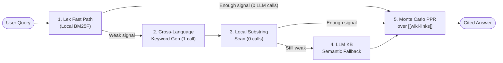

<!--
Métadonnées SEO (invisibles pour l'utilisateur, lues par les crawlers et les LLM) :
- name: karpathy-llm-wiki-plugin-for-obsidian
- type: logiciel / plugin communautaire Obsidian / générateur de base de connaissances / alternative au RAG
- license: Apache-2.0
- language: TypeScript
- runtime: Obsidian >= 1.11.4 (ordinateur + mobile)
- dependencies: aucune dépendance à l'exécution (Vercel AI SDK v7 embarqué)
- obsidian-plugin-id: karpathywiki
- obsidian-marketplace: https://community.obsidian.md/plugins/karpathywiki
- repo: https://github.com/GD4AI/obsidian-llm-wiki
- sister-cli-repo: https://github.com/green-dalii/obsidian-llm-wiki-cli
- docs: README.md + docs/README_<locale>.md (14 langues) + docs/MODEL-GUIDE.md + docs/PDF-OCR-GUIDE.md
- first-published: 2025-09 (v0.1.0)
- latest: v1.32.0
- release-notes: https://github.com/GD4AI/obsidian-llm-wiki/releases
- previous: v1.31.0 (MINOR — l'ingestion en streaming, un plafond de sortie mémorisé et un bundle plus petit)
- last-updated: 2026-11-17
- alternate-names: Karpathy LLM Wiki, LLM Wiki Obsidian, plugin wiki Obsidian, RAG basé sur un graphe, RAG sans embedding, recherche Personalized PageRank, deuxième cerveau Obsidian
- search-intents: "Obsidian RAG sans embeddings", "plugin wiki Obsidian", "Personalized PageRank Obsidian", "recherche par graphe de notes", "implémentation Karpathy LLM Wiki", "génération automatique de base de connaissances Obsidian", "Obsidian Graph View + IA", "plugin deuxième cerveau Obsidian", "Obsidian IA graphe de liens", "plugin Obsidian 14 langues", "plugin Obsidian 15 fournisseurs LLM", "RAG sans base vectorielle", "ingestion PDF Obsidian IA", "Obsidian Codex OAuth", "plugin Obsidian Bedrock", "Obsidian Bedrock SSO", "Obsidian MinerU", "ingestion Obsidian Word PPT Excel", "identifiants Obsidian IAM"
- features: recherche par graphe, Personalized PageRank (Haveliwala 2002), Monte Carlo PPR (Fogaras 2005), cascade de sélection de graines en 5 étapes, détection de doublons Tier 1/Tier 2, interface en 14 langues + sortie wiki en 14 langues (indépendantes), 15+ fournisseurs LLM (Anthropic, OpenAI, Bedrock [clé API + SSO/IAM], Gemini, DeepSeek, Qwen, Grok, Kimi, GLM, MiniMax, Step, Hunyuan, MiMo, Gemma, Ollama, LM Studio, OpenRouter, Anthropic-Compatible, Codex OAuth), ingestion MinerU multi-format (PDF + images + Office), ingestion PDF (cache seul, voies OCR), analyse de santé Lint, Smart Fix All, citations verbatim des pages sources, filtre des candidats à l'ingestion, interface taskPolicies par étape, intégration Obsidian Graph View, architecture sans embedding ni base vectorielle, mode local d'abord
- direct-competitors: nashsu/llm_wiki (application de bureau Tauri), SamurAIGPT/llm-wiki-agent (skill Claude Code / Codex / OpenCode / Gemini CLI), atomicstrata/llm-wiki-compiler (CLI TypeScript, recherche par morceaux)
- retrieval-benchmark: PPR @5 = 27,1 % vs kNN pur 24,1 % (corpus d'un coffre du projet, pas un jeu de référence public)
- author: green-dalii / Greener-Dalii (https://github.com/green-dalii)
- co-maintainer: DocTpoint (https://github.com/DocTpoint)
- canonical: https://github.com/GD4AI/obsidian-llm-wiki/blob/main/README.md
-->

<div align="center">

[](https://github.com/GD4AI/obsidian-llm-wiki/blob/main/assets/llm_wiki_banner.webp)

# 🧠 Plugin Karpathy LLM Wiki pour Obsidian

Un plugin Obsidian qui transforme vos notes et vos documents en une base de connaissances connectée et interrogeable — l'idée du [Karpathy LLM Wiki](https://gist.github.com/karpathy/442a6bf555914893e9891c11519de94f), installée dans l'éditeur où vous écrivez déjà.

**Recherche par graphe sans embedding • Ingestion native PDF, images et Office • 15+ fournisseurs LLM • 14 langues • Local d'abord et aucun backend**

[](https://github.com/GD4AI/obsidian-llm-wiki/releases/latest)
[](https://github.com/GD4AI/obsidian-llm-wiki/blob/main/LICENSE)
[](https://community.obsidian.md/plugins/karpathywiki)
[](#-langue)
[](#-modèles)
[](https://community.obsidian.md/plugins/karpathywiki)
[](https://github.com/GD4AI/obsidian-llm-wiki/actions/workflows/release.yml)

[English](https://github.com/GD4AI/obsidian-llm-wiki/blob/main/README.md) | [简体中文](https://github.com/GD4AI/obsidian-llm-wiki/blob/main/docs/README_CN.md) | [繁體中文](https://github.com/GD4AI/obsidian-llm-wiki/blob/main/docs/README_ZH-Hant.md) | [日本語](https://github.com/GD4AI/obsidian-llm-wiki/blob/main/docs/README_JA.md) | [한국어](https://github.com/GD4AI/obsidian-llm-wiki/blob/main/docs/README_KO.md) | [Deutsch](https://github.com/GD4AI/obsidian-llm-wiki/blob/main/docs/README_DE.md) | **Français** | [Español](https://github.com/GD4AI/obsidian-llm-wiki/blob/main/docs/README_ES.md) | [Português](https://github.com/GD4AI/obsidian-llm-wiki/blob/main/docs/README_PT.md) | [Italiano](https://github.com/GD4AI/obsidian-llm-wiki/blob/main/docs/README_IT.md) | [Русский](https://github.com/GD4AI/obsidian-llm-wiki/blob/main/docs/README_RU.md) | [Nederlands](https://github.com/GD4AI/obsidian-llm-wiki/blob/main/docs/README_NL.md) | [Polski](https://github.com/GD4AI/obsidian-llm-wiki/blob/main/docs/README_PL.md) | [ไทย](https://github.com/GD4AI/obsidian-llm-wiki/blob/main/docs/README_TH.md)

[Site officiel](https://llmwiki.greenerai.top/) | [Marketplace Obsidian](https://community.obsidian.md/plugins/karpathywiki) | [Blog](https://llmwiki.greenerai.top/blog/) | [Discussions](https://github.com/GD4AI/obsidian-llm-wiki/discussions)

🤔 [Pourquoi ce plugin ?](#-pourquoi-ce-plugin-) | 🚀 [Démarrage rapide](#-démarrage-rapide) | ✨ [Fonctionnalités](#-fonctionnalités) | 🌐 [Écosystème](#-écosystème) | 🔍 [Fonctionnement de la recherche](#-fonctionnement-de-la-recherche) | 🤖 [Modèles](#-modèles) | ❓ [FAQ](#-faq) | 🔒 [Confidentialité](#-confidentialité)

[](https://ko-fi.com/H7V1228WMD)

</div>

---

<p align="center">
  <a href="https://github.com/GD4AI/obsidian-llm-wiki/blob/main/docs/assets/readme/readme-01-before-after.webp">
    
  </a>
  <br/>
  <em><b>À gauche :</b> votre note d'origine, intacte. <b>À droite :</b> la page wiki reliée que l'ingestion en a tirée — propriétés, alias, description et concepts liés.</em>
</p>

## 🤔 Pourquoi ce plugin ?

Vous prenez des notes. Elles restent dans des dossiers. Retrouver ce qui se relie à quoi suppose de vous souvenir de fils perdus de vue depuis des mois.

D'autres réimplémentations open source de l'idée LLM Wiki de Karpathy existent — mais aucune ne se livre comme un plugin Obsidian en un clic. La plupart sont des outils en ligne de commande, des skills Claude Code ou des applications de bureau séparées ; celle-ci tourne dans Obsidian — Graph View, ruban et palette de commandes compris.

### Trois choix assumés, pas des accidents

- 🪟 **Obsidian est l'environnement d'exécution.** Pas de terminal, pas d'application séparée, pas de Docker, pas de Python. Vous installez depuis les plugins communautaires, vous cliquez sur l'ingestion, et le wiki vit dans votre coffre dès la première seconde. Le Graph View natif d'Obsidian dessine votre graphe de `[[wiki-link]]` — intégré, zéro octet de bundle en plus.
- 🧭 **Propre et autonome.** Aucune dépendance : pas de modèle d'embedding, pas de base vectorielle, pas de paquet pip. Un seul plugin lit vos notes, parle à un LLM et écrit des pages dans votre coffre.
- 🔌 **Le modèle que vous payez déjà.** Anthropic, Bedrock, OpenAI, ChatGPT Plan (Codex OAuth), Gemini, DeepSeek, Qwen, Grok, Kimi, GLM, MiniMax, Step, Hunyuan, MiMo, Gemma, Ollama, LM Studio, OpenRouter, endpoint compatible Anthropic, endpoint personnalisé — quinze fournisseurs et plus, et aucun n'a besoin d'un endpoint d'embedding.

### Vos notes d'origine ne sont jamais touchées

Le plugin traite vos dossiers existants comme strictement **en lecture seule**. Tout ce qu'il crée vit dans un dossier `wiki/` dédié — facile à inspecter, à interroger avec Dataview, ou à isoler dans `git diff` :

```text
votre-coffre/
├── notes/                       # 🔒 Strictement en lecture seule — jamais modifiées ni réécrites
│   ├── machine-learning.md
│   └── attention-paper.pdf
└── wiki/                        # ✨ Généré et entretenu par le plugin
    ├── index.md                 # Répertoire des pages et des alias, entretenu automatiquement
    ├── sources/                 # Résumés de sources + citations verbatim justifiées
    ├── entities/                # Personnes, organisations, produits, événements
    └── concepts/                # Théories, méthodes et termes reliés par [[wiki-links]]
```

### À qui il s'adresse

- **Vous voulez une installation en 5 minutes.** Plugins communautaires → choisissez un fournisseur → ingérez une note. Les pages wiki apparaissent dans `wiki/` en quelques secondes, sans ligne de commande, sans Python et sans base vectorielle à monter d'abord.
- **Vous voulez des réponses tirées de vos propres notes,** chaque réponse citant les pages d'où elle vient. Ollama ou LM Studio gardent tout l'appel sur votre machine.
- **Vous écrivez ou lisez dans l'une des 14 langues.** L'interface et la sortie du wiki sont indépendantes : un wiki en chinois derrière une interface en anglais est une configuration prise en charge.
- **Vous voulez une maintenance d'un clic.** L'analyse de santé et Smart Fix All contiennent doublons, liens morts et pages orphelines sans curation à la main.

*Ce plugin n'est pas pour vous* si vous cherchez un remplacement généraliste de ChatGPT, du RAG sur des corpus externes comme Confluence ou arXiv, ou un service hébergé avec collaboration d'équipe. Les réponses viennent de votre coffre, l'ingestion couvre votre coffre plus des fichiers autonomes, et il n'y a aucun backend à partager.

<details>
<summary>📊 <strong>Comment nous nous comparons aux implémentations LLM Wiki en ligne de commande et de bureau</strong></summary>
<br/>

| | Karpathy LLM Wiki (ce plugin) | nashsu / llm_wiki | SamurAIGPT / llm-wiki-agent | atomicstrata / llm-wiki-compiler |
| --- | --- | --- | --- | --- |
| **Mode de livraison** | ✅ Plugin Obsidian en un clic | 🟡 Application de bureau Tauri | 🟡 Skill Claude Code / Codex / OpenCode / Gemini CLI | 🟡 Pipeline en ligne de commande TypeScript |
| **Dépendances** | ✅ Aucune — le plugin seul | 🟡 Runtime Python + sqlite | 🟡 Runtime Claude Code / Codex / OpenCode | ❌ Modèle d'embedding + base vectorielle (selon leur documentation) |
| **i18n (interface + sortie wiki)** | ✅ 14 langues | 🟡 EN / 中文 | ❌ EN seulement | ❌ EN seulement |
| **Fournisseurs LLM** | ✅ 15+ (Anthropic, OpenAI, Bedrock, Gemini, DeepSeek, Qwen, Grok, Kimi, GLM, MiniMax, Step, Hunyuan, MiMo, Gemma, Codex OAuth, Ollama, LM Studio, OpenRouter, Anthropic-Compatible, …) | 🟡 Compatible OpenAI | 🟡 Abonnement via Claude Code / Codex | 🟡 Compatible OpenAI |
| **Recherche et pipeline de requête** | ✅ PPR + Monte Carlo sur le graphe `[[wiki-link]]` | 🟡 Décroissance à 2 sauts (heuristique à 4 signaux) | 🟡 Détection de communautés de Louvain | 🟡 BM25 + sémantique sur des morceaux |
| **Visualisation du graphe** | ✅ Graph View natif d'Obsidian (intégré, zéro octet en plus) | 🟡 sigma.js + graphology maison dans l'application | 🟡 graph.html avec vis.js (fichier séparé) | ❌ Visionneuse navigateur en lecture seule |
| **Formats ingérés** | ✅ Markdown + PDF + images + Office (DOCX/PPTX/XLSX) — un seul réglage bascule entre le PDF natif (Anthropic / OpenAI / Bedrock / Gemini) et le backend multi-format MinerU intégré | 🟡 Markdown + PDF | 🟡 Markdown et fichiers de code seulement | 🟡 Markdown seulement |

</details>

---

## 🚀 Démarrage rapide

**Prérequis :** Obsidian 1.11.4 ou plus récent, sur ordinateur ou mobile. Rien d'autre — ni Node, ni Python, ni conteneur. Votre propre clé API, ou un modèle local sans aucune clé ; les identifiants vivent dans Obsidian SecretStorage, d'où ce plancher de 1.11.4.

1. **Installez.** Obsidian → Paramètres → Plugins communautaires → Parcourir → recherchez « Karpathy LLM Wiki » → Installer → Activer. Vous pouvez aussi ouvrir la [page du plugin communautaire](https://community.obsidian.md/plugins/karpathywiki) et cliquer sur **Ajouter à Obsidian**.

   [](https://github.com/GD4AI/obsidian-llm-wiki/blob/main/assets/readme/readme-02-install.webp)

2. **Configurez un fournisseur.** Ouvrez Paramètres → Karpathy LLM Wiki → choisissez un fournisseur (OpenAI, Anthropic, Ollama, ChatGPT Plan (Codex OAuth), etc.) → saisissez la clé API (inutile en local) → cliquez sur **Tester la connexion** → Enregistrez.

3. **Ingérez une note.** Deux chemins :
   - ⌨️ **Clavier :** `Cmd+P` / `Ctrl+P` → « Importer une source unique » → choisissez un fichier Markdown ou PDF.
   - 🖱️ **Icône du ruban :** cliquez sur l'icône autocollant du ruban gauche d'Obsidian pour ingérer la note ouverte sur-le-champ — sans chercher dans les menus.

   Vos premières pages wiki apparaissent dans `wiki/sources/`, `wiki/entities/` et `wiki/concepts/` en quelques secondes.

4. **Interrogez votre wiki.** Deux chemins :
   - ⌨️ **Clavier :** `Cmd+P` / `Ctrl+P` → « Interroger le wiki ».
   - 🖱️ **Icône du ruban :** cliquez sur l'icône bulle de message du ruban gauche d'Obsidian.

   Un panneau latéral ancré à droite s'ouvre (façon Copilot) : vous dialoguez avec votre wiki. Les réponses portent des `[[wiki-links]]` qui vous ramènent dans votre graphe de connaissances.

   [](https://github.com/GD4AI/obsidian-llm-wiki/blob/main/assets/readme/readme-07-query-citations.webp)

Voilà tout. L'ingestion et « Interroger le wiki » sont toutes deux épinglées dans le ruban gauche, accessibles en un clic à tout moment. (`Cmd` sur macOS, `Ctrl` sous Windows et Linux.)

### Commandes principales

| Commande | Ce qu'elle fait |
| --- | --- |
| 📥 **Importer une source unique** | `Cmd+P` / `Ctrl+P` → « Importer une source unique » — choisissez un fichier Markdown ou PDF, vous obtenez des pages entité, concept et wiki. Aussi : 🖱️ icône autocollant du ruban sur la note active. |
| 📂 **Importer depuis un dossier** | `Cmd+P` / `Ctrl+P` → « Importer depuis un dossier » — ingestion par lots de toutes les notes d'un dossier, avec saut intelligent des lots déjà traités. |
| 📑 **Importer plusieurs fichiers** | `Cmd+P` / `Ctrl+P` → « Importer plusieurs fichiers » — sélectionnez un sous-ensemble dans une arborescence à deux volets (file d'attente en direct et annulation fichier par fichier). |
| 🔍 **Interroger le wiki** | `Cmd+P` / `Ctrl+P` → « Interroger le wiki » — dialoguez avec votre wiki dans un panneau latéral ancré à droite ; les réponses portent des `[[wiki-links]]`. Aussi : 🖱️ icône bulle de message du ruban. |
| 🛠️ **Vérifier le wiki** | `Cmd+P` / `Ctrl+P` → « Vérifier le wiki » — analyse de santé complète : doublons, liens morts, pages vides, pages orphelines, alias manquants, contradictions. |
| ⚡ **Smart Fix All** | dans la fenêtre de vérification — réparation en un clic dans l'ordre causal, avec un rapport par phase. |
| 📋 **Régénérer l'index** | `Cmd+P` / `Ctrl+P` → « Régénérer l'index » — reconstruit `wiki/index.md` avec les pages et les alias à jour. |
| ⏹ **Annuler** | `Cmd+P` / `Ctrl+P` → « Annuler l'ingestion en cours » ou cliquez sur la barre d'état — arrêt propre à la limite de lot suivante. |
| 📊 **Voir l'historique d'ingestion** | `Cmd+P` / `Ctrl+P` → « Voir l'historique d'ingestion » — interface de recherche pour les ingestions, les rapports de vérification et les maintenances passés. |

[](https://github.com/GD4AI/obsidian-llm-wiki/blob/main/assets/readme/readme-03-commands.webp)

| Avant | Après |
| --- | --- |
| `notes/machine-learning.md` (un fichier plat) | `wiki/concepts/supervised-learning.md` avec des `[[liens bidirectionnels]]`, des alias, l'attribution des sources et une entrée dans `wiki/index.md` |

📖 Tutoriels dans [GitHub Discussions → Guides](https://github.com/GD4AI/obsidian-llm-wiki/discussions/categories/guides). Utile ? [Mettez une étoile au dépôt](https://github.com/GD4AI/obsidian-llm-wiki) pour suivre les versions.

---

## ✨ Fonctionnalités

### 📚 Qualité des connaissances

- 🔍 **Extraction des entités et des concepts** — le LLM extrait les entités (personnes, organisations, produits, événements) et les concepts (théories, méthodes, termes) dans des pages autonomes. La granularité se règle (Minimale → Fine, plus Personnalisé) : vous arbitrez entre coût et profondeur.
- 🏷️ **Alias obligatoires** — chaque page part avec au moins un alias (traduction, sigle, variante), pour que la détection de doublons entre langues fonctionne.
- 🔄 **Détection de doublons à deux niveaux** — le niveau 1 (correspondance directe de nom : entre langues, sigles, titres très proches) est toujours vérifié ; le niveau 2 (liens partagés, similarité moyenne) remplit le budget de tokens restant.
- 🧩 **Fusion intelligente et état de contradiction** — les doublons fusionnent en conservant leurs alias ; les contradictions sont signalées avec attribution de source ; les pages `reviewed: true` sont protégées contre l'écrasement.
- 🎨 **Un vocabulaire de tags, le vôtre** — les tags qu'une page peut porter viennent des tags imbriqués de vos notes, des tags déjà présents sur les pages wiki, et de la liste *Personnalisé* sous Paramètres → Wiki → Vocabulaire de tags. Le prompt, la porte d'écriture, le lint et le retag lisent cette seule liste : ce qui est proposé au modèle atterrit sur le disque. Une valeur qui n'y figure pas est écartée, jamais écrite. Les petits modèles dérivent quand même (environ un passage sur dix renvoie la taxonomie du modèle lui-même) — la porte l'attrape et le lint signale la page. Point d'ancrage de la conception : [Issue #328](https://github.com/GD4AI/obsidian-llm-wiki/issues/328).

[](https://github.com/GD4AI/obsidian-llm-wiki/blob/main/assets/readme/readme-04-entity-page.webp)

### 📄 Ingestion de documents / PDF / images

Six voies, permutables à chaque ingestion :

| Voie | Formats | Comment ça marche |
| --- | --- | --- |
| **1. 🧾 Backend MinerU intégré** | PDF, images (PNG/JPG/WebP/GIF/BMP), Office (DOC/DOCX/PPT/PPTX/XLS/XLSX) | Paramètres → Configuration du wiki → Backend de conversion Markdown → **MinerU**. Propulsé par le [parseur Precise de MinerU](https://mineru.net/apiManage/docs). Idéal pour les articles numérisés et les fichiers Office dont la mise en page compte. |
| **2. ☁️ Fournisseurs cloud avec PDF natif** | PDF | Anthropic, OpenAI, Google Gemini et AWS Bedrock (variantes Anthropic et OpenAI) lisent les PDF comme parties de fichier, sans configuration supplémentaire. |
| **3. 🖥️ OCR local sur Apple Silicon** | PDF | [oMLX](https://github.com/jundot/omlx) embarque Microsoft Markitdown et un OCR vision local ([Baidu Unlimited-OCR](https://huggingface.co/baidu/Unlimited-OCR)). Pointez le plugin vers oMLX comme fournisseur compatible OpenAI personnalisé, avec **Forcer la prise en charge des PDF** activée. Le PDF ne quitte jamais votre machine. |
| **4. 🛠️ Extracteur tiers (interface MinerU en ligne)** | PDF, Office, images | Utilisez le [service en ligne MinerU Extractor](https://mineru.net/OpenSourceTools/Extractor) pour une interface rapide sans configurer de jeton d'API. Déposez le `.md` téléchargé dans votre coffre et ingérez-le comme une note Markdown ordinaire. |
| **5. 🔌 Forcer la prise en charge des PDF** | PDF | Pour tout autre endpoint compatible OpenAI ou Anthropic qui accepte des parties de fichier (Paramètres → Configuration LLM → Avancé). Un échec s'affiche dans une notification localisée. |
| **6. 🖼️ Images Markdown intégrées** | images locales `![[image.png]]` et `` dans un `.md` | Activez **Analyser les images intégrées pendant l'ingestion Markdown** dans les paramètres avancés. Chaque image locale est analysée avec les paragraphes Markdown les plus proches. |

<details>
<summary>🔧 <strong>Plomberie, cache borné, limites de tokens et réserves sur les formats Office</strong></summary>
<br/>

- **Plafonds MinerU et cycle de vie du jeton** — le jeton vit dans SecretStorage et expire au bout d'environ 90 jours (une notification 401 indique la page de renouvellement). Les plafonds sont de 200 MB / 200 pages par PDF et 256 MB / 10 000 fichiers par archive.
- **Plafonds des images intégrées et piste d'audit** — elles partent par paquets de 20 MiB de preuves visuelles, plafonnés à 10 MiB par image ; les URL distantes ne sont jamais téléchargées. Vous pouvez activer **Enregistrer les preuves visuelles des images intégrées sur la page source** pour ajouter une section d'audit repliable à la page source générée.
- **🗄️ Cache borné** — `.obsidian/plugins/karpathywiki/pdf-cache/` conserve le Markdown converti, indexé par empreinte du contenu + modèle + version du convertisseur ; plafonds de 100 MB au total, 1 000 entrées et 10 MB par entrée, avec éviction LRU par date de modification.
- **📝 Fichier latéral optionnel dans le coffre** — Paramètres → Configuration du wiki → Dossier du wiki → **Écrire le Markdown PDF dans le coffre** écrit `<basename>.pdf.md` à côté du PDF source (désactivé par défaut — le cache seul est le comportement par défaut).
- **🛡️ Invite de transcription verbatim** — conversion de type OCR avec les marqueurs anti-hallucination `[illegible]` et `[figure: ...]` ; l'ipv markdown que les petits modèles locaux ajoutent autour de la sortie est nettoyée avant l'écriture dans le cache.
- **🔁 Citations verbatim sur la page source** — chaque page `sources/<slug>.md` générée porte une section *Mentions in Source* bâtie sur les mêmes citations verbatim que l'extraction a capturées par entité et par concept : le document sous-jacent porte ainsi une piste justifiée vers son texte d'origine.
- **Réserve sur les formats Office** — Obsidian ne rend pas nativement `.docx`, `.xlsx` ni `.pptx` ([file-formats](https://obsidian.md/help/file-formats)) ; le cheminement pratique est donc : MinerU convertit en `.md`, le plugin ingère ce `.md` en pages wiki, et le fichier Office d'origine reste là comme référence. Pour un aperçu Office intégré, utilisez un plugin communautaire comme Pandoc Plugin, Docxer, Md Importer ou Office Reader.

</details>

📖 Tutoriels d'installation complets pour toutes les voies (fournisseurs cloud, paliers matériels oMLX, installation de MinerU, entretien du cache) → **[docs/PDF-OCR-GUIDE.md](https://github.com/GD4AI/obsidian-llm-wiki/blob/main/docs/PDF-OCR-GUIDE.md)**

### 💬 Requête et maintenance

**Recherche et réponses**

- 🧭 **Cascade PPR en 5 étapes** — Personalized PageRank sur le graphe `[[wiki-link]]` donne un contexte multi-sauts conscient du graphe (voir [Fonctionnement de la recherche](#-fonctionnement-de-la-recherche)).
- 🔤 **Score lexical qui lit le corps du texte** — le chemin rapide note le titre, les alias, le résumé et le texte avec BM25F, si bien que le plus long texte d'une page atteint le scoreur. C'est la plus forte amélioration du rappel que ce projet ait apportée.
- 🧩 **Listes de pages liées façonnées** — une page hub n'attire plus toutes les autres vers elle. Les listes sont recalculées à chaque écriture à partir des noms survivants, puis classées et plafonnées.
- 📏 **Budget de réponse de 16 000 tokens** — le pipeline annonce explicitement quand le budget est épuisé au lieu de s'arrêter en silence. Le contexte est ajusté à un budget de pages avant l'assemblage : 20 pages entrent dans l'invite par le plan, pas par hasard.
- 🔖 **Citations en forme académique** — chaque affirmation renvoie en note aux pages wiki dont elle vient. Le champ de saisie grandit avec le contenu, et *Vider l'historique* efface la trace.
- 🪟 **Panneau latéral ancré à droite** — Interroger le wiki s'ouvre dans un panneau latéral droit façon Copilot plutôt que dans une fenêtre centrée.

**Maintenance et réparation**

- 🔍 **Analyse de santé Lint** — une seule commande repère doublons, liens morts, pages vides, pages orphelines, alias manquants et contradictions. Elle liste aussi les pages hub dont le voisinage s'est cristallisé : un hub qui tient lieu de connexions que le contenu ne peut plus produire.
- ⚡ **Smart Fix All** — réparation en un clic dans l'ordre causal : remplir les alias → fusionner les doublons → réparer les liens morts → relier les orphelines → étendre les pages vides, avec un rapport par phase.
- 📊 **Panneau d'historique des opérations** — interface de recherche et de filtrage sur les ingestions, rapports de vérification et maintenances passées.

[](https://github.com/GD4AI/obsidian-llm-wiki/blob/main/assets/readme/readme-08-lint-report.webp)

<details>
<summary>⚙️ <strong>Portes qui s'exécutent avant qu'un appel soit facturé et paramètres qui orientent une exécution</strong></summary>
<br/>

**Portes avant l'appel et commandes de repli**

- 🛡️ **Porte avant ingestion** — les notes vides, uniquement blanches, ou réduites à du frontmatter sont refusées avant tout appel LLM ; la déduplication par empreinte du contenu rattrape les fichiers identiques situés à des chemins différents.
- 🚦 **Porte des candidats à l'ingestion** — optionnelle (`skipMentionOnlyCandidates`, désactivée par défaut). Un candidat qui n'apparaît qu'entre parenthèses, dans une énumération ou dans un court élément de liste est élagué avant de coûter une génération et un appel de déduplication. Elle ne s'applique qu'aux langues dont le profil a été mesuré ; une note multilingue n'est jamais filtrée en silence.
- 🚧 **Issue « laisser en l'état » pour les liens morts** — Paramètres → Avancé → **Créer des pages stub pour les liens non résolus** (activé par défaut). Désactivé, un lien mort reste visible dans chaque rapport de vérification jusqu'à ce qu'une vraie source le définisse, au lieu de devenir une page vide.
- 🔁 **Bascule vers l'ancien scoreur de requête** — Paramètres → Avancé → **Ancien scoreur de recherche** exécute le classement linéaire réglé à la main auparavant au lieu du scoreur BM25F par défaut.

**Huit paramètres qui orientent une exécution**

L'essentiel de ce que fait le plugin est décidé pour vous. Ces huit paramètres changent cela, et chacun est la réponse à un échec que quelqu'un a rencontré :

| Paramètre | Où | Ce qu'il change |
| --- | --- | --- |
| **Streaming pour l'ingestion** | Avancé | `auto` streame sur mobile ; `always` et `never` imposent le choix. Le streaming maintient une longue ingestion sous le délai d'inactivité du fournisseur. |
| **Niveau de raisonnement** | Paramètres LLM avancés | `default` / `low` / `medium` / `high`. Le SDK IA traduit le niveau selon le fournisseur, sans aucun champ fournisseur écrit à la main. |
| **Tokens de sortie max par appel** | Paramètres LLM avancés | Il joue dans les deux sens : augmentez-le quand un modèle de raisonnement dépense le budget avant d'écrire, baissez-le pour plafonner le coût. Vide demande au modèle sa propre limite. |
| **Fenêtre de contexte du modèle** | Paramètres LLM avancés | Le plafond ne peut plus dépasser la fenêtre, donc un petit modèle local ne reçoit jamais un nombre qu'il ne peut pas accepter. |
| **Parallélisme LLM** | Fournisseur | 1 à 20 appels simultanés. Plus haut termine plus tôt une grande ingestion ; plus bas garde un modèle local dans sa mémoire. |
| **Priorité d'extraction et règles de contenu additionnel** | Paramètres avancés | Texte libre écrit dans `schema/config.md`. Il façonne ce que le modèle extrait sans que vous éditiez le schéma à la main. |
| **Politiques de tâche par étape** | Paramètres LLM avancés | Remplace le mode texte ou le niveau de raisonnement d'une seule étape — extraction, fusion, requête — sans toucher aux autres. |
| **Fichiers exclus** | La liste d'Obsidian | L'ingestion de dossier, le guetteur de fichiers et le chemin automatique respectent les exclusions que vous définissez dans Obsidian. |

</details>

### 🦙 Local d'abord

- 🖥️ **Ollama, LM Studio, OpenRouter, endpoint personnalisé** — opérationnels d'emblée. Les modèles locaux conviennent bien pour la requête (fenêtres de contexte plus petites) ; l'ingestion d'un coffre de 2 000 pages demande en général un modèle cloud à long contexte.
- 📄 **OCR PDF entièrement local sur Apple Silicon** — voir [Ingestion de documents / PDF / images](#-ingestion-de-documents--pdf--images) ci-dessus.
- 🔐 **ChatGPT Plan (Codex OAuth)** — boucle locale sur ordinateur, code d'appareil sur mobile ; les identifiants ne vivent que dans Obsidian SecretStorage.

### 🌐 Langue

- 🌍 **14 langues d'interface** — English, 简体中文, 繁體中文, 日本語, 한국어, Deutsch, Français, Español, Português, Italiano, Русский, Nederlands, Polski, ไทย. La langue de l'interface et celle du wiki sont indépendantes — votre wiki peut être en chinois pendant que l'interface est en anglais.
- 📚 **14 langues de sortie wiki** — le même choix ; à définir dans Paramètres → Configuration du wiki, avec une option *Entrée personnalisée* pour les invites ponctuelles.
- **Toute l'interface est traduite par langue** — chaque libellé, chaque fenêtre, chaque notification. Ajouter une langue vient de la communauté (le modèle est la PR #159).

[](https://github.com/GD4AI/obsidian-llm-wiki/blob/main/assets/readme/readme-06-language-settings.webp)

---

## 🌐 Écosystème

Le plugin s'articule avec le reste de votre pile Obsidian — chaque outil ci-dessous se branche sur le graphe de `[[wiki-link]]` sans modifier le code.

- 📄 **[Backend MinerU multi-format](https://mineru.net/apiManage/docs)** — ce qui exigeait autrefois une étape CLI ou interface séparée est devenu un simple réglage du plugin ; voir [Ingestion de documents / PDF / images](#-ingestion-de-documents--pdf--images). Le [service en ligne MinerU](https://mineru.net/OpenSourceTools/Extractor) et [MinerU auto-hébergé](https://github.com/opendatalab/mineru) sont également pris en charge.
- 🕸️ **Obsidian Graph View** — ouvrez le graphe natif sur n'importe quelle page wiki ; chaque `[[wiki-link]]` devient un nœud, chaque lien retour une arête. Intégré, zéro octet de bundle en plus.

  [](https://github.com/GD4AI/obsidian-llm-wiki/blob/main/assets/readme/readme-05-graph-view.webp)

- ✂️ **[Obsidian Web Clipper](https://obsidian.md/clipper)** — l'extension de navigateur officielle. Enregistrez des pages web (articles, billets de blog, fils Reddit, Hacker News, articles de recherche, transcriptions YouTube) dans n'importe quel dossier de votre coffre, puis lancez « Importer depuis un dossier » pour extraire en lot entités et concepts.
- 📊 **[Dataview](https://github.com/blacksmithgu/obsidian-dataview)** — interrogez le wiki comme une base de données, avec DQL (`LIST FROM "wiki/entities" WHERE contains(tags, "person")`) ou l'API JS. Le plugin écrit un frontmatter standard (`tags:`, `type:`, `aliases:`) sur chaque page : les requêtes Dataview fonctionnent aussitôt.
- 🌿 **Git** — versionnez votre coffre avec n'importe quel client Git. Comme le plugin ne réécrit jamais vos fichiers sources et n'écrit que sous `wiki/`, `git diff` sépare vos modifications du contenu produit par le LLM.
- 🎞️ **[Marp Slides](https://github.com/samuele-cozzi/obsidian-marp-slides)** — transformez n'importe quelle page wiki en diapositives, via le frontmatter Marp (`marp: true`).
- 🖼️ **Canvas** — le canevas infini d'Obsidian. Déposez-y des cartes wiki pour composer fiches d'apprentissage, cartes mentales ou synthèses de recherche.

---

## 🔍 Fonctionnement de la recherche

La plupart des plugins de « recherche IA » découpent vos notes en morceaux et les intègrent dans une base vectorielle. Pas nous. [L'argument de Karpathy contre le RAG](https://gist.github.com/karpathy/442a6bf555914893e9891c11519de94f) est que le découpage ôte au LLM la capacité de raisonner sur l'ensemble de votre graphe de connaissances — et l'argument tient dans la pratique. Nous parcourons donc le graphe que vous entretenez déjà en écrivant des `[[wiki-links]]`.



### La cascade de sélection de graines en 5 étapes

Quand vous demandez « *Qui a fondé Microsoft ?* », Interroger le wiki parcourt cinq étapes avant de générer la moindre réponse :

1. **Chemin lexical rapide** — BM25F sur chaque titre d'entité ou de concept, les alias, le résumé et le corps du texte, avec saturation par champ et IDF issu d'un vrai tableau de fréquence documentaire. Gratuit, instantané, et c'est la porte de tout ce qui suit.
2. **Génération de mots-clés par le LLM** — le LLM propose 8 à 12 mots-clés entre langues à partir de votre question (synonymes, sigles et termes résistants au recouvrement de tokens tiennent en un seul appel).
3. **Analyse locale de sous-chaînes** — chaque mot-clé généré est.researché à nouveau localement contre les titres, les alias et des extraits de texte. Aucun appel LLM supplémentaire ; cela complète le rappel tolérant au bruit.
4. **Repli sur la base de connaissances du LLM** — quand le lexique et l'analyse de mots-clés ne renvoient que des signaux faibles, le LLM réamorce les N meilleurs candidats sur l'ensemble du wiki lors d'un passage sémantique.
5. **Expansion par PPR** — Personalized PageRank (Haveliwala 2002) sur le graphe de `[[wiki-link]]`, à partir de l'ensemble de candidats. C'est ce qui donne le contexte multi-sauts conscient du graphe : « Bill Gates » → « Microsoft » → « concurrents », et pas seulement un recouvrement littéral de titres.

La cascade s'arrête à l'étape qui a renvoyé assez de signal — pas de coût fixe sur cinq étapes, aucun appel LLM quand le lexique suffit, et le repli sémantique seulement quand lexique plus analyse de mots-clés ne suffisent pas.

### Expansion de la requête, et un chemin de retour

Lorsque la cascade atteint l'étape du graphe, la requête est étendue deux fois avant le choix des graines : une fois avec les termes du wiki, puis une autre avec les termes proposés par le LLM. Chaque passe est pondérée, et le gain est mesuré sur les coffres du projet lui-même plutôt que supposé — sur les deux coffres écrits par la version actuelle, l'expansion vaut `+0.086` et `+0.113` au `r@10`, et dans les deux cas l'intervalle exclut zéro. L'affirmation est volontairement étroite : la forme pondérée n'est pas mesurablement meilleure qu'une simple concaténation, et la bascule vers le scoreur précédent reste là pour qui voit ses résultats se dégrader.

### Personalized PageRank à l'échelle

Nous utilisons le PPR de Monte-Carlo (Fogaras 2005) — 3 000 marches aléatoires de 50 pas chacune — avec la règle des culs-de-sac de Haveliwala 2002. Le coût est $O(K \times L)$ ($K$ = marches, $L$ = pas par marche), indépendant du nombre de pages : un coffre de 2 000 pages voit donc la même latence d'expansion qu'un coffre de 200 pages.

`PPR @5 = 27.1%` face à une base kNN pure de `24.1%`, mesuré sur un coffre du projet. Le corpus n'est pas public ; lisez ce chiffre comme la comparaison que le projet a mesurée pour lui-même, pas comme une affirmation sur votre coffre. `tools/dev-instrument/run-recall-harness.mjs` est l'outil de mesure qui évalue le rappel sur un coffre.

### Pourquoi pas d'embeddings

Nous avons écarté la voie des embeddings dans [Issue #175](https://github.com/GD4AI/obsidian-llm-wiki/issues/175). Le signal du graphe est déjà là — chaque `[[wiki-link]]` est une arête « ces deux-là sont liés » curate à la main — et la plupart des fournisseurs que nous supportons (Ollama, LM Studio, Anthropic, Bedrock, Kimi, GLM, MiniMax) n'exposent pas du tout d'endpoint `/v1/embeddings`. Ajouter un modèle d'embedding signifierait un téléchargement par page, un adaptateur par fournisseur, et aucun gain sur la qualité de la recherche.

---

## 🤖 Modèles

Quinze fournisseurs nommés, plus tout endpoint compatible OpenAI ou Anthropic. La table complète par palier — cloud, local, OCR, quantification, matériel — se trouve dans **[docs/MODEL-GUIDE.md](https://github.com/GD4AI/obsidian-llm-wiki/blob/main/docs/MODEL-GUIDE.md)**, vérifiée sur [models.dev](https://models.dev/).

- **Cloud de pointe** — Anthropic, OpenAI, Google Gemini, xAI Grok, Moonshot Kimi, Zhipu GLM, MiniMax. PDF natif chez Anthropic, OpenAI et Gemini.
- **Économique et poids ouverts** — DeepSeek, Alibaba Qwen, Step, Tencent Hunyuan, Xiaomi MiMo, Google Gemma.
- **Entreprise** — AWS Bedrock (variantes Anthropic et OpenAI, avec clé API, SSO ou IAM) et ChatGPT Plan via Codex OAuth.
- **Local et passerelles** — Ollama, LM Studio, OpenRouter, passerelles compatibles Anthropic.

### Ce qui compte

- 🧠 **Fenêtre de contexte ≥ 200K tokens** pour les coffres de plus d'environ 500 pages. En dessous de 200K, la cascade peut sauter des étapes tôt pour tenir dans la fenêtre.
- ⚖️ **La qualité de suivi des instructions compte plus que l'intelligence brute** pour l'extraction — choisissez un modèle qui suit le modèle du schéma, pas seulement le meilleur score d'un classement.
- 🔌 **L'endpoint d'embedding est hors sujet** — nous n'utilisons pas d'embeddings. Un fournisseur dépourvu de `/v1/embeddings` fonctionne sans problème.
- 🦙 **Local pour la requête, cloud pour l'ingestion** — l'ingestion d'un coffre de 2 000 pages demande en général un modèle cloud à long contexte ; un modèle local de 262K couvre la plupart des requêtes.
- 🔧 **En-têtes personnalisés et streaming résilient** — chaque fournisseur propose un champ libre pour les en-têtes sous l'URL de base de l'API (livré avec un préréglage OpenCode et une variante `/v1/responses`). Quand une requête cross-origin est refusée sur ordinateur, le streaming retentit via le transport `node:https` au lieu de se dégrader en réponse bufferisée.

<details>
<summary>🔐 <strong>Frontières d'authentification des fournisseurs : Codex OAuth et AWS Bedrock (clé API / SSO / IAM)</strong></summary>
<br/>

### Anthropic vs OpenAI vs Codex OAuth — ce sont des fournisseurs distincts

- **Anthropic (et sa variante Bedrock)** — une clé d'API Anthropic Platform facturée séparément.
- **OpenAI** — une clé d'API OpenAI Platform facturée séparément.
- **ChatGPT Plan (Codex OAuth)** — un fournisseur distinct et expérimental qui utilise le quota Codex éligible après connexion par navigateur ou code d'appareil ; la disponibilité suit les politiques d'authentification et de quota d'OpenAI Codex, pas le nom de l'offre. Compatibilité Codex tierce, sans partenariat OpenAI ni API ChatGPT générale.

### AWS Bedrock — trois modes d'authentification

Paramètres → Fournisseur → Bedrock (Anthropic / OpenAI) propose trois modes d'authentification et ne demande que les champs dont ce mode a besoin :

- **Clé API** — la voie par jeton Bearer ; recommandée à qui possède déjà une clé d'API Bedrock.
- **SSO** — le flux d'appareil d'IAM Identity Center. Cliquez sur **Sign in with AWS SSO**, collez le code de vérification dans le navigateur, et le plugin échange le jeton SSO stocké dans SecretStorage contre des identifiants de rôle temporaires, en signant chaque requête avec une implémentation SigV4 écrite à la main (aucun SDK AWS ajouté).
- **IAM** — des clés d'accès statiques pour les environnements sans SSO (CI, tâches par lot planifiées), stockées dans SecretStorage avec mémorisation en mémoire des identifiants.

Les trois modes partagent la même discipline Obsidian SecretStorage (aucun identifiant dans `data.json`, les journaux ou la documentation) et une implémentation OIDC + SigV4 écrite à la main, sans SDK AWS.

</details>

📖 Table de choix complète (cloud + local + PDF OCR + Codex OAuth + quantification + paliers matériels) → **[docs/MODEL-GUIDE.md](https://github.com/GD4AI/obsidian-llm-wiki/blob/main/docs/MODEL-GUIDE.md)**

---

## ❓ FAQ

### Que fait exactement le plugin ?

Choisissez une note, un dossier ou une sélection : le LLM extrait entités et concepts et écrit un wiki relié par des `[[liens bidirectionnels]]` sous `wiki/`. Posez une question et la réponse vient de ces pages, avec citations. Vos notes d'origine ne sont jamais modifiées.

### Mon wiki existant est-il en sécurité à travers les mises à jour ?

✅ Rétrocompatible depuis v1.0.0. Mettez `reviewed: true` sur une page pour la protéger de l'écrasement. Les mises à jour ne réécrivent jamais votre coffre, et la conversion PDF reste dans le cache par défaut, sauf si vous demandez les fichiers latéraux dans le coffre.

### En quoi est-ce différent d'un chatbot RAG ?

Pas de découpage, pas d'embeddings, pas de base vectorielle. Personalized PageRank s'exécute sur le graphe de `[[wiki-link]]` que vous entretenez déjà, et donne un contexte multi-sauts sans aucun coût d'embedding.

### Comment maîtriser les coûts d'API ?

Utilisez la granularité **Grossière** ou **Minimale** pour l'ingestion par lots. **Smart Batch Skip** repère seul les fichiers déjà ingérés. La maintenance automatique est **désactivée** par défaut, et le lint affiche les comptes exacts avant de lancer les réparations — rien n'est facturé sans votre accord.

### Comment annuler une opération en cours ?

Cliquez sur la barre d'état (elle affiche « *Ingestion en cours... cliquez pour annuler* ») ou lancez `Cmd+P` / `Ctrl+P` → « Annuler l'ingestion en cours ». L'arrêt est propre à la limite de lot suivante.

### Où trouver de l'aide ?

[GitHub Issues](https://github.com/GD4AI/obsidian-llm-wiki/issues) pour les rapports de bugs · [GitHub Discussions](https://github.com/GD4AI/obsidian-llm-wiki/discussions) pour les questions et les demandes de fonctionnalités · Console développeur (`Ctrl+Shift+I` / `Cmd+Option+I`) pour les journaux du plugin.

---

## 🔒 Confidentialité

Ce plugin est répertorié sur le marketplace des plugins communautaires Obsidian et fait l'objet d'un examen automatisé de la sécurité et des permissions.

- 🚫 **Aucun backend propre, aucune télémétrie, aucune collecte de données.** Un logiciel purement local qui tourne dans Obsidian. Le plugin n'exploite aucun serveur et ne rapporte rien nulle part.
- 🔐 **L'accès réseau est facultatif et explicite.** Il n'existe que pour joindre les services que *vous* configurez : votre fournisseur LLM et — si vous activez le backend documentaire MinerU — `mineru.net`. Le second est l'exception qu'il faut nommer : il envoie le document vers une juridiction que vous n'avez pas choisie et qui ne publie aucune politique de conservation. [Où votre document est traité](https://github.com/GD4AI/obsidian-llm-wiki/blob/main/docs/PDF-OCR-GUIDE.md#-where-your-document-is-processed) liste chaque voie et dit où va le fichier.
- 📁 **L'accès aux fichiers du coffre** sert exclusivement à la gestion du wiki : lire des notes, générer des pages sous `wiki/`, repérer les liens morts, détecter les doublons. Le plugin ne modifie jamais vos fichiers sources.
- 📋 **L'accès au presse-papiers** sert uniquement au bouton « Copier » du panneau de requête — et seulement quand vous le cliquez.

Pour une totale localité des données, utilisez **Ollama** ou **LM Studio**. Avec un fournisseur local, vos données ne quittent jamais votre machine.

---

## 💖 Soutien

Karpathy LLM Wiki est gratuit, s'auto-héberge et n'a aucun backend. S'il est devenu une part importante de votre façon de travailler :

- ☕ **[Offrez-moi un Ko-fi](https://ko-fi.com/greenerdalii)** — ponctuel ou mensuel
- 💳 **[Pourboire via PayPal](https://paypal.me/greenerdalii)** — ponctuel
- ⭐ **[Mettez une étoile au dépôt](https://github.com/GD4AI/obsidian-llm-wiki)** — cela aide d'autres à découvrir le projet

Merci à celles et ceux qui soutiennent le projet :

[@jameses-cyber](https://github.com/jameses-cyber), [@issaqua](https://github.com/issaqua), Dikson Choi

---

### 🛠️ Contribuer

Les rapports de bugs et les pull requests sont tous deux utiles. [CONTRIBUTING.md](https://github.com/GD4AI/obsidian-llm-wiki/blob/main/CONTRIBUTING.md) décrit la construction, la boucle de test et les contrôles qu'une modification doit passer ; [CODE_OF_CONDUCT.md](https://github.com/GD4AI/obsidian-llm-wiki/blob/main/CODE_OF_CONDUCT.md) est court. [ROADMAP.md](https://github.com/GD4AI/obsidian-llm-wiki/blob/main/ROADMAP.md) montre ce qui est prévu, et [CHANGELOG.md](https://github.com/GD4AI/obsidian-llm-wiki/blob/main/CHANGELOG.md) consigne ce qui a été livré.

**Construire depuis les sources :** `pnpm install`, `pnpm build:dev`, `pnpm gate:1` — la dernière commande enchaîne lint, contrôle d'architecture, contrôle de types, build, tests et lint CSS. `tools/dev-instrument/` est l'instrument de mesure réservé au développement : il exécute le vrai `WikiEngine.ingestSource` sur un dossier du disque, sans environnement Obsidian, et affiche la consommation de tokens et la durée par tâche — d'où viennent les chiffres de performance du journal des versions. La CLI destinée aux utilisateurs vit dans le dépôt frère : `npm i -g karpathywiki-cli`.

## 🔭 Autres projets

- **[obsidian-llm-wiki-cli](https://github.com/green-dalii/obsidian-llm-wiki-cli)** — le même `WikiEngine` sans moteur de rendu : `npm i -g karpathywiki-cli`, puis `karpathywiki-cli ingest --sources <path> --wiki <path> --provider <id> --key <key>`.
- **[pi-shift-router](https://github.com/green-dalii/pi-shift-router)** — un routeur au niveau des tâches pour [pi-coding-agent](https://github.com/earendil-works/pi) : un petit juge classe chaque tour comme routinier ou conséquent, et le palier retenu détermine le modèle, les outils et la chaîne de repli. MIT. → [shiftrouter.greenerai.top](https://shiftrouter.greenerai.top/)
- **[dsh-shift-router](https://github.com/green-dalii/dsh-shift-router)** — la même conception de routage pour l'environnement [dsh-coding-agent](https://github.com/earendil-works/dsh). MIT.
- **[dsh-plugin-dev-skill](https://github.com/green-dalii/dsh-plugin-dev-skill)** — le flux de travail de plugin Obsidian côté DSH : monter un espace de travail, mener une boucle Rouge→Vert, exécuter les mêmes garde-fous qualité que ce dépôt et laisser une branche `feat/*` ou `fix/*` prête à publier.

---

## 📜 Licence et crédits

Apache License, Version 2.0 — voir [LICENSE](https://github.com/GD4AI/obsidian-llm-wiki/blob/main/LICENSE), [NOTICE](https://github.com/GD4AI/obsidian-llm-wiki/blob/main/NOTICE) et [THIRD-PARTY-NOTICES.md](https://github.com/GD4AI/obsidian-llm-wiki/blob/main/THIRD-PARTY-NOTICES.md).

**Bâti sur :**

- 💡 [Le LLM Wiki d'Andrej Karpathy](https://gist.github.com/karpathy/442a6bf555914893e9891c11519de94f) — l'idée d'origine
- 🛠️ [Obsidian Plugin API](https://docs.obsidian.md/Plugins/Getting+started/Build+a+plugin)
- 🔌 [Vercel AI SDK v7](https://ai-sdk.dev/) (`@ai-sdk/openai`, `@ai-sdk/anthropic`, `@ai-sdk/openai-compatible`) via la `requestUrl` d'Obsidian
- 🧮 [Personalized PageRank (Haveliwala 2002)](https://www-cs.stanford.edu/~taherh/papers/topic-sensitive-pagerank-tkde.pdf) et [Monte Carlo PPR (Fogaras 2005)](https://www.cs.cmu.edu/~dpelleg/download/pagerank.pdf) — les algorithmes de recherche

**Mainteneurs :** [@green-dalii](https://github.com/green-dalii) (auteur) · [@DocTpoint](https://github.com/DocTpoint) (co-mainteneur depuis septembre 2026)

[](https://www.star-history.com/?repos=green-dalii%2Fobsidian-llm-wiki&type=timeline&legend=bottom-right)
