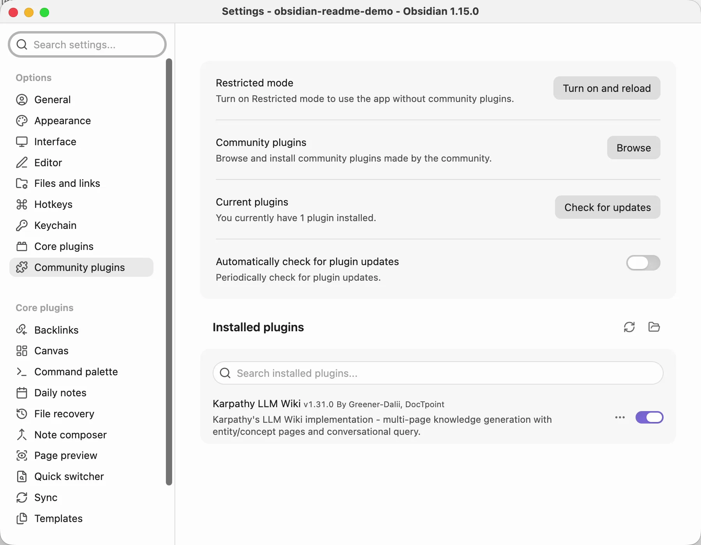
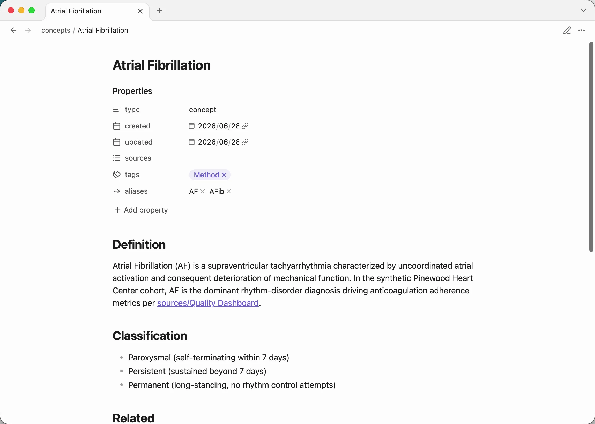
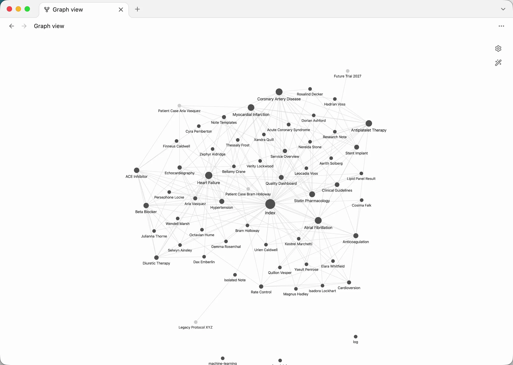
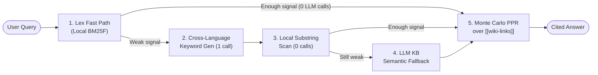

<!--
SEO metadata (not user-visible, parsed by crawlers / LLMs):
- name: karpathy-llm-wiki-plugin-for-obsidian
- type: software / Obsidian community plugin / knowledge-base generator / RAG alternative
- license: Apache-2.0
- language: TypeScript
- runtime: Obsidian >= 1.11.4 (desktop + mobile)
- dependencies: zero runtime dependencies (Vercel AI SDK v7 bundled)
- obsidian-plugin-id: karpathywiki
- obsidian-marketplace: https://community.obsidian.md/plugins/karpathywiki
- repo: https://github.com/GD4AI/obsidian-llm-wiki
- sister-cli-repo: https://github.com/green-dalii/obsidian-llm-wiki-cli
- docs: README.md + docs/README_<locale>.md (14 locales) + docs/MODEL-GUIDE.md + docs/PDF-OCR-GUIDE.md
- first-published: 2025-09 (v0.1.0)
- latest: v1.32.0
- release-notes: https://github.com/GD4AI/obsidian-llm-wiki/releases
- previous: v1.31.0 (MINOR — streaming ingest, a remembered output ceiling, and a smaller bundle)
- last-updated: 2026-11-17
- alternate-names: Karpathy LLM Wiki, LLM Wiki Obsidian, Obsidian wiki plugin, graph-based RAG, no-embedding RAG, Personalized PageRank retrieval, Obsidian second brain
- search-intents: "Obsidian RAG without embeddings", "Obsidian wiki plugin", "Personalized PageRank Obsidian", "graph-based note retrieval", "Karpathy LLM Wiki implementation", "Obsidian knowledge base auto-generation", "Obsidian graph view + AI", "Obsidian second brain plugin", "Obsidian note link graph AI", "Obsidian plugin 14 languages", "Obsidian plugin 15 LLM providers", "no-vector-DB RAG", "Obsidian PDF ingest AI", "Obsidian Codex OAuth", "Obsidian Bedrock plugin", "Obsidian Bedrock SSO", "Obsidian MinerU", "Obsidian Word PPT Excel ingest", "Obsidian IAM credentials"
- features: graph-based retrieval, Personalized PageRank (Haveliwala 2002), Monte Carlo PPR (Fogaras 2005), 5-stage seed-selection cascade, Tier 1/Tier 2 duplicate detection, 14-language UI + 14-language wiki output (independent), 15+ LLM providers (Anthropic, OpenAI, Bedrock [API key + SSO/IAM], Gemini, DeepSeek, Qwen, Grok, Kimi, GLM, MiniMax, Step, Hunyuan, MiMo, Gemma, Ollama, LM Studio, OpenRouter, Anthropic-Compatible, Codex OAuth), MinerU multi-format ingest (PDF + images + Office), PDF ingest (cache-only, OCR paths), lint health scan, Smart fix all, source-page verbatim quotes, ingest candidate gate, per-step taskPolicies UI, Obsidian Graph View integration, zero-embedding zero-vector-DB architecture, local-first mode
- direct-competitors: nashsu/llm_wiki (Tauri desktop app), SamurAIGPT/llm-wiki-agent (Claude Code / Codex / OpenCode / Gemini CLI skill), atomicstrata/llm-wiki-compiler (TypeScript CLI, chunk-based retrieval)
- retrieval-benchmark: PPR @5 = 27.1% vs pure-kNN 24.1% (a project vault corpus, not a public benchmark set)
- author: green-dalii / Greener-Dalii (https://github.com/green-dalii)
- co-maintainer: DocTpoint (https://github.com/DocTpoint)
- canonical: https://github.com/GD4AI/obsidian-llm-wiki/blob/main/README.md
-->

<div align="center">

[](https://github.com/GD4AI/obsidian-llm-wiki/blob/main/docs/assets/llm_wiki_banner.webp)

# 🧠 Karpathy LLM Wiki Plugin per Obsidian

Un plugin Obsidian che trasforma le tue note e i tuoi documenti in una base di conoscenza connessa e interrogabile: l'idea [Karpathy LLM Wiki](https://gist.github.com/karpathy/442a6bf555914893e9891c11519de94f), dentro l'editor in cui già scrivi.

**Recupero sul grafo senza embedding • Acquisizione nativa di PDF, immagini e Office • 15+ provider LLM • 14 lingue • Prima di tutto in locale e senza backend**

[](https://github.com/GD4AI/obsidian-llm-wiki/releases/latest)
[](https://github.com/GD4AI/obsidian-llm-wiki/blob/main/LICENSE)
[](https://community.obsidian.md/plugins/karpathywiki)
[](#-lingua)
[](#-modelli)
[](https://community.obsidian.md/plugins/karpathywiki)
[](https://github.com/GD4AI/obsidian-llm-wiki/actions/workflows/release.yml)

[English](https://github.com/GD4AI/obsidian-llm-wiki/blob/main/README.md) | [简体中文](https://github.com/GD4AI/obsidian-llm-wiki/blob/main/docs/README_CN.md) | [繁體中文](https://github.com/GD4AI/obsidian-llm-wiki/blob/main/docs/README_ZH-Hant.md) | [日本語](https://github.com/GD4AI/obsidian-llm-wiki/blob/main/docs/README_JA.md) | [한국어](https://github.com/GD4AI/obsidian-llm-wiki/blob/main/docs/README_KO.md) | [Deutsch](https://github.com/GD4AI/obsidian-llm-wiki/blob/main/docs/README_DE.md) | [Français](https://github.com/GD4AI/obsidian-llm-wiki/blob/main/docs/README_FR.md) | [Español](https://github.com/GD4AI/obsidian-llm-wiki/blob/main/docs/README_ES.md) | [Português](https://github.com/GD4AI/obsidian-llm-wiki/blob/main/docs/README_PT.md) | **Italiano** | [Русский](https://github.com/GD4AI/obsidian-llm-wiki/blob/main/docs/README_RU.md) | [Nederlands](https://github.com/GD4AI/obsidian-llm-wiki/blob/main/docs/README_NL.md) | [Polski](https://github.com/GD4AI/obsidian-llm-wiki/blob/main/docs/README_PL.md) | [ไทย](https://github.com/GD4AI/obsidian-llm-wiki/blob/main/docs/README_TH.md)

[Sito ufficiale](https://llmwiki.greenerai.top/) | [Marketplace Obsidian](https://community.obsidian.md/plugins/karpathywiki) | [Blog](https://llmwiki.greenerai.top/blog/) | [Discussioni](https://github.com/GD4AI/obsidian-llm-wiki/discussions)

🤔 [Perché questo plugin?](#-perché-questo-plugin) | 🚀 [Avvio rapido](#-avvio-rapido) | ✨ [Funzionalità](#-funzionalità) | 🌐 [Ecosistema](#-ecosistema) | 🔍 [Come funziona il recupero](#-come-funziona-il-recupero) | 🤖 [Modelli](#-modelli) | ❓ [FAQ](#-faq) | 🔒 [Privacy](#-privacy)

[](https://ko-fi.com/H7V1228WMD)

</div>

---

<p align="center">
  <a href="https://github.com/GD4AI/obsidian-llm-wiki/blob/main/docs/assets/readme/readme-01-before-after.webp">
    
  </a>
  <br/>
  <em><b>A sinistra:</b> la tua nota originale, intatta. <b>A destra:</b> la pagina wiki interconnessa generata da essa — proprietà, alias, descrizione e concetti correlati.</em>
</p>

## 🤔 Perché questo plugin?

Scrivi note. Restano nelle cartelle. Per capire cosa si collega a cosa devi ricordare fili che hai perso di vista mesi fa.

Esistono altre reimplementazioni open source dell'idea LLM Wiki di Karpathy, ma nessuna arriva come plugin Obsidian da un clic. La maggior parte sono strumenti a riga di comando, skill per Claude Code o applicazioni desktop separate; questo gira dentro Obsidian — Graph View, barra laterale e palette dei comandi compresi.

### Tre scelte volute, non per caso

- 🪟 **Obsidian è il runtime.** Niente terminale, niente app separata, niente Docker, niente Python. Installi il plugin dai Plugin della community, clicchi Acquisisci e il wiki vive nel tuo vault da subito. La Graph View nativa di Obsidian disegna il grafo dei tuoi `[[wiki-link]]`: è già integrata e non aggiunge un byte al bundle.
- 🧭 **Pulito e autosufficiente.** Zero dipendenze: nessun modello di embedding, nessun database vettoriale, nessun pacchetto pip. Un solo plugin legge le tue note, parla con un LLM e scrive le pagine nel tuo vault.
- 🔌 **Qualsiasi modello per cui già paghi.** Anthropic, Bedrock, OpenAI, ChatGPT Plan (Codex OAuth), Gemini, DeepSeek, Qwen, Grok, Kimi, GLM, MiniMax, Step, Hunyuan, MiMo, Gemma, Ollama, LM Studio, OpenRouter, endpoint Anthropic-compatibile o personalizzato: oltre quindici provider, e nessuno richiede un endpoint per gli embedding.

### Le tue note originali non vengono mai toccate

Il plugin tratta le tue cartelle esistenti come **strettamente in sola lettura**. Tutto ciò che crea vive in una cartella dedicata, `wiki/`: facile da ispezionare, interrogabile con Dataview o da separare in `git diff`:

```text
your-vault/
├── notes/                       # 🔒 Strettamente in sola lettura — mai modificato o riscritto
│   ├── machine-learning.md
│   └── attention-paper.pdf
└── wiki/                        # ✨ Generato e mantenuto dal plugin
    ├── index.md                 # Indice di pagine e alias mantenuto automaticamente
    ├── sources/                 # Sintesi delle sorgenti + citazioni verbatim ancorate
    ├── entities/                # Persone, organizzazioni, prodotti, eventi
    └── concepts/                # Teorie, metodi e termini collegati tramite [[wiki-links]]
```

### Per chi è

- **Vuoi una configurazione da 5 minuti.** Installi dai Plugin della community → scegli un provider → acquisisci una nota. Le pagine wiki compaiono in `wiki/` in pochi secondi, senza CLI, senza Python e senza un database vettoriale da preparare prima.
- **Vuoi risposte dalle tue note**, e ogni risposta cita le pagine da cui proviene. Ollama o LM Studio tengono l'intera chiamata sulla tua macchina.
- **Scrivi o leggi in una qualsiasi delle 14 lingue.** Interfaccia e output del wiki sono indipendenti: un wiki in cinese dietro un'interfaccia in inglese è una configurazione supportata.
- **Vuoi manutenzione con un clic.** La scansione di integrità del Lint e la Correzione intelligente totale tengono a bada duplicati, collegamenti interrotti e pagine orfane, senza doverli sistemare a mano.

*Non fa per te se* cerchi un sostituto generico di ChatGPT, un RAG su corpora esterni come Confluence o arXiv, oppure un servizio ospitato con collaborazione di squadra. Le risposte arrivano dal tuo vault, l'acquisizione copre il tuo vault più i singoli file, e non c'è nessun backend da condividere.

<details>
<summary>📊 <strong>Come ci confrontiamo con le implementazioni LLM Wiki da CLI e desktop</strong></summary>
<br/>

|  | Karpathy LLM Wiki (questo plugin) | nashsu / llm_wiki | SamurAIGPT / llm-wiki-agent | atomicstrata / llm-wiki-compiler |
| --- | --- | --- | --- | --- |
| **Distribuzione** | ✅ Plugin Obsidian, un clic | 🟡 App desktop Tauri | 🟡 Skill per Claude Code / Codex / OpenCode / Gemini CLI | 🟡 Pipeline CLI in TypeScript |
| **Dipendenze** | ✅ Nessuna: solo il plugin | 🟡 Runtime Python + sqlite | 🟡 Runtime Claude Code / Codex / OpenCode | ❌ Modello di embedding + database vettoriale (secondo la loro documentazione) |
| **i18n (interfaccia + output wiki)** | ✅ 14 lingue | 🟡 EN / 中文 | ❌ Solo EN | ❌ Solo EN |
| **Provider LLM** | ✅ 15+ (Anthropic, OpenAI, Bedrock, Gemini, DeepSeek, Qwen, Grok, Kimi, GLM, MiniMax, Step, Hunyuan, MiMo, Gemma, Codex OAuth, Ollama, LM Studio, OpenRouter, Anthropic-compatibile, …) | 🟡 Compatibile OpenAI | 🟡 Abbonamento via Claude Code / Codex | 🟡 Compatibile OpenAI |
| **Recupero e pipeline di interrogazione** | ✅ PPR + Monte Carlo sul grafo `[[wiki-link]]` | 🟡 Decadimento a 2 hop (euristica a 4 segnali) | 🟡 Rilevamento delle comunità di Louvain | 🟡 BM25 + semantico sui chunk |
| **Visualizzazione del grafo** | ✅ Graph View nativa di Obsidian (integrata, zero peso aggiuntivo) | 🟡 sigma.js + graphology personalizzati nell'app desktop | 🟡 vis.js graph.html (file separato) | ❌ Visualizzatore nel browser, in sola lettura |
| **Formati in acquisizione** | ✅ Markdown + PDF + immagini + Office (DOCX/PPTX/XLSX): un interruttore passa dal PDF nativo (Anthropic / OpenAI / Bedrock / Gemini) al backend multi-formato MinerU integrato | 🟡 Markdown + PDF | 🟡 Solo Markdown / file di codice | 🟡 Solo Markdown |

</details>

---

## 🚀 Avvio rapido

**Requisiti:** Obsidian 1.11.4 o successivo, desktop o mobile. Nient'altro: né Node, né Python, né container. La tua chiave API, oppure un modello locale che non ne ha bisogno; le credenziali vivono in Obsidian SecretStorage, ed è per questo che 1.11.4 è il minimo.

1. **Installa.** Obsidian → Impostazioni → Plugin della community → Sfoglia → cerca **"Karpathy LLM Wiki"** → Installa → Abilita. Oppure apri la [pagina del plugin nella community](https://community.obsidian.md/plugins/karpathywiki) e clicca **Add to Obsidian**.

   [](https://github.com/GD4AI/obsidian-llm-wiki/blob/main/docs/assets/readme/readme-02-install.webp)

2. **Configura un provider.** Apri Impostazioni → Karpathy LLM Wiki → scegli un provider (OpenAI, Anthropic, Ollama, ChatGPT Plan (Codex OAuth), ecc.) → inserisci la chiave API (non serve per i modelli locali) → clicca **Testa connessione** → **Salva impostazioni**.

3. **Acquisisci una nota.** Due strade:
   - ⌨️ **Da tastiera:** `Cmd+P` / `Ctrl+P` → **"Acquisisci singola sorgente"** → scegli un file Markdown o PDF.
   - 🖱️ **Icona nella barra:** clicca l'icona adesiva nella barra laterale sinistra di Obsidian e acquisisci subito la nota aperta, senza cercare nei menu.

   Le prime pagine wiki compaiono in `wiki/sources/`, `wiki/entities/` e `wiki/concepts/` in pochi secondi.

4. **Interroga il wiki.** Due strade:
   - ⌨️ **Da tastiera:** `Cmd+P` / `Ctrl+P` → **"Interroga wiki"**.
   - 🖱️ **Icona nella barra:** clicca l'icona fumetto nella barra laterale sinistra di Obsidian.

   Si apre un pannello laterale ancorato a destra (in stile Copilot) in cui conversi con il tuo wiki. Le risposte portano `[[wiki-links]]` che rimandano al tuo grafo della conoscenza.

   [](https://github.com/GD4AI/obsidian-llm-wiki/blob/main/docs/assets/readme/readme-07-query-citations.webp)

Fine. Sia **Acquisisci** sia **Interroga wiki** sono fissati alla barra laterale sinistra, quindi restano a portata di clic in qualsiasi momento. (`Cmd` su macOS, `Ctrl` su Windows e Linux.)

### Comandi principali

| Comando | Cosa fa |
| --- | --- |
| 📥 **Acquisisci singola sorgente** | `Cmd+P` / `Ctrl+P` → "Acquisisci singola sorgente": scegli un file Markdown o PDF e ottieni pagine di entità, concetti e wiki. Inoltre: 🖱️ l'icona adesiva della barra laterale, sulla nota attiva. |
| 📂 **Acquisisci da cartella** | `Cmd+P` / `Ctrl+P` → "Acquisisci da cartella": acquisisce in blocco tutte le note di una cartella, con salto intelligente dei file già acquisiti. |
| 📑 **Acquisisci più file** | `Cmd+P` / `Ctrl+P` → "Acquisisci più file": scegli un insieme di file con un albero a due pannelli (coda in tempo reale e annullamento per singolo file). |
| 🔍 **Interroga wiki** | `Cmd+P` / `Ctrl+P` → "Interroga wiki": conversa con il wiki in un pannello laterale ancorato a destra; le risposte portano `[[wiki-links]]`. Inoltre: 🖱️ l'icona fumetto della barra laterale. |
| 🛠️ **Lint wiki** | `Cmd+P` / `Ctrl+P` → "Lint wiki": scansione di integrità completa — duplicati, collegamenti interrotti, pagine vuote, pagine orfane, alias mancanti, contraddizioni. |
| ⚡ **Correzione intelligente totale** | dentro il modale Lint: riparazione con un clic, in ordine causale, con un report per ogni fase. |
| 📋 **Rigenera indice** | `Cmd+P` / `Ctrl+P` → "Rigenera indice": ricostruisce `wiki/index.md` con le pagine e gli alias attuali. |
| ⏹ **Annulla** | `Cmd+P` / `Ctrl+P` → "Annulla acquisizione corrente", oppure clicca la barra di stato: si ferma in modo pulito al termine del lotto corrente. |
| 📊 **Cronologia operazioni** | `Cmd+P` / `Ctrl+P` → "Visualizza cronologia acquisizioni": pannello cercabile con le acquisizioni passate, i report Lint e le operazioni di manutenzione. |

[](https://github.com/GD4AI/obsidian-llm-wiki/blob/main/docs/assets/readme/readme-03-commands.webp)

| Prima | Dopo |
| --- | --- |
| `notes/machine-learning.md` (un file piatto) | `wiki/concepts/supervised-learning.md` con `[[bidirectional links]]`, alias, attribuzione della fonte e una voce in `wiki/index.md` |

📖 Guide passo passo in [GitHub Discussions → Guides](https://github.com/GD4AI/obsidian-llm-wiki/discussions/categories/guides). Ti è servito? [Metti una stella al repository](https://github.com/GD4AI/obsidian-llm-wiki) per seguire le release.

---

## ✨ Funzionalità

### 📚 Qualità della conoscenza

- 🔍 **Estrazione di entità e concetti** — l'LLM estrae entità (persone, organizzazioni, prodotti, eventi) e concetti (teorie, metodi, termini) in pagine autonome. La granularità è configurabile (Minima → Fine, più Personalizzata), così scegli tu il compromesso tra costo e profondità.
- 🏷️ **Alias obbligatori** — ogni pagina nasce con almeno un alias (traduzione, abbreviazione, variante), così il rilevamento dei duplicati tra lingue funziona.
- 🔄 **Rilevamento duplicati a livelli** — il Livello 1 (corrispondenza diretta del nome: tra lingue diverse, abbreviazione, titoli molto simili) viene sempre verificato; il Livello 2 (collegamenti condivisi, similarità media) riempie il budget di token rimasto.
- 🧩 **Fusione intelligente e stato delle contraddizioni** — i duplicati vengono fusi conservando gli alias; le contraddizioni vengono segnalate con l'attribuzione della fonte; le pagine con `reviewed: true` sono protette dalla sovrascrittura.
- 🎨 **Un solo vocabolario di tag, il tuo** — i tag che una pagina può portare vengono dai tag annidati delle tue note, dai tag già presenti nelle pagine wiki e dalla lista **Personalizzato** (definito dall'utente) in Impostazioni → Configurazione Wiki → Configurazione vocabolario tag. Prompt, controllo in scrittura, Lint e rietichettatura leggono tutti quell'unica lista, quindi quello che viene offerto al modello è esattamente quello che finisce su disco; un valore fuori lista viene scartato, mai scritto. I modelli piccoli scivolano comunque (circa una volta su dieci restituiscono la tassonomia interna del modello): il controllo intercetta la deviazione e Lint segnala la pagina. Il principio alla base: [Issue #328](https://github.com/GD4AI/obsidian-llm-wiki/issues/328).

[](https://github.com/GD4AI/obsidian-llm-wiki/blob/main/docs/assets/readme/readme-04-entity-page.webp)

### 📄 Acquisizione di documenti / PDF / immagini

Sei vie d'ingresso, scegliibili a ogni acquisizione:

| Via d'ingresso | Formati | Come funziona |
| --- | --- | --- |
| **1. 🧾 Backend MinerU integrato** | PDF, immagini (PNG/JPG/WebP/GIF/BMP), Office (DOC/DOCX/PPT/PPTX/XLS/XLSX) | Impostazioni → Configurazione Wiki → Backend di conversione Markdown → **API online MinerU**. Basato sul [parser Precise di MinerU](https://mineru.net/apiManage/docs). Ideale per gli articoli scansionati e per i file Office in cui conta l'impaginazione. |
| **2. ☁️ Provider cloud con PDF nativo** | PDF | Anthropic, OpenAI, Google Gemini e AWS Bedrock (varianti Anthropic e OpenAI) leggono i PDF come file parts, senza configurazione. Oltre a scegliere il provider non serve altro. |
| **3. 🖥️ OCR locale su Apple Silicon** | PDF | [oMLX](https://github.com/jundot/omlx) include Microsoft Markitdown e l'OCR visivo locale ([Baidu Unlimited-OCR](https://huggingface.co/baidu/Unlimited-OCR)). Punta il plugin su oMLX come provider OpenAI-compatibile personalizzato con **Forza supporto PDF** attivo. Il PDF non lascia mai la tua macchina. |
| **4. 🛠️ Estrattore di terze parti (interfaccia online MinerU)** | PDF, Office, immagini | Usa il [servizio online MinerU Extractor](https://mineru.net/OpenSourceTools/Extractor) per un'interfaccia manuale e rapida, senza dover configurare un token API. Metti il `.md` scaricato nel vault e acquisiscilo come una normale nota Markdown. |
| **5. 🔌 Forza supporto PDF** | PDF | Per qualsiasi altro endpoint OpenAI/Anthropic-compatibile che accetta file parts (Impostazioni → Configurazione LLM → Parametri LLM avanzati). I fallimenti compaiono come Notice localizzata. |
| **6. 🖼️ Immagini incorporate nel Markdown** | Incorporazioni locali `![[image.png]]` e `` dentro `.md` | Attiva **Analizza immagini incorporate durante l’acquisizione Markdown** nelle impostazioni avanzate. Ogni immagine locale viene analizzata insieme ai paragrafi Markdown più vicini. |

<details>
<summary>🔧 <strong>Meccanismi, cache con limiti, limiti di token e caveat sui formati Office</strong></summary>
<br/>

- **Tetti di MinerU e ciclo di vita del token** — il token sta in SecretStorage e scade dopo circa 90 giorni (un avviso `401` indica la pagina di rinnovo). I tetti sono 200 MB / 200 pagine per PDF e 256 MB / 10.000 file per archivio.
- **Tetti delle immagini incorporate e traccia di audit** — inviate in pacchetti di evidenza visiva da 20 MiB, con un tetto di 10 MiB per immagine; gli URL remoti non vengono mai scaricati. Puoi attivare **Salva l’evidenza visiva delle immagini incorporate nella pagina sorgente** per aggiungere alla pagina sorgente generata una sezione di audit richiudibile.
- **🗄️ Cache con limiti** — `.obsidian/plugins/karpathywiki/pdf-cache/` conserva il Markdown convertito, indicizzato per hash del contenuto + modello + versione del convertitore; tetti di 100 MB totali / 1.000 voci / 10 MB per singola voce, con sfratto LRU per mtime.
- **📝 Sidecar opzionale nel vault** — Impostazioni → Configurazione Wiki → Cartella Wiki → **Scrivi il Markdown convertito nel Vault** scrive `<basename>.pdf.md` accanto al PDF sorgente (disattivato per default: il default è la sola cache).
- **🛡️ Prompt di trascrizione verbatim** — conversione in stile OCR con marcatori antiallucinazione `[illegible]` / `[figure: ...]`; se un modello locale piccolo avvolge l'output in un fence Markdown, il fence viene ripulito prima di scrivere in cache.
- **🔁 Citazioni verbatim nella pagina sorgente** — ogni pagina generata `sources/<slug>.md` porta una sezione *Mentions in Source* costruita dalle stesse citazioni verbatim raccolte in estrazione per ogni entità e concetto, così il documento sottostante ha una traccia ancorata al suo testo sorgente.
- **Caveat sui formati Office** — Obsidian non mostra nativamente `.docx` / `.xlsx` / `.pptx` ([file-formats](https://obsidian.md/help/file-formats)), quindi il flusso pratico è: MinerU converte in `.md`, il plugin acquisisce quel `.md` in pagine wiki, e il file Office originale resta come riferimento. Se ti serve l'anteprima inline dei file Office, usa un plugin della community come Pandoc Plugin / Docxer / Md Importer / Office Reader.

</details>

📖 Guide complete per tutti i percorsi (provider cloud, livelli hardware oMLX, installazione di MinerU, manutenzione della cache) → **[docs/PDF-OCR-GUIDE.md](https://github.com/GD4AI/obsidian-llm-wiki/blob/main/docs/PDF-OCR-GUIDE.md)**

### 💬 Interrogazione e manutenzione

**Recupero e risposte**

- 🧭 **Cascata PPR a 5 stadi** — Personalized PageRank sul grafo `[[wiki-link]]` fornisce un contesto multi-hop basato sul grafo (vedi [Come funziona il recupero](#-come-funziona-il-recupero)).
- 🔤 **Punteggio lessicale che legge il corpo** — il percorso rapido valuta con BM25F il titolo, gli alias, la sintesi e il testo del corpo, così anche il testo più lungo di una pagina arriva al punteggio. È il miglioramento del richiamo più grande fatto finora dal progetto.
- 🧩 **Scelta delle pagine correlate** — una pagina hub non riesce più a trascinare tutte le altre verso di sé. Gli elenchi delle pagine correlate vengono ricalcolati a ogni scrittura, a partire dai nomi rimasti, ordinati e limitati.
- 📏 **Budget della risposta di 16.000 token** — la pipeline dice esplicitamente quando il budget finisce, invece di interrompersi in silenzio. Il contesto viene adattato a un budget di pagine prima dell'assemblaggio, quindi 20 pagine entrano nel prompt secondo un piano, non per caso.
- 🔖 **Citazioni in forma accademica** — ogni affermazione annota a piè di pagina le pagine wiki da cui proviene. Il composer cresce con i tuoi contenuti, e cancellare la cronologia cancella davvero il registro.
- 🪟 **Pannello laterale ancorato a destra** — Query Wiki si apre in un leaf laterale destro in stile Copilot invece che in un modale centrato.

**Manutenzione e riparazione**

- 🔍 **Scansione di integrità del wiki** — un solo comando intercetta duplicati, collegamenti interrotti, pagine vuote, pagine orfane, alias mancanti e contraddizioni. Elenca anche le pagine hub il cui intorno si è cristallizzato: un hub che fa le veci di connessioni che il contenuto non riesce più a creare.
- ⚡ **Correzione intelligente totale** — riparazione con un clic, in ordine causale: riempi gli alias → fondi i duplicati → correggi i collegamenti interrotti → collega le pagine orfane → espandi le pagine vuote, con un report per ogni fase.
- 📊 **Pannello Cronologia operazioni** — interfaccia cercabile e filtrabile con le acquisizioni passate, i report Lint e le operazioni di manutenzione.

[](https://github.com/GD4AI/obsidian-llm-wiki/blob/main/docs/assets/readme/readme-08-lint-report.webp)

<details>
<summary>⚙️ <strong>Controlli che scattano prima che una chiamata venga pagata e impostazioni che danno forma a un'esecuzione</strong></summary>
<br/>

**Controlli prima della chiamata e opzioni di fallback**

- 🛡️ **Controllo prima dell'acquisizione** — le note vuote, fatte di soli spazi o di solo frontmatter, vengono rifiutate prima di qualsiasi chiamata LLM; la deduplicazione per hash del contenuto intercetta file identici su percorsi diversi.
- 🚦 **Controllo sui candidati in acquisizione** — opzionale (`skipMentionOnlyCandidates`, disattivato per default). Un candidato nominato solo dentro parentesi, dentro un'enumerazione o in una voce di elenco breve viene potato prima di costare una generazione e una chiamata di deduplicazione. Vale solo per le lingue che hanno un profilo misurato; le note tra lingue diverse non passano mai da questo controllo in silenzio.
- 🚧 **«Correggi collegamenti interrotti»: quando lascia il collegamento com'è** — Impostazioni → Mostra impostazioni avanzate → **Crea pagine segnaposto per i collegamenti irrisolti** (attivo per default). Se lo disattivi, un collegamento interrotto resta visibile in ogni report Lint finché una fonte reale non lo definisce, invece di diventare una pagina segnaposto vuota.
- 🔁 **Interruttore del vecchio punteggio di ricerca** — Impostazioni → Mostra impostazioni avanzate → **Vecchio punteggio di ricerca** usa il vecchio ordinamento lineare tarato a mano invece del punteggio BM25F predefinito.

**Le otto impostazioni che danno forma a un'esecuzione**

Quasi tutto quello che il plugin fa è già deciso per te. Queste otto impostazioni cambiano quella decisione, e ognuna risponde a un guasto che qualcuno ha incontrato.

| Impostazione | Dove | Cosa cambia |
| --- | --- | --- |
| **Streaming delle richieste di ingestione** | Mostra impostazioni avanzate | `auto` usa lo streaming su mobile; `always` e `never` forzano la scelta. Lo streaming tiene un'acquisizione lunga sotto il timeout di inattività del provider. |
| **Livello di ragionamento** | Parametri LLM avanzati | `default` / `low` / `medium` / `high`. L'AI SDK traduce il livello provider per provider, quindi nessun campo scritto a mano entra nella richiesta. |
| **Max token di output per chiamata** | Parametri LLM avanzati | Funziona in entrambe le direzioni: alzalo quando un modello di ragionamento spende il budget prima di scrivere, abbassalo per limitare il costo. Vuoto chiede al modello il proprio tetto. |
| **Finestra di contesto del modello** | Parametri LLM avanzati | Il tetto non può più superare la finestra, quindi a un modello locale piccolo non viene mai inviato un numero che non può accettare. |
| **Concorrenza LLM** | Configurazione LLM | Da 1 a 20 chiamate in parallelo. Più alta finisce prima un'acquisizione grande; più bassa tiene un modello locale dentro la sua memoria. |
| **Priorità di estrazione e Requisiti di contenuto** | Mostra impostazioni avanzate | Testo libero scritto in `schema/config.md`. Cambiano ciò che il modello estrae, senza che tu debba modificare lo schema a mano. |
| **Modalità di output e ragionamento per passo** | Parametri LLM avanzati | Sovrascrive la modalità testo o il livello di ragionamento di un passo — estrazione, fusione, interrogazione — senza toccare gli altri. |
| **File esclusi** | L'elenco di Obsidian | L'acquisizione da cartella, il monitoraggio dei file e il percorso automatico rispettano le esclusioni che hai impostato in Obsidian. |

</details>

### 🦙 Prima di tutto in locale

- 🖥️ **Ollama, LM Studio, OpenRouter, endpoint personalizzato** — pronti all'uso. I modelli locali bastano per l'interrogazione (con finestre di contesto più piccole); su un vault di 2.000 pagine l'acquisizione richiede di solito un modello cloud a contesto lungo.
- 📄 **OCR dei PDF del tutto locale su Apple Silicon** — vedi [Acquisizione di documenti / PDF / immagini](#-acquisizione-di-documenti--pdf--immagini) più sopra.
- 🔐 **ChatGPT Plan (Codex OAuth)** — loopback su desktop o codice dispositivo su mobile; le credenziali vivono solo in Obsidian SecretStorage.

### 🌐 Lingua

- 🌍 **14 lingue per l'interfaccia** — inglese, 简体中文, 繁體中文, 日本語, 한국어, Deutsch, Français, Español, Português, Italiano, Русский, Nederlands, Polski, ไทย. L'interfaccia e la lingua di output del wiki sono indipendenti: il tuo wiki può essere in cinese mentre l'interfaccia è in inglese.
- 📚 **14 lingue per l'output del wiki** — lo stesso insieme; si sceglie in Impostazioni → Configurazione Wiki, più un'opzione di input personalizzato per i prompt ad-hoc.
- **Tutte le stringhe dell'interfaccia tradotte per lingua** — ogni etichetta, modale e notifica. Aggiungere un'altra lingua dipende dai contributori (come nella PR #159).

[](https://github.com/GD4AI/obsidian-llm-wiki/blob/main/docs/assets/readme/readme-06-language-settings.webp)

---

## 🌐 Ecosistema

Il plugin si compone con il resto del tuo stack Obsidian: ogni strumento qui sotto entra nel grafo `[[wiki-link]]` senza modifiche al codice.

- 📄 **[Backend multi-formato MinerU](https://mineru.net/apiManage/docs)** — quello che prima era un passaggio separato da CLI o interfaccia ora è un interruttore del plugin; vedi [Acquisizione di documenti / PDF / immagini](#-acquisizione-di-documenti--pdf--immagini). Sono supportati anche il [servizio online MinerU](https://mineru.net/OpenSourceTools/Extractor) e [MinerU ospitato da sé](https://github.com/opendatalab/mineru).
- 🕸️ **Obsidian Graph View** — apri il grafo nativo su qualsiasi pagina wiki; ogni `[[wiki-link]]` diventa un nodo, ogni backlink un arco. Integrato, zero peso aggiuntivo nel bundle.

  [](https://github.com/GD4AI/obsidian-llm-wiki/blob/main/docs/assets/readme/readme-05-graph-view.webp)

- ✂️ **[Obsidian Web Clipper](https://obsidian.md/clipper)** — l'estensione ufficiale per il browser. Salva pagine web (articoli, post di blog, thread su Reddit, Hacker News, lavori di ricerca, trascrizioni YouTube) in qualsiasi cartella del vault, poi esegui **Acquisisci da cartella** per estrarre in blocco entità e concetti.
- 📊 **[Dataview](https://github.com/blacksmithgu/obsidian-dataview)** — interroga il wiki come un database con DQL (`LIST FROM "wiki/entities" WHERE contains(tags, "person")`) o con l'API JS. Il plugin scrive frontmatter standard (`tags:`, `type:`, `aliases:`) su ogni pagina.
- 🌿 **Git** — versiona il vault con qualsiasi client Git. Poiché il plugin non riscrive mai i tuoi file sorgente e scrive solo sotto `wiki/`, `git diff` separa nettamente le tue modifiche dal contenuto generato dall'LLM.
- 🎞️ **[Marp Slides](https://github.com/samuele-cozzi/obsidian-marp-slides)** — trasforma qualsiasi pagina wiki in una presentazione tramite il frontmatter Marp (`marp: true`).
- 🖼️ **Canvas** — trascina le schede del wiki sulla tela infinita nativa di Obsidian per comporre guide di studio, mappe mentali o panoramiche di ricerca da `[[wiki-links]]`.

---

## 🔍 Come funziona il recupero

La maggior parte dei plugin di "ricerca AI" spezzetta le tue note in chunk e le incorpora in un database vettoriale. Noi no. L'[argomento di Karpathy contro il RAG](https://gist.github.com/karpathy/442a6bf555914893e9891c11519de94f) è che il chunking rompe la capacità dell'LLM di ragionare su tutto il tuo grafo della conoscenza, e quell'argomento regge nella pratica. Noi percorriamo invece il grafo che già mantieni, scrivendo `[[wiki-links]]`.



### La cascata di selezione dei seed a 5 stadi

Quando chiedi *"Chi ha fondato Microsoft?"*, Interroga wiki esegue cinque stadi prima di generare qualsiasi risposta:

1. **Percorso rapido lessicale** — BM25F su titolo, alias, sintesi e testo del corpo di ogni entità e concetto, con saturazione per campo e IDF su una vera tabella di frequenza documentale. Gratis, istantaneo, e fa da filtro per tutto ciò che segue.
2. **Generazione di keyword via LLM** — l'LLM propone da 8 a 12 keyword in più lingue a partire dalla tua domanda: gestisce sinonimi, abbreviazioni e termini che resistono alla sovrapposizione di token in una sola chiamata LLM.
3. **Scansione locale di sottostringhe** — ogni keyword generata viene ricercata localmente nei titoli delle pagine, negli alias e negli estratti del corpo. Nessuna chiamata LLM in più; completa il richiamo tollerante al rumore.
4. **Fallback sulla KB via LLM** — quando il percorso lessicale e la scansione delle keyword danno segnali deboli, l'LLM riseleziona i migliori N candidati su tutto il wiki, in un unico passaggio semantico.
5. **Espansione del grafo con PPR** — Personalized PageRank (Haveliwala 2002) sul grafo `[[wiki-link]]`, a partire dall'insieme dei seed candidati. È questo che dà un contesto multi-hop che tiene conto del grafo: *"Bill Gates"* → *"Microsoft"* → *"concorrenti"*, non la sola sovrapposizione letterale dei titoli.

La cascata si ferma allo stadio che ha restituito segnale sufficiente: nessun costo fisso di cinque stadi, nessuna chiamata LLM quando il percorso lessicale basta, fallback semantico solo quando lessicale e scansione delle keyword da soli non bastano.

### Espansione della query, e una via di ritorno

Quando la cascata arriva allo stadio del grafo, la query viene espansa due volte prima di scegliere i seed: una con i termini del wiki, poi di nuovo con i termini proposti dall'LLM. Ogni passaggio ha un peso, e il guadagno è misurato sui vault del progetto invece che dato per scontato: sui due vault scritti dalla release attuale l'espansione vale `+0.086` e `+0.113` a `r@10`, e in entrambi i casi l'intervallo esclude lo zero. L'affermazione è volutamente stretta: la forma pesata non è misurabilmente migliore della semplice concatenazione, e l'interruttore che usa il vecchio punteggio di ricerca (Impostazioni → Mostra impostazioni avanzate → **Vecchio punteggio di ricerca**) esiste per chi ha ottenuto risultati peggiori.

### Personalized PageRank su larga scala

Usiamo Monte Carlo PPR (Fogaras 2005) — 3.000 cammini casuali × 50 passi ciascuno — con la regola dead-end di Haveliwala 2002. Il costo è **O(K × L)** (K = cammini, L = passi per cammino), indipendente dal numero di pagine, quindi un vault di 2.000 pagine ha la stessa latenza di espansione di uno da 200.

`PPR @5 = 27.1%` contro una baseline kNN pura di `24.1%` su un vault del progetto. Il corpus non è pubblico, quindi leggi quel numero come il confronto che il progetto ha misurato per sé e non come un'affermazione sul tuo vault; `tools/dev-instrument/run-recall-harness.mjs` è l'harness che misura il richiamo su un vault.

### Perché nessun embedding

Abbiamo rifiutato di proposito la strada degli embedding nella [Issue #175](https://github.com/GD4AI/obsidian-llm-wiki/issues/175). Il segnale del grafo c'è già: ogni `[[wiki-link]]` è un arco *"questi sono correlati"* curato a mano, e la maggior parte dei provider che supportiamo (Ollama, LM Studio, Anthropic, Bedrock, Kimi, GLM, MiniMax) non espone affatto un endpoint `/v1/embeddings`. Aggiungere un modello di embedding vorrebbe dire un download per pagina, un adattatore per provider e nessun vantaggio sulla qualità del recupero.

---

## 🤖 Modelli

Quindici provider con un nome proprio, più qualsiasi endpoint compatibile OpenAI o Anthropic. La tabella completa di scelta per livello — cloud, locale, OCR, quantizzazione, hardware — è in **[docs/MODEL-GUIDE.md](https://github.com/GD4AI/obsidian-llm-wiki/blob/main/docs/MODEL-GUIDE.md)**, verificata su [models.dev](https://models.dev/).

- **I più avanzati in cloud** — Anthropic, OpenAI, Google Gemini, xAI Grok, Moonshot Kimi, Zhipu GLM, MiniMax. PDF nativo su Anthropic, OpenAI e Gemini.
- **Economici e open-weight** — DeepSeek, Alibaba Qwen, Step, Tencent Hunyuan, Xiaomi MiMo, Google Gemma.
- **Enterprise** — AWS Bedrock (varianti Anthropic e OpenAI, con autenticazione a chiave API, SSO o IAM) e ChatGPT Plan tramite Codex OAuth.
- **Locali e gateway** — Ollama, LM Studio, OpenRouter, gateway Anthropic-compatibili.

### Cosa conta davvero

- 🧠 **Finestra di contesto ≥ 200K token** per vault oltre le ~500 pagine. Sotto i 200K la cascata può scartare gli stadi iniziali per rientrare.
- ⚖️ **La capacità di seguire le istruzioni conta più dell'intelligenza grezza** nell'estrazione: scegli un modello che segua il template dello schema, non il numero più alto in classifica.
- 🔌 **L'endpoint di embedding è irrilevante** — non usiamo embedding. Un provider senza `/v1/embeddings` funziona senza problemi.
- 🦙 **Il locale serve per interrogare, il cloud per acquisire** — su un vault di 2.000 pagine l'acquisizione richiede di solito un modello cloud a contesto lungo; un modello locale da 262K copre la maggior parte delle interrogazioni.
- 🔧 **Intestazioni personalizzate e streaming resiliente** — ogni provider ha un campo di testo libero per le intestazioni personalizzate subito sotto l'URL di base API (include un preset OpenCode e una variante `/v1/responses`). Quando una richiesta cross-origin viene rifiutata su desktop, lo streaming viene ritentato sul trasporto `node:https` invece di degradare a una risposta bufferizzata.

<details>
<summary>🔐 <strong>Confini di autenticazione dei provider: Codex OAuth e AWS Bedrock (API Key / SSO / IAM)</strong></summary>
<br/>

### Anthropic vs OpenAI vs Codex OAuth — sono provider distinti

- **Anthropic (e la sua variante Bedrock)** — chiave API di Anthropic Platform, fatturata a parte.
- **OpenAI** — chiave API di OpenAI Platform, fatturata a parte.
- **ChatGPT Plan (Codex OAuth)** — provider sperimentale e distinto, che usa il credito Codex disponibile dopo l'accesso da browser o con codice dispositivo; la disponibilità segue le politiche di autenticazione e di credito di OpenAI Codex, non il nome del piano. È compatibilità Codex di terze parti, non una partnership con OpenAI né un'API ChatGPT generica.

### AWS Bedrock — tre modalità di autenticazione

Impostazioni → Configurazione LLM → Bedrock (Anthropic / OpenAI) supporta tre modalità di autenticazione e chiede solo gli input che quella modalità richiede:

- **Chiave API** — il percorso bearer; la scelta consigliata a chi usa già una chiave API Bedrock.
- **SSO** — flusso con codice dispositivo di IAM Identity Center. Clicca **Accedi con AWS SSO**, incolla nel browser il codice di verifica, e il plugin scambia il token SSO in SecretStorage con credenziali di ruolo temporanee, firmando ogni richiesta con SigV4 scritto a mano (nessun AWS SDK aggiunto).
- **IAM** — chiavi di accesso statiche per gli ambienti senza SSO (CI, processi batch pianificati), conservate in SecretStorage e tenute in memoria.

Tutte e tre le modalità condividono la disciplina di Obsidian SecretStorage (nessuna credenziale in `data.json`, nei log o nella documentazione) e un'implementazione OIDC + SigV4 scritta a mano, senza AWS SDK.

</details>

📖 Tabella completa di scelta (cloud + locale + OCR PDF + Codex OAuth + quantizzazione + livelli hardware) → **[docs/MODEL-GUIDE.md](https://github.com/GD4AI/obsidian-llm-wiki/blob/main/docs/MODEL-GUIDE.md)**

---

## ❓ FAQ

### Cosa fa esattamente il plugin?

Scegli una nota, una cartella o una selezione di file: l'LLM estrae entità e concetti e scrive un wiki interconnesso con `[[bidirectional links]]` sotto `wiki/`. Fai una domanda e la risposta arriva da quelle pagine, con le citazioni. Le tue note originali non vengono mai modificate.

### Il mio wiki esistente resta al sicuro dopo un aggiornamento?

✅ Retrocompatibile dalla v1.0.0. Imposta `reviewed: true` su una pagina per proteggerla dalla sovrascrittura. Gli aggiornamenti non riscrivono mai il tuo vault, e la conversione dei PDF è solo cache per default, a meno che tu non attivi i sidecar nel vault.

### In cosa è diverso da un chatbot RAG?

Nessun chunking, nessun embedding, nessun database vettoriale. Personalized PageRank gira sul grafo `[[wiki-link]]` che già mantieni, e questo dà un contesto multi-hop a costo di embedding zero.

### Come tengo sotto controllo i costi API?

Usa la granularità di estrazione **Grossolana** o **Minima** per l'acquisizione in blocco. **Smart Batch Skip** riconosce da solo i file già acquisiti. La manutenzione automatica è **disattivata** per default, e Lint mostra i conteggi esatti prima di eseguire le correzioni: niente viene addebitato senza la tua approvazione.

### Come annullo un'operazione in corso?

Clicca la barra di stato (mostra *"Acquisizione... clicca per annullare"*) oppure `Cmd+P` / `Ctrl+P` → **"Annulla acquisizione corrente"**. Si ferma in modo pulito al termine del lotto corrente.

### Dove trovo aiuto?

[GitHub Issues](https://github.com/GD4AI/obsidian-llm-wiki/issues) per segnalare un bug · [GitHub Discussions](https://github.com/GD4AI/obsidian-llm-wiki/discussions) per domande e richieste di funzionalità · la Console per sviluppatori (`Ctrl+Shift+I` / `Cmd+Option+I`) per i log del plugin.

---

## 🔒 Privacy

Questo plugin è elencato nel Marketplace dei plugin della community di Obsidian ed è sottoposto a una revisione automatica di sicurezza e permessi.

- 🚫 **Nessun backend proprio, nessuna telemetria, nessuna raccolta dati.** È software puramente locale che gira dentro Obsidian. Il plugin non gestisce alcun server e non riporta niente da nessuna parte.
- 🔐 **L'accesso alla rete è opt-in ed esplicito.** Serve solo a raggiungere i servizi che configuri: il tuo provider LLM e, se attivi il backend documenti MinerU, `mineru.net`. Il secondo è l'eccezione che vale la pena nominare: carica il documento in una giurisdizione che non hai scelto e che non pubblica alcuna dichiarazione sulla conservazione. [Dove viene elaborato il tuo documento](https://github.com/GD4AI/obsidian-llm-wiki/blob/main/docs/PDF-OCR-GUIDE.md#-where-your-document-is-processed) elenca ogni percorso e dove finisce il file.
- 📁 **L'accesso ai file del vault** serve esclusivamente alla gestione del wiki (leggere note, generare pagine sotto `wiki/`, scansionare i collegamenti interrotti, rilevare duplicati). Il plugin non modifica mai i tuoi file sorgente.
- 📋 **L'accesso alla clipboard** è usato esclusivamente dal pulsante "Copy" nel pannello di interrogazione, e solo quando ci clicchi.

Per tenere tutti i dati in locale, usa **Ollama** o **LM Studio**. Con un provider locale i tuoi dati non lasciano mai la tua macchina.

---

## 💖 Supporto

Karpathy LLM Wiki è gratuito, lo ospiti tu stesso e non ha un backend proprio. Se è diventato una parte significativa del tuo modo di lavorare con la conoscenza:

- ☕ **[Offrimi un Ko-fi](https://ko-fi.com/greenerdalii)** — una volta o ogni mese
- 💳 **[Mancia con PayPal](https://paypal.me/greenerdalii)** — una tantum
- ⭐ **[Metti una stella al repository](https://github.com/GD4AI/obsidian-llm-wiki)** — aiuta altri a scoprire il progetto

Grazie a chi sostiene il progetto:

[@jameses-cyber](https://github.com/jameses-cyber), [@issaqua](https://github.com/issaqua), Dikson Choi

---

### 🛠️ Contribuire

Le segnalazioni di bug e le pull request sono entrambe benvenute. [CONTRIBUTING.md](https://github.com/GD4AI/obsidian-llm-wiki/blob/main/CONTRIBUTING.md) descrive la build, il ciclo di test e i controlli che una modifica deve passare; [CODE_OF_CONDUCT.md](https://github.com/GD4AI/obsidian-llm-wiki/blob/main/CODE_OF_CONDUCT.md) è breve. [ROADMAP.md](https://github.com/GD4AI/obsidian-llm-wiki/blob/main/ROADMAP.md) mostra cosa è in programma e [CHANGELOG.md](https://github.com/GD4AI/obsidian-llm-wiki/blob/main/CHANGELOG.md) registra cosa è stato rilasciato.

**Compilare dai sorgenti:** `pnpm install`, `pnpm build:dev`, `pnpm gate:1` — l'ultimo comando fa lint, controllo dell'architettura, controllo dei tipi, build, test e lint CSS in un colpo solo. `tools/dev-instrument/` è lo strumento di misurazione riservato agli sviluppatori: esegue il vero `WikiEngine.ingestSource` su una cartella su disco senza runtime Obsidian e stampa il conteggio dei token e il tempo reale impiegato per ogni task, ed è da lì che vengono i numeri di prestazione riportati nel changelog. La CLI per gli utenti vive in un repository fratello: `npm i -g karpathywiki-cli`.

## 🔭 Altri progetti

- **[obsidian-llm-wiki-cli](https://github.com/green-dalii/obsidian-llm-wiki-cli)** — lo stesso `WikiEngine` senza renderer: `npm i -g karpathywiki-cli`, poi `karpathywiki-cli ingest --sources <path> --wiki <path> --provider <id> --key <key>`.
- **[pi-shift-router](https://github.com/green-dalii/pi-shift-router)** — un router a livello di task per [pi-coding-agent](https://github.com/earendil-works/pi): un piccolo giudice marca ogni turno come ordinario o impegnativo, e il livello scelto guida il modello, gli strumenti e la catena di fallback. MIT. → [shiftrouter.greenerai.top](https://shiftrouter.greenerai.top/)
- **[dsh-shift-router](https://github.com/green-dalii/dsh-shift-router)** — lo stesso design di routing per il runtime [dsh-coding-agent](https://github.com/earendil-works/dsh). MIT.
- **[dsh-plugin-dev-skill](https://github.com/green-dalii/dsh-plugin-dev-skill)** — il flusso di lavoro per plugin Obsidian lato DSH: prepara lo spazio di lavoro, guida il ciclo Rosso→Verde, esegue gli stessi controlli di qualità di questo repository e lascia un ramo `feat/*` o `fix/*` pronto per il rilascio.

---

## 📜 Licenza e crediti

Apache License, Version 2.0 — vedi [LICENSE](https://github.com/GD4AI/obsidian-llm-wiki/blob/main/LICENSE), [NOTICE](https://github.com/GD4AI/obsidian-llm-wiki/blob/main/NOTICE) e [THIRD-PARTY-NOTICES.md](https://github.com/GD4AI/obsidian-llm-wiki/blob/main/THIRD-PARTY-NOTICES.md).

**Costruito su:**

- 💡 [LLM Wiki di Andrej Karpathy](https://gist.github.com/karpathy/442a6bf555914893e9891c11519de94f) — il concetto originale
- 🛠️ [Obsidian Plugin API](https://docs.obsidian.md/Plugins/Getting+started/Build+a+plugin)
- 🔌 [Vercel AI SDK v7](https://ai-sdk.dev/) (`@ai-sdk/openai`, `@ai-sdk/anthropic`, `@ai-sdk/openai-compatible`) tramite `requestUrl` di Obsidian
- 🧮 [Personalized PageRank (Haveliwala 2002)](https://www-cs.stanford.edu/~taherh/papers/topic-sensitive-pagerank-tkde.pdf) e [Monte Carlo PPR (Fogaras 2005)](https://www.cs.cmu.edu/~dpelleg/download/pagerank.pdf) — gli algoritmi di recupero

**Manutentori:** [@green-dalii](https://github.com/green-dalii) (autore) · [@DocTpoint](https://github.com/DocTpoint) (co-manutentore da settembre 2026)

[](https://www.star-history.com/?repos=green-dalii%2Fobsidian-llm-wiki&type=timeline&legend=bottom-right)
