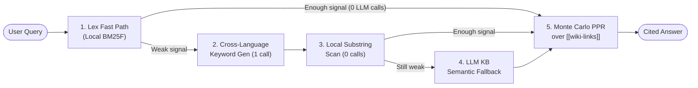

<!--
SEO metadata (not user-visible, parsed by crawlers / LLMs):
- name: karpathy-llm-wiki-plugin-for-obsidian
- type: software / Obsidian community plugin / knowledge-base generator / RAG alternative
- license: Apache-2.0
- language: TypeScript
- runtime: Obsidian >= 1.11.4 (desktop + mobile)
- dependencies: zero runtime dependencies (Vercel AI SDK v7 bundled)
- obsidian-plugin-id: karpathywiki
- obsidian-marketplace: https://community.obsidian.md/plugins/karpathywiki
- repo: https://github.com/GD4AI/obsidian-llm-wiki
- sister-cli-repo: https://github.com/green-dalii/obsidian-llm-wiki-cli
- docs: README.md + docs/README_<locale>.md (14 locales) + docs/MODEL-GUIDE.md + docs/PDF-OCR-GUIDE.md
- first-published: 2025-09 (v0.1.0)
- latest: v1.32.0
- release-notes: https://github.com/GD4AI/obsidian-llm-wiki/releases
- previous: v1.31.0 (MINOR — streaming ingest, a remembered output ceiling, and a smaller bundle)
- last-updated: 2026-11-17
- alternate-names: Karpathy LLM Wiki, LLM Wiki Obsidian, Obsidian wiki plugin, graph-based RAG, no-embedding RAG, Personalized PageRank retrieval, Obsidian second brain
- search-intents: "Obsidian RAG without embeddings", "Obsidian wiki plugin", "Personalized PageRank Obsidian", "graph-based note retrieval", "Karpathy LLM Wiki implementation", "Obsidian knowledge base auto-generation", "Obsidian graph view + AI", "Obsidian second brain plugin", "Obsidian note link graph AI", "Obsidian plugin 14 languages", "Obsidian plugin 15 LLM providers", "no-vector-DB RAG", "Obsidian PDF ingest AI", "Obsidian Codex OAuth", "Obsidian Bedrock plugin", "Obsidian Bedrock SSO", "Obsidian MinerU", "Obsidian Word PPT Excel ingest", "Obsidian IAM credentials"
- features: graph-based retrieval, Personalized PageRank (Haveliwala 2002), Monte Carlo PPR (Fogaras 2005), 5-stage seed-selection cascade, Tier 1/Tier 2 duplicate detection, 14-language UI + 14-language wiki output (independent), 15+ LLM providers (Anthropic, OpenAI, Bedrock [API key + SSO/IAM], Gemini, DeepSeek, Qwen, Grok, Kimi, GLM, MiniMax, Step, Hunyuan, MiMo, Gemma, Ollama, LM Studio, OpenRouter, Anthropic-Compatible, Codex OAuth), MinerU multi-format ingest (PDF + images + Office), PDF ingest (cache-only, OCR paths), lint health scan, Smart fix all, source-page verbatim quotes, ingest candidate gate, per-step taskPolicies UI, Obsidian Graph View integration, zero-embedding zero-vector-DB architecture, local-first mode
- direct-competitors: nashsu/llm_wiki (Tauri desktop app), SamurAIGPT/llm-wiki-agent (Claude Code / Codex / OpenCode / Gemini CLI skill), atomicstrata/llm-wiki-compiler (TypeScript CLI, chunk-based retrieval)
- retrieval-benchmark: PPR @5 = 27.1% vs pure-kNN 24.1% (a project vault corpus, not a public benchmark set)
- author: green-dalii / Greener-Dalii (https://github.com/green-dalii)
- co-maintainer: DocTpoint (https://github.com/DocTpoint)
- canonical: https://github.com/GD4AI/obsidian-llm-wiki/blob/main/README.md
-->

<div align="center">

[](https://github.com/GD4AI/obsidian-llm-wiki/blob/main/docs/assets/llm_wiki_banner.webp)

# 🧠 Karpathy LLM Wiki Plugin for Obsidian

ノートとドキュメントを、つながった問い合わせ可能なナレッジベースに変える Obsidian プラグインです。[Karpathy の LLM Wiki](https://gist.github.com/karpathy/442a6bf555914893e9891c11519de94f) のアイデアを、あなたがすでに書いているエディタの中に作りました。

**埋め込み不要のグラフ検索 • PDF・画像・Office をネイティブに取り込み • 15+ LLM プロバイダー • 14 言語 • ローカルファースト、バックエンドなし**

[](https://github.com/GD4AI/obsidian-llm-wiki/releases/latest)
[](https://github.com/GD4AI/obsidian-llm-wiki/blob/main/LICENSE)
[](https://community.obsidian.md/plugins/karpathywiki)
[](#-言語)
[](#-モデル)
[](https://community.obsidian.md/plugins/karpathywiki)
[](https://github.com/GD4AI/obsidian-llm-wiki/actions/workflows/release.yml)

[English](https://github.com/GD4AI/obsidian-llm-wiki/blob/main/README.md) | [简体中文](https://github.com/GD4AI/obsidian-llm-wiki/blob/main/docs/README_CN.md) | [繁體中文](https://github.com/GD4AI/obsidian-llm-wiki/blob/main/docs/README_ZH-Hant.md) | **日本語** | [한국어](https://github.com/GD4AI/obsidian-llm-wiki/blob/main/docs/README_KO.md) | [Deutsch](https://github.com/GD4AI/obsidian-llm-wiki/blob/main/docs/README_DE.md) | [Français](https://github.com/GD4AI/obsidian-llm-wiki/blob/main/docs/README_FR.md) | [Español](https://github.com/GD4AI/obsidian-llm-wiki/blob/main/docs/README_ES.md) | [Português](https://github.com/GD4AI/obsidian-llm-wiki/blob/main/docs/README_PT.md) | [Italiano](https://github.com/GD4AI/obsidian-llm-wiki/blob/main/docs/README_IT.md) | [Русский](https://github.com/GD4AI/obsidian-llm-wiki/blob/main/docs/README_RU.md) | [Nederlands](https://github.com/GD4AI/obsidian-llm-wiki/blob/main/docs/README_NL.md) | [Polski](https://github.com/GD4AI/obsidian-llm-wiki/blob/main/docs/README_PL.md) | [ไทย](https://github.com/GD4AI/obsidian-llm-wiki/blob/main/docs/README_TH.md)

[公式サイト](https://llmwiki.greenerai.top/) | [Obsidian マーケットプレース](https://community.obsidian.md/plugins/karpathywiki) | [ブログ](https://llmwiki.greenerai.top/blog/) | [Discussions](https://github.com/GD4AI/obsidian-llm-wiki/discussions)

🤔 [なぜこのプラグインなのか](#-なぜこのプラグインなのか) | 🚀 [クイックスタート](#-クイックスタート) | ✨ [特徴](#-特徴) | 🌐 [エコシステム](#-エコシステム) | 🔍 [検索の仕組み](#-検索の仕組み) | 🤖 [モデル](#-モデル) | ❓ [FAQ](#-faq) | 🔒 [プライバシー](#-プライバシー)

[](https://ko-fi.com/H7V1228WMD)

</div>

---

<p align="center">
  <a href="https://github.com/GD4AI/obsidian-llm-wiki/blob/main/docs/assets/readme/readme-01-before-after.webp">
    
  </a>
  <br/>
  <em><b>左：</b> 手を触れていない元のノート。<b>右：</b> そこから生成され、互いにリンクした Wiki ページ — プロパティ、エイリアス、説明、関連する概念。</em>
</p>

## 🤔 なぜこのプラグインなのか？

あなたはノートを書きます。ノートはフォルダに眠ります。何が何と関係しているかを見つけるには、何ヶ月も前に忘れた糸口を思い出す必要があります。

Karpathy の LLM Wiki のアイデアを再実装したオープンソースは、ほかにもあります。ただ、ワンクリックで入る Obsidian プラグインとして出しているものはありません。多くは CLI ツール、Claude Code のスキル、あるいは独立したデスクトップアプリです。この 1 つは Obsidian の中で動きます。グラフビュー、リボン、コマンドパレットもそのまま使えます。

### 意図的に選んだ 3 つの設計判断

- 🪟 **Obsidian がランタイムです。** ターミナルも、別のアプリも、Docker も、Python も要りません。コミュニティプラグインからインストールして取り込みを押せば、Wiki はすぐ vault の中にできます。`[[wiki-link]]` のグラフを描くのは Obsidian ネイティブのグラフビューです。内蔵なので、バンドルサイズも増えません。
- 🧭 **クリーンで、自己完結。** 依存はゼロです。埋め込みモデルも、ベクトル DB も、pip パッケージもありません。1 つのプラグインがノートを読み、LLM と話し、ページを vault に書きます。
- 🔌 **すでに支払っているモデルをそのまま。** Anthropic、Bedrock、OpenAI、ChatGPT Plan（Codex OAuth）、Gemini、DeepSeek、Qwen、Grok、Kimi、GLM、MiniMax、Step、Hunyuan、MiMo、Gemma、Ollama、LM Studio、OpenRouter、Anthropic 互換、カスタムエンドポイント — 15 以上のプロバイダーです。どれも埋め込みエンドポイントを持つ必要はありません。

### 元のノートには手を触れません

プラグインは既存のフォルダを厳格に**読み取り専用**として扱います。作成されるものはすべて、専用の `wiki/` フォルダの中です。目で確かめる、Dataview で問い合わせる、`git diff` で切り分ける — どれもかんたんにできます。

```text
your-vault/
├── notes/                       # 🔒 厳格に読み取り専用 — 変更も書き換えもしません
│   ├── machine-learning.md
│   └── attention-paper.pdf
└── wiki/                        # ✨ プラグインが生成し、保守します
    ├── index.md                 # ページとエイリアスを自動で保つ目次
    ├── sources/                 # ソースの要約と、根拠のある逐語引用
    ├── entities/                # 人物、組織、製品、イベント
    └── concepts/                # 理論、手法、用語 — [[wiki-links]] でつながる
```

### こんな方に向いています

- **5 分で使い始めたい。** コミュニティプラグインからインストール → プロバイダーを選ぶ → ノートを 1 つ取り込む。数秒で Wiki ページが `wiki/` に現れます。CLI も Python もベクトル DB も、先に用意するものはありません。
- **自分のノートから答えが欲しい。** しかも、どの答えにも根拠のページが付く形で。Ollama か LM Studio なら、呼び出しはすべて手元のマシンで終わります。
- **14 言語のどれかで書き、読みます。** インターフェースと Wiki 出力は独立です。英語の UI のまま中国語の Wiki を動かす構成も、正規の使い方です。
- **ワンクリックで保守したい。** Lint チェックと一括スマート修復で、重複、リンク切れ、孤立ページを手作業なしで抑えられます。

*向いていない場合* — 汎用の ChatGPT の置き換え、Confluence や arXiv のような外部コーパスへの RAG、チームで共有できるホスティングサービスを使いたい場合。答えはあなたの vault から出ます。取り込みの対象は vault と単体のファイルです。共有すべきバックエンドはありません。

<details>
<summary>📊 <strong>CLI やデスクトップ版の LLM Wiki 実装との比較</strong></summary>
<br/>

|  | Karpathy LLM Wiki（本プラグイン） | nashsu / llm_wiki | SamurAIGPT / llm-wiki-agent | atomicstrata / llm-wiki-compiler |
| --- | --- | --- | --- | --- |
| **提供の形** | ✅ Obsidian プラグインをワンクリックで | 🟡 Tauri のデスクトップアプリ | 🟡 Claude Code / Codex / OpenCode / Gemini CLI のスキル | 🟡 TypeScript の CLI パイプライン |
| **依存関係** | ✅ なし — プラグイン単体 | 🟡 Python ランタイム + sqlite | 🟡 Claude Code / Codex / OpenCode のランタイム | ❌ 埋め込みモデル + ベクトル DB（先方のドキュメントによる） |
| **i18n（UI + Wiki 出力）** | ✅ 14 言語 | 🟡 EN / 中文 | ❌ 英語のみ | ❌ 英語のみ |
| **LLM プロバイダー** | ✅ 15+（Anthropic、OpenAI、Bedrock、Gemini、DeepSeek、Qwen、Grok、Kimi、GLM、MiniMax、Step、Hunyuan、MiMo、Gemma、Codex OAuth、Ollama、LM Studio、OpenRouter、Anthropic 互換、…） | 🟡 OpenAI 互換 | 🟡 Claude Code / Codex 経由のサブスクリプション | 🟡 OpenAI 互換 |
| **検索とクエリのパイプライン** | ✅ `[[wiki-link]]` グラフ上の PPR + Monte Carlo | 🟡 2 ホップ減衰（4 信号のヒューリスティック） | 🟡 Louvain のコミュニティ検出 | 🟡 チャンク上の BM25 + セマンティック検索 |
| **グラフの可視化** | ✅ Obsidian ネイティブのグラフビュー（内蔵、追加サイズゼロ） | 🟡 デスクトップアプリ内の独自 sigma.js + graphology | 🟡 vis.js の graph.html（別ファイル） | ❌ 読み取り専用のブラウザビューア |
| **取り込み形式** | ✅ Markdown + PDF + 画像 + Office（DOCX/PPTX/XLSX）— スイッチ 1 つで、ネイティブ PDF（Anthropic / OpenAI / Bedrock / Gemini）と組み込みの MinerU マルチフォーマットバックエンドを切り替え | 🟡 Markdown + PDF | 🟡 Markdown / コードファイルのみ | 🟡 Markdown のみ |

</details>

---

## 🚀 クイックスタート

**必要なもの：** Obsidian 1.11.4 以降（デスクトップまたはモバイル）。それ以外は何も要りません。Node も Python もコンテナも不要です。API キーはご自身のものを使うか、キー不要のローカルモデルを使ってください。認証情報は Obsidian の SecretStorage に保管されるので、1.11.4 が最低要件になっているわけです。

1. **インストール。** Obsidian → 設定 → コミュニティプラグイン → ブラウズ → **「Karpathy LLM Wiki」** を検索 → インストール → 有効化。[コミュニティプラグインのページ](https://community.obsidian.md/plugins/karpathywiki) を開いて **Add to Obsidian** を押しても同じです。

   [](https://github.com/GD4AI/obsidian-llm-wiki/blob/main/docs/assets/readme/readme-02-install.webp)

2. **プロバイダーを設定。** 設定 → Karpathy LLM Wiki → プロバイダーを選ぶ（OpenAI、Anthropic、Ollama、ChatGPT Plan（Codex OAuth）など）→ API キーを入力（ローカルなら不要）→ **接続テスト** → **設定を保存**。

3. **ノートを 1 つ取り込む。** 方法は 2 つです。
   - ⌨️ **キーボード：** `Cmd+P` / `Ctrl+P` → **「単一ソースの取り込み」** → Markdown か PDF のファイルを選ぶ。
   - 🖱️ **ツールバーのアイコン：** Obsidian 左側リボンのステッカーアイコンを押すと、いま開いているノートをその場で取り込みます。メニューをたどる必要はありません。

   最初の Wiki ページは数秒で `wiki/sources/`、`wiki/entities/`、`wiki/concepts/` に現れます。

4. **Wiki に問い合わせる。** 方法は 2 つです。
   - ⌨️ **キーボード：** `Cmd+P` / `Ctrl+P` → **「Wikiに問い合わせ」**。
   - 🖱️ **ツールバーのアイコン：** Obsidian 左側リボンのメッセージ円形アイコンを押す。

   Copilot 風に右側へドッキングしたサイドパネルが開き、そこで Wiki と会話できます。答えにはナレッジグラフへ戻る `[[wiki-links]]` が付きます。

   [](https://github.com/GD4AI/obsidian-llm-wiki/blob/main/docs/assets/readme/readme-07-query-citations.webp)

以上です。**取り込み** と **Wikiに問い合わせ** はどちらも左リボンに固定され、いつでもワンクリックで使えます。（macOS は `Cmd`、Windows / Linux は `Ctrl`。）

### 基本コマンド

| コマンド | 内容 |
| --- | --- |
| 📥 **単一ソースの取り込み** | `Cmd+P` / `Ctrl+P` →「単一ソースの取り込み」— Markdown か PDF のファイルを選ぶと、エンティティ・概念・Wiki のページができます。また：🖱️ 開いているノートでリボンのステッカーアイコンを押す。 |
| 📂 **フォルダーからの取り込み** | `Cmd+P` / `Ctrl+P` →「フォルダーからの取り込み」— フォルダ内の全ノートをまとめて取り込み。スマートバッチスキップ付き。 |
| 📑 **複数ファイルを取り込み** | `Cmd+P` / `Ctrl+P` →「複数ファイルを取り込み」— 2 ペインのファイルツリーで一部を選ぶ（ライブキューとファイル単位のキャンセル付き）。 |
| 🔍 **Wikiに問い合わせ** | `Cmd+P` / `Ctrl+P` →「Wikiに問い合わせ」— 右側にドッキングしたサイドパネルで Wiki と会話。答えには `[[wiki-links]]` が付きます。また：🖱️ リボンのメッセージ円形アイコン。 |
| 🛠️ **WikiのLint** | `Cmd+P` / `Ctrl+P` →「WikiのLint」— チェック一式：重複、リンク切れ、空ページ、孤立ページ、欠落エイリアス、矛盾。 |
| ⚡ **一括スマート修復** | Lint モーダルの中 — 因果順にワンクリックで修復し、フェーズごとにレポートします。 |
| 📋 **インデックスの再生成** | `Cmd+P` / `Ctrl+P` →「インデックスの再生成」— 現在のページとエイリアスで `wiki/index.md` を作り直す。 |
| ⏹ **キャンセル** | `Cmd+P` / `Ctrl+P` →「現在の取り込みをキャンセル」か、ステータスバーをクリック — 次のバッチの境界でクリーンに停止します。 |
| 📊 **取り込み履歴** | `Cmd+P` / `Ctrl+P` →「取り込み履歴を表示」— 過去の取り込み、Lint レポート、保守の実行を検索できる UI。 |

[](https://github.com/GD4AI/obsidian-llm-wiki/blob/main/docs/assets/readme/readme-03-commands.webp)

| 変更前 | 変更後 |
| --- | --- |
| `notes/machine-learning.md`（平坦なファイル 1 つ） | `wiki/concepts/supervised-learning.md` — `[[bidirectional links]]`、エイリアス、出典の表示、`wiki/index.md` のエントリ付き |

📖 手順の解説は [GitHub Discussions → Guides](https://github.com/GD4AI/obsidian-llm-wiki/discussions/categories/guides) にあります。役に立ったら [リポジトリに Star](https://github.com/GD4AI/obsidian-llm-wiki) を付けると、リリースを追えます。

---

## ✨ 特徴

### 📚 知識の品質

- 🔍 **エンティティと概念の抽出** — LLM がエンティティ（人物、組織、製品、イベント）と概念（理論、手法、用語）を独立したページに抽出します。粒度は設定できます（最小 → 精细、さらにカスタム）。コストと深さのどちらを取るかは、あなたが選びます。
- 🏷️ **必須のエイリアス** — すべてのページに少なくとも 1 つのエイリアス（訳語、略語、異表記）が付くので、言語をまたぐ重複検出が働きます。
- 🔄 **段階式の重複検出** — Tier 1（名前の直接一致：言語間、略語、よく似たタイトル）は常に検証します。Tier 2（リンクの共有、中程度の類似）は残りのトークン予算を埋めます。
- 🧩 **スマートマージと矛盾の記録** — 重複はエイリアスを保ったままマージします。矛盾は出典付きで印を付けます。`reviewed: true` のページは上書きから守られます。
- 🎨 **タグ語彙は 1 つだけ** — ページが持てるタグは、ノート内のネストしたタグ、Wiki ページにすでに付いているタグ、そして、設定 → Wiki設定 → タグ語彙設定のカスタム（ユーザー定義）リストから来ます。プロンプト、書き込み時のチェック、Lint、再タグ付けは、どれもこの 1 つのリストだけを見ます。モデルに渡されたタグがそのままディスクに書かれ、リストの外の値は捨てられて記録されません。小型モデルではまだずれが生じます（10 回に 1 回ほど、モデル独自の分類を返します）。書き込み時のチェックがそれを弾き、Lint が該当ページを報告します。設計の根拠は [Issue #328](https://github.com/GD4AI/obsidian-llm-wiki/issues/328)。

[](https://github.com/GD4AI/obsidian-llm-wiki/blob/main/docs/assets/readme/readme-04-entity-page.webp)

### 📄 ドキュメント / PDF / 画像の取り込み

取り込みごとに切り替えられる入口が 6 つあります：

| 入口 | 形式 | しくみ |
| --- | --- | --- |
| **1. 🧾 組み込みの MinerU バックエンド** | PDF、画像（PNG/JPG/WebP/GIF/BMP）、Office（DOC/DOCX/PPT/PPTX/XLS/XLSX） | 設定 → Wiki設定 → Markdown 変換バックエンド → **MinerU オンライン API**。[MinerU の Precise パーサ](https://mineru.net/apiManage/docs) が動きます。レイアウトが意味を持つスキャン論文や Office ファイルに向いています。 |
| **2. ☁️ ネイティブ PDF を持つクラウドプロバイダー** | PDF | Anthropic、OpenAI、Google Gemini、AWS Bedrock（Anthropic 版と OpenAI 版）は、PDF をファイルパーツとしてそのまま読みます。プロバイダーを選ぶほかの設定は要りません。 |
| **3. 🖥️ Apple Silicon でのローカル OCR** | PDF | [oMLX](https://github.com/jundot/omlx) は Microsoft Markitdown とローカルの vision OCR（[Baidu Unlimited-OCR](https://huggingface.co/baidu/Unlimited-OCR)）を同梱しています。oMLX を OpenAI 互換のカスタムプロバイダーとして指定し、**PDF サポートを強制** を有効にします。PDF はマシンの外に出ません。 |
| **4. 🛠️ サードパーティの抽出ツール（MinerU のオンライン UI）** | PDF、Office、画像 | [MinerU Extractor のオンラインサービス](https://mineru.net/OpenSourceTools/Extractor) なら、API トークンを設定せずに、ブラウザの UI からすぐ変換できます。ダウンロードした `.md` を vault に入れ、通常の Markdown ノートとして取り込みます。 |
| **5. 🔌 PDF サポートを強制** | PDF | ファイルパーツを受け付けるほかの OpenAI / Anthropic 互換エンドポイント向けです（設定 → LLM 設定 → LLM 高度なパラメータ）。失敗はローカライズされた Notice で表示されます。 |
| **6. 🖼️ Markdown 内の埋め込み画像** | `.md` の中のローカルの `![[image.png]]` と `` | 詳細設定で **Markdown 取り込み中に埋め込み画像を解析** をオンにします。各ローカル画像は、最も近い Markdown の段落と組にして解析されます。 |

<details>
<summary>🔧 <strong>内部処理、上限付きキャッシュ、トークン上限、Office 形式の注意</strong></summary>
<br/>

- **MinerU の上限とトークンの寿命** — トークンは SecretStorage にあり、およそ 90 日で失効します（`401` の通知は更新先のページを示します）。上限は PDF 1 件あたり 200 MB / 200 ページ、アーカイブ 1 件あたり 256 MB / 10,000 ファイルです。
- **埋め込み画像の上限と監査証跡** — 20 MiB 単位の視覚的エビデンスにまとめて送り、1 枚あたり 10 MiB が上限です。リモート URL は決してダウンロードしません。任意で **埋め込み画像の視覚的証拠をソースページに保存** をオンにすると、生成されたソースページに折りたたみ式の監査セクションが付きます。
- **🗄️ 上限付きキャッシュ** — `.obsidian/plugins/karpathywiki/pdf-cache/` に、内容ハッシュ＋モデル＋変換器のバージョンでキー付けした変換済み Markdown を置きます。合計 100 MB / 1,000 エントリ / 単一 10 MB が上限で、mtime による LRU で追い出します。
- **📝 任意のサイドカーファイル** — 設定 → Wiki設定 → Wiki フォルダー → **変換後の Markdown を Vault に書き込む** をオンにすると、元の PDF の隣に `<basename>.pdf.md` が書かれます（既定はオフ。プラグインの既定はキャッシュのみです）。
- **🛡️ 逐語転写のプロンプト** — `[illegible]` / `[figure: ...]` の反幻覚マーカーを付けた、OCR 風の変換です。小型のローカルモデルが付ける markdown フェンスは、キャッシュへ書く前に自動で外します。
- **🔁 ソースページの逐語引用** — 生成される `sources/<slug>.md` の各ページには、抽出時にエンティティ／概念ごとに記録した逐語引用から作った *Mentions in Source* セクションが付きます。元の文書から、ソースの本文まで根拠の分かる道筋が残ります。
- **Office 形式の注意** — Obsidian は `.docx` / `.xlsx` / `.pptx` をネイティブに表示しません（[file-formats](https://obsidian.md/help/file-formats)）。そのため、実際の流れはこうです。MinerU が `.md` に変換し、プラグインがその `.md` を Wiki ページに取り込み、元の Office ファイルは参照用に残します。インラインプレビューが要るなら、Pandoc Plugin / Docxer / Md Importer / Office Reader などのコミュニティプラグインを使ってください。

</details>

📖 全経路の詳しい設定手順（クラウドプロバイダー、oMLX のハードウェア別、MinerU の導入、キャッシュの手入れ）→ **[docs/PDF-OCR-GUIDE.md](https://github.com/GD4AI/obsidian-llm-wiki/blob/main/docs/PDF-OCR-GUIDE.md)**

### 💬 クエリと保守

**検索と回答**

- 🧭 **5 段階の PPR カスケード** — `[[wiki-link]]` グラフの上で Personalized PageRank を使い、グラフをベースにしたマルチホップの文脈を得ます（[検索の仕組み](#-検索の仕組み) を参照）。
- 🔤 **本文まで読む語彙スコアリング** — 速い経路は、タイトル、エイリアス、要約、本文を BM25F で採点します。ページ内いちばん長いテキストも採点側に入ります。これは本プロジェクトが行った中で最大の再現率の改善です。
- 🧩 **関連リストの絞り込みと並べ替え** — ハブページ 1 つが、ほかのすべてのページを自分へ引き寄せることはなくなりました。関連リストは書き込みのたびに、残った名前から作り直し、順位を付け、上限をかけます。
- 📏 **16,000 トークンの回答予算** — 予算を使い切ったときは、パイプラインが黙って止まるのではなく、そのことを明示します。文脈は組み立ての前にページ予算に収まるよう調整されるので、20 ページが偶然ではなく設計どおりにプロンプトへ入ります。
- 🔖 **学術式の引用** — すべての主張に、出典の Wiki ページへの脚注が付きます。メッセージの入力欄は内容の量に応じて伸び、履歴を消去すれば記録も消えます。
- 🪟 **右側にドッキングしたサイドパネル** — Wikiに問い合わせは中央のモーダルではなく、Copilot 風の右サイドバーリーフで開きます。

**保守と修復**

- 🔍 **Lint チェック** — 1 つのコマンドで重複、リンク切れ、空ページ、孤立ページ、欠落エイリアス、矛盾を捕まえます。つながりが結晶化したハブページも一覧します。内容がもう作れないつながりの代わりを、ハブが黙って埋めている状態です。
- ⚡ **一括スマート修復** — 因果順のワンクリック修復：エイリアス補完 → 重複マージ → リンク切れ修正 → 孤立ページの接続 → 空ページの拡張。フェーズごとにレポートします。
- 📊 **操作履歴パネル** — 過去の取り込み、Lint レポート、保守の実行を検索・絞り込みできる UI。

[](https://github.com/GD4AI/obsidian-llm-wiki/blob/main/docs/assets/readme/readme-08-lint-report.webp)

<details>
<summary>⚙️ <strong>LLM の費用が出る前に走るチェックと、実行内容を左右する設定</strong></summary>
<br/>

**呼び出し前のチェックとフォールバック制御**

- 🛡️ **取り込み前のチェック** — 空、空白のみ、frontmatter のみのノートは、LLM を呼ぶ前に拒否します。内容ハッシュによる重複排除が、パスの違う同一ファイルも捕まえます。
- 🚦 **取り込み候補の絞り込み** — オプションです（`skipMentionOnlyCandidates`、既定はオフ）。括弧の中、列挙の中、短いリスト項目の中だけで名前が出てくる候補は、生成と重複排除の呼び出しを消費する前に刈り取ります。適用されるのは測定済みのプロファイルを持つ言語だけです。言語をまたぐノートが黙って除外されることはありません。
- 🚧 **リンク切れ修正の「そのまま残す」動作** — 設定 → 詳細設定を表示 → **解決できないリンクのスタブページを作成**（既定はオン）。オフにすると、リンク切れは実際のソースが定義するまで Lint レポートに残り続けます。空のプレースホルダーページにはなりません。
- 🔁 **旧クエリスコアラーのスイッチ** — 設定 → 詳細設定を表示 → **旧クエリスコアラー** で、以前に手調整した線形ランキングを、既定の BM25F スコラーの代わりに使います。

**実行内容を左右する 8 つの設定**

プラグインの動きの大半は、あなたに代わって決まっています。この 8 つの設定がそれを変えます。どれも、誰かが実際に踏んだ失敗への答えです。

| 設定 | 場所 | 何が変わるか |
| --- | --- | --- |
| **取り込みリクエストのストリーミング** | 詳細設定を表示 | `auto` はモバイルでストリーミングし、`always` と `never` は選択を固定します。長い取り込みをプロバイダーのアイドルタイムアウトの内側に保つのは、このストリーミングです。 |
| **思考レベル** | LLM 高度なパラメータ | `default` / `low` / `medium` / `high`。レベルは AI SDK がプロバイダーごとに翻訳するので、手書きのプロバイダー項目は関与しません。 |
| **1回呼び出しの最大出力トークン数** | LLM 高度なパラメータ | 上下の両方向に効きます。推論モデルが書き始める前に予算を使い切るなら上げ、費用を抑えるなら下げます。空欄ならモデル自身の上限を尋ねます。 |
| **モデルのコンテキストウィンドウ** | LLM 高度なパラメータ | 上限がウィンドウを超えられなくなったので、小型のローカルモデルに受け付けられない数値を送ることはありません。 |
| **LLM 並列度** | LLM 設定 | 1–20 の並列呼び出し。高くすると大きな取り込みが早く終わり、低くするとローカルモデルがメモリに収まります。 |
| **抽出の重点と内容生成の要件** | 詳細設定を表示 | `schema/config.md` に書き込まれる自由文です。スキーマを手で編集せずに、モデルが何を抽出するかを形づくります。 |
| **ステップごとの出力モードと思考** | LLM 高度なパラメータ | 1 つのステップ（抽出、マージ、クエリ）のテキストモードや思考レベルだけを上書きし、ほかは変えません。 |
| **除外するファイル** | Obsidian 自身のリスト | フォルダ取り込み、ファイルの監視、自動実行のすべてが、Obsidian で設定した除外に従います。 |

</details>

### 🦙 ローカルファースト

- 🖥️ **Ollama、LM Studio、OpenRouter、カスタムエンドポイント** — そのまま使えます。ローカルモデルはクエリに向きます（コンテキストウィンドウが小さめです）。2,000 ページの vault の取り込みには、通常は長いコンテキストを持つクラウドモデルが有利です。
- 📄 **Apple Silicon なら PDF OCR も完全にローカル** — 上の [ドキュメント / PDF / 画像の取り込み](#-ドキュメント--pdf--画像の取り込み) を参照。
- 🔐 **ChatGPT Plan（Codex OAuth）** — デスクトップはループバック、モバイルはデバイスコード。認証情報は Obsidian の SecretStorage にだけ置きます。

### 🌐 言語

- 🌍 **UI は 14 言語** — English、简体中文、繁體中文、日本語、한국어、Deutsch、Français、Español、Português、Italiano、Русский、Nederlands、Polski、ไทย。UI の言語と Wiki 出力の言語は独立です。UI は英語のまま、Wiki は中国語、という構成も成り立ちます。
- 📚 **Wiki 出力も 14 言語** — 同じ顔ぶれです。設定 → Wiki設定で選びます。その場限りのプロンプト用に「カスタム...」入力もあります。
- **UI の文字列はロケールごとに全訳** — ラベル、モーダル、通知のすべて。今後の言語追加はコントリビューター主導です（PR #159 が前例）。

[](https://github.com/GD4AI/obsidian-llm-wiki/blob/main/docs/assets/readme/readme-06-language-settings.webp)

---

## 🌐 エコシステム

このプラグインは Obsidian のほかの道具と組み合わせて使えます。以下のどれも、コードを変えずに `[[wiki-link]]` グラフにつながります。

- 📄 **[MinerU マルチフォーマットバックエンド](https://mineru.net/apiManage/docs)** — 以前は別の CLI／UI の手順だったものが、プラグインのスイッチ 1 つになりました。経路の一覧は [ドキュメント / PDF / 画像の取り込み](#-ドキュメント--pdf--画像の取り込み) にあります。[MinerU のオンラインサービス](https://mineru.net/OpenSourceTools/Extractor) と [MinerU のセルフホスト](https://github.com/opendatalab/mineru) にも対応しています。
- 🕸️ **Obsidian グラフビュー** — Wiki のどのページからでもネイティブのグラフを開けます。`[[wiki-link]]` はすべてノードに、バックリンクはすべてエッジになります。内蔵で、バンドルサイズは増えません。

  [](https://github.com/GD4AI/obsidian-llm-wiki/blob/main/docs/assets/readme/readme-05-graph-view.webp)

- ✂️ **[Obsidian Web Clipper](https://obsidian.md/clipper)** — 公式のブラウザ拡張です。Web ページ（記事、ブログ、Reddit のスレッド、Hacker News、論文、YouTube 字幕）を vault の好きなフォルダに保存し、**フォルダーからの取り込み**を実行すれば、エンティティと概念をまとめて抽出できます。
- 📊 **[Dataview](https://github.com/blacksmithgu/obsidian-dataview)** — DQL（`LIST FROM "wiki/entities" WHERE contains(tags, "person")`）や JS API で、Wiki をデータベースのように引けます。プラグインは全ページに標準の frontmatter（`tags:`、`type:`、`aliases:`）を書きます。
- 🌿 **Git** — 好きな Git クライアントで vault を版管理します。プラグインは元のファイルを書き換えず、`wiki/` の下にページを作るだけなので、`git diff` で自分の編集と LLM の生成物をきれいに分けられます。
- 🎞️ **[Marp Slides](https://github.com/samuele-cozzi/obsidian-marp-slides)** — Marp の frontmatter（`marp: true`）で、Wiki のページをスライドに変えます。
- 🖼️ **Canvas** — Wiki のカードを Obsidian ネイティブの無限キャンバスにドラッグすれば、`[[wiki-links]]` から学習ガイド、マインドマップ、研究の俯瞰図を組み立てられます。

---

## 🔍 検索の仕組み

「AI 検索」プラグインの多くは、ノートをチャンクに刻み、ベクトル DB に埋め込みます。このプラグインはそうしません。[Karpathy の RAG への反論](https://gist.github.com/karpathy/442a6bf555914893e9891c11519de94f) は、チャンク化が LLM の「知識グラフ全体をまたいで推論する」力を壊す、というものです。実際にもその通りです。代わりに、あなたが `[[wiki-links]]` を書くことで維持しているグラフをたどります。



### 5 段階のシード選択カスケード

*「Microsoft を創業したのは誰ですか」* と聞くと、Wikiに問い合わせは答えを生成する前に 5 つの段を走らせます：

1. **Lex の速い経路** — すべてのエンティティ／概念のタイトル、エイリアス、要約、本文に BM25F をかけ、フィールドごとの飽和と、実際の文書頻度表に基づく IDF を使います。無料ですぐ返り、この先どの段階へ進むかを決める基準になります。
2. **LLM によるキーワード生成** — LLM がクエリから 8–12 の言語をまたぐキーワードを提案します（同義語、略語、トークンの重なりに強い語を 1 回の呼び出しで吸収します）。
3. **ローカルの部分文字列スキャン** — 生成したキーワードを、ページのタイトル、エイリアス、本文の断片にローカルで当て直します。追加の LLM 呼び出しはなく、ノイズに強い再現率を補います。
4. **LLM による KB フォールバック** — lex とキーワードスキャンの信号が弱いとき、LLM が上位 N 候補を Wiki 全体に対して意味的に選び直し、1 回だけ調べ直します。
5. **PPR によるグラフ拡張** — 候補のシード集合から `[[wiki-link]]` グラフ上で Personalized PageRank（Haveliwala 2002）を走らせます。これがグラフをベースにしたマルチホップの文脈を作ります。*「Bill Gates」* → *「Microsoft」* → *「競合他社」* という形で、タイトルの文字面の一致にとどまりません。

カスケードは、十分な信号が返った段で打ち切ります。5 段分の費用が固定でかかることはなく、lex で足りれば LLM 呼び出しはゼロ、意味的なフォールバックは lex とキーワードスキャンだけでは足りないときだけです。

### クエリ拡張と、戻すためのスイッチ

カスケードがグラフの段に届くと、シードを選ぶ前にクエリを 2 回広げます。1 回目は Wiki 自身の語で、2 回目は LLM が提案した語です。どちらにも重みを付け、その効き目は仮定ではなく本プロジェクトの vault で測っています。現行リリースが書き出した 2 つの vault では、拡張の寄与は `r@10` で `+0.086` と `+0.113` で、どちらも区間がゼロを含みません。主張はわざと狭くしてあります。重み付きの形が単純な連結より測れるほど良いとは言えていません。結果が悪くなった読者のために、以前のスコアラーに戻すスイッチ（`設定 → 詳細設定を表示 → 旧クエリスコアラー`）を用意しています。

### 大規模な Personalized PageRank

Monte Carlo PPR（Fogaras 2005）を使います。3,000 本のランダムウォーク × 各 50 ステップで、Haveliwala 2002 の行き止まりの規則を伴います。計算量は $O(K \times L)$（$K$ = ウォーク数、$L$ = 1 本あたりのステップ数）でページ数に依存しないため、2,000 ページの vault でも 200 ページの vault と同じ拡張の待ち時間です。

`PPR @5 = 27.1%` は、純粋 kNN の基準 `24.1%` と比べた本プロジェクトの vault での値です。コーパスは公開していないので、この数字は「あなたの vault についての主張」ではなく「プロジェクトが自身のために測った比較」として読んでください。vault に対する再現率を測るのは `tools/dev-instrument/run-recall-harness.mjs` です。

### なぜ埋め込みを使わないのか

[Issue #175](https://github.com/GD4AI/obsidian-llm-wiki/issues/175) で、埋め込みの経路は意図的に退けました。グラフの信号はすでにそこにあります。`[[wiki-link]]` はどれも*「この 2 つは関係がある」*という、1 本ずつ手で整えたエッジです。さらに、対応するプロバイダーの多く（Ollama、LM Studio、Anthropic、Bedrock、Kimi、GLM、MiniMax）は `/v1/embeddings` エンドポイントをそもそも出していません。埋め込みモデルを足せば、ページごとのダウンロードと、プロバイダーごとのアダプターが増え、検索品質の利得はゼロです。

---

## 🤖 モデル

名前のあるプロバイダーが 15 あり、加えて OpenAI 互換・Anthropic 互換のエンドポイントならどれでも使えます。階層ごとに選ぶ表一式（クラウド、ローカル、OCR、量子化、ハードウェア）は **[docs/MODEL-GUIDE.md](https://github.com/GD4AI/obsidian-llm-wiki/blob/main/docs/MODEL-GUIDE.md)** にあり、[models.dev](https://models.dev/) と照合して確認済みです。

- **フロンティアのクラウド** — Anthropic、OpenAI、Google Gemini、xAI Grok、Moonshot Kimi、Zhipu GLM、MiniMax。Anthropic、OpenAI、Gemini はネイティブ PDF。
- **低価格とオープンウェイト** — DeepSeek、Alibaba Qwen、Step、Tencent Hunyuan、Xiaomi MiMo、Google Gemma。
- **エンタープライズ** — AWS Bedrock（Anthropic 版と OpenAI 版。API キー・SSO・IAM の認証）と、Codex OAuth 経由の ChatGPT Plan。
- **ローカルとゲートウェイ** — Ollama、LM Studio、OpenRouter、Anthropic 互換のゲートウェイ。

### 重要な選択基準

- 🧠 **コンテキストウィンドウ 200K トークン以上** — 約 500 ページを超える vault では必須です。200K を下回ると、カスケードが収めるために前の段を落とすことがあります。
- ⚖️ **指示への追従性は素の IQ より大事** — 抽出の作業ではこれが問われます。スキーマのテンプレートに従うモデルを選び、リーダーボードの最大値を選ばないでください。
- 🔌 **埋め込みエンドポイントは無関係** — 埋め込みは使いません。`/v1/embeddings` を持たないプロバイダーでも問題なく動きます。
- 🦙 **クエリはローカル、取り込みはクラウド** — 2,000 ページの vault の取り込みには、通常は長いコンテキストのクラウドモデルが要ります。262K のローカルモデルならクエリのほとんどを賄えます。
- 🔧 **カスタムヘッダーと堅牢なストリーミング** — 各プロバイダーには API Base URL のすぐ下にある自由入力の「カスタムヘッダー」欄があります（OpenCode のプリセットと `/v1/responses` 版を同梱）。デスクトップでクロスオリジンのリクエストが拒否されたとき、ストリーミングはバッファ済みの答えに落ちるのではなく、`node:https` トランスポートで再試行します。

<details>
<summary>🔐 <strong>プロバイダーの認証の境界：Codex OAuth と AWS Bedrock（API キー / SSO / IAM）</strong></summary>
<br/>

### Anthropic vs OpenAI vs Codex OAuth — それぞれ独立したプロバイダー

- **Anthropic（および Bedrock 版）** — 別請求の Anthropic Platform API キー。
- **OpenAI** — 別請求の OpenAI Platform API キー。
- **ChatGPT Plan（Codex OAuth）** — 実験的で独立したプロバイダーです。ブラウザかデバイスコードでサインインしたあと、対象となる Codex の利用枠を使います。使えるかどうかは OpenAI Codex の認証と利用枠のポリシーに従い、プラン名で決まるものではありません。OpenAI との提携でも汎用の ChatGPT API でもなく、サードパーティによる Codex 互換の実装です。

### AWS Bedrock — 3 つの認証モード

設定 → LLM 設定 → Bedrock（Anthropic / OpenAI）は 3 つの認証モードに対応し、そのモードが実際に必要とする入力だけを尋ねます。

- **API キー** — ベアラートークンの経路です。Bedrock の API キーをすでに使っている人に推奨です。
- **SSO** — IAM Identity Center のデバイスフローです。**AWS SSO でサインイン** を押し、ブラウザで検証コードを貼ると、プラグインは SSO トークンを SecretStorage の中で一時的なロールの資格情報と交換し、すべてのリクエストを手書きの SigV4 で署名します（AWS SDK は追加しません）。
- **IAM** — SSO のない環境（CI、定時のバッチ処理）向けの静的アクセスキーです。SecretStorage に保存し、メモリ上で資格情報をメモ化します。

3 つのモードは、同じ Obsidian SecretStorage の規律（`data.json`、ログ、ドキュメントに認証情報を残さない）と、AWS SDK を使わない手書きの OIDC + SigV4 の実装を共有します。

</details>

📖 選び方の表一式（クラウド＋ローカル＋PDF OCR＋Codex OAuth＋量子化＋ハードウェア別）→ **[docs/MODEL-GUIDE.md](https://github.com/GD4AI/obsidian-llm-wiki/blob/main/docs/MODEL-GUIDE.md)**

---

## ❓ FAQ

### このプラグインは実際に何をするのですか？

ノート、フォルダ、ファイル選択のいずれかを渡すと、LLM がエンティティと概念を抽出し、`wiki/` の下に `[[bidirectional links]]` で結ばれた Wiki を書きます。質問すれば、答えはそのページから出て、引用が付きます。元のノートは決して変更しません。

### いまの Wiki はアップグレードしても安全ですか？

✅ v1.0.0 から後方互換です。上書きから守りたいページには `reviewed: true` を設定してください。アップグレードで vault を書き換えることはなく、PDF 変換は既定ではキャッシュのみで、サイドカーファイルを明示的に選ぶまでにはなりません。

### RAG のチャットボットと何が違うのですか？

チャンク化なし、埋め込みなし、ベクトル DB なし。あなたがすでに維持している `[[wiki-link]]` グラフの上で Personalized PageRank を走らせるので、埋め込みの費用ゼロでマルチホップの文脈が得られます。

### API の費用はどう抑えますか？

まとめて取り込むときは **粗め** か **最小** の抽出粒度を使ってください。**スマートバッチスキップ**が取り込み済みのファイルを自動で見分けます。自動メンテナンスは既定で **オフ** です。Lint は修復を走らせる前に正確な件数を出すので、あなたの承諾なしに費用は発生しません。

### 実行中の操作を止めるには？

ステータスバー（「取り込み中... クリックでキャンセル」と表示されます）をクリックするか、`Cmd+P` / `Ctrl+P` → **「現在の取り込みをキャンセル」** を選びます。次のバッチの境界でクリーンに止まります。

### 助けはどこで得られますか？

バグ報告は [GitHub Issues](https://github.com/GD4AI/obsidian-llm-wiki/issues)、質問と機能要望は [GitHub Discussions](https://github.com/GD4AI/obsidian-llm-wiki/discussions)、プラグインのログは開発者コンソール（`Ctrl+Shift+I` / `Cmd+Option+I`）で見られます。

---

## 🔒 プライバシー

このプラグインは Obsidian コミュニティプラグインマーケットに掲載され、安全性と権限について自動レビューを受けています。

- 🚫 **自前のバックエンドなし、テレメトリなし、データ収集なし。** Obsidian の中で動く純粋なローカルソフトウェアです。プラグインはサーバーを運用せず、どこにも何も報告しません。
- 🔐 **ネットワークアクセスはオプトインで、明示的です。** 実際にアクセスするのは、あなたが設定したサービスだけです。LLM プロバイダー、そして MinerU の文書バックエンドをオンにした場合は `mineru.net` です。2 つ目は名指ししておく価値のある例外です。文書を、あなたが選んでいない法域へアップロードし、そこは保持について何も表明していません。[文書がどこで処理されるか](https://github.com/GD4AI/obsidian-llm-wiki/blob/main/docs/PDF-OCR-GUIDE.md#-where-your-document-is-processed) に、経路と送り先をすべて書いてあります。
- 📁 **vault のファイルアクセス** は Wiki の管理にだけ使います（ノートの読み取り、`wiki/` の下のページ生成、リンク切れの走査、重複の検出）。元のファイルは決して変更しません。
- 📋 **クリップボードへのアクセス** は、クエリパネルの「Copy」ボタンだけが使い、しかもあなたが押したときだけです。

データを完全に手元に置きたいなら、**Ollama** か **LM Studio** を使ってください。ローカルのプロバイダーなら、データがマシンの外に出ることはありません。

---

## 💖 サポート

Karpathy LLM Wiki は無料で、セルフホストで、自前のバックエンドを持ちません。あなたの知識の作業の中で意味のある一部になっているなら：

- ☕ **[Ko-fi でコーヒーを](https://ko-fi.com/greenerdalii)** — 1 回でも、毎月でも
- 💳 **[PayPal でチップを](https://paypal.me/greenerdalii)** — 1 回のチップ
- ⭐ **[リポジトリに Star を付ける](https://github.com/GD4AI/obsidian-llm-wiki)** — このプロジェクトを他の人に見つけてもらう助けになります

プロジェクトを支えてくださっている方々：

[@jameses-cyber](https://github.com/jameses-cyber)、[@issaqua](https://github.com/issaqua)、Dikson Choi

---

### 🛠️ コントリビュート

バグ報告もプルリクエストも歓迎します。[CONTRIBUTING.md](https://github.com/GD4AI/obsidian-llm-wiki/blob/main/CONTRIBUTING.md) に、ビルド、テストの回し方、変更が通すべきチェックをまとめてあります。[CODE_OF_CONDUCT.md](https://github.com/GD4AI/obsidian-llm-wiki/blob/main/CODE_OF_CONDUCT.md) は短いものです。[ROADMAP.md](https://github.com/GD4AI/obsidian-llm-wiki/blob/main/ROADMAP.md) に予定、[CHANGELOG.md](https://github.com/GD4AI/obsidian-llm-wiki/blob/main/CHANGELOG.md) に出荷した内容があります。

**ソースからのビルド：** `pnpm install`、`pnpm build:dev`、`pnpm gate:1` — 最後の 1 つが lint、アーキテクチャ検査、型検査、ビルド、テスト、CSS lint をまとめて走らせます。`tools/dev-instrument/` は開発者専用の計測ツールです。Obsidian のランタイムなしで、実物の `WikiEngine.ingestSource` をディスク上のフォルダに対して走らせ、タスクごとのトークン数と実時間を出します。変更履歴に載っている性能の数値は、ここから来ています。利用者向けの CLI は兄弟リポジトリです — `npm i -g karpathywiki-cli`。

## 🔭 その他のプロジェクト

- **[obsidian-llm-wiki-cli](https://github.com/green-dalii/obsidian-llm-wiki-cli)** — レンダラーを持たない、同じ `WikiEngine` です。`npm i -g karpathywiki-cli` で入れ、`karpathywiki-cli ingest --sources <path> --wiki <path> --provider <id> --key <key>` で走らせます。
- **[pi-shift-router](https://github.com/green-dalii/pi-shift-router)** — [pi-coding-agent](https://github.com/earendil-works/pi) 向けのタスク単位のルーターです。小さな判定役が各ターンを「ありふれた用事」か「重い判断」かに分類し、選ばれた段がモデル、道具、フォールバックの連鎖を決めます。MIT。→ [shiftrouter.greenerai.top](https://shiftrouter.greenerai.top/)
- **[dsh-shift-router](https://github.com/green-dalii/dsh-shift-router)** — [dsh-coding-agent](https://github.com/earendil-works/dsh) ランタイム向けの同じ設計のルーターです。MIT。
- **[dsh-plugin-dev-skill](https://github.com/green-dalii/dsh-plugin-dev-skill)** — DSH 側の Obsidian プラグイン開発手順です。ワークスペースを組み、Red→Green のループを回し、このリポジトリと同じ品質ゲートを走らせ、リリースできる `feat/*` か `fix/*` のブランチを残します。

---

## 📜 ライセンスとクレジット

Apache License, Version 2.0 — [LICENSE](https://github.com/GD4AI/obsidian-llm-wiki/blob/main/LICENSE)、[NOTICE](https://github.com/GD4AI/obsidian-llm-wiki/blob/main/NOTICE)、[THIRD-PARTY-NOTICES.md](https://github.com/GD4AI/obsidian-llm-wiki/blob/main/THIRD-PARTY-NOTICES.md) を参照してください。

**土台にしたもの：**

- 💡 [Andrej Karpathy の LLM Wiki](https://gist.github.com/karpathy/442a6bf555914893e9891c11519de94f) — 原案
- 🛠️ [Obsidian Plugin API](https://docs.obsidian.md/Plugins/Getting+started/Build+a+plugin)
- 🔌 [Vercel AI SDK v7](https://ai-sdk.dev/)（`@ai-sdk/openai`、`@ai-sdk/anthropic`、`@ai-sdk/openai-compatible`）を Obsidian の `requestUrl` 経由で
- 🧮 [Personalized PageRank（Haveliwala 2002）](https://www-cs.stanford.edu/~taherh/papers/topic-sensitive-pagerank-tkde.pdf) と [Monte Carlo PPR（Fogaras 2005）](https://www.cs.cmu.edu/~dpelleg/download/pagerank.pdf) — 検索のアルゴリズム

**メンテナー：** [@green-dalii](https://github.com/green-dalii)（作者）· [@DocTpoint](https://github.com/DocTpoint)（2026 年 9 月から共同メンテナー）

[](https://www.star-history.com/?repos=green-dalii%2Fobsidian-llm-wiki&type=timeline&legend=bottom-right)
