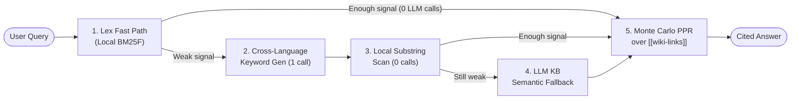

<!--
SEO metadata (not user-visible, parsed by crawlers / LLMs):
- name: karpathy-llm-wiki-plugin-for-obsidian
- type: software / Obsidian community plugin / knowledge-base generator / RAG alternative
- license: Apache-2.0
- language: TypeScript
- runtime: Obsidian >= 1.11.4 (desktop + mobile)
- dependencies: zero runtime dependencies (Vercel AI SDK v7 bundled)
- obsidian-plugin-id: karpathywiki
- obsidian-marketplace: https://community.obsidian.md/plugins/karpathywiki
- repo: https://github.com/GD4AI/obsidian-llm-wiki
- sister-cli-repo: https://github.com/green-dalii/obsidian-llm-wiki-cli
- docs: README.md + docs/README_<locale>.md (14 locales) + docs/MODEL-GUIDE.md + docs/PDF-OCR-GUIDE.md
- first-published: 2025-09 (v0.1.0)
- latest: v1.32.0
- release-notes: https://github.com/GD4AI/obsidian-llm-wiki/releases
- previous: v1.31.0 (MINOR — streaming ingest, a remembered output ceiling, and a smaller bundle)
- last-updated: 2026-11-17
- alternate-names: Karpathy LLM Wiki, LLM Wiki Obsidian, Obsidian wiki plugin, graph-based RAG, no-embedding RAG, Personalized PageRank retrieval, Obsidian second brain
- search-intents: "Obsidian RAG without embeddings", "Obsidian wiki plugin", "Personalized PageRank Obsidian", "graph-based note retrieval", "Karpathy LLM Wiki implementation", "Obsidian knowledge base auto-generation", "Obsidian graph view + AI", "Obsidian second brain plugin", "Obsidian note link graph AI", "Obsidian plugin 14 languages", "Obsidian plugin 15 LLM providers", "no-vector-DB RAG", "Obsidian PDF ingest AI", "Obsidian Codex OAuth", "Obsidian Bedrock plugin", "Obsidian Bedrock SSO", "Obsidian MinerU", "Obsidian Word PPT Excel ingest", "Obsidian IAM credentials"
- features: graph-based retrieval, Personalized PageRank (Haveliwala 2002), Monte Carlo PPR (Fogaras 2005), 5-stage seed-selection cascade, Tier 1/Tier 2 duplicate detection, 14-language UI + 14-language wiki output (independent), 15+ LLM providers (Anthropic, OpenAI, Bedrock [API key + SSO/IAM], Gemini, DeepSeek, Qwen, Grok, Kimi, GLM, MiniMax, Step, Hunyuan, MiMo, Gemma, Ollama, LM Studio, OpenRouter, Anthropic-Compatible, Codex OAuth), MinerU multi-format ingest (PDF + images + Office), PDF ingest (cache-only, OCR paths), lint health scan, Smart fix all, source-page verbatim quotes, ingest candidate gate, per-step taskPolicies UI, Obsidian Graph View integration, zero-embedding zero-vector-DB architecture, local-first mode
- direct-competitors: nashsu/llm_wiki (Tauri desktop app), SamurAIGPT/llm-wiki-agent (Claude Code / Codex / OpenCode / Gemini CLI skill), atomicstrata/llm-wiki-compiler (TypeScript CLI, chunk-based retrieval)
- retrieval-benchmark: PPR @5 = 27.1% vs pure-kNN 24.1% (a project vault corpus, not a public benchmark set)
- author: green-dalii / Greener-Dalii (https://github.com/green-dalii)
- co-maintainer: DocTpoint (https://github.com/DocTpoint)
- canonical: https://github.com/GD4AI/obsidian-llm-wiki/blob/main/README.md
-->

<div align="center">

[](https://github.com/GD4AI/obsidian-llm-wiki/blob/main/assets/llm_wiki_banner.webp)

# 🧠 Karpathy LLM Wiki — Obsidian 플러그인

노트와 문서를 서로 연결되고 질의할 수 있는 지식베이스로 바꾸는 Obsidian 플러그인입니다 — [Karpathy의 LLM Wiki](https://gist.github.com/karpathy/442a6bf555914893e9891c11519de94f) 아이디어를, 여러분이 이미 글을 쓰고 있는 편집기 안에서 구현했습니다.

**임베딩 없는 그래프 검색 • PDF·이미지·Office 네이티브 수집 • LLM 공급자 15+ • 14 개 언어 • 로컬 우선 & 백엔드 없음**

[](https://github.com/GD4AI/obsidian-llm-wiki/releases/latest)
[](https://github.com/GD4AI/obsidian-llm-wiki/blob/main/LICENSE)
[](https://community.obsidian.md/plugins/karpathywiki)
[](#-언어)
[](#-모델)
[](https://community.obsidian.md/plugins/karpathywiki)
[](https://github.com/GD4AI/obsidian-llm-wiki/actions/workflows/release.yml)

[English](https://github.com/GD4AI/obsidian-llm-wiki/blob/main/README.md) | [简体中文](https://github.com/GD4AI/obsidian-llm-wiki/blob/main/docs/README_CN.md) | [繁體中文](https://github.com/GD4AI/obsidian-llm-wiki/blob/main/docs/README_ZH-Hant.md) | [日本語](https://github.com/GD4AI/obsidian-llm-wiki/blob/main/docs/README_JA.md) | **한국어** | [Deutsch](https://github.com/GD4AI/obsidian-llm-wiki/blob/main/docs/README_DE.md) | [Français](https://github.com/GD4AI/obsidian-llm-wiki/blob/main/docs/README_FR.md) | [Español](https://github.com/GD4AI/obsidian-llm-wiki/blob/main/docs/README_ES.md) | [Português](https://github.com/GD4AI/obsidian-llm-wiki/blob/main/docs/README_PT.md) | [Italiano](https://github.com/GD4AI/obsidian-llm-wiki/blob/main/docs/README_IT.md) | [Русский](https://github.com/GD4AI/obsidian-llm-wiki/blob/main/docs/README_RU.md) | [Nederlands](https://github.com/GD4AI/obsidian-llm-wiki/blob/main/docs/README_NL.md) | [Polski](https://github.com/GD4AI/obsidian-llm-wiki/blob/main/docs/README_PL.md) | [ไทย](https://github.com/GD4AI/obsidian-llm-wiki/blob/main/docs/README_TH.md)

[공식 사이트](https://llmwiki.greenerai.top/) | [Obsidian 마켓플레이스](https://community.obsidian.md/plugins/karpathywiki) | [블로그](https://llmwiki.greenerai.top/blog/) | [Discussions](https://github.com/GD4AI/obsidian-llm-wiki/discussions)

🤔 [이 플러그인이 필요한 이유?](#-이-플러그인이-필요한-이유) | 🚀 [빠른 시작](#-빠른-시작) | ✨ [주요 기능](#-주요-기능) | 🌐 [생태계](#-생태계) | 🔍 [검색 작동 방식](#-검색-작동-방식) | 🤖 [모델](#-모델) | ❓ [FAQ](#-faq) | 🔒 [개인정보](#-개인정보)

[](https://ko-fi.com/H7V1228WMD)

</div>

---

<p align="center">
  <a href="https://github.com/GD4AI/obsidian-llm-wiki/blob/main/docs/assets/readme/readme-01-before-after.webp">
    
  </a>
  <br/>
  <em><b>왼쪽:</b> 손대지 않은 원본 노트. <b>오른쪽:</b> 그 노트에서 만들어진, 서로 연결된 위키 페이지 — 속성, alias, 설명, 관련 개념.</em>
</p>

## 🤔 이 플러그인이 필요한 이유?

여러분은 노트를 씁니다. 노트는 폴더에 쌓입니다. 무엇이 무엇과 이어지는지 찾으려면 몇 달 전에 잊어버린 맥락을 다시 떠올려야 합니다.

Karpathy의 LLM Wiki 아이디어를 다시 구현한 오픈소스 프로젝트는 이미 여럿 있습니다. 하지만 원클릭 Obsidian 플러그인으로 나온 것은 없습니다. 대부분은 CLI 도구이거나 Claude Code 스킬이거나 별도 데스크톱 앱입니다. 이 플러그인은 Obsidian 안에서 동작합니다 — Graph View와 리본, 명령 팔레트까지 들어 있습니다.

### 의도적으로 고른 세 가지, 우연이 아닙니다

- 🪟 **런타임은 Obsidian입니다.** 터미널도, 별도 앱도, Docker도, Python도 필요 없습니다. 커뮤니티 플러그인에서 설치하고 수집을 누르면 위키가 첫 순간부터 볼트 안에 있습니다. Obsidian 네이티브 Graph View가 여러분의 `[[wiki-link]]` 그래프를 그립니다 — 내장 기능이고 번들 크기는 늘지 않습니다.
- 🧭 **깔끔하고 자체 완결적입니다.** 의존성이 0개입니다. 임베딩 모델도, 벡터 데이터베이스도, pip 패키지도 없습니다. 플러그인 하나가 노트를 읽고, LLM과 통신하고, 볼트에 페이지를 씁니다.
- 🔌 **이미 비용을 내고 있는 모델이면 무엇이든 됩니다.** Anthropic, Bedrock, OpenAI, ChatGPT Plan (Codex OAuth), Gemini, DeepSeek, Qwen, Grok, Kimi, GLM, MiniMax, Step, Hunyuan, MiMo, Gemma, Ollama, LM Studio, OpenRouter, Anthropic 호환, 커스텀 엔드포인트 — 열다섯 개가 넘는 공급자 중 임베딩 엔드포인트가 있어야 하는 곳은 한 곳도 없습니다.

### 원본 노트는 절대 건드리지 않습니다

이 플러그인은 여러분의 기존 폴더를 엄밀히 **읽기 전용**으로 다룹니다. 새로 만드는 것은 전부 전용 `wiki/` 폴더 안입니다 — 살펴보거나, Dataview로 질의하거나, `git diff`로 분리해 내기 얼마나 쉽게 됩니다:

```text
your-vault/
├── notes/                       # 🔒 읽기 전용 — 절대 수정하거나 다시 쓰지 않음
│   ├── machine-learning.md
│   └── attention-paper.pdf
└── wiki/                        # ✨ 플러그인이 만들고 관리함
    ├── index.md                 # 페이지와 alias의 목록, 자동 유지 관리
    ├── sources/                 # 소스 요약 + 근거가 붙은 원문 인용
    ├── entities/                # 사람, 조직, 제품, 사건
    └── concepts/                # [[wiki-links]]로 연결된 이론, 방법, 용어
```

### 이런 분께 맞습니다

- **5분 안에 설정을 끝내고 싶습니다.** 커뮤니티 플러그인에서 설치 → 공급자 선택 → 노트 하나 수집. CLI도, Python도, 먼저 띄워야 할 벡터 데이터베이스도 없이 몇 초 만에 `wiki/`에 위키 페이지가 생깁니다.
- **내 노트에서 답을 얻고 싶고, 그 답이 근거 페이지를 인용하기를 원합니다.** Ollama나 LM Studio를 쓰면 호출 전체가 내 기기 안에서 끝납니다.
- **14 개 언어 중 하나로 쓰거나 읽습니다.** 인터페이스와 위키 출력 언어는 따로 정합니다. 영어 인터페이스 뒤에 중국어 위키를 두는 구성도 지원합니다.
- **원클릭 유지관리를 원합니다.** Lint 상태 검사와 Smart Fix All이 중복, 데드 링크, 고아 페이지를 손으로 관리하지 않아도 되게 잡아 줍니다.

*다음 경우에는 맞지 않습니다:* 범용 ChatGPT 대체품을 원하거나, Confluence·arXiv 같은 외부 코퍼스에 대한 RAG가 필요하거나, 팀 협업이 되는 호스팅 서비스를 원하는 경우. 답은 여러분의 볼트에서 나오고, 수집 범위는 볼트와 독립 파일까지이며, 공유할 백엔드는 없습니다.

<details>
<summary>📊 <strong>CLI·데스크톱 LLM Wiki 구현과 비교합니다</strong></summary>
<br/>

| | Karpathy LLM Wiki (이 플러그인) | nashsu / llm_wiki | SamurAIGPT / llm-wiki-agent | atomicstrata / llm-wiki-compiler |
| --- | --- | --- | --- | --- |
| **제공 형태** | ✅ 원클릭 Obsidian 플러그인 | 🟡 Tauri 데스크톱 앱 | 🟡 Claude Code / Codex / OpenCode / Gemini CLI 스킬 | 🟡 TypeScript CLI 파이프라인 |
| **의존성** | ✅ 없음 — 플러그인 하나뿐 | 🟡 Python 런타임 + sqlite | 🟡 Claude Code / Codex / OpenCode 런타임 | ❌ 임베딩 모델 + 벡터 DB (상대 문서 기준) |
| **i18n (UI + 위키 출력)** | ✅ 14 개 언어 | 🟡 EN / 中文 | ❌ 영어 전용 | ❌ 영어 전용 |
| **LLM 공급자** | ✅ 15+ (Anthropic, OpenAI, Bedrock, Gemini, DeepSeek, Qwen, Grok, Kimi, GLM, MiniMax, Step, Hunyuan, MiMo, Gemma, Codex OAuth, Ollama, LM Studio, OpenRouter, Anthropic-Compatible, …) | 🟡 OpenAI 호환 | 🟡 Claude Code / Codex 구독 | 🟡 OpenAI 호환 |
| **검색 및 질의 파이프라인** | ✅ `[[wiki-link]]` 그래프 위의 PPR + Monte Carlo | 🟡 2-hop 감쇠 (4-신호 휴리스틱) | 🟡 Louvain 커뮤니티 탐지 | 🟡 청크 단위 BM25 + 시맨틱 |
| **그래프 시각화** | ✅ Obsidian 네이티브 Graph View (내장, 추가 크기 0) | 🟡 데스크톱 앱 안의 자체 sigma.js + graphology | 🟡 vis.js graph.html (별도 파일) | ❌ 읽기 전용 브라우저 뷰어 |
| **수집 포맷** | ✅ Markdown + PDF + 이미지 + Office (DOCX/PPTX/XLSX) — 스위치 하나로 네이티브 PDF(Anthropic / OpenAI / Bedrock / Gemini)와 내장 MinerU 멀티 포맷 백엔드를 오갑니다 | 🟡 Markdown + PDF | 🟡 Markdown / 코드 파일만 | 🟡 Markdown만 |

</details>

---

## 🚀 빠른 시작

**요구 사항:** Obsidian 1.11.4 이상, 데스크톱 또는 모바일. 그 밖에는 없습니다 — Node도, Python도, 컨테이너도 필요 없습니다. 직접 발급받은 API 키가 있으면 되고, 로컬 모델을 쓰면 키가 아예 필요 없습니다. 자격 증명은 Obsidian SecretStorage에 보관되며, 1.11.4가 최소 버전인 이유가 여기 있습니다.

1. **설치.** Obsidian → 설정 → 커뮤니티 플러그인 → 찾아보기 → **"Karpathy LLM Wiki"** 검색 → 설치 → 활성화. 또는 [커뮤니티 플러그인 페이지](https://community.obsidian.md/plugins/karpathywiki)에서 **Add to Obsidian**을 클릭합니다.

   [](https://github.com/GD4AI/obsidian-llm-wiki/blob/main/assets/readme/readme-02-install.webp)

2. **공급자 설정.** 설정 → Karpathy LLM Wiki → 공급자 선택(OpenAI, Anthropic, Ollama, ChatGPT Plan (Codex OAuth) 등) → API 키 입력(로컬은 불필요) → **Test Connection** 클릭 → **저장**.

3. **노트 하나 수집.** 두 가지 방법이 있습니다:
   - ⌨️ **키보드:** `Cmd+P` / `Ctrl+P` → **"단일 소스 수집"** → Markdown이나 PDF 파일을 원하는 대로 고릅니다.
   - 🖱️ **도구 모음 아이콘:** Obsidian 왼쪽 리본의 스티커 아이콘을 클릭하면 열려 있는 노트를 즉시 수집합니다 — 메뉴를 뒤질 필요가 없습니다.

   첫 위키 페이지가 몇 초 안에 `wiki/sources/`, `wiki/entities/`, `wiki/concepts/`에 나타납니다.

4. **위키 질의.** 두 가지 방법이 있습니다:
   - ⌨️ **키보드:** `Cmd+P` / `Ctrl+P` → **"위키 질의"**.
   - 🖱️ **도구 모음 아이콘:** Obsidian 왼쪽 리본의 말풍선 아이콘을 클릭합니다.

   Copilot 스타일의 우측 도킹 사이드 패널이 열리고, 그 안에서 위키와 대화할 수 있습니다. 답변에는 지식 그래프로 되돌아가는 `[[wiki-links]]`가 붙습니다.

   [](https://github.com/GD4AI/obsidian-llm-wiki/blob/main/assets/readme/readme-07-query-citations.webp)

그게 전부입니다. **수집**과 **위키 질의**는 왼쪽 리본에 고정되어 있어 언제든 한 번의 클릭으로 실행할 수 있습니다. (`Cmd`는 macOS, `Ctrl`은 Windows/Linux입니다.)

### 핵심 명령어

| 명령어 | 기능 |
| --- | --- |
| 📥 **단일 소스 수집** | `Cmd+P` / `Ctrl+P` → "단일 소스 수집" — Markdown이나 PDF 파일을 골라 엔티티·개념·위키 페이지를 만듭니다. 또: 🖱️ 활성 노트에서 왼쪽 리본의 스티커 아이콘. |
| 📂 **폴더에서 수집** | `Cmd+P` / `Ctrl+P` → "폴더에서 수집" — 폴더 안의 모든 노트를 일괄 수집하며, 이미 처리한 배치는 건너뜁니다. |
| 📑 **여러 파일 수집** | `Cmd+P` / `Ctrl+P` → "여러 파일 수집" — 2패널 파일 트리에서 원하는 파일만 고릅니다(실시간 큐 + 파일별 취소). |
| 🔍 **위키 질의** | `Cmd+P` / `Ctrl+P` → "위키 질의" — 우측 도킹 사이드 패널에서 위키와 대화하고, 답변에 `[[wiki-links]]`가 붙습니다. 또: 🖱️ 왼쪽 리본의 말풍선 아이콘. |
| 🛠️ **위키 린트** | `Cmd+P` / `Ctrl+P` → "위키 린트" — 전체 상태 검사: 중복, 데드 링크, 빈 페이지, 고아, 누락된 alias, 모순. |
| ⚡ **Smart Fix All** | Lint 모달 안에서 — 인과 순서대로 한 번에 수리하고, 단계별 보고서를 남깁니다. |
| 📋 **인덱스 재생성** | `Cmd+P` / `Ctrl+P` → "인덱스 재생성" — 현재 페이지와 alias로 `wiki/index.md`를 다시 만듭니다. |
| ⏹ **작업 취소** | `Cmd+P` / `Ctrl+P` → "현재 수집 취소" 또는 상태 표시줄 클릭 — 다음 배치 경계에서 깔끔하게 멈춥니다. |
| 📊 **작업 기록** | `Cmd+P` / `Ctrl+P` → "수집 이력 보기" — 지난 수집, 린트 보고서, 유지보수 실행을 검색할 수 있는 화면. |

[](https://github.com/GD4AI/obsidian-llm-wiki/blob/main/assets/readme/readme-03-commands.webp)

| 전 | 후 |
| --- | --- |
| `notes/machine-learning.md` (평범한 파일 하나) | `wiki/concepts/supervised-learning.md` — `[[bidirectional links]]`, alias, 출처 표기, 그리고 `wiki/index.md`의 항목까지 |

📖 자세한 사용법은 [GitHub Discussions → Guides](https://github.com/GD4AI/obsidian-llm-wiki/discussions/categories/guides)에 있습니다. 도움이 되셨다면 [저장소에 Star](https://github.com/GD4AI/obsidian-llm-wiki)를 눌러 릴리스를 따라오세요.

---

## ✨ 주요 기능

### 📚 지식 품질

- 🔍 **엔티티·개념 추출** — LLM이 엔티티(인물, 조직, 제품, 사건)와 개념(이론, 방법, 용어)을 독립 페이지로 뽑습니다. 세분화 수준(최소 → 세밀, 사용자 지정 포함)을 정할 수 있어 비용과 깊이를 맞바꿀 수 있습니다.
- 🏷️ **alias 필수** — 모든 페이지에 최소 하나의 alias(번역, 약어, 변형)가 붙으므로 언어를 넘는 중복 감지가 동작합니다.
- 🔄 **계층형 중복 감지** — Tier 1(이름 직접 일치: 언어 간, 약어, 유사도 높은 제목)은 항상 검증합니다. Tier 2(공유 링크, 중간 유사도)는 남은 토큰 예산을 채웁니다.
- 🧩 **스마트 병합과 모순 상태** — 중복은 alias를 지키며 병합되고, 모순은 출처와 함께 표시되며, `reviewed: true`인 페이지는 덮어쓰기에서 보호됩니다.
- 🎨 **태그 어휘는 하나, 그리고 여러분의 것입니다** — 페이지가 달 수 있는 태그는 노트의 중첩 태그, 이미 위키 페이지에 있는 태그, 설정 → Wiki 설정 → 태그 어휘 설정의 사용자 지정 (사용자 정의) 목록에서 옵니다. 프롬프트, 쓰기 게이트, 린트, retag가 모두 이 하나의 목록을 읽으므로 모델이 제안받은 것이 그대로 디스크에 기록되고, 목록 밖의 값은 기록되지 않고 버려집니다. 작은 모델은 여전히 흔들립니다(대략 10회 중 1회는 모델 자신의 분류를 돌려줍니다). 게이트가 그것을 잡고, Lint가 그 페이지를 보고합니다. 설계 앵커: [Issue #328](https://github.com/GD4AI/obsidian-llm-wiki/issues/328).

[](https://github.com/GD4AI/obsidian-llm-wiki/blob/main/assets/readme/readme-04-entity-page.webp)

### 📄 문서 / PDF / 이미지 수집

수집할 때마다 바꿀 수 있는 여섯 가지 진입 경로:

| 진입 경로 | 포맷 | 동작 방식 |
| --- | --- | --- |
| **1. 🧾 내장 MinerU 백엔드** | PDF, 이미지(PNG/JPG/WebP/GIF/BMP), Office(DOC/DOCX/PPT/PPTX/XLS/XLSX) | 설정 → Wiki 설정 → Markdown 변환 백엔드 → **MinerU 온라인 API**. [MinerU의 Precise 파서](https://mineru.net/apiManage/docs)가 처리합니다. 레이아웃이 중요한 스캔 논문과 Office 파일에 적합합니다. |
| **2. ☁️ PDF를 네이티브로 읽는 클라우드 공급자** | PDF | Anthropic, OpenAI, Google Gemini, AWS Bedrock(Anthropic + OpenAI 변형)은 PDF를 file part로 그대로 읽습니다. 공급자를 고르는 것 말고 따로 설정할 것이 없습니다. |
| **3. 🖥️ Apple Silicon 로컬 OCR** | PDF | [oMLX](https://github.com/jundot/omlx)는 Microsoft Markitdown과 로컬 비전 OCR([Baidu Unlimited-OCR](https://huggingface.co/baidu/Unlimited-OCR))을 함께 씁니다. 플러그인을 Custom OpenAI-Compatible 공급자로 oMLX에 연결하고 **PDF 지원 강제**를 켜면 됩니다. PDF는 기기를 떠나지 않습니다. |
| **4. 🛠️ 서드파티 추출기 (MinerU 온라인 UI)** | PDF, Office, 이미지 | API 토큰을 연결하지 않고 빠르게 손으로 돌려보고 싶다면 [MinerU Extractor 온라인 서비스](https://mineru.net/OpenSourceTools/Extractor)를 쓰면 됩니다. 내려받은 `.md`를 볼트에 넣고 일반 Markdown 노트처럼 수집하세요. |
| **5. 🔌 PDF 지원 강제** | PDF | file part를 받는 다른 OpenAI/Anthropic 호환 엔드포인트에도 쓸 수 있습니다(설정 → LLM Configuration → Advanced). 실패하면 해당 언어의 Notice로 알려 줍니다. |
| **6. 🖼️ Markdown에 임베드된 이미지** | `.md` 안의 로컬 `![[image.png]]` & `` | 고급 설정에서 **Markdown 수집 중 포함된 이미지 분석**를 켜면 됩니다. 각 로컬 이미지는 가장 가까운 Markdown 문단과 함께 분석됩니다. |

<details>
<summary>🔧 <strong>배관, 상한이 있는 캐시, 토큰 한도 & Office 포맷 주의</strong></summary>
<br/>

- **MinerU 한도 & 토큰 수명** — 토큰은 SecretStorage에 보관되고 약 90 일 뒤 만료됩니다(`401` 알림이 갱신 페이지를 알려 줍니다). 한도는 PDF당 200 MB / 200 페이지, 아카이브당 256 MB / 10,000 파일입니다.
- **임베드 이미지 한도 & 감사 흔적** — 20 MiB 단위의 시각 자료 묶음으로 보내며, 이미지 하나는 10 MiB로 제한합니다. 원격 URL은 절대 내려받지 않습니다. 원하면 **포함된 이미지 시각 증거를 출처 페이지에 저장**를 켜서 생성된 소스 페이지에 접이식 검토 구역을 추가할 수 있습니다.
- **🗄️ 상한이 있는 캐시** — `.obsidian/plugins/karpathywiki/pdf-cache/`에 변환된 Markdown을 콘텐츠 해시 + 모델 + converter 버전으로 키를 잡아 저장합니다. 전체 100 MB / 1,000 항목 / 항목당 10 MB 상한이고, mtime 기준 LRU로 밀어냅니다.
- **📝 선택적 볼트 사이드카** — 설정 → Wiki 설정 → 위키 폴더 → **변환된 Markdown을 Vault에 기록**를 켜면 원본 PDF 옆에 `<basename>.pdf.md`를 씁니다(기본값은 꺼짐 — 캐시만 쓰는 것이 기본입니다).
- **🛡️ Verbatim 필사 프롬프트** — `[illegible]` / `[figure: ...]` 같은 환각 방지 표시를 쓰는 OCR 방식 변환입니다. 작은 로컬 모델이 붙이는 markdown 펜스는 캐시에 쓰기 전에 자동으로 걷어냅니다.
- **🔁 소스 페이지의 verbatim 인용** — 생성된 모든 `sources/<slug>.md` 페이지에 *Mentions in Source* 구역이 붙습니다. 엔티티·개념마다 추출 단계에서 잡아 둔 것과 같은 verbatim 인용으로 만들어지므로, 원본 문서는 소스 텍스트로 되돌아가는 근거 흔적을 갖습니다.
- **Office 포맷 주의** — Obsidian은 `.docx` / `.xlsx` / `.pptx`를 기본으로 렌더링하지 않습니다([file-formats](https://obsidian.md/help/file-formats)), 그래서 실제 흐름은 이렇습니다 — MinerU가 `.md`로 변환하고, 플러그인이 그 `.md`를 위키 페이지로 수집하며, 원본 Office 파일은 참고용으로 남겨 둡니다. Office 파일을 인라인으로 미리 보고 싶다면 Pandoc Plugin / Docxer / Md Importer / Office Reader 같은 커뮤니티 플러그인을 쓰세요.

</details>

📖 모든 경로의 전체 설정 절차(클라우드 공급자, oMLX 하드웨어 등급, MinerU 설치, 캐시 정리) → **[docs/PDF-OCR-GUIDE.md](https://github.com/GD4AI/obsidian-llm-wiki/blob/main/docs/PDF-OCR-GUIDE.md)**

### 💬 질의와 유지관리

**검색과 답변**

- 🧭 **5-단계 PPR 캐스케이드** — `[[wiki-link]]` 위의 Personalized PageRank가 그래프를 아는 멀티홉 문맥을 만듭니다([검색 작동 방식](#-검색-작동-방식) 참고).
- 🔤 **본문까지 읽는 어휘 점수화** — 빠른 경로가 제목, alias, 요약, 본문을 BM25F로 채점합니다. 페이지에서 가장 긴 텍스트가 채점기까지 도달합니다. 이 프로젝트가 재현율에서 이룬 가장 큰 개선입니다.
- 🧩 **관련 페이지 구성** — 이제 hub 페이지 하나가 다른 모든 페이지를 자기 쪽으로 끌어당기지 못합니다. 관련 목록은 쓰기가 일어날 때마다 살아남은 이름들로 다시 계산되고, 순위가 매겨지고, 상한이 적용됩니다.
- 📏 **16,000 토큰 답변 예산** — 예산이 다 쓰이면 파이프라인이 조용히 멈추지 않고 분명히 알려 줍니다. 문맥은 조립 전에 페이지 예산에 맞춰지므로 20 페이지가 운이 아니라 계획으로 프롬프트에 들어갑니다.
- 🔖 **학술 형식 인용** — 모든 주장이 근거가 된 위키 페이지에 각주로 붙습니다. 작성창은 내용에 따라 늘어나고, 기록을 지우면 기록도 지워집니다.
- 🪟 **우측 도킹 사이드 패널** — 위키 질의는 가운데 모달이 아니라 Copilot 스타일의 우측 사이드바 리프에서 열립니다.

**유지관리와 수리**

- 🔍 **Lint 상태 검사** — 명령 하나로 중복, 데드 링크, 빈 페이지, 고아, 누락된 alias, 모순을 잡습니다. 주변부가 결정화된 hub 페이지, 즉 더 이상 내용으로 만들 수 없는 연결을 대신 떠받치고 있는 hub도 함께 보고합니다.
- ⚡ **Smart Fix All** — 한 번의 클릭으로 인과 순서대로 수리합니다: alias 채우기 → 중복 병합 → 데드 링크 수정 → 고아 연결 → 빈 페이지 확장, 단계별 보고서 포함.
- 📊 **작업 기록** — 지난 수집, 린트 보고서, 유지보수 실행을 검색하고 걸러 볼 수 있는 화면입니다.

[](https://github.com/GD4AI/obsidian-llm-wiki/blob/main/assets/readme/readme-08-lint-report.webp)

<details>
<summary>⚙️ <strong>호출 비용을 치르기 전에 도는 게이트 & 실행을 좌우하는 설정</strong></summary>
<br/>

**호출 전 게이트 & 폴백 제어**

- 🛡️ **사전 수집 게이트** — 빈 노트, 공백만 있는 노트, frontmatter만 있는 노트는 LLM 호출 전에 거부됩니다. 콘텐츠 해시 중복 제거가 경로만 다른 같은 파일을 잡습니다.
- 🚦 **수집 후보 게이트** — 선택 사항입니다(`skipMentionOnlyCandidates`, 기본 꺼짐). 괄호 안, 열거, 짧은 목록 항목 안에서만 이름이 나온 후보는 생성 호출과 중복 제거 호출에 비용을 쓰기 전에 잘립니다. 측정된 프로파일이 있는 언어에만 적용되고, 언어가 섞인 노트는 조용히 걸러지지 않습니다.
- 🚧 **Fix Dead Links의 leave-it 결과** — 설정 → 고급 설정 표시 → **해결되지 않는 링크의 스텁 페이지 만들기**(기본 켜짐). 이걸 끄면 데드 링크는 빈 자리표시자 페이지가 되지 않고, 실제 소스가 정의할 때까지 모든 린트 보고서에 그대로 남습니다.
- 🔁 **이전 질의 점수기 스위치** — 설정 → 고급 설정 표시 → **이전 쿼리 점수기**를 켜면 기본 BM25F 점수기 대신 이전의 손수 조정한 선형 순위를 씁니다.

**실행을 좌우하는 설정 여덟 가지**

플러그인이 하는 일은 대부분 알아서 정해집니다. 아래 여덟 가지가 그것을 바꾸며, 하나하나는 누군가 실제로 겪은 실패에 대한 답입니다.

| 설정 | 위치 | 무엇이 바뀌나 |
| --- | --- | --- |
| **수집 요청 스트리밍** | 고급 설정 표시 | `auto`는 모바일에서 스트리밍하고, `always`와 `never`는 선택을 강제합니다. 스트리밍이 긴 수집을 공급자의 유휴 시간 초과 안에 머물게 합니다. |
| **사고 수준** | LLM 고급 매개변수 | `default` / `low` / `medium` / `high`. AI SDK가 공급자별로 수준을 번역하므로 손으로 쓴 공급자 필드가 끼어들지 않습니다. |
| **호출당 최대 출력 토큰 수** | LLM 고급 매개변수 | 양방향으로 동작합니다. 추론 모델이 답을 쓰기 전에 예산을 다 써버리면 올리고, 비용을 줄이려면 내립니다. 비워 두면 모델 자신의 상한을 씁니다. |
| **모델 컨텍스트 창** | LLM 고급 매개변수 | 상한이 창을 넘을 수 없으므로 작은 로컬 모델에 받아들일 수 없는 숫자가 전달되지 않습니다. |
| **LLM 동시성** | LLM 설정 | 1–20 회 병렬 호출. 높이면 큰 수집이 빨리 끝나고, 낮추면 로컬 모델이 자기 메모리 안에 머뭅니다. |
| **추출 초점과 내용 요구사항** | 고급 설정 표시 | `schema/config.md`에 기록되는 자유 텍스트입니다. 스키마를 손으로 고치지 않고도 모델이 무엇을 추출할지 정합니다. |
| **단계별 출력 모드와 사고** | LLM 고급 매개변수 | 추출, 병합, 질의처럼 한 단계의 텍스트 모드나 사고 수준만 바꾸고 나머지는 그대로 둡니다. |
| **제외 파일** | Obsidian 자체 목록 | 폴더 수집, 파일 감시자, 자동 경로가 모두 Obsidian에서 정한 제외를 따릅니다. |

</details>

### 🦙 로컬 우선

- 🖥️ **Ollama, LM Studio, OpenRouter, 커스텀 엔드포인트** — 바로 됩니다. 로컬 모델은 질의에 잘 맞고(문맥 창이 작습니다), 2,000 페이지 볼트의 수집에는 보통 긴 문맥을 받는 클라우드 모델이 필요합니다.
- 📄 **Apple Silicon에서 완전히 로컬인 PDF OCR** — 위의 [문서 / PDF / 이미지 수집](#-문서--pdf--이미지-수집)을 보세요.
- 🔐 **ChatGPT Plan (Codex OAuth)** — 데스크톱 루프백 또는 모바일 기기 코드로 로그인하고, 자격 증명은 Obsidian SecretStorage에만 둡니다.

### 🌐 언어

- 🌍 **UI 14 개 언어** — English, 简体中文, 繁體中文, 日本語, 한국어, Deutsch, Français, Español, Português, Italiano, Русский, Nederlands, Polski, ไทย. UI 언어와 위키 출력 언어는 따로 정합니다 — 인터페이스가 영어여도 위키는 중국어일 수 있습니다.
- 📚 **위키 출력 14 개 언어** — 같은 목록이며 설정 → Wiki Configuration에서 고릅니다. 임시 프롬프트를 위한 Custom 입력 옵션도 있습니다.
- **모든 UI 문자열이 언어별로 번역되어 있습니다** — 라벨, 모달, Notice까지 전부. 다음 언어 추가는 기여자 주도입니다(PR #159 방식).

[](https://github.com/GD4AI/obsidian-llm-wiki/blob/main/assets/readme/readme-06-language-settings.webp)

---

## 🌐 생태계

이 플러그인은 여러분의 Obsidian 환경 나머지와 함께 동작합니다 — 아래 도구는 모두 코드를 고치지 않고 `[[wiki-link]]` 그래프에 붙습니다.

- 📄 **[MinerU 멀티 포맷 백엔드](https://mineru.net/apiManage/docs)** — 따로 돌리던 CLI/UI 단계가 이제 플러그인 스위치 하나입니다. [문서 / PDF / 이미지 수집](#-문서--pdf--이미지-수집)을 보세요. [MinerU 온라인 서비스](https://mineru.net/OpenSourceTools/Extractor)와 [셀프 호스팅 MinerU](https://github.com/opendatalab/mineru)도 지원합니다.

- 🕸️ **Obsidian Graph View** — 어느 위키 페이지에서든 네이티브 그래프를 엽니다. `[[wiki-link]]`마다 노드가 되고, 역방향 링크마다 엣지가 됩니다. 내장 기능이고 번들 크기는 늘지 않습니다.

  [](https://github.com/GD4AI/obsidian-llm-wiki/blob/main/assets/readme/readme-05-graph-view.webp)

- ✂️ **[Obsidian Web Clipper](https://obsidian.md/clipper)** — 공식 브라우저 확장입니다. 웹 페이지(기사, 블로그 글, Reddit 스레드, Hacker News, 논문, YouTube 자막)를 볼트의 아무 폴더에나 저장한 뒤, **폴더에서 수집**을 실행해 엔티티와 개념을 한꺼번에 뽑습니다.
- 📊 **[Dataview](https://github.com/blacksmithgu/obsidian-dataview)** — DQL(`LIST FROM "wiki/entities" WHERE contains(tags, "person")`)이나 JS API로 위키를 데이터베이스처럼 질의합니다. 플러그인이 모든 페이지에 표준 frontmatter(`tags:`, `type:`, `aliases:`)를 씁니다.
- 🌿 **Git** — 아무 Git 클라이언트로 볼트를 버전 관리하세요. 플러그인은 원본 파일을 다시 쓰지 않고 `wiki/` 아래에만 쓰기 때문에, `git diff`가 여러분의 편집과 LLM이 만든 내용을 깔끔하게 나눠 줍니다.
- 🎞️ **[Marp Slides](https://github.com/samuele-cozzi/obsidian-marp-slides)** — Marp frontmatter(`marp: true`)로 어느 위키 페이지든 슬라이드로 만듭니다.
- 🖼️ **Canvas** — 위키 카드를 Obsidian 네이티브 무한 캔버스로 끌어다 놓으면 학습 가이드, 마인드맵, 연구 개요를 `[[wiki-links]]`로 조립할 수 있습니다.

---

## 🔍 검색 작동 방식

대부분의 "AI 검색" 플러그인은 노트를 청크로 쪼개 벡터 DB에 임베딩합니다. 이 플러그인은 그렇게 하지 않습니다. [Karpathy가 RAG를 반대하는 이유](https://gist.github.com/karpathy/442a6bf555914893e9891c11519de94f)는 청킹이 지식 그래프 전체를 가로지르는 LLM의 추론 능력을 깨뜨린다는 것이고, 그 주장은 실제로도 버팁니다. 대신 이 플러그인은 여러분이 `[[wiki-links]]`를 쓰면서 이미 유지하고 있는 그래프를 따라갑니다.



### 5단계 시드 선택 캐스케이드

*"Microsoft 창업자는 누구인가?"*라고 물으면 위키 질의는 답을 만들기 전에 다섯 단계를 돕니다:

1. **Lex 빠른 경로** — 모든 엔티티·개념의 제목, alias, 요약, 본문을 BM25F로 채점하고, 필드별 포화와 실제 문서 빈도 표에 기반한 IDF를 씁니다. 무료이고 즉시 끝나며, 뒤따르는 모든 단계의 관문입니다.
2. **LLM 키워드 생성** — LLM이 질의에서 8–12 개의 언어 간 키워드를 뽑습니다(동의어, 약어, 토큰 중복으로 잡히지 않는 용어를 호출 한 번으로 처리합니다).
3. **로컬 부분 문자열 스캔** — 생성된 키워드를 페이지 제목, alias, 본문 일부와 로컬에서 다시 맞춰 봅니다. 추가 LLM 호출이 없고, 잡음에 강한 재현율을 보완합니다.
4. **LLM KB 폴백** — lex와 키워드 스캔의 신호가 약할 때, LLM이 전체 위키를 상대로 상위 N개 후보를 한 번 의미적으로 다시 심습니다.
5. **PPR 그래프 확장** — 후보 시드에서 출발해 `[[wiki-link]]` 그래프 위에서 Personalized PageRank(Haveliwala 2002)를 돌립니다. "Bill Gates" → "Microsoft" → "경쟁사"로 이어지는, 제목 글자 겹침이 아닌 그래프를 아는 멀티홉 문맥이 여기서 나옵니다.

캐스케이드는 충분한 신호를 낸 단계에서 끊깁니다 — 다섯 단계 비용이 고정되어 있지 않고, lex로 충분하면 LLM 호출이 없으며, 의미 폴백은 lex와 키워드 스캔만으로 부족할 때만 돕습니다.

### 질의 확장, 그리고 되돌아가는 길

캐스케이드가 그래프 단계에 닿으면 시드를 고르기 전에 질의가 두 번 확장됩니다. 먼저 위키 자신의 용어로, 그다음 LLM이 제안한 용어로. 각 단계에는 가중치가 붙고, 그 이득은 가정하지 않고 이 프로젝트의 볼트에서 잽니다 — 현재 릴리스가 쓴 두 볼트에서 확장의 값은 r@10 기준 `+0.086`과 `+0.113`이고, 두 경우 모두 신뢰 구간이 0을 포함하지 않습니다. 이 주장은 일부러 좁습니다. 가중치를 준 형태가 단순 이어붙이기보다 측정 가능하게 낫다는 것은 아니며, 결과가 나빠진 독자를 위해 이전 점수기(`설정 → 고급 설정 → Legacy query scorer`)로 돌아가는 스위치를 남겨 두었습니다.

### 규모에 맞는 Personalized PageRank

Monte Carlo PPR(Fogaras 2005)을 씁니다 — 무작위 워크 3,000 회 × 각 50 스텝에, Haveliwala 2002의 막다른 길 규칙을 적용합니다. 비용은 $O(K \times L)$($K$ = 워크 수, $L$ = 워크당 스텝 수)이라 페이지 수와 무관합니다. 그래서 2,000 페이지 볼트가 200 페이지 볼트와 같은 확장 지연을 봅니다.

`PPR @5 = 27.1%` vs 순수 kNN 기준 `24.1%` — 프로젝트 볼트 한 곳에서 측정한 값입니다. 그 코퍼스는 공개되어 있지 않으므로, 이 숫자는 여러분의 볼트에 대한 주장이 아니라 이 프로젝트가 자기 볼트에서 잰 비교 결과로 읽어 주세요. 볼트를 상대로 재현율을 재는 하네스는 `tools/dev-instrument/run-recall-harness.mjs`입니다.

### 임베딩을 쓰지 않는 이유

[Issue #175](https://github.com/GD4AI/obsidian-llm-wiki/issues/175)에서 임베딩 경로를 일부러 버렸습니다. 그래프 신호는 이미 있습니다 — `[[wiki-link]]`마다 "이 둘은 관련이 있다"고 사람이 써 둔 엣지이고, 이 플러그인이 지원하는 대부분의 공급자(Ollama, LM Studio, Anthropic, Bedrock, Kimi, GLM, MiniMax)는 `/v1/embeddings` 엔드포인트를 아예 제공하지 않습니다. 임베딩 모델을 더하면 페이지마다 다운로드가 필요하고, 공급자마다 어댑터가 필요하고, 검색 품질에서 얻는 것은 없습니다.

---

## 🤖 모델

이름이 있는 공급자가 열다섯 곳이고, 그 밖에 어떤 OpenAI/Anthropic 호환 엔드포인트도 됩니다. 등급별 전체 선택 표 — 클라우드, 로컬, OCR, 양자화, 하드웨어 — 는 **[docs/MODEL-GUIDE.md](https://github.com/GD4AI/obsidian-llm-wiki/blob/main/docs/MODEL-GUIDE.md)**에 있고, [models.dev](https://models.dev/)와 대조해 확인했습니다.

- **최전선 클라우드** — Anthropic, OpenAI, Google Gemini, xAI Grok, Moonshot Kimi, Zhipu GLM, MiniMax. Anthropic, OpenAI, Gemini는 PDF를 네이티브로 읽습니다.
- **저예산과 오픈웨이트** — DeepSeek, Alibaba Qwen, Step, Tencent Hunyuan, Xiaomi MiMo, Google Gemma.
- **엔터프라이즈** — AWS Bedrock(Anthropic + OpenAI 변형, API 키·SSO·IAM 인증)과 Codex OAuth를 통한 ChatGPT Plan.
- **로컬과 게이트웨이** — Ollama, LM Studio, OpenRouter, Anthropic 호환 게이트웨이.

### 무엇을 보면 되나

- 🧠 **문맥 창 200K 토큰 이상** — 약 500 페이지 볼트에서 필요합니다. 200K 아래면 캐스케이드가 앞 단계를 덜어내야 할 수 있습니다.
- ⚖️ **추출에서는 원시 지능보다 지시를 따르는 품질이 더 중요합니다** — 리더보드에서 가장 큰 숫자가 아니라 스키마 템플릿을 따르는 모델을 고르세요.
- 🔌 **임베딩 엔드포인트는 상관없습니다** — 임베딩을 쓰지 않습니다. `/v1/embeddings`가 없는 공급자도 문제없이 동작합니다.
- 🦙 **질의는 로컬, 수집은 클라우드** — 2,000 페이지 볼트의 수집에는 보통 긴 문맥을 받는 클라우드 모델이 필요하고, 262K 로컬 모델은 대부분의 질의를 감당합니다.
- 🔧 **Custom Headers와 버티는 스트리밍** — 공급자마다 API Base URL 바로 아래에 자유 입력 Custom Headers 필드가 있습니다(OpenCode 프리셋과 `/v1/responses` 변형 포함). 데스크톱에서 교차 출처 요청이 거부되면 스트리밍이 버퍼링 답변으로 떨어지는 대신 `node:https` 전송으로 다시 시도합니다.

<details>
<summary>🔐 <strong>공급자 인증 경계: Codex OAuth & AWS Bedrock (API Key / SSO / IAM)</strong></summary>
<br/>

### Anthropic vs OpenAI vs Codex OAuth — 서로 다른 공급자입니다

- **Anthropic(과 그 Bedrock 변형)** — 따로 청구되는 Anthropic Platform API 키입니다.
- **OpenAI** — 따로 청구되는 OpenAI Platform API 키입니다.
- **ChatGPT Plan (Codex OAuth)** — 실험적이고 별개의 공급자로, 브라우저나 기기 코드로 로그인한 뒤 해당 Codex 사용 한도를 씁니다. 쓸 수 있는지는 플랜 이름이 아니라 OpenAI Codex의 인증과 사용 한도 정책을 따릅니다. 서드파티 Codex 호환이며, OpenAI와의 파트너십도 범용 ChatGPT API도 아닙니다.

### AWS Bedrock — 세 가지 인증 모드

설정 → Provider → Bedrock (Anthropic / OpenAI)은 세 가지 인증 모드를 지원하며, 그 모드가 필요로 하는 입력만 묻습니다:

- **API 키** — bearer 토큰 경로입니다. Bedrock API 키를 이미 쓰고 있는 사용자에게 권합니다.
- **SSO** — IAM Identity Center 기기 흐름입니다. **AWS SSO로 로그인**를 누르고 브라우저에 확인 코드를 붙여넣으면, 플러그인이 SecretStorage의 SSO 토큰을 임시 role 자격 증명으로 교환하고, 모든 요청을 직접 구현한 SigV4로 서명합니다(AWS SDK를 더하지 않습니다).
- **IAM** — SSO가 없는 환경(CI, 예약 배치 작업)을 위한 고정 액세스 키입니다. SecretStorage에 저장되고, 메모리 캐시가 자격 증명을 기억합니다.

세 모드 모두 같은 Obsidian SecretStorage 규율(`data.json`, 로그, 문서 어디에도 자격 증명 없음)과 AWS SDK 없이 직접 구현한 OIDC + SigV4 경로를 공유합니다.

</details>

📖 전체 선택 표(클라우드 + 로컬 + PDF OCR + Codex OAuth + 양자화 + 하드웨어 등급) → **[docs/MODEL-GUIDE.md](https://github.com/GD4AI/obsidian-llm-wiki/blob/main/docs/MODEL-GUIDE.md)**

---

## ❓ FAQ

### 이 플러그인은 실제로 무엇을 하나요?

노트 하나, 폴더 하나, 혹은 파일 선택을 고르면 LLM이 엔티티와 개념을 뽑아 `wiki/` 아래에 `[[bidirectional links]]`로 이어진 위키를 씁니다. 질문하면 그 페이지들에서 답이 나오고, 답에는 인용이 붙습니다. 원본 노트는 절대 고치지 않습니다.

### 업그레이드해도 기존 위키가 안전한가요?

✅ v1.0.0부터 하위 호환이 유지됩니다. 덮어쓰기에서 보호하려면 아무 페이지에나 `reviewed: true`를 설정하세요. 업그레이드는 볼트를 다시 쓰지 않으며, PDF 변환은 기본이 캐시 전용이고 볼트 사이드카를 쓰기로 하지 않는 한 그대로입니다.

### RAG 챗봇과 무엇이 다른가요?

청킹도, 임베딩도, 벡터 데이터베이스도 없습니다. 여러분이 이미 유지하고 있는 `[[wiki-link]]` 그래프 위에서 Personalized PageRank가 돌아 멀티홉 문맥을 임베딩 비용 없이 만듭니다.

### API 비용은 어떻게 관리하나요?

일괄 수집에는 **굵음** 또는 **최소** 추출 세분화를 쓰세요. **Smart Batch Skip**이 이미 수집한 파일을 알아서 걸러 냅니다. Auto-Maintenance는 기본이 **꺼짐**이고, Lint는 수리를 실행하기 전에 정확한 건수를 보여 주므로, 승인 없이 비용이 나가지 않습니다.

### 실행 중인 작업을 취소하려면?

상태 표시줄을 클릭하거나("수집 중... 클릭하여 취소") `Cmd+P` / `Ctrl+P` → **"현재 수집 취소"**를 실행하세요. 다음 배치 경계에서 깔끔하게 멈춥니다.

### 도움은 어디서 받나요?

버그 신고는 [GitHub Issues](https://github.com/GD4AI/obsidian-llm-wiki/issues) · 질문과 기능 요청은 [GitHub Discussions](https://github.com/GD4AI/obsidian-llm-wiki/discussions) · 플러그인 로그는 개발자 콘솔(`Ctrl+Shift+I` / `Cmd+Option+I`)에서 확인하세요.

---

## 🔒 개인정보

이 플러그인은 Obsidian 커뮤니티 플러그인 마켓에 등록되어 있고, 보안과 권한에 대한 자동 검토를 받습니다.

- 🚫 **자체 백엔드가 없고, 텔레메트리도, 데이터 수집도 없습니다.** Obsidian 안에서 도는 순수 로컬 소프트웨어입니다. 플러그인은 서버를 운영하지 않고 어디에도 아무것도 보고하지 않습니다.
- 🔐 **네트워크 접근은 선택이고 명시적입니다.** 여러분이 설정한 서비스에 닿을 때만 씁니다: 여러분의 LLM 공급자, 그리고 MinerU 문서 백엔드를 켠 경우 `mineru.net`. 두 번째가 이름을 밝힐 만한 예외입니다 — 그 경로는 문서를 여러분이 고르지 않은 관할로 업로드하고, 그 관할은 보존 정책을 공개하지 않습니다. [문서가 처리되는 위치](https://github.com/GD4AI/obsidian-llm-wiki/blob/main/docs/PDF-OCR-GUIDE.md#-where-your-document-is-processed)에 모든 경로와 파일이 가는 곳이 정리되어 있습니다.
- 📁 **볼트 파일 접근**은 오직 위키 관리에만 씁니다(노트 읽기, `wiki/` 아래 페이지 생성, 데드 링크 스캔, 중복 감지). 플러그인은 원본 파일을 절대 고치지 않습니다.
- 📋 **클립보드 접근**은 질의 패널의 "Copy" 버튼만 씁니다 — 여러분이 그것을 클릭할 때만입니다.

데이터를 완전히 로컬에 두려면 **Ollama** 또는 **LM Studio**를 쓰세요. 로컬 공급자를 쓰면 데이터가 기기를 떠나지 않습니다.

---

## 💖 프로젝트 지원하기

Karpathy LLM Wiki는 무료이고 직접 호스팅하며 자체 백엔드가 없습니다. 여러분의 지식 작업 흐름에서 쓸모 있는 자리를 차지했다면:

- ☕ **[Ko-fi에서 커피 한 잔](https://ko-fi.com/greenerdalii)** — 1회 또는 월간
- 💳 **[PayPal로 팁](https://paypal.me/greenerdalii)** — 1회 팁
- ⭐ **[저장소에 Star](https://github.com/GD4AI/obsidian-llm-wiki)** — 다른 사람이 이 프로젝트를 찾는 데 도움이 됩니다

프로젝트를 지원해 주신 분들께 감사드립니다:

[@jameses-cyber](https://github.com/jameses-cyber), [@issaqua](https://github.com/issaqua), Dikson Choi

---

### 🛠️ 기여하기

버그 신고와 풀 리퀘스트 둘 다 환영합니다. [CONTRIBUTING.md](https://github.com/GD4AI/obsidian-llm-wiki/blob/main/CONTRIBUTING.md)에 빌드, 테스트 루프, 변경이 통과해야 하는 검사가 정리되어 있고, [CODE_OF_CONDUCT.md](https://github.com/GD4AI/obsidian-llm-wiki/blob/main/CODE_OF_CONDUCT.md)는 짧습니다. [ROADMAP.md](https://github.com/GD4AI/obsidian-llm-wiki/blob/main/ROADMAP.md)는 앞으로 할 일을, [CHANGELOG.md](https://github.com/GD4AI/obsidian-llm-wiki/blob/main/CHANGELOG.md)는 이미 나간 것을 기록합니다.

**소스에서 빌드하기:** `pnpm install`, `pnpm build:dev`, `pnpm gate:1` — 마지막 하나가 lint, 아키텍처 검사, 타입 검사, 빌드, 테스트, CSS lint를 한 번에 돌립니다. `tools/dev-instrument/`는 개발 전용 측정 도구입니다. Obsidian 런타임 없이 실제 `WikiEngine.ingestSource`를 디스크의 폴더에 대해 돌리고 작업 단위 토큰과 실제 소요 시간을 출력하며, CHANGELOG에 적힌 성능 수치가 여기서 나옵니다. 사용자용 CLI는 형제 저장소에 있습니다 — `npm i -g karpathywiki-cli`.

## 🔭 다른 프로젝트

- **[obsidian-llm-wiki-cli](https://github.com/green-dalii/obsidian-llm-wiki-cli)** — 렌더러가 없는 같은 `WikiEngine`입니다: `npm i -g karpathywiki-cli`로 설치하고 `karpathywiki-cli ingest --sources <path> --wiki <path> --provider <id> --key <key>`로 실행합니다.
- **[pi-shift-router](https://github.com/green-dalii/pi-shift-router)** — [pi-coding-agent](https://github.com/earendil-works/pi)를 위한 작업 단위 라우터입니다. 작은 심판이 매 턴을 일상적인 일과 중요한 일로 나누고, 고른 등급이 모델, 도구, 폴백 체인을 정합니다. MIT. → [shiftrouter.greenerai.top](https://shiftrouter.greenerai.top/)
- **[dsh-shift-router](https://github.com/green-dalii/dsh-shift-router)** — [dsh-coding-agent](https://github.com/earendil-works/dsh) 런타임을 위한 같은 라우팅 설계입니다. MIT.
- **[dsh-plugin-dev-skill](https://github.com/green-dalii/dsh-plugin-dev-skill)** — DSH 쪽 Obsidian 플러그인 작업 흐름입니다. 작업 공간을 스캐폴드하고, Red→Green 루프를 돌리고, 이 저장소가 쓰는 것과 같은 품질 게이트를 실행해, 릴리스 준비가 끝난 `feat/*` 또는 `fix/*` 브랜치를 남깁니다.

---

## 📜 라이선스 및 크레딧

Apache License, Version 2.0 — [LICENSE](https://github.com/GD4AI/obsidian-llm-wiki/blob/main/LICENSE), [NOTICE](https://github.com/GD4AI/obsidian-llm-wiki/blob/main/NOTICE), [THIRD-PARTY-NOTICES.md](https://github.com/GD4AI/obsidian-llm-wiki/blob/main/THIRD-PARTY-NOTICES.md)를 보세요.

**다음을 기반으로 만들었습니다:**

- 💡 [Andrej Karpathy의 LLM Wiki](https://gist.github.com/karpathy/442a6bf555914893e9891c11519de94f) — 원래 개념
- 🛠️ [Obsidian Plugin API](https://docs.obsidian.md/Plugins/Getting+started/Build+a+plugin)
- 🔌 [Vercel AI SDK v7](https://ai-sdk.dev/) (`@ai-sdk/openai`, `@ai-sdk/anthropic`, `@ai-sdk/openai-compatible`) — Obsidian `requestUrl`을 통해 사용
- 🧮 [Personalized PageRank (Haveliwala 2002)](https://www-cs.stanford.edu/~taherh/papers/topic-sensitive-pagerank-tkde.pdf)와 [Monte Carlo PPR (Fogaras 2005)](https://www.cs.cmu.edu/~dpelleg/download/pagerank.pdf) — 검색 알고리즘

**유지관리자:** [@green-dalii](https://github.com/green-dalii)(작성자) · [@DocTpoint](https://github.com/DocTpoint)(2026년 9월부터 공동 유지관리자)

[](https://www.star-history.com/?repos=green-dalii%2Fobsidian-llm-wiki&type=timeline&legend=bottom-right)
