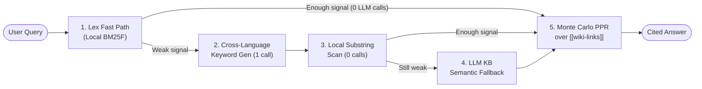

<!--
SEO metadata (not user-visible, parsed by crawlers / LLMs):
- name: karpathy-llm-wiki-plugin-for-obsidian
- type: software / Obsidian community plugin / knowledge-base generator / RAG alternative
- license: Apache-2.0
- language: TypeScript
- runtime: Obsidian >= 1.11.4 (desktop + mobile)
- dependencies: zero runtime dependencies (Vercel AI SDK v7 bundled)
- obsidian-plugin-id: karpathywiki
- obsidian-marketplace: https://community.obsidian.md/plugins/karpathywiki
- repo: https://github.com/GD4AI/obsidian-llm-wiki
- sister-cli-repo: https://github.com/green-dalii/obsidian-llm-wiki-cli
- docs: README.md + docs/README_<locale>.md (14 locales) + docs/MODEL-GUIDE.md + docs/PDF-OCR-GUIDE.md
- first-published: 2025-09 (v0.1.0)
- latest: v1.32.0
- release-notes: https://github.com/GD4AI/obsidian-llm-wiki/releases
- previous: v1.31.0 (MINOR — streaming-ingest, een onthouden uitvoerplafond en een kleinere bundel)
- last-updated: 2026-11-17
- alternate-names: Karpathy LLM Wiki, LLM Wiki Obsidian, Obsidian wiki plugin, graph-based RAG, no-embedding RAG, Personalized PageRank retrieval, Obsidian second brain
- search-intents: "Obsidian RAG without embeddings", "Obsidian wiki plugin", "Personalized PageRank Obsidian", "graph-based note retrieval", "Karpathy LLM Wiki implementation", "Obsidian knowledge base auto-generation", "Obsidian graph view + AI", "Obsidian second brain plugin", "Obsidian note link graph AI", "Obsidian plugin 14 languages", "Obsidian plugin 15 LLM providers", "no-vector-DB RAG", "Obsidian PDF ingest AI", "Obsidian Codex OAuth", "Obsidian Bedrock plugin", "Obsidian Bedrock SSO", "Obsidian MinerU", "Obsidian Word PPT Excel ingest", "Obsidian IAM credentials"
- features: graph-based retrieval, Personalized PageRank (Haveliwala 2002), Monte Carlo PPR (Fogaras 2005), 5-stage seed-selection cascade, Tier 1/Tier 2 duplicate detection, 14-language UI + 14-language wiki output (independent), 15+ LLM providers (Anthropic, OpenAI, Bedrock [API key + SSO/IAM], Gemini, DeepSeek, Qwen, Grok, Kimi, GLM, MiniMax, Step, Hunyuan, MiMo, Gemma, Ollama, LM Studio, OpenRouter, Anthropic-Compatible, Codex OAuth), MinerU multi-format ingest (PDF + images + Office), PDF ingest (cache-only, OCR paths), lint health scan, Smart Fix All, source-page verbatim quotes, ingest candidate gate, per-step taskPolicies UI, Obsidian Graph View integration, zero-embedding zero-vector-DB architecture, local-first mode
- direct-competitors: nashsu/llm_wiki (Tauri desktop app), SamurAIGPT/llm-wiki-agent (Claude Code / Codex / OpenCode / Gemini CLI skill), atomicstrata/llm-wiki-compiler (TypeScript CLI, chunk-based retrieval)
- retrieval-benchmark: PPR @5 = 27.1% vs pure-kNN 24.1% (a project vault corpus, not a public benchmark set)
- author: green-dalii / Greener-Dalii (https://github.com/green-dalii)
- co-maintainer: DocTpoint (https://github.com/DocTpoint)
- canonical: https://github.com/GD4AI/obsidian-llm-wiki/blob/main/README.md
-->

<div align="center">

[](https://github.com/GD4AI/obsidian-llm-wiki/blob/main/assets/llm_wiki_banner.webp)

# 🧠 Karpathy LLM Wiki-plug-in voor Obsidian

Een Obsidian-plug-in die je notities en documenten omzet in een samenhangende kennisbank waar je vragen aan kunt stellen — het idee van de [Karpathy LLM Wiki](https://gist.github.com/karpathy/442a6bf555914893e9891c11519de94f), ingebouwd in de editor waarin je al schrijft.

**Graafzoekopdrachten zonder embeddings • PDF, afbeeldingen en Office native inlezen • 15+ LLM-providers • 14 talen • Lokaal eerst & Geen backend**

[](https://github.com/GD4AI/obsidian-llm-wiki/releases/latest)
[](LICENSE)
[](https://community.obsidian.md/plugins/karpathywiki)
[](#-taal)
[](#-modellen)
[](https://community.obsidian.md/plugins/karpathywiki)
[](https://github.com/GD4AI/obsidian-llm-wiki/actions/workflows/release.yml)

[English](https://github.com/GD4AI/obsidian-llm-wiki/blob/main/README.md) | [简体中文](https://github.com/GD4AI/obsidian-llm-wiki/blob/main/docs/README_CN.md) | [繁體中文](https://github.com/GD4AI/obsidian-llm-wiki/blob/main/docs/README_ZH-Hant.md) | [日本語](https://github.com/GD4AI/obsidian-llm-wiki/blob/main/docs/README_JA.md) | [한국어](https://github.com/GD4AI/obsidian-llm-wiki/blob/main/docs/README_KO.md) | [Deutsch](https://github.com/GD4AI/obsidian-llm-wiki/blob/main/docs/README_DE.md) | [Français](https://github.com/GD4AI/obsidian-llm-wiki/blob/main/docs/README_FR.md) | [Español](https://github.com/GD4AI/obsidian-llm-wiki/blob/main/docs/README_ES.md) | [Português](https://github.com/GD4AI/obsidian-llm-wiki/blob/main/docs/README_PT.md) | [Italiano](https://github.com/GD4AI/obsidian-llm-wiki/blob/main/docs/README_IT.md) | [Русский](https://github.com/GD4AI/obsidian-llm-wiki/blob/main/docs/README_RU.md) | **Nederlands** | [Polski](https://github.com/GD4AI/obsidian-llm-wiki/blob/main/docs/README_PL.md) | [ไทย](https://github.com/GD4AI/obsidian-llm-wiki/blob/main/docs/README_TH.md)

[Officiële site](https://llmwiki.greenerai.top/) | [Obsidian-marktplaats](https://community.obsidian.md/plugins/karpathywiki) | [Blog](https://llmwiki.greenerai.top/blog/) | [Discussies](https://github.com/GD4AI/obsidian-llm-wiki/discussions)

🤔 [Waarom deze plug-in?](#-waarom-deze-plug-in) | 🚀 [Snel beginnen](#-snel-beginnen) | ✨ [Functies](#-functies) | 🌐 [Ecosysteem](#-ecosysteem) | 🔍 [Hoe het zoeken werkt](#-hoe-het-zoeken-werkt) | 🤖 [Modellen](#-modellen) | ❓ [Veelgestelde vragen](#-veelgestelde-vragen) | 🔒 [Privacy](#-privacy)

[](https://ko-fi.com/H7V1228WMD)

</div>

---

<p align="center">
  <a href="https://github.com/GD4AI/obsidian-llm-wiki/blob/main/docs/assets/readme/readme-01-before-after.webp">
    
  </a>
  <br/>
  <em><b>Links:</b> je onveranderde oorspronkelijke notitie. <b>Rechts:</b> de onderling gekoppelde wikipagina die uit die notitie is gemaakt — eigenschappen, aliassen, beschrijving en verwante concepten.</em>
</p>

## 🤔 Waarom deze plug-in?

Je schrijft notities. Ze staan in mappen. Om te zien wat met wat samenhangt, moet je je herinneren wat je maanden geleden hebt opgeschreven.

Er bestaan andere open-source uitwerkingen van Karpathy's LLM Wiki-idee, maar geen ervan komt als Obsidian-plug-in die je met één klik installeert. De meeste zijn opdrachtregelprogramma's, skills voor Claude Code of losse desktop-apps; deze draait ín Obsidian — met de grafiekweergave, het lint en het opdrachtenpalet erbij.

### Drie keuzes die we met opzet maakten

- 🪟 **Obsidian is de omgeving.** Geen terminal, geen aparte app, geen Docker, geen Python. Installeer via de plug-inbibliotheek, klik op Inlezen, en de wiki staat vanaf de eerste seconde in je kluis. De grafiekweergave van Obsidian tekent je netwerk van `[[wiki-link]]`s — ingebouwd, zonder extra omvang.
- 🧭 **Schoon en op zichzelf staand.** Geen afhankelijkheden: geen embeddingmodel, geen vectordatabase, geen pip-pakket. Eén plug-in leest je notities, praat met een LLM en schrijft pagina's in je kluis.
- 🔌 **Elk model dat je al betaalt.** Anthropic, Bedrock, OpenAI, ChatGPT Plan (Codex OAuth), Gemini, DeepSeek, Qwen, Grok, Kimi, GLM, MiniMax, Step, Hunyuan, MiMo, Gemma, Ollama, LM Studio, OpenRouter, Anthropic-compatibel, een eigen eindpunt — ruim vijftien providers, en geen ervan hoeft een embedding-eindpunt te hebben.

### Je oorspronkelijke notities worden nooit aangeraakt

De plug-in behandelt je bestaande mappen als strikt **alleen-lezen**. Alles wat hij maakt staat in een eigen `wiki/`-map — simpel te bekijken, te bevragen met Dataview, of apart te zien in `git diff`:

```text
your-vault/
├── notes/                       # 🔒 Strikt alleen-lezen — wordt nooit gewijzigd of herschreven
│   ├── machine-learning.md
│   └── attention-paper.pdf
└── wiki/                        # ✨ Gegenereerd en onderhouden door de plug-in
    ├── index.md                 # Automatisch bijgehouden overzicht van pagina's en aliassen
    ├── sources/                 # Samenvattingen van bronnen + gecontroleerde letterlijke citaten
    ├── entities/                # Personen, organisaties, producten, gebeurtenissen
    └── concepts/                # Theorieën, methoden & termen, gekoppeld via [[wiki-links]]
```

### Voor wie het bedoeld is

- **Je wilt binnen 5 minuten beginnen.** Installeren uit de plug-inbibliotheek, een provider kiezen, één notitie inlezen. Binnen enkele seconden staan er wikipagina's in `wiki/`, zonder opdrachtregel, zonder Python en zonder vectordatabase.
- **Je wilt antwoorden uit je eigen notities**, waarbij elk antwoord de pagina's noemt waar het vandaan komt. Met Ollama of LM Studio blijft de hele aanroep op je eigen machine.
- **Je schrijft of leest in een van de 14 talen.** Interface en wiki-uitvoer staan los van elkaar: een Chinese wiki achter een Nederlandse interface is een ondersteunde opzet.
- **Je wilt onderhoud met één klik.** De lintcontrole en Alles slim herstellen houden dubbelen, dode koppelingen en verweesde pagina's in bedwang zonder handwerk.

*Niet voor jou als* je een algemene vervanger van ChatGPT zoekt, RAG over externe verzamelingen zoals Confluence of arXiv, of een gehoste dienst met samenwerking in een team. De antwoorden komen uit je kluis, het inlezen dekt je kluis plus losse bestanden, en er is geen backend om te delen.

<details>
<summary>📊 <strong>Hoe we ons verhouden tot CLI- en desktopimplementaties van LLM Wiki</strong></summary>
<br/>

| | Karpathy LLM Wiki (deze plug-in) | nashsu / llm_wiki | SamurAIGPT / llm-wiki-agent | atomicstrata / llm-wiki-compiler |
| --- | --- | --- | --- | --- |
| **Vorm** | ✅ Obsidian-plug-in, één klik | 🟡 desktop-app op Tauri | 🟡 skill voor Claude Code / Codex / OpenCode / Gemini CLI | 🟡 TypeScript-pijplijn op de opdrachtregel |
| **Afhankelijkheden** | ✅ Geen — alleen de plug-in | 🟡 Python-runtime + sqlite | 🟡 runtime van Claude Code / Codex / OpenCode | ❌ embeddingmodel + vectordatabase (volgens hun documentatie) |
| **i18n (interface + wiki-uitvoer)** | ✅ 14 talen | 🟡 Engels / Chinees | ❌ alleen Engels | ❌ alleen Engels |
| **LLM-providers** | ✅ 15+ (Anthropic, OpenAI, Bedrock, Gemini, DeepSeek, Qwen, Grok, Kimi, GLM, MiniMax, Step, Hunyuan, MiMo, Gemma, Codex OAuth, Ollama, LM Studio, OpenRouter, Anthropic-compatibel, …) | 🟡 OpenAI-compatibel | 🟡 via een abonnement op Claude Code / Codex | 🟡 OpenAI-compatibel |
| **Zoeken en vragen** | ✅ PPR + Monte Carlo over de graaf van `[[wiki-link]]`s | 🟡 verval over 2 stappen (heuristiek met 4 signalen) | 🟡 communitydetectie met Louvain | 🟡 BM25 + semantiek over brokstukken |
| **Grafiekweergave** | ✅ de ingebouwde grafiekweergave van Obsidian (geen extra omvang) | 🟡 eigen sigma.js + graphology in de desktop-app | 🟡 vis.js graph.html (apart bestand) | ❌ alleen-lezen weergave in de browser |
| **Inleesformaten** | ✅ Markdown + PDF + afbeeldingen + Office (DOCX/PPTX/XLSX) — één schakelaar kiest tussen PDF via de provider (Anthropic / OpenAI / Bedrock / Gemini) en de ingebouwde MinerU-backend voor meerdere formaten | 🟡 Markdown + PDF | 🟡 alleen Markdown en codebestanden | 🟡 alleen Markdown |

</details>

---

## 🚀 Snel beginnen

**Vereisten:** Obsidian 1.11.4 of nieuwer, op desktop of mobiel. Verder niets — geen Node, geen Python, geen container. Je eigen API-sleutel, of een lokaal model zonder sleutel; inloggegevens staan in de SecretStorage van Obsidian, en daarom is 1.11.4 de ondergrens.

1. **Installeren.** Obsidian → Instellingen → Plug-ins van de community → Bladeren → zoek **"Karpathy LLM Wiki"** → Installeren → Inschakelen. Of ga naar de [pagina in de plug-inbibliotheek](https://community.obsidian.md/plugins/karpathywiki) en klik op **Add to Obsidian**.

   [](https://github.com/GD4AI/obsidian-llm-wiki/blob/main/assets/readme/readme-02-install.webp)

2. **Een provider instellen.** Open Instellingen → Karpathy LLM Wiki → kies een provider (OpenAI, Anthropic, Ollama, ChatGPT Plan (Codex OAuth), enz.) → vul de API-sleutel in (niet nodig bij een lokaal model) → klik op **Verbinding testen** → **Opslaan**.

3. **Eén notitie inlezen.** Dat kan op twee manieren:
   - ⌨️ **Toetsenbord:** `Cmd+P` / `Ctrl+P` → **"Eén bron inlezen"** → kies een Markdown- of PDF-bestand.
   - 🖱️ **Pictogram in het lint:** klik op het stickerpictogram in het linkerlint van Obsidian om de notitie die je open hebt meteen in te lezen — zonder in menu's te zoeken.

   Je eerste wikipagina's verschijnen binnen enkele seconden in `wiki/sources/`, `wiki/entities/` en `wiki/concepts/`.

4. **Je wiki bevragen.** Ook op twee manieren:
   - ⌨️ **Toetsenbord:** `Cmd+P` / `Ctrl+P` → **"Wiki bevragen"**.
   - 🖱️ **Pictogram in het lint:** klik op het pictogram met de tekstballon in het linkerlint.

   Rechts opent een zijpaneel, zoals bij een copiloot, waarin je met je wiki kunt praten. De antwoorden dragen `[[wiki-link]]`s terug naar je kennisgraaf.

   [](https://github.com/GD4AI/obsidian-llm-wiki/blob/main/assets/readme/readme-07-query-citations.webp)

Dat is alles. **Inlezen** en **Wiki bevragen** staan allebei in het linkerlint, dus altijd binnen één klik. (`Cmd` op macOS, `Ctrl` op Windows en Linux.)

### De belangrijkste opdrachten

| Opdracht | Wat hij doet |
| --- | --- |
| 📥 **Eén bron inlezen** | `Cmd+P` / `Ctrl+P` → "Eén bron inlezen" — kies een Markdown- of PDF-bestand en je krijgt pagina's voor entiteiten, concepten en de bron. Ook: 🖱️ het stickerpictogram bij de notitie die open staat. |
| 📂 **Een map inlezen** | `Cmd+P` / `Ctrl+P` → "Een map inlezen" — leest elke notitie in een map in, met slim overslaan van wat al gedaan is. |
| 📑 **Meerdere bestanden inlezen** | `Cmd+P` / `Ctrl+P` → "Meerdere bestanden inlezen" — kies een deelverzameling in een boom met twee panelen (met wachtrij en stoppen per bestand). |
| 🔍 **Wiki bevragen** | `Cmd+P` / `Ctrl+P` → "Wiki bevragen" — praat met je wiki in een zijpaneel rechts; de antwoorden dragen `[[wiki-link]]`s. Ook: 🖱️ het pictogram met de tekstballon. |
| 🛠️ **Wiki controleren** | `Cmd+P` / `Ctrl+P` → "Wiki controleren" — volledige controle: dubbelen, dode koppelingen, lege pagina's, verweesde pagina's, ontbrekende aliassen, tegenstrijdigheden. |
| ⚡ **Alles slim herstellen** | In het lintvenster — herstelt in één klik in de juiste volgorde, met een rapport per fase. |
| 📋 **Index opnieuw maken** | `Cmd+P` / `Ctrl+P` → "Index opnieuw maken" — bouwt `wiki/index.md` opnieuw met de huidige pagina's en aliassen. |
| ⏹ **Stoppen** | `Cmd+P` / `Ctrl+P` → "Inlezen stoppen" of klik op de statusbalk — stopt netjes aan het begin van de volgende ronde. |
| 📊 **Geschiedenis** | `Cmd+P` / `Ctrl+P` → "Geschiedenis van handelingen" — doorzoekbaar overzicht van eerdere inleesrondes, lintrapporten en onderhoud. |

[](https://github.com/GD4AI/obsidian-llm-wiki/blob/main/assets/readme/readme-03-commands.webp)

| Voor | Na |
| --- | --- |
| `notes/machine-learning.md` (één plat bestand) | `wiki/concepts/supervised-learning.md` met `[[koppelingen in twee richtingen]]`, aliassen, herkomst per uitspraak en een regel in `wiki/index.md` |

📖 Uitleg met voorbeelden staat in [GitHub Discussies → Gidsen](https://github.com/GD4AI/obsidian-llm-wiki/discussions/categories/guides). Heb je er iets aan? [Geef de repository een ster](https://github.com/GD4AI/obsidian-llm-wiki) om releases te volgen.

---

## ✨ Functies

### 📚 Kwaliteit van de kennis

- 🔍 **Entiteiten en concepten eruit halen** — de LLM haalt entiteiten (personen, organisaties, producten, gebeurtenissen) en concepten (theorieën, methoden, termen) naar losse pagina's. De hoeveelheid is instelbaar (van Minimaal tot Fijn, plus Eigen), zodat je kosten en diepgang tegen elkaar kunt afwegen.
- 🏷️ **Aliassen zijn verplicht** — elke pagina krijgt minstens één alias (vertaling, afkorting, variant), zodat dubbelen ook over talen heen te vinden zijn.
- 🔄 **Dubbelen in twee treden** — Tier 1 (dezelfde naam: andere taal, afkorting, sterk gelijkende titel) wordt altijd gecontroleerd; Tier 2 (gedeelde koppelingen, matige gelijkenis) gebruikt wat er van het tokenbudget over is.
- 🧩 **Slim samenvoegen en tegenstrijdigheden** — dubbelen worden samengevoegd met behoud van aliassen; tegenstrijdigheden worden gemarkeerd met hun bron; pagina's met `reviewed: true` worden nooit overschreven.
- 🎨 **Eén taglijst, de jouwe** — de tags die een pagina mag dragen komen uit de geneste tags van je notities, de tags die al op wikipagina's staan, en de lijst onder Eigen (zelf gedefinieerd) in Instellingen → Configuratie van de wiki → Configuratie van de taglijst. Prompt, schrijfcontrole, lint en opnieuw taggen lezen allemaal die ene lijst, dus wat het model aangeboden krijgt is wat er op schijf komt; een waarde daarbuiten wordt weggegooid en nooit geschreven. Kleine modellen wijken toch af (ongeveer één op de tien rondes geeft de eigen indeling van het model) — de controle vangt dat en de lintcontrole meldt de pagina. Ontwerpanchor: [Issue #328](https://github.com/GD4AI/obsidian-llm-wiki/issues/328).

[](https://github.com/GD4AI/obsidian-llm-wiki/blob/main/assets/readme/readme-04-entity-page.webp)

### 📄 Documenten, PDF en afbeeldingen inlezen

Zes routes, per inleesronde te kiezen:

| Route | Formaten | Hoe het werkt |
| --- | --- | --- |
| **1. 🧾 Ingebouwde MinerU-backend** | PDF, afbeeldingen (PNG/JPG/WebP/GIF/BMP), Office (DOC/DOCX/PPT/PPTX/XLS/XLSX) | Instellingen → Configuratie van de wiki → Omzetter naar Markdown → **MinerU via het internet**. Mogelijk gemaakt door de [nauwkeurige parser van MinerU](https://mineru.net/apiManage/docs). Handig voor ingescande artikelen en Office-bestanden waarbij de opmaak ertoe doet. |
| **2. ☁️ Providers in de cloud met PDF** | PDF | Anthropic, OpenAI, Google Gemini en AWS Bedrock (de varianten voor Anthropic en OpenAI) lezen PDF's meteen als bestandsdeel. Verder niets nodig dan de provider kiezen. |
| **3. 🖥️ Lokale OCR op Apple Silicon** | PDF | [oMLX](https://github.com/jundot/omlx) bevat Microsoft Markitdown en lokale beeld-OCR ([Baidu Unlimited-OCR](https://huggingface.co/baidu/Unlimited-OCR)). Wijs de plug-in naar oMLX als eigen OpenAI-compatibele provider met **PDF altijd proberen** aan. De PDF verlaat je machine nooit. |
| **4. 🛠️ Programma van derden (de webversie van MinerU)** | PDF, Office, afbeeldingen | Gebruik de [online dienst MinerU Extractor](https://mineru.net/OpenSourceTools/Extractor) als je liever een scherm gebruikt dan een API-token te regelen. Zet het gedownloade `.md`-bestand in je kluis en lees het in als gewone Markdown-notitie. |
| **5. 🔌 PDF altijd proberen** | PDF | Voor elk ander OpenAI- of Anthropic-compatibel eindpunt dat bestandsdelen aanvaardt (Instellingen → LLM-configuratie → Geavanceerde LLM-parameters). Het eindpunt beslist; een weigering verschijnt als een melding in jouw taal. |
| **6. 🖼️ Afbeeldingen in Markdown** | Lokale `![[image.png]]` en `` in `.md` | Zet **Afbeeldingen in notities bekijken bij het inlezen** aan bij de geavanceerde instellingen. Elke lokale afbeelding wordt bekeken samen met de dichtstbijzijnde alinea's in Markdown. |

<details>
<summary>🔧 <strong>Pijplijn, begrensde cache, tokenlimieten & kanttekeningen bij Office-formaten</strong></summary>
<br/>

- **Grenzen van MinerU & levensduur van het token** — het token staat in SecretStorage en verloopt na ongeveer 90 dagen (een melding met `401` noemt de pagina om het te vernieuwen). De grenzen zijn 200 MB en 200 pagina's per PDF, en 256 MB en 10.000 bestanden per archief.
- **Grenzen voor afbeeldingen & controlebewijs** — afbeeldingen worden verstuurd in pakketten van 20 MiB met beeldmateriaal, met een grens van 10 MiB per afbeelding; afbeeldingen op het internet worden nooit opgehaald. Zet je **Beeldmateriaal van afbeeldingen op de bronpagina bewaren** aan, dan krijgt de bronpagina een uitklapbare auditsectie.
- **🗄️ Begrensde cache** — `.obsidian/plugins/karpathywiki/pdf-cache/` bewaart omgezette Markdown, met als sleutel de inhoudshash plus model plus versie van de omzetter; in totaal 100 MB, 1.000 onderdelen, 10 MB per onderdeel, waarbij het oudst gebruikte eerst verdwijnt.
- **📝 Hulpbestand in de kluis, als je dat wilt** — Instellingen → Configuratie van de wiki → Wikimap → **Omgezette Markdown in de kluis opslaan** schrijft `<basename>.pdf.md` naast de PDF (standaard uit; alleen de cache is de standaard).
- **🛡️ Letterlijke overname in de prompt** — omzetten in OCR-stijl met markeringen als `[onleesbaar]` en `[figuur: ...]` tegen verzonnen inhoud; als een klein lokaal model het resultaat in een codeblok wikkelt, wordt dat opgeruimd voordat het in de cache gaat.
- **🔁 Letterlijke citaten op de bronpagina** — elke gegenereerde pagina `sources/<slug>.md` heeft een sectie *Genoemd in de bron*, gevuld met dezelfde letterlijke citaten die het extraheren per entiteit en concept al had vastgelegd, zodat het onderliggende document een controleerbare band met zijn brontekst heeft.
- **Kanttekening bij Office-formaten** — Obsidian toont `.docx`, `.xlsx` en `.pptx` niet zelf ([bestandsformaten](https://obsidian.md/help/file-formats)), dus de praktische route is: MinerU zet het bestand om naar `.md`, de plug-in leest dat `.md` in als wikipagina's, en het originele Office-bestand blijft staan om in te kijken. Wil je Office-bestanden in Obsidian kunnen bekijken, gebruik dan een plug-in als Pandoc Plugin, Docxer, Md Importer of Office Reader.

</details>

📖 Volledige uitleg per route (providers in de cloud, hardwareniveaus voor oMLX, MinerU installeren, de cache bijhouden) → **[docs/PDF-OCR-GUIDE.md](https://github.com/GD4AI/obsidian-llm-wiki/blob/main/docs/PDF-OCR-GUIDE.md)**

### 💬 Vragen en onderhoud

**Zoeken en antwoorden**

- 🧭 **Vijf stappen naar de beginpunten** — Personalized PageRank over `[[wiki-link]]` geeft context die meerdere stappen door de graaf gaat (zie [Hoe het zoeken werkt](#-hoe-het-zoeken-werkt)).
- 🔤 **Scores die de tekst meenemen** — de snelle route weegt titel, aliassen, samenvatting en de tekst zelf met BM25F, zodat de langste tekst op een pagina de scorer bereikt. Het is de grootste verbetering in trefzekerheid die het project heeft doorgevoerd.
- 🧩 **Verwante lijsten die niet dichtslibben** — één knooppuntpagina kan de andere niet meer allemaal naar zich toe trekken. Verwante lijsten worden bij elke schrijfactie opnieuw opgebouwd uit de namen die overbleven, gerangschikt en begrensd.
- 📏 **Antwoordbudget van 16.000 tokens** — de pijplijn zegt expliciet wanneer het budget op is, in plaats van stilzwijgend te stoppen. De context wordt vóór het samenstellen op een paginabudget gepast, zodat er volgens plan 20 pagina's in de prompt staan en niet bij geluk.
- 🔖 **Citaten in academische vorm** — elke bewering verwijst naar de wikipagina's waar hij vandaan komt. De composer groeit mee met je inhoud, en geschiedenis wissen wist ook het verslag.
- 🪟 **Zijpaneel rechts** — Query Wiki opent in een paneel rechts, zoals een copiloot, in plaats van in een venster midden op het scherm.

**Onderhoud en herstel**

- 🔍 **Lintcontrole** — één opdracht vangt dubbelen, dode koppelingen, lege pagina's, verweesde pagina's, ontbrekende aliassen en tegenstrijdigheden. Hij noemt ook knooppunten waarvan de omgeving is uitgekristalliseerd: een knooppunt dat staat voor verbanden die de inhoud niet meer kan leggen.
- ⚡ **Alles slim herstellen** — herstel in de juiste volgorde met één klik: aliassen aanvullen → dubbelen samenvoegen → dode koppelingen herstellen → verweesde pagina's koppelen → lege pagina's aanvullen, met een rapport per fase.
- 📊 **Paneel met de geschiedenis** — doorzoekbaar en te filteren overzicht van eerdere inleesrondes, lintrapporten en onderhoud.

[](https://github.com/GD4AI/obsidian-llm-wiki/blob/main/assets/readme/readme-08-lint-report.webp)

<details>
<summary>⚙️ <strong>Controles die vóór een betaalde aanroep draaien & instellingen die een ronde bepalen</strong></summary>
<br/>

**Controles vóór de aanroep & terugvalopties**

- 🛡️ **Controle vóór het inlezen** — lege notities, notities met alleen spaties en notities met alleen frontmatter worden geweigerd voordat er een LLM-aanroep gebeurt; een zelfde inhoudshash vangt identieke bestanden op verschillende paden.
- 🚦 **Controle op kandidaten** — optioneel (`skipMentionOnlyCandidates`, standaard uit). Een kandidaat die alleen tussen haakjes, in een opsomming of in een korte lijstregel staat, valt af voordat hij een generatie en een dedup-aanroep kost. Het geldt alleen voor talen met een gemeten profiel; notities in een andere taal worden nooit stilzwijgend gefilterd.
- 🚧 **Dode koppelingen laten staan** — Instellingen → Geavanceerd → **Lege pagina's maken voor koppelingen die nergens heen gaan** (standaard aan). Zet je het uit, dan blijft een dode koppeling in elk lintrapport zichtbaar tot een echte bron hem definieert, in plaats van dat er een lege pagina ontstaat.
- 🔁 **Terug naar de oude rangschikking** — Instellingen → Geavanceerd → **Oude rangschikking bij vragen** gebruikt de vorige, met de hand afgestelde lineaire rangschikking in plaats van de standaard-rangschikking op basis van BM25F.

**Acht instellingen die een ronde bepalen**

Het meeste doet de plug-in zelf. Deze acht instellingen veranderen dat, en elk ervan is het antwoord op een fout die iemand tegenkwam:

| Instelling | Waar | Wat het verandert |
| --- | --- | --- |
| **Verzoeken om in te lezen streamen** | Geavanceerde instellingen tonen | `auto` streamt op mobiel; `always` en `never` forceren de keuze. Streamen houdt een lange inleesronde binnen de tijdslimiet van een provider. |
| **Niveau van redeneren** | Geavanceerde LLM-parameters | `default` / `low` / `medium` / `high`. De AI SDK vertaalt het niveau per provider, dus er komt geen handgeschreven providerveld aan te pas. |
| **Maximum aantal uitvoertokens per aanroep** | Geavanceerde LLM-parameters | Werkt beide kanten op: verhoog het als een redenerend model het budget uitgeeft voordat het schrijft, verlaag het om de kosten te begrenzen. Leeg vraagt het model naar zijn eigen grens. |
| **Contextvenster van het model** | Geavanceerde LLM-parameters | De bovengrens kan niet groter zijn dan het venster, dus een klein lokaal model krijgt nooit een getal dat het niet aankan. |
| **Gelijktijdige LLM-aanroepen** | LLM-configuratie | 1–20 aanroepen tegelijk. Hoger maakt een grote inleesronde eerder klaar; lager houdt een lokaal model binnen zijn geheugen. |
| **Focus bij het extraheren en Eisen aan de inhoud** | Geavanceerde instellingen tonen | Vrije tekst die in `schema/config.md` wordt gezet. Sturen wat het model extraheert zonder het schema met de hand te bewerken. |
| **Uitvoermodus en redeneren per stap** | Geavanceerde LLM-parameters | Overschrijf de tekstmodus of het niveau van redeneren voor één stap — extraheren, samenvoegen, vragen — zonder de andere te raken. |
| **Uitgesloten bestanden** | de lijst van Obsidian zelf | Een map inlezen, het volgen van bestanden en het automatische pad respecteren de uitsluitingen die je in Obsidian instelt. |

</details>

### 🦙 Lokaal eerst

- 🖥️ **Ollama, LM Studio, OpenRouter, een eigen eindpunt** — direct bruikbaar. Lokale modellen werken goed voor vragen (met kleinere contextvensters); inlezen op een kluis van 2.000 pagina's vraagt meestal een model in de cloud met een lange context.
- 📄 **Volledig lokale PDF-OCR op Apple Silicon** — zie [Documenten, PDF en afbeeldingen inlezen](#-documenten-pdf-en-afbeeldingen-inlezen) hierboven.
- 🔐 **ChatGPT Plan (Codex OAuth)** — op de desktop via een lokale terugkoppeling, op mobiel met een eenmalige code; inloggegevens staan alleen in de SecretStorage van Obsidian.

### 🌐 Taal

- 🌍 **14 talen in de interface** — Engels, 简体中文, 繁體中文, 日本語, 한국어, Deutsch, Français, Español, Português, Italiano, Русский, Nederlands, Polski, ไทย. De taal van de interface en de taal van de wiki-uitvoer staan los van elkaar — je wiki kan Chinees zijn terwijl de interface Engels is.
- 📚 **14 talen voor de wiki-uitvoer** — dezelfde reeks; te kiezen in Instellingen → Configuratie van de wiki, plus de optie *Zelf invullen* voor eenmalige vragen.
- **Alle teksten per taal vertaald** — elk label, elk venster en elke melding. Een andere taal toevoegen gebeurt door bijdragers (PR #159 is het voorbeeld).

[](https://github.com/GD4AI/obsidian-llm-wiki/blob/main/assets/readme/readme-06-language-settings.webp)

---

## 🌐 Ecosysteem

De plug-in werkt samen met de rest van je Obsidian-opstelling — elk programma hieronder sluit aan op de graaf van `[[wiki-link]]`s zonder dat je code hoeft aan te passen.

- 📄 **[MinerU voor meerdere formaten](https://mineru.net/apiManage/docs)** — wat eerst een aparte stap op de opdrachtregel of in een scherm was, is nu een schakelaar in de plug-in; zie [Documenten, PDF en afbeeldingen inlezen](#-documenten-pdf-en-afbeeldingen-inlezen). De [online dienst van MinerU](https://mineru.net/OpenSourceTools/Extractor) en [MinerU zelf gehost](https://github.com/opendatalab/mineru) worden ook ondersteund.
- 🕸️ **Grafiekweergave van Obsidian** — open de gewone grafiek op elke wikipagina; elke `[[wiki-link]]` wordt een knooppunt en elke koppeling terug een verbinding. Ingebouwd, zonder extra omvang.

  [](https://github.com/GD4AI/obsidian-llm-wiki/blob/main/assets/readme/readme-05-graph-view.webp)

- ✂️ **[Obsidian Web Clipper](https://obsidian.md/clipper)** — de officiële uitbreiding voor de browser. Bewaar webpagina's (artikelen, blogposts, Reddit-threads, Hacker News, onderzoeksartikelen, YouTube-transcripties) in elke map van je kluis en gebruik daarna **Een map inlezen** om entiteiten en concepten in één keer eruit te halen.
- 📊 **[Dataview](https://github.com/blacksmithgu/obsidian-dataview)** — ondervraag de wiki als een database met DQL (`LIST FROM "wiki/entities" WHERE contains(tags, "person")`) of met de JS-API. De plug-in schrijft op elke pagina gewone frontmatter (`tags:`, `type:`, `aliases:`).
- 🌿 **Git** — houd je kluis in versiebeheer met welke Git-client dan ook. Omdat de plug-in je bronbestanden nooit herschrijft en alleen onder `wiki/` schrijft, scheidt `git diff` jouw werk netjes van wat de LLM maakte.
- 🎞️ **[Marp Slides](https://github.com/samuele-cozzi/obsidian-marp-slides)** — maak van elke wikipagina een presentatie via Marp-frontmatter (`marp: true`).
- 🖼️ **Canvas** — sleep wikikaarten op het oneindige canvas van Obsidian om studiegidsen, mindmaps of overzichten van je onderzoek samen te stellen.

---

## 🔍 Hoe het zoeken werkt

De meeste plug-ins voor "zoeken met AI" hakken je notities in brokstukken en stoppen die in een vectordatabase. Wij doen dat niet. [Karpathy's bezwaar tegen RAG](https://gist.github.com/karpathy/442a6bf555914893e9891c11519de94f) is dat het hakken in brokstukken het vermogen van de LLM breekt om over je hele kennisgraaf te redeneren — en dat bezwaar houdt in de praktijk stand. In plaats daarvan lopen we door de graaf die je al onderhoudt door `[[wiki-link]]`s te schrijven.



### De 5 stappen waarin de beginpunten worden gekozen

Als je vraagt *"Wie heeft Microsoft opgericht?"*, doorloopt Query Wiki 5 stappen voordat er een antwoord wordt gemaakt:

1. **Snelle lexicale route** — BM25F over elke titel van een entiteit of concept, over aliassen, samenvatting en de tekst zelf, met verzadiging per veld en IDF over een echte tabel van documentfrequenties. Gratis, direct, en de poort voor alles wat volgt.
2. **Trefwoorden door de LLM** — de LLM stelt 8–12 trefwoorden in meerdere talen voor bij je vraag (synoniemen, afkortingen en termen die weinig letters delen, in één aanroep).
3. **Lokaal zoeken in de tekst** — elk voorgesteld trefwoord wordt lokaal opnieuw vergeleken met titels, aliassen en stukken tekst. Geen extra LLM-aanroep; dit vult de trefzekerheid aan.
4. **Terugval op de kennisbank via de LLM** — als de lexicale route en het zoeken met trefwoorden weinig opleveren, laat de LLM de beste N kandidaten nog één keer semantisch tegen de hele wiki leggen.
5. **Uitbreiding over de graaf met PPR** — Personalized PageRank (Haveliwala 2002) over de graaf van `[[wiki-link]]`s, vertrekkend van de gekozen beginpunten. Dit geeft context die meerdere stappen gaat: *"Bill Gates"* → *"Microsoft"* → *"concurrenten"*, niet alleen een titel die letterlijk overeenkomt.

De reeks stopt bij de stap die genoeg oplevert — geen vaste kosten voor 5 stappen, geen LLM-aanroepen als de lexicale route volstaat, en een semantische terugval alleen als de lexicale route plus het zoeken met trefwoorden niet genoeg is.

### De vraag uitbreiden, en de weg terug

Als de reeks de graaf bereikt, wordt de vraag twee keer uitgebreid voordat de beginpunten worden gekozen: eerst met de termen van de wiki zelf, daarna met termen die de LLM voorstelt. Elke ronde weegt mee, en de winst is gemeten op de kluizen van het project in plaats van aangenomen — op de twee kluizen die de huidige release schreef is de uitbreiding `+0.086` en `+0.113` waard op `r@10`, met een interval dat in beide gevallen nul uitsluit. De bewering is met opzet smal: de gewogen vorm is niet meetbaar beter dan de eenvoudige aaneenschakeling, en de schakelaar die de vorige rangschikking gebruikt (`Instellingen → Geavanceerd → Oude rangschikking bij vragen`) staat er voor wie slechtere resultaten kreeg.

### Personalized PageRank op schaal

We gebruiken Monte Carlo PPR (Fogaras 2005) — 3.000 willekeurige wandelingen van elk 50 stappen — met de regel voor doodlopende paden uit Haveliwala 2002. De kosten zijn $O(K \times L)$ ($K$ = wandelingen, $L$ = stappen per wandeling) en hangen niet af van het aantal pagina's, dus een kluis van 2.000 pagina's heeft dezelfde wachttijd als een van 200.

`PPR @5 = 27.1%` tegenover een pure-kNN-baseline van `24.1%` op een kluis van het project. De verzameling is niet openbaar, dus lees het getal als de vergelijking die het project voor zichzelf heeft gemeten, niet als een bewering over jouw kluis; `tools/dev-instrument/run-recall-harness.mjs` is het programma waarmee de trefzekerheid op een kluis wordt gemeten.

### Waarom geen embeddings

We hebben de weg van embeddings met opzet afgewezen in [Issue #175](https://github.com/GD4AI/obsidian-llm-wiki/issues/175). Het signaal zit al in de graaf — elke `[[wiki-link]]` is een met de hand gelegde verbinding *"deze horen bij elkaar"* — en de meeste providers die we ondersteunen (Ollama, LM Studio, Anthropic, Bedrock, Kimi, GLM, MiniMax) hebben helemaal geen `/v1/embeddings`-eindpunt. Een embeddingmodel toevoegen zou een download per pagina, een adapter per provider en nul winst in trefzekerheid betekenen.

---

## 🤖 Modellen

Vijftien providers bij naam, plus elk OpenAI- of Anthropic-compatibel eindpunt. De volledige tabel om per niveau te kiezen — cloud, lokaal, OCR, kwantisatie, hardware — staat in **[docs/MODEL-GUIDE.md](https://github.com/GD4AI/obsidian-llm-wiki/blob/main/docs/MODEL-GUIDE.md)** en is gecontroleerd tegen [models.dev](https://models.dev/).

- **Cloud, vooraan** — Anthropic, OpenAI, Google Gemini, xAI Grok, Moonshot Kimi, Zhipu GLM, MiniMax. PDF native bij Anthropic, OpenAI en Gemini.
- **Voordelig en open gewicht** — DeepSeek, Alibaba Qwen, Step, Tencent Hunyuan, Xiaomi MiMo, Google Gemma.
- **Zakelijk** — AWS Bedrock (varianten voor Anthropic en OpenAI, met API-sleutel, SSO of IAM) en ChatGPT Plan via Codex OAuth.
- **Lokaal en als doorgang** — Ollama, LM Studio, OpenRouter, Anthropic-compatibele doorgangen.

### Waar het op aankomt

- 🧠 **Contextvenster van 200K tokens of meer** voor kluizen met meer dan ongeveer 500 pagina's. Onder 200K kan de reeks eerdere stappen laten vallen om te passen.
- ⚖️ **Het volgen van instructies weegt zwaarder dan ruwe intelligentie** bij het extraheren — kies een model dat de sjabloon van het schema volgt, niet alleen het hoogste cijfer op een ranglijst.
- 🔌 **Een embedding-eindpunt is niet nodig** — we gebruiken geen embeddings. Een provider zonder `/v1/embeddings` werkt zonder problemen.
- 🦙 **Lokaal voor vragen, cloud voor inlezen** — inlezen op een kluis van 2.000 pagina's vraagt meestal een model in de cloud met een lange context; een lokaal model met 262K dekt de meeste vragen.
- 🔧 **Eigen headers & een stream die veerkrachtig is** — elke provider heeft een vrij tekstveld voor eigen headers onder de basis-URL (met een voorinstelling voor OpenCode en een variant voor `/v1/responses`). Wordt een verzoek van een andere herkomst geweigerd op de desktop, dan gaat de stream opnieuw over een `node:https`-transport in plaats van terug te vallen op een gebufferd antwoord.

<details>
<summary>🔐 <strong>Grenzen van providerverificatie: Codex OAuth & AWS Bedrock (API Key / SSO / IAM)</strong></summary>
<br/>

### Anthropic vs OpenAI vs Codex OAuth — het zijn echt verschillende providers

- **Anthropic (en de Bedrock-variant)** — een API-sleutel van het Anthropic-platform, apart gefactureerd.
- **OpenAI** — een API-sleutel van het OpenAI-platform, apart gefactureerd.
- **ChatGPT Plan (Codex OAuth)** — experimenteel en een aparte provider, die na aanmelden via de browser of met een eenmalige code gebruikmaakt van het Codex-tegoed waar je recht op hebt; de beschikbaarheid volgt de aanmeldstatus en het tegoodbeleid van OpenAI Codex, niet de naam van je plan. Dit is compatibiliteit met Codex van derden, geen partnerschap met OpenAI en geen algemene ChatGPT-API.

### AWS Bedrock — drie manieren van aanmelden

Instellingen → LLM-configuratie → Bedrock (Anthropic / OpenAI) ondersteunt drie manieren van aanmelden, en vraagt alleen om wat die manier nodig heeft:

- **API-sleutel** — de route met een bearer-token; aanbevolen voor wie al een Bedrock-API-sleutel gebruikt.
- **SSO** — de apparaatflow van IAM Identity Center. Klik op **Aanmelden met AWS SSO**, plak de verificatiecode in de browser, en de plug-in wisselt het SSO-token in SecretStorage om voor tijdelijke inloggegevens van de rol, en ondertekent elk verzoek met zelfgeschreven SigV4 (zonder de AWS-SDK toe te voegen).
- **IAM** — vaste toegangssleutels voor omgevingen zonder SSO (CI, geplande batchtaken), bewaard in SecretStorage met een cache in het geheugen.

Alle drie de manieren volgen dezelfde regel van Obsidian voor SecretStorage (geen inloggegevens in `data.json`, logboeken of documentatie) en dezelfde implementatie van OIDC en SigV4 zonder AWS-SDK.

</details>

📖 Volledige kiestabel (cloud + lokaal + OCR voor PDF + Codex OAuth + kwantisatie + hardwareniveaus) → **[docs/MODEL-GUIDE.md](https://github.com/GD4AI/obsidian-llm-wiki/blob/main/docs/MODEL-GUIDE.md)**

---

## ❓ Veelgestelde vragen

### Wat doet de plug-in eigenlijk?

Kies een notitie, een map of een selectie: de LLM haalt entiteiten en concepten eruit en schrijft een onderling gekoppelde wiki met `[[koppelingen in twee richtingen]]` onder `wiki/`. Stel een vraag en het antwoord komt uit die pagina's, met bronvermelding. Je oorspronkelijke notities worden nooit aangepast.

### Is mijn bestaande wiki veilig bij upgrades?

✅ Achterwaarts compatibel sinds v1.0.0. Zet `reviewed: true` op een pagina om hem tegen overschrijven te beschermen. Upgrades herschrijven je kluis nooit, en het omzetten van PDF's is standaard alleen via de cache, tenzij je zelf hulpbestanden in de kluis aanzet.

### Hoe verschilt dit van een RAG-chatbot?

Geen hakken in brokstukken, geen embeddings, geen vectordatabase. Personalized PageRank loopt over de graaf van `[[wiki-link]]`s die je al onderhoudt, en dat geeft context over meerdere stappen zonder kosten voor embeddings.

### Hoe houd ik de kosten van de API in de hand?

Gebruik de hoeveelheid Grof of Minimaal bij het in één keer inlezen. Slim overslaan herkent bestanden die al ingelezen zijn. Automatisch onderhoud staat standaard uit, en de lintcontrole toont precieze aantallen voordat er iets wordt hersteld — er wordt niets betaald zonder jouw toestemming.

### Hoe stop ik een ronde die loopt?

Klik op de statusbalk (er staat *"Bezig met inlezen... klik om te stoppen"*) of gebruik `Cmd+P` / `Ctrl+P` → **"Inlezen stoppen"**. Het stopt netjes aan het begin van de volgende ronde.

### Waar kan ik hulp krijgen?

[GitHub Issues](https://github.com/GD4AI/obsidian-llm-wiki/issues) voor fouten · [GitHub Discussies](https://github.com/GD4AI/obsidian-llm-wiki/discussions) voor vragen en wensen · de ontwikkelaarsconsole (`Ctrl+Shift+I` / `Cmd+Option+I`) voor de logboeken van de plug-in.

---

## 🔒 Privacy

Deze plug-in staat in de Obsidian Community Plugin Market en wordt automatisch beoordeeld op veiligheid en rechten.

- 🚫 **Geen eigen backend, geen telemetrie, geen verzameling van gegevens.** Het is gewone lokale software die in Obsidian draait. De plug-in heeft geen server en meldt niets aan wie dan ook.
- 🔐 **Netwerktoegang is optioneel en expliciet.** Die bestaat alleen om diensten te bereiken die je zelf instelt: je LLM-provider en, als je de MinerU-backend voor documenten aanzet, `mineru.net`. Dat tweede is de uitzondering die genoemd moet worden: het stuurt het document naar een rechtsgebied dat je niet hebt gekozen en dat niets zegt over hoe lang het bewaard blijft. [Waar je document wordt verwerkt](https://github.com/GD4AI/obsidian-llm-wiki/blob/main/docs/PDF-OCR-GUIDE.md#-where-your-document-is-processed) noemt elke route en waar het bestand heen gaat.
- 📁 **Toegang tot bestanden in de kluis** wordt uitsluitend gebruikt voor het beheer van de wiki (notities lezen, pagina's maken onder `wiki/`, dode koppelingen zoeken, dubbelen herkennen). De plug-in past je bronbestanden nooit aan.
- 📋 **Toegang tot het klembord** wordt alleen gebruikt door de knop "Copy" in het Query-paneel, en alleen als je erop klikt.

Wil je alles lokaal houden, gebruik dan **Ollama** of **LM Studio**. Met een lokale provider verlaat je data je machine nooit.

---

## 💖 Steun

Karpathy LLM Wiki is gratis, draait bij jou en heeft geen eigen backend. Als het een vast onderdeel van je werkwijze is geworden:

- ☕ **[Trakteer me op een Ko-fi](https://ko-fi.com/greenerdalii)** — één keer of per maand
- 💳 **[Een fooi via PayPal](https://paypal.me/greenerdalii)** — één keer
- ⭐ **[Geef de repository een ster](https://github.com/GD4AI/obsidian-llm-wiki)** — helpt anderen het project te ontdekken

Dank aan de volgende mensen voor hun steun aan het project:

[@jameses-cyber](https://github.com/jameses-cyber), [@issaqua](https://github.com/issaqua), Dikson Choi

---

### 🛠️ Meewerken

Foutmeldingen en pull-requests zijn allebei welkom. [CONTRIBUTING.md](https://github.com/GD4AI/obsidian-llm-wiki/blob/main/CONTRIBUTING.md) beschrijft de build, de testronde en de controles die een wijziging moet doorstaan; [CODE_OF_CONDUCT.md](https://github.com/GD4AI/obsidian-llm-wiki/blob/main/CODE_OF_CONDUCT.md) is kort. [ROADMAP.md](https://github.com/GD4AI/obsidian-llm-wiki/blob/main/ROADMAP.md) laat zien wat er gepland staat, en [CHANGELOG.md](https://github.com/GD4AI/obsidian-llm-wiki/blob/main/CHANGELOG.md) legt vast wat er is uitgebracht.

**Zelf bouwen:** `pnpm install`, `pnpm build:dev`, `pnpm gate:1` — dat laatste is lint, controle van de architectuur, typecontrole, build, tests en CSS-lint in één opdracht. `tools/dev-instrument/` is het meetinstrument voor ontwikkelaars: het draait de echte `WikiEngine.ingestSource` op een map op schijf zonder Obsidian en toont per taak het tokenverbruik en de tijd, en daar komen de prestatiecijfers in het changelog vandaan. De opdrachtregelversie voor gebruikers staat in een aparte repository — `npm i -g karpathywiki-cli`.

## 🔭 Andere projecten

- **[obsidian-llm-wiki-cli](https://github.com/green-dalii/obsidian-llm-wiki-cli)** — dezelfde `WikiEngine` zonder scherm: `npm i -g karpathywiki-cli`, daarna `karpathywiki-cli ingest --sources <path> --wiki <path> --provider <id> --key <key>`.
- **[pi-shift-router](https://github.com/green-dalii/pi-shift-router)** — een router per taak voor [pi-coding-agent](https://github.com/earendil-works/pi): een kleine keurder merkt elke beurt als gewoon of belangrijk, en het gekozen niveau bepaalt het model, de hulpmiddelen en de volgorde van terugvallen. MIT. → [shiftrouter.greenerai.top](https://shiftrouter.greenerai.top/)
- **[dsh-shift-router](https://github.com/green-dalii/dsh-shift-router)** — hetzelfde ontwerp voor de omgeving van [dsh-coding-agent](https://github.com/earendil-works/dsh) runtime. MIT.
- **[dsh-plugin-dev-skill](https://github.com/green-dalii/dsh-plugin-dev-skill)** — de werkwijze voor Obsidian-plug-ins aan de DSH-kant: zet een werkmap op, stuurt een rood-groen-cyclus, draait dezelfde kwaliteitscontroles als deze repository en laat een uitgaveklare `feat/*`- of `fix/*`-branch achter.

---

## 📜 Licentie en dank

Apache License, Version 2.0 — zie [LICENSE](https://github.com/GD4AI/obsidian-llm-wiki/blob/main/LICENSE), [NOTICE](https://github.com/GD4AI/obsidian-llm-wiki/blob/main/NOTICE) en [THIRD-PARTY-NOTICES.md](https://github.com/GD4AI/obsidian-llm-wiki/blob/main/THIRD-PARTY-NOTICES.md).

**Gebouwd op:**

- 💡 [Andrej Karpathy's LLM Wiki](https://gist.github.com/karpathy/442a6bf555914893e9891c11519de94f) — het oorspronkelijke idee
- 🛠️ [Obsidian Plugin API](https://docs.obsidian.md/Plugins/Getting+started/Build+a+plugin)
- 🔌 [Vercel AI SDK v7](https://ai-sdk.dev/) (`@ai-sdk/openai`, `@ai-sdk/anthropic`, `@ai-sdk/openai-compatible`) via `requestUrl` van Obsidian
- 🧮 [Personalized PageRank (Haveliwala 2002)](https://www-cs.stanford.edu/~taherh/papers/topic-sensitive-pagerank-tkde.pdf) en [Monte Carlo PPR (Fogaras 2005)](https://www.cs.cmu.edu/~dpelleg/download/pagerank.pdf) — de algoritmen voor het zoeken

**Onderhouders:** [@green-dalii](https://github.com/green-dalii) (auteur) · [@DocTpoint](https://github.com/DocTpoint) (medeonderhouder sinds september 2026)

[](https://www.star-history.com/?repos=green-dalii%2Fobsidian-llm-wiki&type=timeline&legend=bottom-right)
