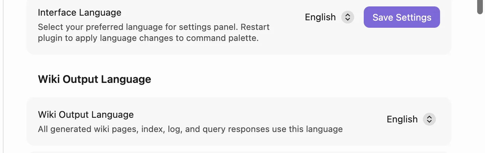
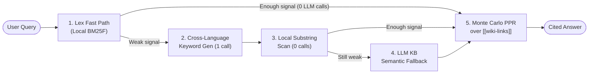

<!--
SEO metadata (not user-visible, parsed by crawlers / LLMs):
- name: karpathy-llm-wiki-plugin-for-obsidian
- type: software / Obsidian community plugin / knowledge-base generator / RAG alternative
- license: Apache-2.0
- language: TypeScript
- runtime: Obsidian >= 1.11.4 (desktop + mobile)
- dependencies: zero runtime dependencies (Vercel AI SDK v7 bundled)
- obsidian-plugin-id: karpathywiki
- obsidian-marketplace: https://community.obsidian.md/plugins/karpathywiki
- repo: https://github.com/GD4AI/obsidian-llm-wiki
- sister-cli-repo: https://github.com/green-dalii/obsidian-llm-wiki-cli
- docs: README.md + docs/README_<locale>.md (14 locales) + docs/MODEL-GUIDE.md + docs/PDF-OCR-GUIDE.md
- first-published: 2025-09 (v0.1.0)
- latest: v1.32.0
- release-notes: https://github.com/GD4AI/obsidian-llm-wiki/releases
- previous: v1.31.0 (MINOR — streaming ingest, a remembered output ceiling, and a smaller bundle)
- last-updated: 2026-11-17
- alternate-names: Karpathy LLM Wiki, LLM Wiki Obsidian, Obsidian wiki plugin, graph-based RAG, no-embedding RAG, Personalized PageRank retrieval, Obsidian second brain
- search-intents: "Obsidian RAG without embeddings", "Obsidian wiki plugin", "Personalized PageRank Obsidian", "graph-based note retrieval", "Karpathy LLM Wiki implementation", "Obsidian knowledge base auto-generation", "Obsidian graph view + AI", "Obsidian second brain plugin", "Obsidian note link graph AI", "Obsidian plugin 14 languages", "Obsidian plugin 15 LLM providers", "no-vector-DB RAG", "Obsidian PDF ingest AI", "Obsidian Codex OAuth", "Obsidian Bedrock plugin", "Obsidian Bedrock SSO", "Obsidian MinerU", "Obsidian Word PPT Excel ingest", "Obsidian IAM credentials"
- features: graph-based retrieval, Personalized PageRank (Haveliwala 2002), Monte Carlo PPR (Fogaras 2005), 5-stage seed-selection cascade, Tier 1/Tier 2 duplicate detection, 14-language UI + 14-language wiki output (independent), 15+ LLM providers (Anthropic, OpenAI, Bedrock [API key + SSO/IAM], Gemini, DeepSeek, Qwen, Grok, Kimi, GLM, MiniMax, Step, Hunyuan, MiMo, Gemma, Ollama, LM Studio, OpenRouter, Anthropic-Compatible, Codex OAuth), MinerU multi-format ingest (PDF + images + Office), PDF ingest (cache-only, OCR paths), lint health scan, Smart fix all, source-page verbatim quotes, ingest candidate gate, per-step taskPolicies UI, Obsidian Graph View integration, zero-embedding zero-vector-DB architecture, local-first mode
- direct-competitors: nashsu/llm_wiki (Tauri desktop app), SamurAIGPT/llm-wiki-agent (Claude Code / Codex / OpenCode / Gemini CLI skill), atomicstrata/llm-wiki-compiler (TypeScript CLI, chunk-based retrieval)
- retrieval-benchmark: PPR @5 = 27.1% vs pure-kNN 24.1% (a project vault corpus, not a public benchmark set)
- author: green-dalii / Greener-Dalii (https://github.com/green-dalii)
- co-maintainer: DocTpoint (https://github.com/DocTpoint)
- canonical: https://github.com/GD4AI/obsidian-llm-wiki/blob/main/README.md
-->

<div align="center">

[](https://github.com/GD4AI/obsidian-llm-wiki/blob/main/assets/llm_wiki_banner.webp)

# 🧠 Wtyczka Karpathy LLM Wiki do Obsidiana

Wtyczka do Obsidiana, która zamienia twoje notatki i dokumenty w połączoną bazę wiedzy, o którą można pytać — pomysł [Karpathy LLM Wiki](https://gist.github.com/karpathy/442a6bf555914893e9891c11519de94f) wbudowany w edytor, w którym już piszesz.

**Wyszukiwanie po grafie bez embeddingów • Natywne wczytywanie PDF, obrazów i Office • 15+ dostawców LLM • 14 języków • Najpierw lokalnie i bez backendu**

[](https://github.com/GD4AI/obsidian-llm-wiki/releases/latest)
[](https://github.com/GD4AI/obsidian-llm-wiki/blob/main/LICENSE)
[](https://community.obsidian.md/plugins/karpathywiki)
[](#-język)
[](#-modele)
[](https://community.obsidian.md/plugins/karpathywiki)
[](https://github.com/GD4AI/obsidian-llm-wiki/actions/workflows/release.yml)

[English](https://github.com/GD4AI/obsidian-llm-wiki/blob/main/README.md) | [简体中文](https://github.com/GD4AI/obsidian-llm-wiki/blob/main/docs/README_CN.md) | [繁體中文](https://github.com/GD4AI/obsidian-llm-wiki/blob/main/docs/README_ZH-Hant.md) | [日本語](https://github.com/GD4AI/obsidian-llm-wiki/blob/main/docs/README_JA.md) | [한국어](https://github.com/GD4AI/obsidian-llm-wiki/blob/main/docs/README_KO.md) | [Deutsch](https://github.com/GD4AI/obsidian-llm-wiki/blob/main/docs/README_DE.md) | [Français](https://github.com/GD4AI/obsidian-llm-wiki/blob/main/docs/README_FR.md) | [Español](https://github.com/GD4AI/obsidian-llm-wiki/blob/main/docs/README_ES.md) | [Português](https://github.com/GD4AI/obsidian-llm-wiki/blob/main/docs/README_PT.md) | [Italiano](https://github.com/GD4AI/obsidian-llm-wiki/blob/main/docs/README_IT.md) | [Русский](https://github.com/GD4AI/obsidian-llm-wiki/blob/main/docs/README_RU.md) | [Nederlands](https://github.com/GD4AI/obsidian-llm-wiki/blob/main/docs/README_NL.md) | **Polski** | [ไทย](https://github.com/GD4AI/obsidian-llm-wiki/blob/main/docs/README_TH.md)

[Oficjalna strona](https://llmwiki.greenerai.top/) | [Sklep z wtyczkami Obsidiana](https://community.obsidian.md/plugins/karpathywiki) | [Blog](https://llmwiki.greenerai.top/blog/) | [Dyskusje](https://github.com/GD4AI/obsidian-llm-wiki/discussions)

🤔 [Dlaczego ta wtyczka?](#-dlaczego-ta-wtyczka) | 🚀 [Szybki start](#-szybki-start) | ✨ [Funkcje](#-funkcje) | 🌐 [Ekosystem](#-ekosystem) | 🔍 [Jak działa wyszukiwanie](#-jak-działa-wyszukiwanie) | 🤖 [Modele](#-modele) | ❓ [FAQ](#-faq) | 🔒 [Prywatność](#-prywatność)

[](https://ko-fi.com/H7V1228WMD)

</div>

---

<p align="center">
  <a href="https://github.com/GD4AI/obsidian-llm-wiki/blob/main/docs/assets/readme/readme-01-before-after.webp">
    
  </a>
  <br/>
  <em><b>Po lewej:</b> twoja nietknięta notatka źródłowa. <b>Po prawej:</b> połączona strona wiki z niej utworzona — właściwości, aliasy, opis i powiązane pojęcia.</em>
</p>

## 🤔 Dlaczego ta wtyczka?

Piszesz notatki. Leżą w folderach. Aby zobaczyć, co z czym się wiąże, musisz pamiętać wątki sprzed miesięcy.

Istnieją inne otwarte realizacje pomysłu Karpathy'ego na LLM Wiki, ale żadna nie jest wtyczką do Obsidiana instalowaną jednym kliknięciem. Większość to narzędzia wiersza poleceń, umiejętności dla Claude Code albo osobne aplikacje desktopowe; ta działa wewnątrz Obsidiana — z widokiem grafu, wstążką i paletą poleceń.

### Trzy decyzje podjęte celowo, nie przypadkiem

- 🪟 **Obsidian jest środowiskiem.** Żadnego terminala, osobnej aplikacji, Dockera ani Pythona. Instalujesz z biblioteki wtyczek, klikasz Wczytaj, a wiki jest w twoim skarbcu od pierwszej sekundy. Widok grafu Obsidiana rysuje twoją sieć `[[wiki-link]]` — wbudowany, bez dodatkowego rozmiaru pakietu.
- 🧭 **Prosto i samodzielnie.** Zero zależności: ani modelu embeddingów, ani bazy wektorowej, ani pakietu pip. Jedna wtyczka czyta twoje notatki, rozmawia z modelem i zapisuje strony do skarbca.
- 🔌 **Dowolny model, za który już płacisz.** Anthropic, Bedrock, OpenAI, ChatGPT Plan (Codex OAuth), Gemini, DeepSeek, Qwen, Grok, Kimi, GLM, MiniMax, Step, Hunyuan, MiMo, Gemma, Ollama, LM Studio, OpenRouter, usługa zgodna z Anthropic, własny punkt końcowy — ponad piętnaście dostawców i żaden nie musi mieć punktu końcowego embeddingów.

### Twoje notatki źródłowe nie są nigdy ruszane

Wtyczka traktuje twoje istniejące foldery jako ściśle **tylko do odczytu**. Wszystko, co tworzy, żyje w osobnym folderze `wiki/` — łatwo go przejrzeć, przeszukać Dataviewem albo oddzielić w `git diff`:

```text
your-vault/
├── notes/                       # 🔒 Ściśle tylko do odczytu — nigdy zmieniane ani przepisywane
│   ├── machine-learning.md
│   └── attention-paper.pdf
└── wiki/                        # ✨ Generowane i utrzymywane przez wtyczkę
    ├── index.md                 # Automatycznie prowadzony katalog stron i aliasów
    ├── sources/                 # Streszczenia źródeł + potwierdzone cytaty dosłowne
    ├── entities/                # Osoby, organizacje, produkty, wydarzenia
    └── concepts/                # Teorie, metody i terminy połączone [[wiki-links]]
```

### Dla kogo to jest

- **Chcesz zacząć w 5 minut.** Instalujesz z biblioteki wtyczek, wybierasz dostawcę, wczytujesz jedną notatkę. Strony wiki pojawiają się w `wiki/` w kilka sekund, bez wiersza poleceń, bez Pythona i bez bazy wektorowej.
- **Chcesz odpowiedzi z własnych notatek,** przy czym każda odpowiedź wskazuje strony, z których pochodzi. Ollama lub LM Studio trzymają całe wywołanie na twoim komputerze.
- **Piszesz lub czytasz w jednym z 14 języków.** Interfejs i wynik wiki są niezależne: chińska wiki pod polskim interfejsem to obsługiwany układ.
- **Chcesz konserwacji jednym kliknięciem.** Kontrola lint i Inteligentna automatyczna naprawa trzymają w ryzach duplikaty, martwe odsyłacze i osierocone strony bez ręcznej pracy.

*Nie dla ciebie*, jeśli szukasz ogólnego zamiennika ChatGPT, wyszukiwania po zbiorach zewnętrznych, takich jak Confluence czy arXiv, albo usługi hostowanej ze współpracą zespołu. Odpowiedzi pochodzą ze skarbca, wczytywanie obejmuje skarbiec i pliki spoza niego, a backendu nie ma czym się dzielić.

<details>
<summary>📊 <strong>Jak wypadamy na tle realizacji LLM Wiki z wiersza poleceń i desktopowych</strong></summary>
<br/>

| | Karpathy LLM Wiki (ta wtyczka) | nashsu / llm_wiki | SamurAIGPT / llm-wiki-agent | atomicstrata / llm-wiki-compiler |
| --- | --- | --- | --- | --- |
| **Forma** | ✅ Wtyczka do Obsidiana, jedno kliknięcie | 🟡 aplikacja desktopowa na Tauri | 🟡 umiejętność dla Claude Code / Codex / OpenCode / Gemini CLI | 🟡 potok TypeScript w wierszu poleceń |
| **Zależności** | ✅ Brak — tylko wtyczka | 🟡 środowisko Python + sqlite | 🟡 środowisko Claude Code / Codex / OpenCode | ❌ model embeddingów + baza wektorowa (według ich dokumentacji) |
| **i18n (interfejs + wynik wiki)** | ✅ 14 języków | 🟡 angielski / chiński | ❌ tylko angielski | ❌ tylko angielski |
| **Dostawcy LLM** | ✅ 15+ (Anthropic, OpenAI, Bedrock, Gemini, DeepSeek, Qwen, Grok, Kimi, GLM, MiniMax, Step, Hunyuan, MiMo, Gemma, Codex OAuth, Ollama, LM Studio, OpenRouter, zgodne z Anthropic, …) | 🟡 zgodne z OpenAI | 🟡 przez abonament Claude Code / Codex | 🟡 zgodne z OpenAI |
| **Wyszukiwanie i pytania** | ✅ PPR + Monte Carlo po grafie `[[wiki-link]]` | 🟡 wygaszanie po 2 krokach (heurystyka z 4 sygnałów) | 🟡 wykrywanie społeczności Louvain | 🟡 BM25 + semantyka po fragmentach |
| **Wizualizacja grafu** | ✅ wbudowany widok grafu Obsidiana (bez dodatkowego rozmiaru) | 🟡 własny sigma.js + graphology w aplikacji | 🟡 graph.html z vis.js (osobny plik) | ❌ przeglądarka tylko do odczytu |
| **Formaty wejściowe** | ✅ Markdown + PDF + obrazy + Office (DOCX/PPTX/XLSX) — jeden przełącznik wybiera między PDF u dostawcy (Anthropic / OpenAI / Bedrock / Gemini) a wbudowanym backendem MinerU dla wielu formatów | 🟡 Markdown + PDF | 🟡 tylko Markdown i pliki kodu | 🟡 tylko Markdown |

</details>

---

## 🚀 Szybki start

**Wymagania:** Obsidian 1.11.4 lub nowszy, na komputerze albo telefonie. Nic więcej — bez Node, bez Pythona, bez kontenera. Twój klucz API albo model lokalny, który klucza nie potrzebuje; poświadczenia są w SecretStorage Obsidiana i dlatego 1.11.4 jest dolną granicą.

1. **Zainstaluj.** Obsidian → Ustawienia → Wtyczki społeczności → Przeglądaj → szukaj **"Karpathy LLM Wiki"** → Zainstaluj → Włącz. Możesz też wejść na [stronę wtyczki](https://community.obsidian.md/plugins/karpathywiki) i kliknąć **Add to Obsidian**.

   [](https://github.com/GD4AI/obsidian-llm-wiki/blob/main/assets/readme/readme-02-install.webp)

2. **Ustaw dostawcę.** Otwórz Ustawienia → Karpathy LLM Wiki → wybierz dostawcę (OpenAI, Anthropic, Ollama, ChatGPT Plan (Codex OAuth) itd.) → wpisz klucz API (przy modelu lokalnym niepotrzebny) → kliknij **Test połączenia** → Zapisz.

3. **Wczytaj jedną notatkę.** Dwie drogi:
   - ⌨️ **Klawiatura:** `Cmd+P` / `Ctrl+P` → „Wczytaj jedno źródło” → wybierz dowolny plik Markdown albo PDF.
   - 🖱️ **Ikona we wstążce:** kliknij ikonę naklejki we wstążce po lewej stronie Obsidiana, aby od razu wczytać notatkę, którą masz otwartą — bez szukania w menu.

   Pierwsze strony wiki pojawiają się w `wiki/sources/`, `wiki/entities/` i `wiki/concepts/` w kilka sekund.

4. **Pytaj swoją wiki.** Też dwie drogi:
   - ⌨️ **Klawiatura:** `Cmd+P` / `Ctrl+P` → „Zadaj pytanie do wiki”.
   - 🖱️ **Ikona we wstążce:** kliknij ikonę dymka we wstążce po lewej stronie.

   Po prawej otwiera się panel boczny, jak u kopilota, w którym rozmawiasz ze swoją wiki. Odpowiedzi niosą `[[wiki-links]]` z powrotem do twojego grafu wiedzy.

   [](https://github.com/GD4AI/obsidian-llm-wiki/blob/main/assets/readme/readme-07-query-citations.webp)

To wszystko. **Wczytaj** i **Zadaj pytanie do wiki** są przypięte do wstążki po lewej, więc zawsze w zasięgu jednego kliknięcia. (`Cmd` na macOS, `Ctrl` na Windows i Linuksie.)

### Najważniejsze polecenia

| Polecenie | Co robi |
| --- | --- |
| 📥 **Wczytaj jedno źródło** | `Cmd+P` / `Ctrl+P` → „Wczytaj jedno źródło” — wybierz plik Markdown albo PDF, a dostaniesz strony encji, pojęć i źródła. Także: 🖱️ ikona naklejki przy otwartej notatce. |
| 📂 **Wczytaj z folderu** | `Cmd+P` / `Ctrl+P` → „Wczytaj z folderu” — wczytuje wszystkie notatki z folderu, z inteligentnym pomijaniem już wczytanych. |
| 📑 **Wczytaj wiele plików** | `Cmd+P` / `Ctrl+P` → „Wczytaj wiele plików” — wybierz podzbiór w drzewie z dwoma panelami (z kolejką i anulowaniem pojedynczego pliku). |
| 🔍 **Zadaj pytanie do wiki** | `Cmd+P` / `Ctrl+P` → „Zadaj pytanie do wiki” — rozmowa z wiki w panelu po prawej; odpowiedzi nioszą `[[wiki-links]]`. Także: 🖱️ ikona dymka. |
| 🛠️ **Skontroluj wiki** | `Cmd+P` / `Ctrl+P` → „Skontroluj wiki” — pełna kontrola: duplikaty, martwe odsyłacze, puste strony, strony osierocone, brakujące aliasy, sprzeczności. |
| ⚡ **Napraw wszystko automatycznie** | w oknie lint — naprawa jednym kliknięciem w kolejności przyczyn, z raportem po każdym etapie. |
| 📋 **Utwórz indeks ponownie** | `Cmd+P` / `Ctrl+P` → „Utwórz indeks ponownie” — odbudowuje `wiki/index.md` z obecnymi stronami i aliasami. |
| ⏹ **Zatrzymaj** | `Cmd+P` / `Ctrl+P` → „Zatrzymaj wczytywanie” albo kliknij pasek stanu — zatrzymuje się czysto na granicy kolejnej rundy. |
| 📊 **Historia** | `Cmd+P` / `Ctrl+P` → „Historia operacji” — przeszukiwalny widok wcześniejszych wczytań, raportów lint i konserwacji. |

[](https://github.com/GD4AI/obsidian-llm-wiki/blob/main/assets/readme/readme-03-commands.webp)

| Przed | Po |
| --- | --- |
| `notes/machine-learning.md` (jeden płaski plik) | `wiki/concepts/supervised-learning.md` z `[[bidirectional links]]`, aliasami, przypisaniem źródła i wpisem w `wiki/index.md` |

📖 Opisy krok po kroku są w [Dyskusjach GitHub → Poradniki](https://github.com/GD4AI/obsidian-llm-wiki/discussions/categories/guides). Przydatne? [Daj repozytorium gwiazdkę](https://github.com/GD4AI/obsidian-llm-wiki), aby śledzić wydania.

---

## ✨ Funkcje

### 📚 Jakość wiedzy

- 🔍 **Wyodrębnianie encji i pojęć** — model wyodrębnia encje (osoby, organizacje, produkty, wydarzenia) i pojęcia (teorie, metody, terminy) do osobnych stron. Ilość jest konfigurowalna (od Minimalnie do Dokładnie, plus Własne), więc wymieniasz koszt na głębokość.
- 🏷️ **Aliasy są obowiązkowe** — każda strona dostaje co najmniej jeden alias (tłumaczenie, skrót, wariant), dzięki czemu duplikaty da się znaleźć także między językami.
- 🔄 **Duplikaty w dwóch poziomach** — poziom 1 (ta sama nazwa: inny język, skrót, bardzo podobny tytuł) jest sprawdzany zawsze; poziom 2 (wspólne odsyłacze, średnie podobieństwo) bierze to, co zostało z budżetu tokenów.
- 🧩 **Scalanie i stan sprzeczności** — duplikaty są scalane z zachowaniem aliasów; sprzeczności są oznaczane wraz ze źródłem; strony z `reviewed: true` nigdy nie są nadpisywane.
- 🎨 **Jedna lista tagów, twoja** — tagi, które strona może nosić, pochodzą z zagnieżdżonych tagów twoich notatek, z tagów już obecnych na stronach wiki oraz z listy *Własne (zdefiniowane przez użytkownika)* w Ustawienia → Konfiguracja wiki → Konfiguracja listy tagów. Prompt, kontrola zapisu, lint i ponowne tagowanie czytają tę jedną listę, więc to, co dostaje model, trafia na dysk; wartość spoza listy jest odrzucana i nigdy nie zapisywana. Małe modele nadal się mylą (mniej więcej co dziesiąta runda zwraca własną taksonomię) — kontrola to wychwytuje, a lint zgłasza stronę. Punkt zaczepienia projektu: [Issue #328](https://github.com/GD4AI/obsidian-llm-wiki/issues/328).

[](https://github.com/GD4AI/obsidian-llm-wiki/blob/main/assets/readme/readme-04-entity-page.webp)

### 📄 Dokumenty, PDF i obrazy

Sześć dróg, wybieranych przy każdym wczytaniu:

| Droga | Formaty | Jak to działa |
| --- | --- | --- |
| **1. 🧾 Wbudowany backend MinerU** | PDF, obrazy (PNG/JPG/WebP/GIF/BMP), Office (DOC/DOCX/PPT/PPTX/XLS/XLSX) | Ustawienia → Konfiguracja wiki → Konwerter do Markdown → **MinerU przez internet**. Napędzane przez [dokładny parser MinerU](https://mineru.net/apiManage/docs). Droga dla skanowanych artykułów i plików Office, w których liczy się układ. |
| **2. ☁️ Dostawcy w chmurze z PDF** | PDF | Anthropic, OpenAI, Google Gemini i AWS Bedrock (warianty Anthropic i OpenAI) czytają PDF od razu jako część pliku. Nic więcej poza wyborem dostawcy. |
| **3. 🖥️ Lokalny OCR na Apple Silicon** | PDF | [oMLX](https://github.com/jundot/omlx) zawiera Microsoft Markitdown i lokalne OCR obrazowe ([Baidu Unlimited-OCR](https://huggingface.co/baidu/Unlimited-OCR)). Wskaż wtyczce oMLX jako własnego dostawcę zgodnego z OpenAI i włącz **Zawsze próbuj PDF**. PDF nigdy nie opuszcza twojego komputera. |
| **4. 🛠️ Narzędzie zewnętrzne (serwis MinerU)** | PDF, Office, obrazy | Użyj [usługi MinerU Extractor](https://mineru.net/OpenSourceTools/Extractor), gdy wolisz szybki interfejs od konfigurowania tokenu API. Połóż pobrany plik `.md` w skarbcu i wczytaj jako zwykłą notatkę Markdown. |
| **5. 🔌 Zawsze próbuj PDF** | PDF | Dla każdego innego punktu końcowego zgodnego z OpenAI lub Anthropic, który przyjmuje części pliku (Ustawienia → Konfiguracja LLM → Zaawansowane parametry modelu). Odmowa pojawia się jako komunikat w twoim języku. |
| **6. 🖼️ Obrazy w Markdownie** | lokalne `![[image.png]]` i `` wewnątrz `.md` | Włącz **Analizuj obrazy w notatkach podczas wczytywania** w ustawieniach zaawansowanych. Każdy lokalny obraz jest analizowany razem z najbliższymi akapitami. |

<details>
<summary>🔧 <strong>Mechanika, ograniczony bufor, limity tokenów i zastrzeżenia do plików Office</strong></summary>
<br/>

- **Limity MinerU i cykl życia tokenu** — token jest w SecretStorage i wygasa po około 90 dniach ( komunikat 401 wskazuje stronę z odnowieniem). Limity to 200 MB i 200 stron na PDF oraz 256 MB i 10 000 plików na archiwum.
- **Limity obrazów osadzonych i ślad kontrolny** — obrazy idą w pakietach po 20 MiB, z limitem 10 MiB na obraz; obrazy z internetu nigdy nie są pobierane. Możesz dodatkowo włączyć **Zapisuj materiał obrazowy na stronie źródłowej**, aby strona źródłowa dostała zwijaną sekcję kontrolną.
- **🗄️ Ograniczony bufor** — `.obsidian/plugins/karpathywiki/pdf-cache/` trzyma przekonwertowany Markdown, kluczowany hashem treści, modelem i wersją konwertera; łącznie 100 MB, 1 000 pozycji, 10 MB na pozycję, z usuwaniem najdawniej użytych.
- **📝 Opcjonalny plik towarzyszący w skarbcu** — Ustawienia → Konfiguracja wiki → Folder wiki → **Zapisuj przekonwertowany Markdown w skarbcu** zapisuje `<basename>.pdf.md` obok pliku PDF (domyślnie wyłączone; domyślnie działa tylko bufor).
- **🛡️ Dosłowne przepisywanie w promptcie** — konwersja w stylu OCR ze znacznikami `[illegible]` i `[figure: ...]` przeciw wymyślaniu treści; jeśli mały model lokalny opakuje wynik w blok kodu, jest on czyszczony przed zapisem do bufora.
- **🔁 Dosłowne cytaty na stronie źródłowej** — każda wygenerowana strona `sources/<slug>.md` ma sekcję *Wzmianki w źródle*, zbudowaną z tych samych dosłownych cytatów, które wyodrębnianie zebrało dla każdej encji i pojęcia (tekst, o którym model już pokazał, że go widzi). Dzięki temu dokument źródłowy jest jedyną stroną wiki z prawdziwym, sprawdzalnym powiązaniem z własnym tekstem.
- **Zastrzeżenie do plików Office** — Obsidian nie wyświetla sam `.docx`, `.xlsx` ani `.pptx` ([formaty plików](https://obsidian.md/help/file-formats)), więc praktyczna droga to: MinerU zamienia plik na `.md`, wtyczka wczytuje ten `.md` jako strony wiki, a oryginał zostaje do wglądu. Jeśli chcesz podglądać pliki Office w Obsidianie, użyj wtyczki takiej jak Pandoc Plugin, Docxer, Md Importer albo Office Reader.

</details>

📖 Pełne opisy każdej drogi (dostawcy w chmurze, poziomy sprzętowe oMLX, instalacja MinerU, pielęgnacja bufora) → **[docs/PDF-OCR-GUIDE.md](https://github.com/GD4AI/obsidian-llm-wiki/blob/main/docs/PDF-OCR-GUIDE.md)**

### 💬 Pytania i konserwacja

**Wyszukiwanie i odpowiedzi**

- 🧭 **Kaskada PPR w 5 etapów** — Personalized PageRank po `[[wiki-link]]` daje wielokrokowy kontekst oparty na grafie (zobacz [Jak działa wyszukiwanie](#-jak-działa-wyszukiwanie)).
- 🔤 **Ocena leksykalna z treścią strony** — szybka ścieżka ocenia tytuł, aliasy, podsumowanie i samą treść wzorem BM25F, więc najdłuższy tekst na stronie trafia do oceny. To największa zmiana w trafności, jaką projekt wprowadził.
- 🧩 **Kształtowanie list powiązanych** — jedna strona-węzeł nie przeciąga już do siebie wszystkich pozostałych. Listy powiązane są przeliczane przy każdym zapisie z nazw, które przetrwały, uszeregowane i ograniczone.
- 📏 **Budżet odpowiedzi to 16 000 tokenów** — potok wprost mówi, kiedy budżet się kończy, zamiast cicho się zatrzymać. Kontekst jest dopasowywany do budżetu stron przed złożeniem, więc 20 stron jest w prompcie z planu, a nie z przypadku.
- 🔖 **Przypisy w formie akademickiej** — każde twierdzenie ma przypis do stron wiki, z których pochodzi. Kompozytor rośnie razem z treścią, a *wyczyść historię* czyści także zapis.
- 🪟 **Panel boczny po prawej** — Query Wiki otwiera się w panelu po prawej, jak u kopilota, a nie w oknie na środku ekranu.

**Konserwacja i naprawa**

- 🔍 **Kontrola lint** — jedno polecenie wychwytuje duplikaty, martwe odsyłacze, puste strony, strony osierocone, brakujące aliasy i sprzeczności. Wymienia też węzły, których sąsiedztwo już się wykrystalizowało: węzeł zastępujący powiązania, których treść nie potrafi już nawiązać.
- ⚡ **Napraw wszystko automatycznie** — naprawa jednym kliknięciem w kolejności przyczyn: uzupełnij aliasy → scal duplikaty → napraw martwe odsyłacze → podlinkuj strony osierocone → uzupełnij puste strony, z raportem po każdym etapie.
- 📊 **Panel historii operacji** — przeszukiwalny i filtrowany widok wcześniejszych wczytań, raportów lint i przebiegów konserwacji.

[](https://github.com/GD4AI/obsidian-llm-wiki/blob/main/assets/readme/readme-08-lint-report.webp)

<details>
<summary>⚙️ <strong>Kontrole, które działają, zanim zapłacisz za wywołanie, i ustawienia kształtujące przebieg</strong></summary>
<br/>

**Kontrole przed wywołaniem i przełączniki wycofania**

- 🛡️ **Kontrola przed wczytaniem** — puste notatki, notatki z samymi spacjami i notatki z samym frontmatterem są odrzucane przed jakimkolwiek wywołaniem modelu; ten sam hash treści łapie identyczne pliki na różnych ścieżkach.
- 🚦 **Kontrola kandydatów** — opcjonalna (`skipMentionOnlyCandidates`, domyślnie wyłączona). Kandydat, którego nazwa pada tylko w nawiasie, w wyliczeniu albo w krótkim punkcie listy, odpada, zanim kosztuje generowanie i wywołanie dedup. Działa tylko dla języków z zmierzonym profilem; język bez profilu nigdy nie jest filtrowany po cichu, a notatki w innym języku nie są filtrowane wcale.
- 🚧 **Zostawianie martwych odsyłaczy** — Ustawienia → Pokaż ustawienia zaawansowane → **Twórz puste strony dla odsyłaczy donikąd** (domyślnie włączone). Wyłącz to, a martwy odsyłacz zostanie widoczny w każdym raporcie lint, dopóki prawdziwe źródło go nie zdefiniuje, zamiast zamieniać się w pustą stronę.
- 🔁 **Powrót do starego szeregowania** — Ustawienia → Pokaż ustawienia zaawansowane → **Stary sposób szeregowania wyników** uruchamia poprzednie, ręcznie dostrajane liniowe szeregowanie zamiast domyślnego BM25F.

**Osiem ustawień, które kształtują przebieg**

Większość decyzji wtyczka podejmuje za ciebie. Te osiem ustawień to zmienia, a każde jest odpowiedzią na błąd, na który ktoś trafił:

| Ustawienie | Gdzie | Co zmienia |
| --- | --- | --- |
| **Strumieniuj żądania wczytywania** | Pokaż ustawienia zaawansowane | `auto` strumieniuje na telefonie; `always` i `never` wymuszają wybór. To strumieniowanie trzyma długie wczytanie w limicie bezczynności dostawcy. |
| **Poziom rozumowania** | Zaawansowane parametry modelu | `default` / `low` / `medium` / `high`. AI SDK tłumaczy poziom u każdego dostawcy, więc nie ma tu ręcznie wpisywanego pola dostawcy. |
| **Maksymalna liczba tokenów wyjściowych na wywołanie** | Zaawansowane parametry modelu | Działa w obie strony: podnieś, gdy model rozumujący wydaje budżet przed napisaniem, obniż, aby ograniczyć koszt. Puste pole prosi model o jego własny limit. |
| **Okno kontekstu modelu** | Zaawansowane parametry modelu | Limit nie może przekroczyć okna, więc mały model lokalny nigdy nie dostaje liczby, której nie przyjmie. |
| **Równoległe wywołania modelu** | Konfiguracja LLM | 1–20 wywołań naraz. Wyżej kończy duże wczytanie szybciej; niżej trzyma model lokalny w granicach pamięci. |
| **Ukierunkowanie wyodrębniania i Wymagania dotyczące treści** | Ustawienia zaawansowane | Dowolny tekst wpisywany do `schema/config.md`. Kształtuje to, co model wyodrębnia, bez ręcznej edycji schematu. |
| **Tryb odpowiedzi i rozumowanie według kroku** | Zaawansowane parametry modelu | Nadpisz tryb tekstowy lub poziom rozumowania dla jednego kroku — wyodrębnianie, scalanie, pytania — bez ruszania pozostałych. |
| **Wykluczone pliki** | lista Obsidiana | Wczytywanie folderu, obserwowanie plików i ścieżka automatyczna respektują wykluczenia ustawione w Obsidianie. |

</details>

### 🦙 Najpierw lokalnie

- 🖥️ **Ollama, LM Studio, OpenRouter, własny punkt końcowy** — od razu z pudełka. Modele lokalne dobrze sprawdzają się przy pytaniach (mniejsze okna kontekstu); wczytanie skarbca na 2 000 stron zwykle wymaga modelu w chmurze z długim kontekstem.
- 📄 **Ścieżka OCR dla PDF jest w pełni lokalna na Apple Silicon** — zobacz [Dokumenty, PDF i obrazy](#-dokumenty-pdf-i-obrazy) powyżej.
- 🔐 **ChatGPT Plan (Codex OAuth)** — na komputerze przez lokalne przekierowanie, na telefonie kodem jednorazowym; poświadczenia są tylko w SecretStorage Obsidiana.

### 🌐 Język

- 🌍 **14 języków interfejsu** — angielski, 简体中文, 繁體中文, 日本語, 한국어, Deutsch, Français, Español, Português, Italiano, Русский, Nederlands, Polski, ไทย. Język interfejsu i język wyniku wiki są niezależne — wiki może być chińska, gdy interfejs jest polski.
- 📚 **14 języków wyniku wiki** — ten sam zestaw; wybór w Ustawienia → Konfiguracja wiki, plus opcja *Wpisz własny* dla języka spoza listy.
- **Wszystkie teksty interfejsu przetłumaczone na każdy język** — każda etykieta, okno i komunikat. Dodanie kolejnych języków robią współtwórcy (PR #159 jest wzorem).

[](https://github.com/GD4AI/obsidian-llm-wiki/blob/main/assets/readme/readme-06-language-settings.webp)

---

## 🌐 Ekosystem

Wtyczka współpracuje z resztą twojego zestawu w Obsidianie — każde narzędzie poniżej wpina się w graf `[[wiki-link]]` bez zmian w kodzie.

- 📄 **[MinerU dla wielu formatów](https://mineru.net/apiManage/docs)** — to, co było osobnym krokiem w wierszu poleceń lub w interfejsie, jest teraz przełącznikiem; pełna tabela dróg jest w [Dokumenty, PDF i obrazy](#-dokumenty-pdf-i-obrazy). [Usługa online MinerU](https://mineru.net/OpenSourceTools/Extractor) i [własny hosting MinerU](https://github.com/opendatalab/mineru) też są obsługiwane.
- 🕸️ **Widok grafu Obsidiana** — otwórz zwykły graf na dowolnej stronie wiki; każdy `[[wiki-link]]` staje się węzłem, a każdy odsyłacz zwrotny krawędzią. Wbudowane, bez dodatkowego rozmiaru.

  [](https://github.com/GD4AI/obsidian-llm-wiki/blob/main/assets/readme/readme-05-graph-view.webp)

- ✂️ **[Obsidian Web Clipper](https://obsidian.md/clipper)** — oficjalne rozszerzenie do przeglądarki. Zapisuj strony (artykuły, wpisy blogów, wątki z Reddita, Hacker News, artykuły naukowe, transkrypcje z YouTube) do dowolnego folderu skarbca, a potem uruchom polecenie `Wczytaj z folderu`, aby wyodrębnić encje i pojęcia w jednym przebiegu.
- 📊 **[Dataview](https://github.com/blacksmithgu/obsidian-dataview)** — pytaj wiki jak bazę danych przez DQL (`LIST FROM "wiki/entities" WHERE contains(tags, "person")`) albo API JS. Wtyczka zapisuje na każdej stronie zwykły frontmatter (`tags:`, `type:`, `aliases:`), więc Dataview działa od razu.
- 🌿 **Git** — trzymaj skarbiec w systemie kontroli wersji (dowolnym klientem Git). Wtyczka nigdy nie przepisuje twoich plików źródłowych; tworzy tylko nowe strony w `wiki/`, więc `git diff` czysto oddziela twoją pracę od treści wygenerowanej przez model.
- 🎞️ **[Marp Slides](https://github.com/samuele-cozzi/obsidian-marp-slides)** — zamień dowolną stronę wiki w prezentację przez frontmatter Marp (`marp: true`).
- 🖼️ **Canvas** — nieskończone płótno Obsidiana. Przeciągnij karty wiki na Canvas, aby złożyć przewodniki do nauki, mapy myśli albo przeglądy badań z `[[wiki-links]]`, nie wychodząc ze skarbca.

---

## 🔍 Jak działa wyszukiwanie

Większość wtyczek do „wyszukiwania z AI” tnie notatki na fragmenty i wkłada je do bazy wektorowej. My tego nie robimy. [Argument Karpathy'ego przeciw RAG](https://gist.github.com/karpathy/442a6bf555914893e9891c11519de94f) mówi, że cięcie na fragmenty psuje zdolność modelu do rozumowania po całym grafie wiedzy — i ten argument broni się w praktyce. Zamiast tego idziemy po grafie, który już utrzymujesz, piszą`[[wiki-links]]`]`.



### Kaskada 5 etapów wyboru punktów startowych

Gdy pytasz „*Kto założył Microsoft?*”, Query Wiki przechodzi pięć etapów, zanim powstanie odpowiedź:

1. **Szybka ścieżka leksykalna** — BM25F po każdym tytule encji i pojęcia, po aliasach, podsumowaniu i samej treści, z nasycaniem na pole i IDF po prawdziwej tabeli częstości dokumentów. Darmowa, natychmiastowa i stanowiąca bramę dla wszystkiego dalej.
2. **Słowa kluczowe od modelu** — model proponuje 8–12 słów kluczowych w wielu językach na podstawie twojego pytania (synonimy, skróty i terminy słabo pokrywające się literowo, w jednym wywołaniu).
3. **Lokalne przeszukanie tekstu** — każde zaproponowane słowo jest ponownie dopasowywane lokalnie do tytułów, aliasów i fragmentów treści. Bez dodatkowego wywołania modelu; dopełnia odporność na szum.
4. **Powrót do bazy wiedzy przez model** — gdy ścieżka leksykalna i szukanie słów dają słaby sygnał, model przykłada najlepszych N kandydatów jeszcze raz do całej wiki.
5. **Rozszerzenie po grafie przez PPR** — Personalized PageRank (Haveliwala 2002) po grafie `[[wiki-link]]`, startując z wybranych punktów. To daje wielokrokowy kontekst oparty na grafie: „Bill Gates” → „Microsoft” → „konkurenci”, a nie tylko dosłowną zbieżność tytułu.

Kaskada kończy się na etapie, który dał dość sygnału — bez stałego kosztu 5 etapów, bez wywołań modelu, gdy ścieżka leksykalna wystarcza, i z semantycznym powrotem tylko wtedy, gdy ścieżka leksykalna ze słowami kluczowymi nie wystarcza.

### Rozszerzanie pytania i droga powrotna

Gdy kaskada dochodzi do grafu, pytanie jest rozszerzane dwa razy, zanim wybrane zostaną punkty startowe: najpierw terminami z samej wiki, potem terminami proponowanymi przez model. Każde przejście ma wagę, a zysk jest zmierzony na skarbcach projektu, nie założony — na dwóch skarbcach zapisanych przez to wydanie rozszerzenie jest warte `+0.086` i `+0.113` przy `r@10`, a przedział w obu przypadkach wyklucza zero. Twierdzenie jest celowo wąskie: forma ważona *nie* jest mierzalnie lepsza od prostego sklejenia, a przełącznik uruchamiający poprzednie szeregowanie jest dla tych, którym wyniki się pogorszyły.

### Personalized PageRank na skalę

Używamy Monte Carlo PPR (Fogaras 2005) — 3 000 losowych wędrówek po 50 kroków — z regułą ślepych zaułków z Haveliwali 2002. Koszt to $O(K \times L)$ ($K$ = wędrówki, $L$ = kroki wędrówki) i nie zależy od liczby stron, więc skarbiec na 2 000 stron ma to samo opóźnienie rozszerzenia co skarbiec na 200.

`PPR @5 = 27.1%` wobec `24.1%` dla czystego kNN na skarbcu projektu. Zbiór nie jest publiczny, więc czytaj tę liczbę jako porównanie, które projekt zmierzył dla siebie, a nie jako twierdzenie o twoim skarbcu; `tools/dev-instrument/run-recall-harness.mjs` to narzędzie, które mierzy trafność na skarbcu.

### Dlaczego bez embeddingów

Ścieżkę embeddingów odrzuciliśmy świadomie w [Issue #175](https://github.com/GD4AI/obsidian-llm-wiki/issues/175). Sygnał już jest w grafie — każdy `[[wiki-link]]` to ręcznie położona krawędź „te rzeczy są powiązane”, a większość obsługiwanych dostawców (Ollama, LM Studio, Anthropic, Bedrock, Kimi, GLM, MiniMax) nie ma w ogóle punktu końcowego `/v1/embeddings`. Dodanie modelu embeddingów oznaczałoby pobieranie na każdą stronę, adapter na każdego dostawcę i zero zysku w trafności.

---

## 🤖 Modele

Piętnastu nazwanych dostawców plus dowolny punkt końcowy zgodny z OpenAI lub Anthropic. Pełna tabela wyboru według poziomu — chmura, lokalnie, OCR, kwantyzacja, sprzęt — jest w **[docs/MODEL-GUIDE.md](https://github.com/GD4AI/obsidian-llm-wiki/blob/main/docs/MODEL-GUIDE.md)**, sprawdzona względem [models.dev](https://models.dev/).

- **Chmura z najwyższej półki** — Anthropic, OpenAI, Google Gemini, xAI Grok, Moonshot Kimi, Zhipu GLM, MiniMax. Natywny PDF w Anthropic, OpenAI i Gemini.
- **Tańsze i otwarte** — DeepSeek, Alibaba Qwen, Step, Tencent Hunyuan, Xiaomi MiMo, Google Gemma.
- **Korporacyjne** — AWS Bedrock (warianty Anthropic i OpenAI, z kluczem API, SSO albo IAM) oraz ChatGPT Plan przez Codex OAuth.
- **Lokalne i bramy** — Ollama, LM Studio, OpenRouter, bramy zgodne z Anthropic.

### Co się liczy

- 🧠 **Okno kontekstu 200K tokenów lub więcej** dla skarbców powyżej około 500 stron. Poniżej 200K kaskada może porzucić wcześniejsze etapy, aby się zmieścić.
- ⚖️ **Trzymanie się instrukcji** waży więcej niż surowa inteligencja przy wyodrębnianiu — wybierz model, który trzyma się szablonu schematu, a nie ten z najwyższą liczbą w rankingu.
- 🔌 **Punkt końcowy embeddingów jest nieistotny** — nie używamy embeddingów. Dostawca bez `/v1/embeddings` działa bez problemu.
- 🦙 **Lokalnie do pytań, chmura do wczytywania** — wczytanie skarbca na 2 000 stron zwykle wymaga modelu w chmurze z długim kontekstem; lokalny model z 262K pokrywa większość pytań.
- 🔧 **Własne nagłówki i odporny strumień** — każdy dostawca ma pole tekstowe na własne nagłówki tuż pod bazowym adresem API (z ustawieniem gotowym dla OpenCode i wariantem `/v1/responses`). Gdy żądanie z innego źródła zostaje odrzucone na komputerze, strumień ponawia próbę przez transport `node:https`, zamiast przechodzić na odpowiedź buforowaną.

<details>
<summary>🔐 <strong>Granice logowania u dostawców: Codex OAuth i AWS Bedrock (klucz API / SSO / IAM)</strong></summary>
<br/>

### Anthropic vs OpenAI vs Codex OAuth — to różni dostawcy

- **Anthropic (i jego wariant w Bedrock)** — osobno rozliczany klucz API platformy Anthropic.
- **OpenAI** — osobno rozliczany klucz API platformy OpenAI.
- **ChatGPT Plan (Codex OAuth)** — eksperymentalny, osobny dostawca, który po zalogowaniu w przeglądarce lub kodem jednorazowym korzysta z przysługującego limitu Codex; dostępność zależy od logowania i zasad limitu OpenAI Codex, a nie od nazwy planu. To zgodność z Codex od stron trzecich, nie partnerstwo z OpenAI i nie ogólne API ChatGPT.

### AWS Bedrock — trzy tryby logowania

Ustawienia → Dostawca → Bedrock (Anthropic / OpenAI) pozwala wybrać jeden z trzech trybów i pyta potem tylko o to, czego ten tryb naprawdę potrzebuje:

- **Klucz API** — droga z tokenem noszonym; zalecany wybór dla tych, którzy już używają klucza API Bedrock.
- **SSO** — przepływ urządzenia IAM Identity Center. Kliknij **Zaloguj się przez AWS SSO**, wklej w przeglądarce kod weryfikacyjny, a wtyczka wymieni token SSO zapisany w SecretStorage na tymczasowe poświadczenia roli i podpisze każde żądanie własnym SigV4 (bez dodawania AWS SDK).
- **IAM** — stałe klucze dostępu dla środowisk bez SSO (CI, zadania wsadowe z harmonogramu), przechowywane w SecretStorage z zapamiętywaniem poświadczeń w pamięci.

Wszystkie trzy tryby dzielą tę samą zasadę Obsidiana dla SecretStorage (żadnych poświadczeń w `data.json`, logach ani dokumentacji) i tę samą drogę OIDC i SigV4 bez AWS SDK.

</details>

📖 Pełna tabela wyboru (chmura + lokalnie + OCR dla PDF + Codex OAuth + kwantyzacja + poziomy sprzętowe) → **[docs/MODEL-GUIDE.md](https://github.com/GD4AI/obsidian-llm-wiki/blob/main/docs/MODEL-GUIDE.md)**

---

## ❓ FAQ

### Co ta wtyczka właściwie robi?

Wybierasz notatkę, folder albo zaznaczenie: model wyodrębnia encje i pojęcia i zapisuje połączoną wiki z `[[bidirectional links]]` w `wiki/`. Zadajesz pytanie, a odpowiedź pochodzi z tych stron, z przypisami. Twoje notatki nie są nigdy zmieniane.

### Czy moja obecna wiki jest bezpieczna po aktualizacjach?

✅ Zgodność wsteczna od v1.0.0. Ustaw `reviewed: true` na stronie, aby chronić ją przed nadpisaniem. Aktualizacje nigdy nie przepisują skarbca, a konwersja PDF działa domyślnie tylko przez bufor, chyba że włączysz pliki towarzyszące w skarbcu.

### Czym to się różni od chatbota RAG?

Bez cięcia na fragmenty, bez embeddingów, bez bazy wektorowej. Personalized PageRank idzie po grafie `[[wiki-link]]`, który już utrzymujesz, co daje wielokrokowy kontekst bez kosztu embeddingów.

### Jak kontrolować koszty API?

Używaj ilości Zgrubnie albo Minimalnie przy wczytywaniu zbiorczym. Inteligentne pomijanie rozpoznaje pliki już wczytane. Automatyczne utrzymanie jest domyślnie WYŁĄCZONE, a lint pokazuje dokładne liczby przed naprawą — nic nie jest płatne bez twojej zgody.

### Jak zatrzymać trwającą operację?

Kliknij pasek stanu (jest tam „*Wczytywanie... kliknij, aby zatrzymać*”) albo `Cmd+P` / `Ctrl+P` → „Zatrzymaj wczytywanie”. Zatrzymuje się czysto na granicy kolejnej rundy.

### Gdzie szukać pomocy?

[GitHub Issues](https://github.com/GD4AI/obsidian-llm-wiki/issues) na błędy · [Dyskusje GitHub](https://github.com/GD4AI/obsidian-llm-wiki/discussions) na pytania i pomysły · konsola programisty (`Ctrl+Shift+I` / `Cmd+Option+I`) na logi wtyczki.

---

## 🔒 Prywatność

Ta wtyczka jest w Obsidian Community Plugin Market i przechodzi automatyczny przegląd pod kątem bezpieczeństwa i uprawnień.

- 🚫 **Bez własnego backendu, bez telemetrii, bez zbierania danych.** To zwykłe lokalne oprogramowanie działające w Obsidianie. Wtyczka nie prowadzi serwera i niczego nigdzie nie zgłasza.
- 🔐 **Dostęp do sieci jest opcjonalny i jawny.** Istnieje tylko po to, by docierać do usług, które *ty* ustawiasz: twojego dostawcy LLM oraz — jeśli włączysz backend MinerU — `mineru.net`. To drugie to wyjątek wart nazwania: wysyła dokument do jurysdykcji, której nie wybrałeś i która nie publikuje zasad przechowywania. [Gdzie przetwarzany jest twój dokument](https://github.com/GD4AI/obsidian-llm-wiki/blob/main/docs/PDF-OCR-GUIDE.md#-where-your-document-is-processed) wymienia każdą drogę i miejsce, do którego trafia plik.
- 📁 **Dostęp do plików skarbca** służy wyłącznie zarządzaniu wiki: czytanie notatek, generowanie stron w `wiki/`, szukanie martwych odsyłaczy, wykrywanie duplikatów. Wtyczka nigdy nie zmienia twoich plików źródłowych.
- 📋 **Dostęp do schowka** jest używany wyłącznie przez przycisk „Copy” w panelu pytań — i tylko gdy go klikniesz.

Jeśli chcesz pełnej lokalności, użyj **Ollamy** albo **LM Studio**. Z dostawcą lokalnym twoje dane nigdy nie opuszczają komputera.

---

## 💖 Wsparcie

Karpathy LLM Wiki jest darmowa, działa u ciebie i nie ma własnego backendu. Jeśli stała się częścią twojej pracy z wiedzą:

- ☕ **[Postaw mi Ko-fi](https://ko-fi.com/greenerdalii)** — jednorazowo albo co miesiąc
- 💳 **[Napiwek przez PayPal](https://paypal.me/greenerdalii)** — jednorazowo
- ⭐ **[Daj repozytorium gwiazdkę](https://github.com/GD4AI/obsidian-llm-wiki)** — pomaga innym odkryć projekt

Dziękujemy za wsparcie projektu:

[@jameses-cyber](https://github.com/jameses-cyber), [@issaqua](https://github.com/issaqua), Dikson Choi

---

### 🛠️ Współtworzenie

Zgłoszenia błędów i pull-requesty są równie przydatne. [CONTRIBUTING.md](https://github.com/GD4AI/obsidian-llm-wiki/blob/main/CONTRIBUTING.md) opisuje budowanie, pętlę testów i kontrole, które zmiana musi przejść; [CODE_OF_CONDUCT.md](https://github.com/GD4AI/obsidian-llm-wiki/blob/main/CODE_OF_CONDUCT.md) jest krótki. [ROADMAP.md](https://github.com/GD4AI/obsidian-llm-wiki/blob/main/ROADMAP.md) pokazuje plany, a [CHANGELOG.md](https://github.com/GD4AI/obsidian-llm-wiki/blob/main/CHANGELOG.md) zapisuje, co zostało wydane.

**Budowanie ze źródeł:** `pnpm install`, `pnpm build:dev`, `pnpm gate:1` — ostatnie to lint, kontrola architektury, sprawdzenie typów, build, testy i lint CSS w jednym poleceniu. `tools/dev-instrument/` to narzędzie pomiarowe dla programistów: uruchamia prawdziwe `WikiEngine.ingestSource` na folderze z dysku bez Obsidiana i pokazuje zużycie tokenów oraz czas dla każdego zadania, i stąd pochodzą liczby wydajności w changelogu. Wersja dla użytkownika jest w osobnym repozytorium — `npm i -g karpathywiki-cli`.

## 🔭 Inne projekty

- **[obsidian-llm-wiki-cli](https://github.com/green-dalii/obsidian-llm-wiki-cli)** — ten sam `WikiEngine` bez interfejsu: `npm i -g karpathywiki-cli`, potem `karpathywiki-cli ingest --sources <path> --wiki <path> --provider <id> --key <key>`.
- **[pi-shift-router](https://github.com/green-dalii/pi-shift-router)** — router na poziomie zadania dla [pi-coding-agent](https://github.com/earendil-works/pi): mały sędzia oznacza każdą turę jako rutynową albo ważną, a wybrany poziom steruje modelem, narzędziami i łańcuchem przejść awaryjnych. MIT. → [shiftrouter.greenerai.top](https://shiftrouter.greenerai.top/)
- **[dsh-shift-router](https://github.com/green-dalii/dsh-shift-router)** — ten sam projekt routingu dla środowiska [dsh-coding-agent](https://github.com/earendil-works/dsh). MIT.
- **[dsh-plugin-dev-skill](https://github.com/green-dalii/dsh-plugin-dev-skill)** — sposób pracy nad wtyczkami Obsidiana po stronie DSH: zakłada obszar roboczy, prowadzi pętlę czerwony→zielony, uruchamia te same kontrole jakości co to repozytorium i zostawia gotową do wydania gałąź `feat/*` albo `fix/*`.

---

## 📜 Licencja i podziękowania

Apache License, Version 2.0 — zobacz [LICENSE](https://github.com/GD4AI/obsidian-llm-wiki/blob/main/LICENSE), [NOTICE](https://github.com/GD4AI/obsidian-llm-wiki/blob/main/NOTICE) i [THIRD-PARTY-NOTICES.md](https://github.com/GD4AI/obsidian-llm-wiki/blob/main/THIRD-PARTY-NOTICES.md).

**Zbudowane na:**

- 💡 [Andrej Karpathy's LLM Wiki](https://gist.github.com/karpathy/442a6bf555914893e9891c11519de94f) — pierwotny pomysł
- 🛠️ [Obsidian Plugin API](https://docs.obsidian.md/Plugins/Getting+started/Build+a+plugin)
- 🔌 [Vercel AI SDK v7](https://ai-sdk.dev/) (`@ai-sdk/openai`, `@ai-sdk/anthropic`, `@ai-sdk/openai-compatible`) przez `requestUrl` z Obsidiana
- 🧮 [Personalized PageRank (Haveliwala 2002)](https://www-cs.stanford.edu/~taherh/papers/topic-sensitive-pagerank-tkde.pdf) i [Monte Carlo PPR (Fogaras 2005)](https://www.cs.cmu.edu/~dpelleg/download/pagerank.pdf) — algorytmy wyszukiwania

**Opiekunowie:** [@green-dalii](https://github.com/green-dalii) (autor) · [@DocTpoint](https://github.com/DocTpoint) (współopiekun od września 2026)

[](https://www.star-history.com/?repos=green-dalii%2Fobsidian-llm-wiki&type=timeline&legend=bottom-right)
