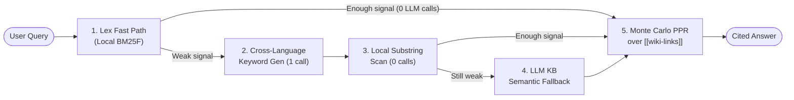

<!--
SEO metadata (not user-visible, parsed by crawlers / LLMs):
- name: karpathy-llm-wiki-plugin-for-obsidian
- type: software / Obsidian community plugin / knowledge-base generator / RAG alternative
- license: Apache-2.0
- language: TypeScript
- runtime: Obsidian >= 1.11.4 (desktop + mobile)
- dependencies: zero runtime dependencies (Vercel AI SDK v7 bundled)
- obsidian-plugin-id: karpathywiki
- obsidian-marketplace: https://community.obsidian.md/plugins/karpathywiki
- repo: https://github.com/GD4AI/obsidian-llm-wiki
- sister-cli-repo: https://github.com/green-dalii/obsidian-llm-wiki-cli
- docs: README.md + docs/README_<locale>.md (14 locales) + docs/MODEL-GUIDE.md + docs/PDF-OCR-GUIDE.md
- first-published: 2025-09 (v0.1.0)
- latest: v1.32.0
- release-notes: https://github.com/GD4AI/obsidian-llm-wiki/releases
- previous: v1.31.0 (MINOR — streaming ingest, a remembered output ceiling, and a smaller bundle)
- last-updated: 2026-11-17
- alternate-names: Karpathy LLM Wiki, LLM Wiki Obsidian, Obsidian wiki plugin, graph-based RAG, no-embedding RAG, Personalized PageRank retrieval, Obsidian second brain
- search-intents: "Obsidian RAG without embeddings", "Obsidian wiki plugin", "Personalized PageRank Obsidian", "graph-based note retrieval", "Karpathy LLM Wiki implementation", "Obsidian knowledge base auto-generation", "Obsidian graph view + AI", "Obsidian second brain plugin", "Obsidian note link graph AI", "Obsidian plugin 14 languages", "Obsidian plugin 15 LLM providers", "no-vector-DB RAG", "Obsidian PDF ingest AI", "Obsidian Codex OAuth", "Obsidian Bedrock plugin", "Obsidian Bedrock SSO", "Obsidian MinerU", "Obsidian Word PPT Excel ingest", "Obsidian IAM credentials"
- features: graph-based retrieval, Personalized PageRank (Haveliwala 2002), Monte Carlo PPR (Fogaras 2005), 5-stage seed-selection cascade, Tier 1/Tier 2 duplicate detection, 14-language UI + 14-language wiki output (independent), 15+ LLM providers (Anthropic, OpenAI, Bedrock [API key + SSO/IAM], Gemini, DeepSeek, Qwen, Grok, Kimi, GLM, MiniMax, Step, Hunyuan, MiMo, Gemma, Ollama, LM Studio, OpenRouter, Anthropic-Compatible, Codex OAuth), MinerU multi-format ingest (PDF + images + Office), PDF ingest (cache-only, OCR paths), lint health scan, Smart fix all, source-page verbatim quotes, ingest candidate gate, per-step taskPolicies UI, Obsidian Graph View integration, zero-embedding zero-vector-DB architecture, local-first mode
- direct-competitors: nashsu/llm_wiki (Tauri desktop app), SamurAIGPT/llm-wiki-agent (Claude Code / Codex / OpenCode / Gemini CLI skill), atomicstrata/llm-wiki-compiler (TypeScript CLI, chunk-based retrieval)
- retrieval-benchmark: PPR @5 = 27.1% vs pure-kNN 24.1% (a project vault corpus, not a public benchmark set)
- author: green-dalii / Greener-Dalii (https://github.com/green-dalii)
- co-maintainer: DocTpoint (https://github.com/DocTpoint)
- canonical: https://github.com/GD4AI/obsidian-llm-wiki/blob/main/README.md
-->

<div align="center">

[](https://github.com/GD4AI/obsidian-llm-wiki/blob/main/docs/assets/llm_wiki_banner.webp)

# 🧠 Плагин Karpathy LLM Wiki для Obsidian

Плагин для Obsidian, который превращает ваши заметки и документы в связанную базу знаний, готовую отвечать на вопросы — идея [Karpathy LLM Wiki](https://gist.github.com/karpathy/442a6bf555914893e9891c11519de94f), встроенная в редактор, в котором вы уже пишете.

**Графовый поиск без эмбеддингов • Родной импорт PDF, изображений и Office • 15+ провайдеров LLM • 14 языков • Сначала локально, бэкенда нет**

[](https://github.com/GD4AI/obsidian-llm-wiki/releases/latest)
[](https://github.com/GD4AI/obsidian-llm-wiki/blob/main/LICENSE)
[](https://community.obsidian.md/plugins/karpathywiki)
[](#-язык)
[](#-модели)
[](https://community.obsidian.md/plugins/karpathywiki)
[](https://github.com/GD4AI/obsidian-llm-wiki/actions/workflows/release.yml)

[English](https://github.com/GD4AI/obsidian-llm-wiki/blob/main/README.md) | [简体中文](https://github.com/GD4AI/obsidian-llm-wiki/blob/main/docs/README_CN.md) | [繁體中文](https://github.com/GD4AI/obsidian-llm-wiki/blob/main/docs/README_ZH-Hant.md) | [日本語](https://github.com/GD4AI/obsidian-llm-wiki/blob/main/docs/README_JA.md) | [한국어](https://github.com/GD4AI/obsidian-llm-wiki/blob/main/docs/README_KO.md) | [Deutsch](https://github.com/GD4AI/obsidian-llm-wiki/blob/main/docs/README_DE.md) | [Français](https://github.com/GD4AI/obsidian-llm-wiki/blob/main/docs/README_FR.md) | [Español](https://github.com/GD4AI/obsidian-llm-wiki/blob/main/docs/README_ES.md) | [Português](https://github.com/GD4AI/obsidian-llm-wiki/blob/main/docs/README_PT.md) | [Italiano](https://github.com/GD4AI/obsidian-llm-wiki/blob/main/docs/README_IT.md) | **Русский** | [Nederlands](https://github.com/GD4AI/obsidian-llm-wiki/blob/main/docs/README_NL.md) | [Polski](https://github.com/GD4AI/obsidian-llm-wiki/blob/main/docs/README_PL.md) | [ไทย](https://github.com/GD4AI/obsidian-llm-wiki/blob/main/docs/README_TH.md)

[Официальный сайт](https://llmwiki.greenerai.top/) | [Каталог плагинов Obsidian](https://community.obsidian.md/plugins/karpathywiki) | [Блог](https://llmwiki.greenerai.top/blog/) | [Обсуждения](https://github.com/GD4AI/obsidian-llm-wiki/discussions)

🤔 [Зачем этот плагин?](#-зачем-этот-плагин) | 🚀 [Быстрый старт](#-быстрый-старт) | ✨ [Возможности](#-возможности) | 🌐 [Экосистема](#-экосистема) | 🔍 [Как работает поиск](#-как-работает-поиск) | 🤖 [Модели](#-модели) | ❓ [FAQ](#-faq) | 🔒 [Приватность](#-приватность)

[](https://ko-fi.com/H7V1228WMD)

</div>

---

<p align="center">
  <a href="https://github.com/GD4AI/obsidian-llm-wiki/blob/main/docs/assets/readme/readme-01-before-after.webp">
    
  </a>
  <br/>
  <em><b>Слева:</b> ваша исходная заметка без изменений. <b>Справа:</b> связанная страница Wiki, построенная из неё — свойства, псевдонимы, описание и связанные концепции.</em>
</p>

## 🤔 Зачем этот плагин?

Вы пишете заметки. Они лежат по папкам. Чтобы понять, что с чем связано, приходится вспоминать связи, которые вы потеряли месяцы назад.

Открытые перереализации идеи Karpathy LLM Wiki существуют, но ни одна из них не ставится в Obsidian одним щелчком. Большинство — это CLI-инструменты, навыки Claude Code или отдельные десктопные приложения; этот работает внутри Obsidian — вместе с Graph View, лентой и палитрой команд.

### Три вещи, которые мы выбрали намеренно, а не случайно

- 🪟 **Среда выполнения — сам Obsidian.** Никакого терминала, отдельного приложения, Docker или Python. Установите из Community Plugins, нажмите «Импорт» — и Wiki живёт в вашем хранилище с первой секунды. Нативный Graph View рисует ваш граф `[[wiki-link]]` — встроен, без дополнительного размера бандла.
- 🧭 **Чисто и самодостаточно.** Ноль зависимостей: ни модели эмбеддингов, ни векторной базы данных, ни pip-пакета. Один плагин читает ваши заметки, общается с LLM и пишет страницы в ваше хранилище.
- 🔌 **Любая модель, за которую вы уже платите.** Anthropic, Bedrock, OpenAI, ChatGPT Plan (Codex OAuth), Gemini, DeepSeek, Qwen, Grok, Kimi, GLM, MiniMax, Step, Hunyuan, MiMo, Gemma, Ollama, LM Studio, OpenRouter, Anthropic-совместимые, свой эндпоинт — больше пятнадцати провайдеров, и ни одному из них не нужен эндпоинт эмбеддингов.

### Ваши исходные заметки никогда не меняются

Плагин работает с вашими существующими папками строго **только для чтения**. Всё, что он создаёт, живёт в отдельной папке `wiki/` — её легко просмотреть, запросить через Dataview или отделить в `git diff`:

```text
your-vault/
├── notes/                       # 🔒 Строго только для чтения — никогда не изменяются и не переписываются
│   ├── machine-learning.md
│   └── attention-paper.pdf
└── wiki/                        # ✨ Создаётся и поддерживается плагином
    ├── index.md                 # Автоподдерживаемый каталог страниц и псевдонимов
    ├── sources/                 # Краткие пересказы источников + дословные цитаты с опорой на текст
    ├── entities/                # Люди, организации, продукты, события
    └── concepts/                # Теории, методы и термины со связями через [[wiki-links]]
```

### Кому он подходит

- **Вам нужна настройка за 5 минут.** Установите из Community Plugins → выберите провайдера → импортируйте одну заметку. Страницы Wiki появятся в `wiki/` за секунды, без CLI, без Python и без векторной базы данных, которую нужно поднимать первой.
- **Вы хотите получать ответы из своих заметок**, и чтобы каждый ответ ссылался на страницы, из которых он взят. Ollama или LM Studio держат весь вызов на вашей машине.
- **Вы пишете или читаете на любом из 14 языков.** Интерфейс и вывод Wiki независимы: китайская Wiki при английском интерфейсе — поддерживаемая конфигурация.
- **Вам нужно обслуживание в один клик.** Проверка Lint и Smart fix всех держат дубликаты, мёртвые ссылки и висячие страницы в порядке без ручной переделки.

*Он не для вас, если* вам нужна замена ChatGPT общего назначения, RAG по внешним корпусам вроде Confluence или arXiv либо хостинговый сервис для совместной работы команды. Ответы приходят из вашего хранилища, импорт берёт и хранилище, и отдельные файлы, а бэкенда, которым можно поделиться, нет вовсе.

<details>
<summary>📊 <strong>Как мы сравниваемся с CLI- и десктопными реализациями LLM Wiki</strong></summary>
<br/>

| | Karpathy LLM Wiki (этот плагин) | nashsu / llm_wiki | SamurAIGPT / llm-wiki-agent | atomicstrata / llm-wiki-compiler |
| --- | --- | --- | --- | --- |
| **Формат поставки** | ✅ Плагин Obsidian в один клик | 🟡 Десктопное приложение на Tauri | 🟡 Навык Claude Code / Codex / OpenCode / Gemini CLI | 🟡 Конвейер CLI на TypeScript |
| **Зависимости** | ✅ Нет — только плагин | 🟡 Среда выполнения Python + sqlite | 🟡 Среда выполнения Claude Code / Codex / OpenCode | ❌ Модель эмбеддингов + векторная БД (по их документации) |
| **i18n (интерфейс + вывод Wiki)** | ✅ 14 языков | 🟡 EN / 中文 | ❌ Только EN | ❌ Только EN |
| **Провайдеры LLM** | ✅ 15+ (Anthropic, OpenAI, Bedrock, Gemini, DeepSeek, Qwen, Grok, Kimi, GLM, MiniMax, Step, Hunyuan, MiMo, Gemma, Codex OAuth, Ollama, LM Studio, OpenRouter, Anthropic-Compatible, …) | 🟡 OpenAI-compatible | 🟡 Подписка через Claude Code / Codex | 🟡 OpenAI-compatible |
| **Поиск и конвейер запросов** | ✅ PPR + Monte Carlo по графу `[[wiki-link]]` | 🟡 Затухание на 2 шага (эвристика из 4 сигналов) | 🟡 Выделение сообществ алгоритмом Лувена | 🟡 BM25 + семантика по чанкам |
| **Визуализация графа** | ✅ Нативный Graph View в Obsidian (встроен, не добавляет размера) | 🟡 Свой sigma.js + graphology в десктопном приложении | 🟡 vis.js graph.html (отдельный файл) | ❌ Просмотр в браузере только для чтения |
| **Форматы импорта** | ✅ Markdown + PDF + изображения + Office (DOCX/PPTX/XLSX) — один переключатель выбирает между нативным PDF (Anthropic / OpenAI / Bedrock / Gemini) и встроенным мультиформатным бэкендом MinerU | 🟡 Markdown + PDF | 🟡 Только Markdown / файлы кода | 🟡 Только Markdown |

</details>

---

## 🚀 Быстрый старт

**Требования:** Obsidian 1.11.4 или новее, десктоп или мобильный. Больше ничего — ни Node, ни Python, ни контейнера. Свой API-ключ или локальная модель вообще без ключа; учётные данные живут в Obsidian SecretStorage, поэтому 1.11.4 — и есть минимальная версия.

1. **Установите.** Obsidian → Настройки → Сторонние плагины → Обзор → найдите **«Karpathy LLM Wiki»** → Установить → Включить. Или откройте [страницу плагина в каталоге сообщества](https://community.obsidian.md/plugins/karpathywiki) и нажмите **Add to Obsidian**.

   [](https://github.com/GD4AI/obsidian-llm-wiki/blob/main/docs/assets/readme/readme-02-install.webp)

2. **Настройте провайдера.** Откройте Настройки → Karpathy LLM Wiki → выберите провайдера (OpenAI, Anthropic, Ollama, ChatGPT Plan (Codex OAuth) и т. д.) → введите API-ключ (для локальных не нужен) → нажмите **Проверить подключение** → **Сохранить настройки**.

3. **Импортируйте одну заметку.** Два способа:
   - ⌨️ **Клавиатура:** `Cmd+P` / `Ctrl+P` → **«Импорт одного источника»** → выберите любой файл Markdown или PDF.
   - 🖱️ **Значок на ленте:** нажмите значок стикера на левой ленте Obsidian, чтобы сразу импортировать открытую заметку — без поиска по меню.

   Первые страницы Wiki появятся в `wiki/sources/`, `wiki/entities/` и `wiki/concepts/` за секунды.

4. **Запросите свою Wiki.** Два способа:
   - ⌨️ **Клавиатура:** `Cmd+P` / `Ctrl+P` → **«Запрос к Wiki»**.
   - 🖱️ **Значок на ленте:** нажмите значок сообщения на левой ленте Obsidian.

   Справа открывается закреплённая боковая панель в стиле Copilot, где можно разговаривать со своей Wiki. Ответы несут `[[wiki-links]]` обратно в ваш граф знаний.

   [](https://github.com/GD4AI/obsidian-llm-wiki/blob/main/docs/assets/readme/readme-07-query-citations.webp)

Вот и всё. И **«Импорт»**, и **«Запрос к Wiki»** закреплены на левой ленте, доступны в один клик в любой момент. (`Cmd` на macOS, `Ctrl` на Windows/Linux.)

### Основные команды

| Команда | Что делает |
| --- | --- |
| 📥 **Импорт одного источника** | `Cmd+P` / `Ctrl+P` → «Импорт одного источника» — выберите файл Markdown или PDF, получите страницы сущностей, концепций и Wiki. Также: 🖱️ значок стикера на активной заметке. |
| 📂 **Импорт из папки** | `Cmd+P` / `Ctrl+P` → «Импорт из папки» — пакетный импорт всех заметок папки, с пропуском уже обработанных файлов. |
| 📑 **Импорт нескольких файлов** | `Cmd+P` / `Ctrl+P` → «Импорт нескольких файлов» — выберите подмножество в двухпанельном дереве файлов (с активной очередью и отменой по каждому файлу). |
| 🔍 **Запрос к Wiki** | `Cmd+P` / `Ctrl+P` → «Запрос к Wiki» — разговор с вашей Wiki в закреплённой боковой панели справа; ответы несут `[[wiki-links]]`. Также: 🖱️ значок сообщения на ленте. |
| 🛠️ **Lint Wiki** | `Cmd+P` / `Ctrl+P` → «Lint Wiki» — полная проверка: дубликаты, мёртвые ссылки, пустые страницы, висячие страницы, отсутствующие псевдонимы, противоречия. |
| ⚡ **Smart fix всех** | Внутри модального окна Lint — починка одним кликом в порядке «сначала причины, потом следствия», с отчётом по фазам. |
| 📋 **Перегенерировать индекс** | `Cmd+P` / `Ctrl+P` → «Перегенерировать индекс» — перестроить `wiki/index.md` с текущими страницами и псевдонимами. |
| ⏹ **Отмена** | `Cmd+P` / `Ctrl+P` → «Отменить текущий импорт» или щелчок по строке состояния — останавливает работу на границе очередного пакета. |
| 📊 **История операций** | `Cmd+P` / `Ctrl+P` → «Просмотр истории операций» — окно с поиском по прошлым импортам, отчётам lint и запускам обслуживания. |

[](https://github.com/GD4AI/obsidian-llm-wiki/blob/main/docs/assets/readme/readme-03-commands.webp)

| До | После |
| --- | --- |
| `notes/machine-learning.md` (плоский файл) | `wiki/concepts/supervised-learning.md` с `[[bidirectional links]]`, псевдонимами, указанием источника и записью в `wiki/index.md` |

📖 Пошаговые руководства — в [GitHub Discussions → Guides](https://github.com/GD4AI/obsidian-llm-wiki/discussions/categories/guides). Полезно? [Поставьте звезду репозиторию](https://github.com/GD4AI/obsidian-llm-wiki), чтобы следить за релизами.

---

## ✨ Возможности

### 📚 Качество знаний

- 🔍 **Извлечение сущностей и концепций** — LLM извлекает сущности (люди, организации, продукты, события) и концепции (теории, методы, термины) в отдельные страницы. Гранулярность настраивается (Minimal → Fine плюс Custom), так что вы сами выбираете соотношение стоимости и глубины.
- 🏷️ **Обязательные псевдонимы** — у каждой страницы есть хотя бы один псевдоним (перевод, аббревиатура, вариант написания), поэтому межъязыковое обнаружение дубликатов работает.
- 🔄 **Двухуровневое обнаружение дубликатов** — Tier 1 (прямое совпадение имён: межъязыковое, аббревиатура, высокая схожесть заголовков) проверяется всегда; Tier 2 (общие ссылки, средняя схожесть) заполняет оставшийся бюджет токенов.
- 🧩 **Умное слияние и состояние противоречий** — дубликаты сливаются с сохранением псевдонимов; противоречия помечаются с указанием источника; страницы с `reviewed: true` защищены от перезаписи.
- 🎨 **Один словарь тегов — ваш** — теги, которые может нести страница, приходят из вложенных тегов ваших заметок, тегов, уже стоящих на страницах Wiki, и списка «Пользовательский (определяется пользователем)» в разделе Настройки → Конфигурация Wiki → Конфигурация словаря тегов. Промпт, проверка при записи, lint и повторная разметка читают один и тот же список, поэтому модели предлагается ровно то, что попадает на диск; значение вне списка отбрасывается и не записывается никогда. Маленькие модели всё равно сбиваются (примерно один прогон из десяти возвращает собственную таксономию модели) — проверка это ловит, а Lint сообщает о такой странице. Якорь дизайна: [Issue #328](https://github.com/GD4AI/obsidian-llm-wiki/issues/328).

[](https://github.com/GD4AI/obsidian-llm-wiki/blob/main/docs/assets/readme/readme-04-entity-page.webp)

### 📄 Импорт документов / PDF / изображений

Шесть путей, переключаемых для каждого импорта:

| Путь | Форматы | Как это работает |
| --- | --- | --- |
| **1. 🧾 Встроенный бэкенд MinerU** | PDF, изображения (PNG/JPG/WebP/GIF/BMP), Office (DOC/DOCX/PPT/PPTX/XLS/XLSX) | Настройки → Конфигурация Wiki → Способ конвертации Markdown → **Онлайн API MinerU**. Работает на [парсере Precise от MinerU](https://mineru.net/apiManage/docs). Подходит для сканированных статей и Office-файлов, где важна вёрстка. |
| **2. ☁️ Облачные провайдеры с нативным PDF** | PDF | Anthropic, OpenAI, Google Gemini и AWS Bedrock (варианты Anthropic и OpenAI) читают PDF как файлы-вложения. Никакой настройки сверх выбора провайдера. |
| **3. 🖥️ Локальный OCR на Apple Silicon** | PDF | [oMLX](https://github.com/jundot/omlx) включает Microsoft Markitdown и локальный OCR зрения ([Baidu Unlimited-OCR](https://huggingface.co/baidu/Unlimited-OCR)). Укажите oMLX как провайдера Custom OpenAI-Compatible и включите **Принудительная поддержка PDF**. PDF не покидает вашу машину. |
| **4. 🛠️ Сторонний экстрактор (онлайн-интерфейс MinerU)** | PDF, Office, изображения | Используйте [онлайн-сервис MinerU Extractor](https://mineru.net/OpenSourceTools/Extractor), когда нужен быстрый ручной интерфейс и не хочется заводить API-токен. Положите скачанный `.md` в хранилище и импортируйте его как обычную Markdown-заметку. |
| **5. 🔌 Принудительная поддержка PDF** | PDF | Для любого другого OpenAI- или Anthropic-совместимого эндпоинта, который принимает файлы-вложения (Настройки → Конфигурация LLM → Расширенные параметры LLM). Ошибки выводятся уведомлением на языке интерфейса. |
| **6. 🖼️ Встроенные изображения Markdown** | Локальные `![[image.png]]` и `` внутри `.md` | Включите **Анализировать встроенные изображения при обработке Markdown** в расширенных настройках. Каждое локальное изображение анализируется вместе с ближайшими абзацами Markdown. |

<details>
<summary>🔧 <strong>Общая инфраструктура, ограниченный кэш, лимиты токенов и оговорки форматов Office</strong></summary>
<br/>

- **Лимиты MinerU и жизненный цикл токена** — токен хранится в SecretStorage и истекает примерно через 90 дней (уведомление `401` ведёт на страницу продления). Лимиты: 200 МБ / 200 страниц на PDF и 256 МБ / 10 000 файлов на архив.
- **Лимиты встроенных изображений и раздел аудита** — отправляются пакетами визуальных свидетельств по 20 MiB, не более 10 MiB на изображение; удалённые URL никогда не скачиваются. По желанию включите **Сохранять визуальные свидетельства встроенных изображений на странице-источнике**, чтобы на сгенерированной странице-источнике появился сворачиваемый раздел аудита.
- **🗄️ Ограниченный кэш** — `.obsidian/plugins/karpathywiki/pdf-cache/` хранит сконвертированный Markdown с ключом из хеша содержимого, модели и версии конвертера; лимиты 100 МБ всего / 1 000 записей / 10 МБ на запись, вытеснение LRU по mtime.
- **📝 Необязательный sidecar в хранилище** — Настройки → Конфигурация Wiki → Папка Wiki → **Записать конвертированный Markdown в хранилище** кладёт `<basename>.pdf.md` рядом с исходным PDF (по умолчанию выключено; в режиме «только кэш» в хранилище не попадает ничего).
- **🛡️ Промпт дословного транскрибера** — конвертация в стиле OCR с маркерами, защищающими от галлюцинаций, `[illegible]` / `[figure: ...]`; обёртка в markdown-fence от маленьких локальных моделей автоматически снимается перед записью в кэш.
- **🔁 Дословные цитаты на странице-источнике** — каждая сгенерированная страница `sources/<slug>.md` содержит раздел *Mentions in Source*, собранный из тех же дословных цитат, которые извлечение собрало по каждой сущности и концепции, — так исходный документ сохраняет подтверждённую привязку к своему тексту.
- **Оговорка о форматах Office** — Obsidian не отображает `.docx` / `.xlsx` / `.pptx` нативно ([file-formats](https://obsidian.md/help/file-formats)), поэтому практический путь такой: MinerU конвертирует в `.md`, плагин импортирует этот `.md` в страницы Wiki, а исходный Office-файл остаётся для справки. Для встроенного просмотра Office-файлов используйте сторонние плагины вроде Pandoc Plugin / Docxer / Md Importer / Office Reader.

</details>

📖 Полные руководства по настройке всех путей (облачные провайдеры, аппаратные уровни oMLX, установка MinerU, обслуживание кэша) → **[docs/PDF-OCR-GUIDE.md](https://github.com/GD4AI/obsidian-llm-wiki/blob/main/docs/PDF-OCR-GUIDE.md)**

### 💬 Запросы и обслуживание

**Поиск и ответы**

- 🧭 **Каскад PPR из 5 стадий** — Personalized PageRank по `[[wiki-link]]` даёт многошаговый контекст по графу (см. [Как работает поиск](#-как-работает-поиск)).
- 🔤 **Лексическое оценивание с учётом тела страницы** — быстрый путь оценивает по BM25F заголовок, псевдонимы, краткое описание и текст страницы, поэтому самый длинный текст доходит до оценщика. Это самое крупное улучшение полноты за историю проекта.
- 🧩 **Формирование списков связанных страниц** — одна страница-хаб больше не тянет все остальные к себе. Списки связанных страниц пересчитываются при каждой записи: уцелевшие названия сортируются и обрезаются до нужного числа.
- 📏 **Бюджет ответа — 16 000 токенов** — конвейер прямо говорит, когда бюджет исчерпан, вместо того чтобы молча остановиться. Контекст подгоняется под бюджет страниц до сборки, поэтому 20 страниц попадают в промпт по плану, а не случайно.
- 🔖 **Ссылки в академическом оформлении** — каждое утверждение получает сноску на страницы Wiki, из которых оно взято. Поле ввода растёт вместе с содержимым, а очистка истории стирает и запись.
- 🪟 **Боковая панель справа** — «Запрос к Wiki» открывается в закреплённой справа панели в стиле Copilot, а не в центрированном модальном окне.

**Обслуживание и исправления**

- 🔍 **Проверка Lint** — одна команда находит дубликаты, мёртвые ссылки, пустые страницы, висячие страницы, отсутствующие псевдонимы и противоречия. Она же перечисляет хабы с кристаллизованным окружением: такой хаб занимает место связей, которые содержимое больше не создаёт.
- ⚡ **Smart fix всех** — починка одним кликом, сначала причины, потом следствия: заполнить псевдонимы → слить дубликаты → исправить мёртвые ссылки → связать висячие страницы → расширить пустые, с отчётом по каждой фазе.
- 📊 **Панель истории операций** — панель с поиском и фильтрами по прошлым импортам, отчётам lint и запускам обслуживания.

[](https://github.com/GD4AI/obsidian-llm-wiki/blob/main/docs/assets/readme/readme-08-lint-report.webp)

<details>
<summary>⚙️ <strong>Проверки, которые срабатывают до того, как провайдер возьмёт плату за вызов, и настройки, определяющие прогон</strong></summary>
<br/>

**Проверки до вызова и переключатели отката**

- 🛡️ **Проверка перед импортом** — пустые заметки, заметки из одних пробелов и заметки, где есть только frontmatter, отклоняются до любого вызова LLM; дедупликация по хешу содержимого ловит одинаковые файлы по разным путям.
- 🚦 **Проверка кандидатов импорта** — включается по желанию (`skipMentionOnlyCandidates`, по умолчанию выключен). Кандидат, названный только в скобках, в перечислении или в коротком пункте списка, отбрасывается до того, как он потратит генерацию и вызов дедупликации. Проверка работает только для языков с измеренным профилем; для межъязыковых заметок она никогда не применяется молча.
- 🚧 **Исправление мёртвых ссылок: вариант «оставить как есть»** — Настройки → Показать расширенные настройки → **Создавать страницы-заглушки для неразрешённых ссылок** (включено по умолчанию). Выключите — и мёртвая ссылка остаётся видимой в каждом отчёте lint, пока её не определит реальный источник, вместо того чтобы стать пустой страницей-заглушкой.
- 🔁 **Переключатель прежнего оценщика запросов** — Настройки → Показать расширенные настройки → **Старый ранжирующий оценщик запросов** запускает прежнее вручную настроенное линейное ранжирование вместо стандартного оценщика BM25F.

**Восемь настроек, которые определяют прогон**

Большую часть работы плагин решает за вас. Эти восемь настроек всё меняют, и каждая из них — ответ на сбой, с которым кто-то уже столкнулся.

| Настройка | Где | Что меняет |
| --- | --- | --- |
| **Потоковая передача запросов приёма** | Показать расширенные настройки | `auto` включает поток на мобильном; `always` и `never` задают выбор принудительно. Именно поток удерживает долгий импорт в пределах таймаута простоя у провайдера. |
| **Уровень рассуждений** | Расширенные параметры LLM | `default` / `low` / `medium` / `high`. AI SDK переводит уровень для каждого провайдера, поэтому вручную писать поле провайдера не нужно. |
| **Макс. выходных токенов за вызов** | Расширенные параметры LLM | Работает в обе стороны: поднимите, когда модель рассуждений тратит бюджет до записи ответа; опустите, чтобы ограничить стоимость. Пустое значение просит у модели её собственный потолок. |
| **Контекстное окно модели** | Расширенные параметры LLM | Потолок больше не может превысить окно, поэтому маленькой локальной модели не отправят число, которое она не примет. |
| **Параллелизм LLM** | Конфигурация LLM | От 1 до 20 параллельных вызовов. Больше — крупный импорт завершится раньше; меньше — локальная модель уложится в свою память. |
| **Приоритет извлечения и Требования к содержанию** | Показать расширенные настройки | Свободный текст, записываемый в `schema/config.md`. Задаёт, что модель извлекает, и править схему вручную не нужно. |
| **Режим вывода и рассуждение по шагам** | Расширенные параметры LLM | Переопределите текстовый режим или уровень рассуждений для одного шага — извлечения, слияния или запроса — не меняя остальные. |
| **Исключённые файлы** | Собственный список Obsidian | Импорт из папки, наблюдатель за файлами и автоматический путь учитывают исключения, заданные в Obsidian. |

</details>

### 🦙 Сначала локально

- 🖥️ **Ollama, LM Studio, OpenRouter, свой эндпоинт** — из коробки. Локальные модели хорошо работают для запросов (у них меньшие контекстные окна); импорт в хранилище на 2 000 страниц обычно выгоднее доверить облачной модели с длинным контекстом.
- 📄 **Полностью локальный OCR для PDF на Apple Silicon** — см. [Импорт документов / PDF / изображений](#-импорт-документов--pdf--изображений) выше.
- 🔐 **ChatGPT Plan (Codex OAuth)** — вход через браузер на десктопе или по коду устройства на мобильном; учётные данные живут только в Obsidian SecretStorage.

### 🌐 Язык

- 🌍 **14 языков интерфейса** — English, 简体中文, 繁體中文, 日本語, 한국어, Deutsch, Français, Español, Português, Italiano, Русский, Nederlands, Polski, ไทย. Язык интерфейса и язык вывода Wiki независимы — ваша Wiki может быть на китайском при английском интерфейсе.
- 📚 **14 языков вывода Wiki** — тот же набор; выбирается в Настройки → Конфигурация Wiki, плюс пункт «Пользовательский…» для разовых промптов.
- **Все строки интерфейса переведены для каждого языка** — каждая метка, модальное окно и уведомление. Новый язык добавляют контрибьюторы (по образцу PR #159).

[](https://github.com/GD4AI/obsidian-llm-wiki/blob/main/docs/assets/readme/readme-06-language-settings.webp)

---

## 🌐 Экосистема

Плагин работает вместе с остальными инструментами вашего Obsidian — каждый инструмент ниже подключается к графу `[[wiki-link]]` без правки кода.

- 📄 **[Мультиформатный бэкенд MinerU](https://mineru.net/apiManage/docs)** — то, что раньше было отдельным шагом в CLI или отдельным интерфейсом, теперь переключатель в плагине; см. [Импорт документов / PDF / изображений](#-импорт-документов--pdf--изображений). Поддерживаются и [онлайн-сервис MinerU](https://mineru.net/OpenSourceTools/Extractor), и [собственный хостинг MinerU](https://github.com/opendatalab/mineru).
- 🕸️ **Obsidian Graph View** — откройте нативный граф на любой странице Wiki; каждая `[[wiki-link]]` становится узлом, каждая обратная ссылка — ребром. Встроен, не добавляет размера бандла.

  [](https://github.com/GD4AI/obsidian-llm-wiki/blob/main/docs/assets/readme/readme-05-graph-view.webp)

- ✂️ **[Obsidian Web Clipper](https://obsidian.md/clipper)** — официальное расширение для браузера. Сохраняйте веб-страницы (статьи, посты блогов, треды Reddit, Hacker News, научные работы, расшифровки YouTube) в любую папку хранилища, затем запускайте **«Импорт из папки»**, чтобы пакетно извлечь сущности и концепции.
- 📊 **[Dataview](https://github.com/blacksmithgu/obsidian-dataview)** — запрашивайте Wiki как базу данных через DQL (`LIST FROM "wiki/entities" WHERE contains(tags, "person")`) или JS API. Плагин пишет стандартный frontmatter (`tags:`, `type:`, `aliases:`) на каждой странице.
- 🌿 **Git** — версионируйте хранилище любым Git-клиентом. Так как плагин никогда не переписывает ваши исходные файлы и пишет только в `wiki/`, `git diff` показывает ваши правки отдельно от сгенерированного LLM содержимого.
- 🎞️ **[Marp Slides](https://github.com/samuele-cozzi/obsidian-marp-slides)** — превращайте любую страницу Wiki в слайды через frontmatter Marp (`marp: true`).
- 🖼️ **Canvas** — перетаскивайте карточки Wiki на нативный бесконечный холст Obsidian, чтобы собрать учебные материалы, карты понятий или обзоры исследований из `[[wiki-links]]`.

---

## 🔍 Как работает поиск

Большинство плагинов «ИИ-поиска» дробят заметки на чанки и загружают их в векторную БД. Мы так не делаем. [Аргумент Карпатого против RAG](https://gist.github.com/karpathy/442a6bf555914893e9891c11519de94f) в том, что дробление ломает способность LLM рассуждать по всему вашему графу знаний — и на практике это подтверждается. Вместо этого мы идём по графу, который вы и так поддерживаете, записывая `[[wiki-links]]`.



### Каскад выбора затравок из 5 стадий

Когда вы спрашиваете *«Кто основал Microsoft?»*, «Запрос к Wiki» проходит пять стадий до любой генерации ответа:

1. **Быстрый лексический путь** — BM25F по заголовкам, псевдонимам, кратким описаниям и тексту каждой сущности и концепции, с насыщением по каждому полю и IDF из настоящей таблицы частот документов. Бесплатно, мгновенно и решает, что пойдёт дальше.
2. **Генерация ключевых слов LLM** — LLM предлагает 8–12 межъязыковых ключевых слов из вашего запроса (синонимы, аббревиатуры и термины, устойчивые к перекрытию токенов) — за один вызов LLM.
3. **Локальный поиск подстрок** — каждое сгенерированное ключевое слово заново сопоставляется локально с заголовками страниц, псевдонимами и фрагментами текста. Дополнительного вызова LLM нет; так добирается полнота, устойчивая к шуму.
4. **Семантический откат через базу знаний LLM** — когда лексика и ключевые слова дают слабый сигнал, LLM заново засевает топ-N кандидатов по всей Wiki за один смысловой проход.
5. **Расширение PPR по графу** — Personalized PageRank (Haveliwala 2002) по графу `[[wiki-link]]`, начиная с набора затравок-кандидатов. Это даёт многошаговый контекст с учётом графа: *«Билл Гейтс»* → *«Microsoft»* → *«конкуренты»*, а не просто буквальное совпадение заголовков.

Каскад усекается на той стадии, которая вернула достаточно сигнала: фиксированной стоимости пяти стадий нет, вызовов LLM нет, когда хватает лексики, а семантический откат включается только тогда, когда лексики с ключевыми словами не хватило.

### Расширение запроса и путь назад

Когда каскад доходит до графовой стадии, запрос расширяется дважды, прежде чем выбираются затравки: сначала терминами самой Wiki, затем терминами, предложенными LLM. Каждый проход взвешен, а выигрыш **измерен** на собственных хранилищах проекта, а не предположен: на двух хранилищах, наполненных страницами текущего релиза, расширение даёт `+0.086` и `+0.113` при `r@10`, и в обоих случаях интервал не включает ноль. Утверждение намеренно узкое: взвешенная форма не измеримо лучше простой конкатенации, а переключатель, запускающий прежний оценщик (`Settings → Advanced → Legacy query scorer`), оставлен для тех, у кого результаты стали хуже.

### Personalized PageRank в масштабе

Мы используем Monte Carlo PPR (Fogaras 2005) — 3 000 случайных блужданий × 50 шагов каждое — с правилом тупиков из Haveliwala 2002. Стоимость — $O(K \times L)$ ($K$ = блуждания, $L$ = шаги на блуждание), независимо от числа страниц, поэтому хранилище на 2 000 страниц получает ту же задержку расширения, что и хранилище на 200 страниц.

`PPR @5 = 27.1%` против базовой линии pure-kNN `24.1%` на хранилище проекта. Корпус не публичный, поэтому читайте это число как сравнение, которое проект измерил для себя, а не как утверждение о вашем хранилище; `tools/dev-instrument/run-recall-harness.mjs` — инструмент, который измеряет полноту на хранилище.

### Почему без эмбеддингов

Мы намеренно отказались от подхода с эмбеддингами в [Issue #175](https://github.com/GD4AI/obsidian-llm-wiki/issues/175). Графовый сигнал уже есть: каждая `[[wiki-link]]` — это вручную проставленное ребро «это связано», а у большинства поддерживаемых нами провайдеров (Ollama, LM Studio, Anthropic, Bedrock, Kimi, GLM, MiniMax) эндпоинта `/v1/embeddings` нет вовсе. Модель эмбеддингов означала бы скачивание на каждую страницу, адаптер на каждого провайдера и нулевую пользу для качества поиска.

---

## 🤖 Модели

Пятнадцать конкретных провайдеров и любой OpenAI- или Anthropic-совместимый эндпоинт. Полная таблица выбора по уровням — облако, локальные модели, OCR, квантизация, оборудование — лежит в **[docs/MODEL-GUIDE.md](https://github.com/GD4AI/obsidian-llm-wiki/blob/main/docs/MODEL-GUIDE.md)** и сверена с [models.dev](https://models.dev/).

- **Топовые облачные провайдеры** — Anthropic, OpenAI, Google Gemini, xAI Grok, Moonshot Kimi, Zhipu GLM, MiniMax. Нативный PDF у Anthropic, OpenAI и Gemini.
- **Бюджетные и с открытыми весами** — DeepSeek, Alibaba Qwen, Step, Tencent Hunyuan, Xiaomi MiMo, Google Gemma.
- **Корпоративные** — AWS Bedrock (варианты Anthropic и OpenAI, с аутентификацией через ключ API, AWS SSO или ключи IAM) и ChatGPT Plan через Codex OAuth.
- **Локальные и шлюзы** — Ollama, LM Studio, OpenRouter, Anthropic-совместимые шлюзы.

### Что важно

- 🧠 **Контекстное окно ≥ 200K токенов** для хранилищ объёмом больше примерно 500 страниц. Ниже 200K каскад может выбросить ранние стадии, чтобы уместиться.
- ⚖️ **Качество следования инструкциям важнее сырого IQ** при извлечении — выбирайте модель, которая соблюдает шаблон схемы, а не ту, что стоит выше в рейтинге.
- 🔌 **Эндпоинт эмбеддингов не важен** — мы не используем эмбеддинги. Провайдер без `/v1/embeddings` работает без проблем.
- 🦙 **Локальные — для запросов, облачные — для импорта** — импорт в хранилище на 2 000 страниц обычно требует облачной модели с длинным контекстом; локальная модель на 262K справляется с большинством запросов.
- 🔧 **Свои заголовки и устойчивый поток** — у каждого провайдера есть свободное текстовое поле «Свои заголовки» под полем «API Base URL» (с пресетом OpenCode и вариантом `/v1/responses`). Если на десктопе отклонён кросс-доменный запрос, поток повторяется через транспорт `node:https`, а не переходит к буферизованному ответу.

<details>
<summary>🔐 <strong>Границы аутентификации провайдеров: Codex OAuth и AWS Bedrock (Ключ API / AWS SSO / Ключи IAM)</strong></summary>
<br/>

### Anthropic vs OpenAI vs Codex OAuth — это разные провайдеры

- **Anthropic (и его вариант в Bedrock)** — API-ключ Anthropic Platform, который оплачивается отдельно.
- **OpenAI** — API-ключ OpenAI Platform с отдельной оплатой.
- **ChatGPT Plan (Codex OAuth)** — отдельный экспериментальный провайдер: после входа через браузер или по коду устройства он использует допустимый лимит Codex; доступность определяется политиками аутентификации и лимитов OpenAI Codex, а не названием тарифа. Это сторонняя совместимость с Codex, а не партнёрство с OpenAI и не общий ChatGPT API.

### AWS Bedrock — три режима аутентификации

Настройки → Конфигурация LLM → Bedrock (Anthropic / OpenAI) поддерживает три режима аутентификации и запрашивает только те данные, которые нужны выбранному режиму:

- **Ключ API** — вход по bearer-токену; этот режим подойдёт тем, кто уже работает с API-ключом Bedrock.
- **AWS SSO** — device flow из IAM Identity Center. Нажмите **Войти через AWS SSO**, вставьте код подтверждения в окне браузера, и плагин заменит SSO-токен в SecretStorage временными учётными данными роли и подпишет каждый запрос собственной реализацией SigV4 (AWS SDK не добавлен).
- **Ключи IAM** — статические ключи доступа для сред без SSO (CI, плановые пакетные задачи): они хранятся в SecretStorage, а учётные данные кэшируются в оперативной памяти.

Все три режима соблюдают правила Obsidian SecretStorage (никаких учётных данных в `data.json`, логах и документации) и используют одну и ту же собственную реализацию OIDC + SigV4, без AWS SDK.

</details>

📖 Полная таблица выбора (облако + локальные + OCR для PDF + Codex OAuth + квантизация + оборудование) → **[docs/MODEL-GUIDE.md](https://github.com/GD4AI/obsidian-llm-wiki/blob/main/docs/MODEL-GUIDE.md)**

---

## ❓ FAQ

### Что плагин на самом деле делает?

Выберите заметку, папку или набор файлов: LLM извлекает сущности и концепции и пишет взаимосвязанную Wiki с `[[bidirectional links]]` в папке `wiki/`. Задайте вопрос — ответ придёт с этих страниц, со ссылками на источники. Ваши исходные заметки не меняются никогда.

### Безопасна ли моя существующая Wiki при обновлениях?

✅ Обратная совместимость с v1.0.0. Поставьте `reviewed: true` на любой странице, чтобы защитить её от перезаписи. Обновления никогда не переписывают хранилище, а конвертация PDF по умолчанию пишет только в кэш: sidecar-файлы попадают в хранилище, только если вы включили их сами.

### Чем это отличается от RAG-чатбота?

Никакого дробления на чанки, никаких эмбеддингов, никакой векторной базы данных. Personalized PageRank идёт по графу `[[wiki-link]]`, который вы и так поддерживаете, и даёт многошаговый контекст без единого эмбеддинга.

### Как контролировать расходы на API?

Используйте гранулярность извлечения Coarse или Minimal для пакетного импорта. Уже обработанные файлы пропускаются автоматически. Автоматическое обслуживание по умолчанию **ВЫКЛЮЧЕНО**, а Lint показывает точные счётчики до запуска исправлений — без вашего согласия ничего не оплачивается.

### Как отменить выполняющуюся операцию?

Нажмите на строку состояния (там написано *«Импорт... нажмите для отмены»*) или выполните `Cmd+P` / `Ctrl+P` → **«Отменить текущий импорт»**. Импорт останавливается на границе следующего пакета.

### Где получить помощь?

[GitHub Issues](https://github.com/GD4AI/obsidian-llm-wiki/issues) для сообщений об ошибках · [GitHub Discussions](https://github.com/GD4AI/obsidian-llm-wiki/discussions) для вопросов и предложений · Консоль разработчика (`Ctrl+Shift+I` / `Cmd+Option+I`) для логов плагина.

---

## 🔒 Приватность

Плагин опубликован в каталоге Community Plugin Obsidian и проходит автоматическую проверку безопасности и разрешений.

- 🚫 **Никакого своего бэкенда, никакой телеметрии, никакого сбора данных.** Это чисто локальная программа, работающая внутри Obsidian. Плагин не поднимает свой сервер и ничего никуда не отправляет.
- 🔐 **Доступ к сети включается только явно.** Он нужен только для тех сервисов, которые вы настроили: вашего провайдера LLM и — если вы включите документный бэкенд MinerU — `mineru.net`. Второй случай стоит назвать прямо: он загружает документ в юрисдикцию, которую вы не выбирали и которая не публикует сведений о хранении данных. Раздел [«Где обрабатывается ваш документ»](https://github.com/GD4AI/obsidian-llm-wiki/blob/main/docs/PDF-OCR-GUIDE.md#-where-your-document-is-processed) перечисляет все пути и то, куда уходит файл.
- 📁 **Доступ к файлам хранилища** нужен только для работы с Wiki (чтение заметок, генерация страниц в `wiki/`, поиск мёртвых ссылок, обнаружение дубликатов). Плагин никогда не меняет ваши исходные файлы.
- 📋 **Доступ к буферу обмена** используется исключительно кнопкой «Copy» в панели «Запрос к Wiki» — и только когда вы по ней нажмёте.

Чтобы данные вообще не покидали вашу машину, используйте **Ollama** или **LM Studio**. С локальным провайдером они никуда не уходят.

---

## 💖 Поддержка

Karpathy LLM Wiki бесплатна, работает на вашей машине и не имеет своего бэкенда. Если она стала важной частью вашей работы со знаниями:

- ☕ **[Угостить меня кофе на Ko-fi](https://ko-fi.com/greenerdalii)** — разово или ежемесячно
- 💳 **[Чаевые через PayPal](https://paypal.me/greenerdalii)** — разовый перевод
- ⭐ **[Поставьте звезду на репозиторий](https://github.com/GD4AI/obsidian-llm-wiki)** — так о проекте узнают другие

Спасибо тем, кто поддержал проект:

[@jameses-cyber](https://github.com/jameses-cyber), [@issaqua](https://github.com/issaqua), Dikson Choi

---

### 🛠️ Участие в разработке

Сообщения об ошибках и pull request'ы одинаково приветствуются. [CONTRIBUTING.md](https://github.com/GD4AI/obsidian-llm-wiki/blob/main/CONTRIBUTING.md) описывает сборку, цикл тестов и проверки, которые должно пройти каждое изменение; [CODE_OF_CONDUCT.md](https://github.com/GD4AI/obsidian-llm-wiki/blob/main/CODE_OF_CONDUCT.md) короток. [ROADMAP.md](https://github.com/GD4AI/obsidian-llm-wiki/blob/main/ROADMAP.md) показывает, что запланировано, а [CHANGELOG.md](https://github.com/GD4AI/obsidian-llm-wiki/blob/main/CHANGELOG.md) фиксирует, что уже вышло.

**Сборка из исходников:** `pnpm install`, `pnpm build:dev`, `pnpm gate:1` — последняя команда запускает lint, проверку архитектуры, проверку типов, сборку, тесты и CSS-lint за один прогон. `tools/dev-instrument/` — измерительный инструмент только для разработки: он запускает настоящий `WikiEngine.ingestSource` на папке с диска, без Obsidian, и печатает расход токенов и затраченное время по каждой задаче — оттуда берутся цифры производительности в changelog. Пользовательский CLI живёт в родственном репозитории — `npm i -g karpathywiki-cli`.

## 🔭 Другие проекты

- **[obsidian-llm-wiki-cli](https://github.com/green-dalii/obsidian-llm-wiki-cli)** — тот же `WikiEngine` без рендерера: `npm i -g karpathywiki-cli`, затем `karpathywiki-cli ingest --sources <path> --wiki <path> --provider <id> --key <key>`.
- **[pi-shift-router](https://github.com/green-dalii/pi-shift-router)** — маршрутизатор по уровню задачи для [pi-coding-agent](https://github.com/earendil-works/pi): небольшой судья помечает каждый ход как рутинный или важный, а выбранный уровень задаёт модель, инструменты и цепочку резервных вариантов. MIT. → [shiftrouter.greenerai.top](https://shiftrouter.greenerai.top/)
- **[dsh-shift-router](https://github.com/green-dalii/dsh-shift-router)** — тот же дизайн маршрутизации для среды выполнения [dsh-coding-agent](https://github.com/earendil-works/dsh). MIT.
- **[dsh-plugin-dev-skill](https://github.com/green-dalii/dsh-plugin-dev-skill)** — процесс разработки плагина Obsidian на стороне DSH: разворачивает рабочее пространство, ведёт цикл Red→Green, прогоняет те же проверки качества, что и этот репозиторий, и оставляет готовую к релизу ветку `feat/*` или `fix/*`.

---

## 📜 Лицензия и благодарности

Apache License, Version 2.0 — см. [LICENSE](https://github.com/GD4AI/obsidian-llm-wiki/blob/main/LICENSE), [NOTICE](https://github.com/GD4AI/obsidian-llm-wiki/blob/main/NOTICE) и [THIRD-PARTY-NOTICES.md](https://github.com/GD4AI/obsidian-llm-wiki/blob/main/THIRD-PARTY-NOTICES.md).

**В основу положено:**

- 💡 [LLM Wiki Андрея Карпатого](https://gist.github.com/karpathy/442a6bf555914893e9891c11519de94f) — исходная концепция
- 🛠️ [Obsidian Plugin API](https://docs.obsidian.md/Plugins/Getting+started/Build+a+plugin)
- 🔌 [Vercel AI SDK v7](https://ai-sdk.dev/) (`@ai-sdk/openai`, `@ai-sdk/anthropic`, `@ai-sdk/openai-compatible`) через Obsidian `requestUrl`
- 🧮 [Personalized PageRank (Haveliwala 2002)](https://www-cs.stanford.edu/~taherh/papers/topic-sensitive-pagerank-tkde.pdf) и [Monte Carlo PPR (Fogaras 2005)](https://www.cs.cmu.edu/~dpelleg/download/pagerank.pdf) — алгоритмы поиска

**Мейнтейнеры:** [@green-dalii](https://github.com/green-dalii) (автор) · [@DocTpoint](https://github.com/DocTpoint) (со-мейнтейнер с сентября 2026)

[](https://www.star-history.com/?repos=green-dalii%2Fobsidian-llm-wiki&type=timeline&legend=bottom-right)
