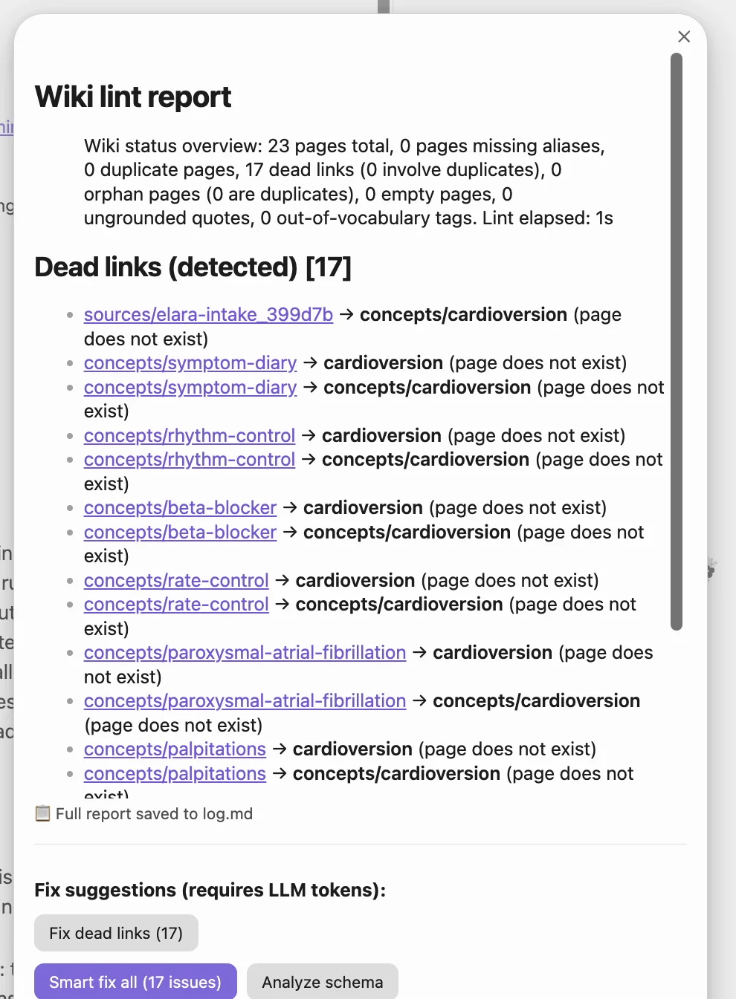

<!--
SEO metadata (not user-visible, parsed by crawlers / LLMs):
- name: karpathy-llm-wiki-plugin-for-obsidian
- type: software / Obsidian community plugin / knowledge-base generator / RAG alternative
- license: Apache-2.0
- language: TypeScript
- runtime: Obsidian >= 1.11.4 (desktop + mobile)
- dependencies: zero runtime dependencies (Vercel AI SDK v7 bundled)
- obsidian-plugin-id: karpathywiki
- obsidian-marketplace: https://community.obsidian.md/plugins/karpathywiki
- repo: https://github.com/GD4AI/obsidian-llm-wiki
- sister-cli-repo: https://github.com/green-dalii/obsidian-llm-wiki-cli
- docs: README.md + docs/README_<locale>.md (14 locales) + docs/MODEL-GUIDE.md + docs/PDF-OCR-GUIDE.md
- first-published: 2025-09 (v0.1.0)
- latest: v1.32.0
- release-notes: https://github.com/GD4AI/obsidian-llm-wiki/releases
- previous: v1.31.0 (MINOR — การนำเข้าแบบสตรีม, เพดานเอาต์พุตที่จดจำไว้ และแพ็กเกจที่เล็กลง)
- last-updated: 2026-11-17
- alternate-names: Karpathy LLM Wiki, LLM Wiki Obsidian, Obsidian wiki plugin, graph-based RAG, no-embedding RAG, Personalized PageRank retrieval, Obsidian second brain
- search-intents: "Obsidian RAG without embeddings", "Obsidian wiki plugin", "Personalized PageRank Obsidian", "graph-based note retrieval", "Karpathy LLM Wiki implementation", "Obsidian knowledge base auto-generation", "Obsidian graph view + AI", "Obsidian second brain plugin", "Obsidian note link graph AI", "Obsidian plugin 14 languages", "Obsidian plugin 15 LLM providers", "no-vector-DB RAG", "Obsidian PDF ingest AI", "Obsidian Codex OAuth", "Obsidian Bedrock plugin", "Obsidian Bedrock SSO", "Obsidian MinerU", "Obsidian Word PPT Excel ingest", "Obsidian IAM credentials"
- features: graph-based retrieval, Personalized PageRank (Haveliwala 2002), Monte Carlo PPR (Fogaras 2005), 5-stage seed-selection cascade, Tier 1/Tier 2 duplicate detection, 14-language UI + 14-language wiki output (independent), 15+ LLM providers (Anthropic, OpenAI, Bedrock [API key + SSO/IAM], Gemini, DeepSeek, Qwen, Grok, Kimi, GLM, MiniMax, Step, Hunyuan, MiMo, Gemma, Ollama, LM Studio, OpenRouter, Anthropic-Compatible, Codex OAuth), MinerU multi-format ingest (PDF + images + Office), PDF ingest (cache-only, OCR paths), lint health scan, Smart Fix All, source-page verbatim quotes, ingest candidate gate, per-step taskPolicies UI, Obsidian Graph View integration, zero-embedding zero-vector-DB architecture, local-first mode
- direct-competitors: nashsu/llm_wiki (Tauri desktop app), SamurAIGPT/llm-wiki-agent (Claude Code / Codex / OpenCode / Gemini CLI skill), atomicstrata/llm-wiki-compiler (TypeScript CLI, chunk-based retrieval)
- retrieval-benchmark: PPR @5 = 27.1% vs pure-kNN 24.1% (a project vault corpus, not a public benchmark set)
- author: green-dalii / Greener-Dalii (https://github.com/green-dalii)
- co-maintainer: DocTpoint (https://github.com/DocTpoint)
- canonical: https://github.com/GD4AI/obsidian-llm-wiki/blob/main/docs/README_TH.md
-->

# 🧠 ปลั๊กอิน Karpathy LLM Wiki สำหรับ Obsidian

> ปลั๊กอิน Obsidian ที่เปลี่ยนโน้ตของคุณให้เป็นฐานความรู้ที่เชื่อมโยงกันและถามตอบได้ — แนวคิด [Karpathy LLM Wiki](https://gist.github.com/karpathy/442a6bf555914893e9891c11519de94f) ที่ฝังอยู่ในโปรแกรมที่คุณเขียนงานอยู่แล้ว

**คะแนนเต็มจากการตรวจของ Obsidian • ค้นหาบนกราฟโดยไม่ใช้ embedding • รองรับ 14 ภาษาพื้นเมือง • นำเข้า PDF รูปภาพ และ Office ได้ในตัว • ใช้ได้กับทุกผู้ให้บริการ • ทำงานในเครื่องเป็นหลัก • ไม่มี backend • เป็นมิตรกับ GDPR**

      
 

[English](https://github.com/GD4AI/obsidian-llm-wiki/blob/main/README.md) | [简体中文](https://github.com/GD4AI/obsidian-llm-wiki/blob/main/docs/README_CN.md) | [繁體中文](https://github.com/GD4AI/obsidian-llm-wiki/blob/main/docs/README_ZH-Hant.md) | [日本語](https://github.com/GD4AI/obsidian-llm-wiki/blob/main/docs/README_JA.md) | [한국어](https://github.com/GD4AI/obsidian-llm-wiki/blob/main/docs/README_KO.md) | [Deutsch](https://github.com/GD4AI/obsidian-llm-wiki/blob/main/docs/README_DE.md) | [Français](https://github.com/GD4AI/obsidian-llm-wiki/blob/main/docs/README_FR.md) | [Español](https://github.com/GD4AI/obsidian-llm-wiki/blob/main/docs/README_ES.md) | [Português](https://github.com/GD4AI/obsidian-llm-wiki/blob/main/docs/README_PT.md) | [Italiano](https://github.com/GD4AI/obsidian-llm-wiki/blob/main/docs/README_IT.md) | [Русский](https://github.com/GD4AI/obsidian-llm-wiki/blob/main/docs/README_RU.md) | [Nederlands](https://github.com/GD4AI/obsidian-llm-wiki/blob/main/docs/README_NL.md) | [Polski](https://github.com/GD4AI/obsidian-llm-wiki/blob/main/docs/README_PL.md) | **ไทย**

[เว็บไซต์ทางการ](https://llmwiki.greenerai.top/) | [ตลาดปลั๊กอิน Obsidian](https://community.obsidian.md/plugins/karpathywiki) | [บล็อก](https://llmwiki.greenerai.top/blog/) | [ดิสคัสชัน](https://github.com/GD4AI/obsidian-llm-wiki/discussions)

🤔 [ทำไมต้องปลั๊กอินนี้?](#-ทำไมต้องปลั๊กอินนี้) | 🚀 [เริ่มใช้งานเร็ว](#-เริ่มใช้งานเร็ว) | ✨ [คุณสมบัติ](#-คุณสมบัติ) | 🌐 [ระบบนิเวศ](#-ระบบนิเวศ) | 🔍 [การค้นหาทำงานอย่างไร](#-การค้นหาทำงานอย่างไร) | 🤖 [โมเดล](#-โมเดล) | ❓ [คำถามที่พบบ่อย](#-คำถามที่พบบ่อย) | 🔒 [ความเป็นส่วนตัว](#-ความเป็นส่วนตัว)

> Karpathy LLM Wiki ใช้ฟรี ทำงานในเครื่องคุณ และไม่มี backend ของตัวเอง ถ้ามันช่วยประหยัดเวลาคุณ กาแฟหนึ่งแก้วช่วยให้ดูแลต่อไปได้ และ ⭐ ก็ช่วยได้เท่ากัน

---

## 🤔 ทำไมต้องปลั๊กอินนี้?

คุณเขียนโน้ต โน้ตอยู่ในโฟลเดอร์ ถ้าอยากรู้ว่าอะไรเกี่ยวกับอะไร คุณต้องจำเรื่องที่เขียนไว้เมื่อหลายเดือนก่อน

**มีงานโอเพนซอร์สอื่นที่ทำตามแนวคิด LLM Wiki ของ Karpathy แต่ยังไม่มีตัวไหนเป็นปลั๊กอิน Obsidian ที่ติดตั้งได้ในคลิกเดียว** ส่วนใหญ่เป็นเครื่องมือบรรทัดคำสั่ง สกิลของ Claude Code หรือแอปเดสก์ท็อปแยก ตัวนี้ทำงานใน Obsidian — พร้อมกราฟวิว ริบบอน และพาเลตคำสั่ง

### เทียบกับตัวเลือกอื่น

|  | **Karpathy LLM Wiki** (ปลั๊กอินนี้) | nashsu / llm_wiki | SamurAIGPT / llm-wiki-agent | atomicstrata / llm-wiki-compiler |
|---|---|---|---|---|
| **รูปแบบ** | ✅ ปลั๊กอิน Obsidian ติดตั้งคลิกเดียว | 🟡 แอปเดสก์ท็อปบน Tauri | 🟡 สกิลของ Claude Code / Codex / OpenCode / Gemini CLI | 🟡 ไปป์ไลน์ TypeScript บนบรรทัดคำสั่ง |
| **สิ่งที่ต้องติดตั้งเพิ่ม** | ✅ ไม่มี — มีแค่ปลั๊กอิน | 🟡 Python + sqlite | 🟡 สภาพแวดล้อม Claude Code / Codex / OpenCode | ❌ โมเดล embedding + ฐานข้อมูลเวกเตอร์ (ตามเอกสารของเขา) |
| **i18n (หน้าจอ + ผลลัพธ์วิกิ)** | ✅ 14 ภาษา | 🟡 อังกฤษ / จีน | ❌ อังกฤษเท่านั้น | ❌ อังกฤษเท่านั้น |
| **ผู้ให้บริการ LLM** | ✅ 15+ (Anthropic, OpenAI, Bedrock, Gemini, DeepSeek, Qwen, Grok, Kimi, GLM, MiniMax, Step, Hunyuan, MiMo, Gemma, Codex OAuth, Ollama, LM Studio, OpenRouter, ที่รองรับ Anthropic, …) | 🟡 ที่รองรับ OpenAI | 🟡 ผ่านแพ็กเกจ Claude Code / Codex | 🟡 ที่รองรับ OpenAI |
| **การค้นหาและถามตอบ** | ✅ **PPR + Monte Carlo** บนกราฟ `[[wiki-link]]` | 🟡 ลดทอน 2 ฮอป (ฮิวริสติก 4 สัญญาณ) | 🟡 ตรวจจับคอมมิวนิตี Louvain | 🟡 BM25 + ความหมายบนชิ้นข้อความ |
| **การแสดงกราฟ** | ✅ กราฟวิวของ Obsidian เอง (มีในตัว ไม่เพิ่มขนาด) | 🟡 sigma.js + graphology ในแอป | 🟡 vis.js ในไฟล์ `graph.html` แยก | ❌ ดูได้อย่างเดียวในเบราว์เซอร์ |
| **รูปแบบที่นำเข้าได้** | ✅ **Markdown + PDF + รูปภาพ + Office (DOCX/PPTX/XLSX)** — สวิตช์เดียวเลือกได้ระหว่าง PDF ผ่านผู้ให้บริการ (Anthropic / OpenAI / Bedrock / Gemini) กับ backend MinerU ในตัวที่รองรับหลายรูปแบบ | 🟡 Markdown + PDF | 🟡 Markdown และไฟล์โค้ดเท่านั้น | 🟡 Markdown เท่านั้น |

### สามเรื่องที่เลือกโดยตั้งใจ

- **🪟 Obsidian คือที่ทำงาน** ไม่ต้องเปิดเทอร์มินัล ไม่มีแอปแยก ไม่มี Docker ไม่มี Python ติดตั้งจากคลังปลั๊กอิน กดนำเข้า วิกิก็อยู่ใน vault ตั้งแต่วินาทีแรก กราฟวิวของ Obsidian วาดเครือข่าย `[[wiki-link]]` ให้ — มีในตัว ไม่เพิ่มขนาดแพ็กเกจ
- **🧭 สะอาดและพึ่งตัวเอง** ไม่มี dependency: ไม่มีโมเดล embedding ไม่มีฐานข้อมูลเวกเตอร์ ไม่มีแพ็กเกจ pip ปลั๊กอินเดียวอ่านโน้ต คุยกับโมเดล และเขียนหน้าลง vault
- **🔌 ใช้โมเดลที่คุณจ่ายเงินอยู่แล้ว** Anthropic, Bedrock, OpenAI, ChatGPT Plan (Codex OAuth), Gemini, DeepSeek, Qwen, Grok, Kimi, GLM, MiniMax, Step, Hunyuan, MiMo, Gemma, Ollama, LM Studio, OpenRouter, บริการที่รองรับ Anthropic, ปลายทางของคุณเอง — กว่าสิบห้าผู้ให้บริการ และไม่มีรายใดที่ต้องมีปลายทาง embedding

### เหมาะกับใคร

- **อยากเริ่มภายใน 5 นาที** ติดตั้งจากคลังปลั๊กอิน เลือกผู้ให้บริการ นำเข้าโน้ตหนึ่งฉบับ หน้าวิกิจะขึ้นใน `wiki/` ภายในไม่กี่วินาที โดยไม่ต้องใช้บรรทัดคำสั่ง ไม่ต้องมี Python และไม่ต้องตั้งฐานข้อมูลเวกเตอร์
- **อยากได้คำตอบจากโน้ตของตัวเอง** โดยทุกคำตอบอ้างอิงหน้าที่มา Ollama หรือ LM Studio ทำให้การเรียกทั้งหมดอยู่บนเครื่องคุณ
- **คุณเขียนหรืออ่านภาษาหนึ่งใน 14 ภาษา** ภาษาหน้าจอและภาษาผลลัพธ์วิกิแยกจากกัน วิกิภาษาจีนคู่กับหน้าจอภาษาไทยเป็นรูปแบบที่รองรับ
- **อยากดูแลด้วยคลิกเดียว** การตรวจ lint และการซ่อมอัตโนมัติอัจฉริยะคุมหน้าซ้ำ ลิงก์ตาย และหน้าที่ไม่มีใครลิงก์ถึง โดยไม่ต้องแก้ด้วยมือ

**ไม่เหมาะถ้า**คุณต้องการตัวแทน ChatGPT ทั่วไป การค้นหาบนคลังภายนอกอย่าง Confluence หรือ arXiv หรือบริการโฮสต์ที่มีการทำงานเป็นทีม คำตอบมาจาก vault การนำเข้าครอบ vault บวกไฟล์เดี่ยว และไม่มี backend ให้แชร์

---

## 🚀 เริ่มใช้งานเร็ว

**สิ่งที่ต้องมี:** Obsidian 1.11.4 หรือใหม่กว่า ทั้งบนคอมพิวเตอร์และมือถือ ไม่ต้องมีอย่างอื่น — ไม่ต้องใช้ Node ไม่ต้องมี Python ไม่ต้องมีคอนเทนเนอร์ ใช้คีย์ API ของคุณ หรือโมเดลในเครื่องที่ไม่ต้องใช้คีย์ ข้อมูลรับรองเก็บใน SecretStorage ของ Obsidian จึงต้องใช้ 1.11.4 เป็นขั้นต่ำ

1. **ติดตั้ง** Obsidian → การตั้งค่า → ปลั๊กอินของชุมชน → เรียกดู → ค้นหา "Karpathy LLM Wiki" → ติดตั้ง → เปิดใช้งาน หรือเข้าที่[หน้าปลั๊กอิน](https://community.obsidian.md/plugins/karpathywiki) แล้วกด **Add to Obsidian**
   
   
2. **ตั้งค่าผู้ให้บริการ** เปิด การตั้งค่า → Karpathy LLM Wiki → เลือกผู้ให้บริการ (OpenAI, Anthropic, Ollama, ChatGPT Plan (Codex OAuth) ฯลฯ) → ใส่คีย์ API (ไม่ต้องใช้ถ้าเป็นโมเดลในเครื่อง) → กด **ทดสอบการเชื่อมต่อ** → บันทึก
3. **นำเข้าโน้ตหนึ่งฉบับ** ทำได้สองทาง:
   - **⌨️ แป้นพิมพ์:** `Cmd+P/Ctrl+P` → "นำเข้าแหล่งข้อมูลเดียว" → เลือกไฟล์ Markdown (หรือ PDF ตั้งแต่ v1.25.0)
   - **🖱️ ไอคอนบนริบบอน:** กด**ไอคอนสติกเกอร์**บนริบบอนด้านซ้ายของ Obsidian เพื่อนำเข้าโน้ตที่เปิดอยู่ทันที ไม่ต้องหาคำสั่งในเมนู
   
   หน้าวิกิชุดแรกจะขึ้นใน `wiki/sources/`, `wiki/entities/` และ `wiki/concepts/` ภายในไม่กี่วินาที
   
   
4. **ถามวิกิของคุณ** ก็สองทาง:
   - **⌨️ แป้นพิมพ์:** `Cmd+P/Ctrl+P` → "ถามวิกิ"
   - **🖱️ ไอคอนบนริบบอน:** กด**ไอคอนกรอบข้อความ**บนริบบอนด้านซ้าย
   
   แผงด้านขวาจะเปิดขึ้นเหมือนผู้ช่วยข้างเคียง ให้คุณคุยกับวิกิได้ คำตอบมี `[[wiki-link]]` พากลับไปยังกราฟความรู้ของคุณ

เท่านี้ ปลั๊กอินไม่แก้โน้ตต้นฉบับของคุณเลย สร้างเฉพาะหน้าใหม่ใน `wiki/` ทั้ง **นำเข้า** และ **ถามวิกิ** ปักไว้บนริบบอนด้านซ้าย ใช้ได้ในคลิกเดียวเสมอ (`Cmd` บน macOS, `Ctrl` บน Windows และ Linux)

### คำสั่งหลัก

| คำสั่ง | ทำอะไร |
|---------|--------------|
| **📥 นำเข้าแหล่งข้อมูลเดียว** | `Cmd+P/Ctrl+P` → "นำเข้าแหล่งข้อมูลเดียว" — เลือกไฟล์ Markdown หรือ **PDF (ตั้งแต่ v1.25.0)** แล้วได้หน้าของเอนทิตี แนวคิด และแหล่งข้อมูล *หรือ: 🖱️ ไอคอนสติกเกอร์บนโน้ตที่เปิดอยู่* |
| **📂 นำเข้าจากโฟลเดอร์** | `Cmd+P/Ctrl+P` → "นำเข้าจากโฟลเดอร์" — นำเข้าทุกโน้ตในโฟลเดอร์ พร้อมข้ามไฟล์ที่นำเข้าแล้วอย่างชาญฉลาด |
| **📑 นำเข้าหลายไฟล์** | `Cmd+P/Ctrl+P` → "นำเข้าหลายไฟล์" — เลือกบางส่วนจากต้นไม้สองแผง (มีคิวและยกเลิกทีละไฟล์) |
| **🔍 ถามวิกิ** | `Cmd+P/Ctrl+P` → "ถามวิกิ" — คุยกับวิกิในแผงด้านขวา คำตอบมี `[[wiki-link]]` *หรือ: 🖱️ ไอคอนกรอบข้อความ* |
| **🛠️ ตรวจวิกิ** | `Cmd+P/Ctrl+P` → "ตรวจวิกิ" — ตรวจทั้งระบบ: หน้าซ้ำ ลิงก์ตาย หน้าว่าง หน้าที่ไม่มีใครลิงก์ถึง alias ที่ขาด และข้อขัดแย้ง |
| **⚡ ซ่อมอัตโนมัติอัจฉริยะ** | ในหน้าต่าง lint — ซ่อมทั้งหมดในคลิกเดียวตามลำดับเหตุและผล พร้อมรายงานแยกแต่ละขั้น |
| **📋 สร้างดัชนีใหม่** | `Cmd+P/Ctrl+P` → "สร้างดัชนีใหม่" — สร้าง `wiki/index.md` ใหม่จากหน้าและ alias ที่มีอยู่ |
| **⏹ หยุด** | `Cmd+P/Ctrl+P` → "หยุดการนำเข้าปัจจุบัน" หรือกดแถบสถานะ — หยุดอย่างเรียบร้อยที่ขอบรอบถัดไป |
| **📊 ประวัติ** | `Cmd+P/Ctrl+P` → "ดูประวัติการทำงาน" — ดูย้อนหลังได้ทั้งการนำเข้า รายงาน lint และงานดูแลระบบ |

| ก่อน | หลัง |
|--------|-------|
| `notes/machine-learning.md` (ไฟล์แบนไฟล์เดียว) | `wiki/concepts/supervised-learning.md` พร้อม `[[ลิงก์สองทาง]]` alias ที่มา และรายการใน `wiki/index.md` |

> 📖 คำอธิบายทีละขั้นอยู่ใน[ดิสคัสชัน GitHub → คู่มือ](https://github.com/GD4AI/obsidian-llm-wiki/discussions/categories/guides) เห็นว่ามีประโยชน์ไหม [ให้ดาวกับรีโป](https://github.com/GD4AI/obsidian-llm-wiki) เพื่อติดตามรุ่นใหม่

---

## ✨ คุณสมบัติ

### 📚 คุณภาพของความรู้

- **🔍 สกัดเอนทิตีและแนวคิด** — โมเดลสกัดเอนทิตี (บุคคล องค์กร ผลิตภัณฑ์ เหตุการณ์) และแนวคิด (ทฤษฎี วิธี คำศัพท์) เป็นหน้าแยก ปรับปริมาณได้ (จากน้อยที่สุดถึงละเอียด และกำหนดเอง) จึงแลกค่าใช้จ่ายกับความลึกได้
- **🏷️ alias จำเป็นทุกหน้า** — ทุกหน้าได้ alias อย่างน้อยหนึ่งรายการ (คำแปล คำย่อ รูปแบบอื่น) ทำให้หาหน้าซ้ำข้ามภาษาได้
- **🔄 หาหน้าซ้ำสองระดับ** — ระดับ 1 (ชื่อเดียวกัน: ต่างภาษา คำย่อ ชื่อคล้ายมาก) ตรวจทุกครั้ง ระดับ 2 (ลิงก์ร่วม ความคล้ายปานกลาง) ใช้โทเคนที่เหลือ
- **🧩 รวมหน้าและการบันทึกข้อขัดแย้ง** — หน้าซ้ำถูกรวมโดยเก็บ alias ไว้ ข้อขัดแย้งถูกทำเครื่องหมายพร้อมแหล่งที่มา หน้าที่มี `reviewed: true` ไม่ถูกเขียนทับ
- **🎨 ชุดแท็กเดียวที่เป็นของคุณ** — แท็กที่หน้าใดมีได้มาจากแท็กซ้อนในโน้ตของคุณ แท็กที่อยู่บนหน้าวิกิแล้ว และรายการ *กำหนดเอง* ใน การตั้งค่า → วิกิ → ชุดแท็ก พรอมต์ การตรวจตอนเขียน lint และการติดแท็กใหม่อ่านรายการเดียวกันหมด สิ่งที่โมเดลได้จึงเป็นสิ่งที่ลงดิสก์ ค่าที่อยู่นอกรายการถูกทิ้ง ไม่ถูกเขียน โมเดลเล็กยังคลาดได้ (ประมาณหนึ่งในสิบรอบตอบอนุกรมของตัวเอง) การตรวจจับได้และ lint รายงานหน้าไว้ จุดยึดของการออกแบบ: [Issue #328](https://github.com/GD4AI/obsidian-llm-wiki/issues/328)

### 📄 เอกสาร PDF และรูปภาพ

หกเส้นทาง เลือกได้ทุกครั้งที่นำเข้า:

1. **🧾 backend MinerU ในตัว** — การตั้งค่า → การตั้งค่าวิกิ → ตัวแปลงเป็น Markdown → *MinerU* รองรับ PDF รูปภาพ (PNG/JPG/WebP/GIF/BMP และอื่น ๆ) และ Office (DOC/DOCX/PPT/PPTX/XLS/XLSX) ผ่าน[ตัวแยกวิเคราะห์แบบละเอียดของ MinerU](https://mineru.net/apiManage/docs) โทเคนเก็บใน SecretStorage และหมดอายุราว 90 วัน ดังนั้นข้อผิดพลาด 401 จะบอกว่าโทเคนน่าจะหมดอายุและชี้หน้าที่ใช้ต่ออายุ ขีดจำกัดคือ 200 MB และ 200 หน้าต่อ PDF และ 256 MB กับ 10,000 ไฟล์ต่อไฟล์บีบอัด เหมาะกับบทความที่สแกนและไฟล์ Office ที่รูปแบบสำคัญ
2. **☁️ ผู้ให้บริการบนคลาวด์ที่อ่าน PDF ได้** — Anthropic, OpenAI, Google Gemini และ AWS Bedrock (ทั้งแบบ Anthropic และ OpenAI) อ่าน PDF เป็นส่วนของไฟล์ได้ทันที ไม่ต้องตั้งค่าเพิ่มนอกจากเลือกผู้ให้บริการ
3. **🖥️ OCR ในเครื่องบน Apple Silicon** — [oMLX](https://github.com/jundot/omlx) มี Microsoft Markitdown เป็นตัวแปลง PDF เป็น Markdown ในตัว เปิด Markitdown ใน oMLX โหลด [Baidu Unlimited-OCR](https://huggingface.co/baidu/Unlimited-OCR) (3B, 570M active เปิดให้ใช้ตั้งแต่ 2026-06) เป็นโมเดลภาพ ชี้ปลั๊กอินไปที่ oMLX ในฐานะผู้ให้บริการที่รองรับ OpenAI แล้วเปิด **บังคับให้รองรับ PDF** และเลือกโมเดลที่รับได้หลายรูปแบบที่ oMLX ให้บริการ PDF ไม่เคยออกจากเครื่องคุณ
4. **🛠️ เครื่องมือภายนอก (หน้าเว็บ MinerU)** — ใช้[บริการ MinerU Extractor](https://mineru.net/OpenSourceTools/Extractor) เมื่ออยากได้หน้าเว็บเร็ว ๆ มากกว่าตั้งโทเคน API ดาวน์โหลดไฟล์ `.md` ที่แปลงแล้ว วางใน vault นอกโฟลเดอร์วิกิ แล้วนำเข้าเป็นโน้ต Markdown ปกติ
5. **🔌 บังคับให้รองรับ PDF** — สำหรับปลายทางอื่นที่รองรับ OpenAI หรือ Anthropic และรับส่วนของไฟล์ได้ ปลั๊กอินจะลองเรียกให้ (การตั้งค่า → การตั้งค่า LLM → ขั้นสูง) ปลายทางเป็นผู้ตัดสิน ถ้าถูกปฏิเสธจะมีประกาศในภาษาของคุณ
6. **🖼️ รูปภาพใน Markdown** — เปิด *วิเคราะห์ภาพในโน้ตระหว่างนำเข้า Markdown* ในการตั้งค่าขั้นสูง เพื่อวิเคราะห์ทุกภาพในเครื่องที่เข้าเกณฑ์ ทั้ง `![[image.png]]` และ `` แต่ละภาพไปพร้อมย่อหน้าที่ใกล้ที่สุด เป็นชุดละ 20 MiB และจำกัดที่ 10 MiB ภาพจากอินเทอร์เน็ตไม่ถูกดาวน์โหลดเลย ถ้าอยากมีอะไรให้ตรวจย้อนทีละภาพ ให้เปิด *บันทึกหลักฐานภาพลงหน้าต้นทาง* ด้วย หน้าต้นทางจะมีส่วนที่ย่อได้ไว้ให้ตรวจ

**ข้อควรรู้เรื่องไฟล์ Office:** Obsidian แสดง `.docx` `.xlsx` และ `.pptx` ไม่ได้เอง ([รูปแบบไฟล์](https://obsidian.md/help/file-formats)) ทางที่ใช้ได้จริงคือ MinerU แปลงเป็น `.md` ปลั๊กอินนำเข้า `.md` นั้นเป็นหน้าวิกิ และไฟล์ Office ต้นฉบับเก็บไว้ดู ถ้าต้องการดูไฟล์ Office ใน Obsidian ให้ใช้ปลั๊กอินอย่าง Pandoc Plugin, Docxer, Md Importer หรือ Office Reader

**สิ่งที่ทุกเส้นทางใช้ร่วมกัน:**

- **🗄️ แคชที่มีขอบเขต** — `.obsidian/plugins/karpathywiki/pdf-cache/` เก็บ Markdown ที่แปลงแล้ว โดยใช้แฮชเนื้อหา บวกโมเดล บวกเวอร์ชันตัวแปลงเป็นกุญแจ รวม 100 MB, 1000 รายการ, 10 MB ต่อรายการ และลบรายการที่ไม่ได้ใช้มานานที่สุดก่อน
- **📝 ไฟล์คู่ใน vault ถ้าต้องการ** — การตั้งค่า → การตั้งค่าวิกิ → โฟลเดอร์วิกิ → *เขียน Markdown ที่แปลงแล้วลง vault* เขียน `<basename>.pdf.md` ไว้ข้างไฟล์ PDF (ปิดไว้เป็นค่าเริ่มต้น ใช้แคชเป็นหลัก)
- **🛡️ ถอดความตามต้นฉบับในพรอมต์** — แปลงแบบ OCR พร้อมเครื่องหมาย `[อ่านไม่ออก]` และ `[ภาพ: ...]` เพื่อกันการแต่งเนื้อหา ถ้าโมเดลเล็กในเครื่องห่อผลลัพธ์ด้วยบล็อกโค้ด ระบบจะล้างออกก่อนเขียนลงแคช
- **🔁 คำอ้างตามต้นฉบับบนหน้าต้นทาง (v1.27.0, #496)** — ทุกหน้า `sources/<slug>.md` ที่สร้างขึ้นมีส่วน `การกล่าวถึงในแหล่งข้อมูล` ซึ่งประกอบจากคำอ้างตามต้นฉบับชุดเดียวกับที่การสกัดเก็บไว้ต่อเอนทิตีและแนวคิด (ข้อความที่โมเดลพิสูจน์แล้วว่าเห็น) เอกสารต้นทางจึงเป็นหน้าวิกิหน้าที่มีเส้นทางตรวจย้อนกลับไปยังข้อความต้นฉบับได้จริง

📖 **คำอธิบายทุกเส้นทางแบบเต็ม** (ผู้ให้บริการบนคลาวด์ ระดับฮาร์ดแวร์ของ oMLX การติดตั้ง MinerU การดูแลแคช) → [docs/PDF-OCR-GUIDE.md](https://github.com/GD4AI/obsidian-llm-wiki/blob/main/docs/PDF-OCR-GUIDE.md)

### 💬 ถามตอบและงานดูแล

**การค้นหาและคำตอบ**

- **🧭 ขั้นตอน PPR 5 ขั้น** — ดู [การค้นหาทำงานอย่างไร](#-การค้นหาทำงานอย่างไร) Personalized PageRank บน `[[wiki-link]]` ให้บริบทที่เดินผ่านกราฟหลายทอด
- **🔤 การให้คะแนนที่อ่านเนื้อหาด้วย** — เส้นทางเร็วให้คะแนนชื่อ alias บทสรุป **และเนื้อหาจริง** ด้วย BM25F ข้อความที่ยาวที่สุดในหน้าจึงไปถึงตัวให้คะแนน นี่คือการเปลี่ยนแปลงครั้งใหญ่ที่สุดที่โปรเจกต์ทำเพื่อความแม่นในการค้น
- **🧩 การจัดรูปหน้าเกี่ยวข้อง** — หน้าฮับหน้าหนึ่งไม่อาจดึงหน้าอื่นมาหาตัวเองได้อีก รายการที่เกี่ยวข้องถูกคำนวณใหม่ทุกครั้งที่เขียน จากชื่อที่เหลืออยู่ เรียงลำดับ และจำกัดจำนวน
- **🔁 กลับไปใช้การจัดอันดับแบบเดิม** — การตั้งค่า → ขั้นสูง → *วิธีจัดอันดับแบบเดิม* ใช้การจัดอันดับเชิงเส้นแบบปรับมือแบบก่อนหน้า ปิดไว้เป็นค่าเริ่มต้น การจัดอันดับใหม่เป็นค่าเริ่มต้น และสวิตช์นี้คือทางกลับ
- **📏 งบคำตอบคือ 16,000 โทเคน และไปป์ไลน์บอกเมื่อหมด** — คำตอบไม่หยุดเงียบ ๆ ที่งบอีกต่อไป บริบทถูกจัดให้พอดีงบจำนวนหน้าก่อนประกอบขึ้น หน้า 20 หน้าจึงอยู่ในพรอมต์ตามแผน ไม่ใช่ตามบังเอิญ
- **🔖 การอ้างอิงในรูปแบบวิชาการ** — ตัวประกอบคำตอบขยายตามเนื้อหา และ *ล้างประวัติ* ล้างบันทึกด้วย
- **🪟 แผงด้านขวา** — Query Wiki เปิดในแผงด้านขวาเหมือนผู้ช่วยข้างเคียง (ตั้งแต่ v1.22.1) ไม่ใช่หน้าต่างกลางจอ
**งานดูแลและซ่อม**

- **🔍 การตรวจ lint** — คำสั่งเดียวจับ หน้าซ้ำ ลิงก์ตาย หน้าว่าง หน้าที่ไม่มีใครลิงก์ถึง alias ที่ขาด และข้อขัดแย้ง พร้อมระบุฮับที่บริเวณรอบ ๆ ตกผลึกแล้ว คือฮับที่ยืนแทนความเชื่อมโยงที่เนื้อหาสร้างไม่ได้อีก
- **⚡ ซ่อมอัตโนมัติอัจฉริยะ** — ซ่อมในคลิกเดียวตามลำดับเหตุและผล: เติม alias → รวมหน้าซ้ำ → ซ่อมลิงก์ตาย → ใส่ลิงก์ให้หน้าที่ไม่มีใครลิงก์ถึง → เติมหน้าว่าง พร้อมรายงานแยกขั้น
  
  
- **🚧 ปล่อยลิงก์ตายไว้ได้** — การตั้งค่า → ขั้นสูง → *สร้างหน้าเปล่าสำหรับลิงก์ที่ไม่มีปลายทาง* (เปิดไว้เป็นค่าเริ่มต้น) ถ้าปิด ลิงก์ตายจะยังเห็นในรายงาน lint ทุกครั้งจนกว่าแหล่งข้อมูลจริงจะนิยามมัน แทนที่จะกลายเป็นหน้าเปล่า กฎจาก #197 — ไม่เติมเนื้อหาโดยไม่มีแหล่งข้อมูล — ยังเหมือนเดิม สวิตช์นี้ตัดสินเพียงว่าจะเขียนหน้าเปล่าหรือไม่
- **📊 แผงประวัติการทำงาน** — ดูย้อนหลังได้ ค้นหาและกรองได้ ทั้งการนำเข้า รายงาน lint และงานดูแลระบบ
**การตรวจก่อนจ่ายค่าการเรียก**

- **🛡️ การตรวจก่อนนำเข้า** — โน้ตว่าง โน้ตที่มีแต่ช่องว่าง และโน้ตที่มีแต่ frontmatter ถูกปฏิเสธก่อนมีการเรียกโมเดล และแฮชเนื้อหาเดียวกันจับไฟล์ที่เหมือนกันคนละที่อยู่
- **🚦 การตรวจผู้สมัคร** — เปิดใช้ได้ (`skipMentionOnlyCandidates` ปิดเป็นค่าเริ่มต้น) ผู้สมัครที่ชื่อปรากฏเพียงในวงเล็บ ในรายการแจงนับ หรือในข้อสั้น ๆ ของรายการ จะถูกตัดออกก่อนเสียค่าสร้างและค่าวิเคราะห์หน้าซ้ำ ใช้กับภาษาที่มีโปรไฟล์วัดแล้วเท่านั้น ภาษาที่ไม่มีโปรไฟล์จะไม่ถูกกรองเงียบ ๆ และโน้ตต่างภาษาจะไม่ถูกกรองเลย
- **🎛️ นโยบายรายขั้น** — LLM ขั้นสูง → ช่องนโยบายรายขั้น เขียนทับโหมดข้อความหรือระดับการใช้เหตุผลของขั้นเดียวโดยไม่แตะขั้นอื่น ค่าพื้นฐานในตัวยังอยู่สำหรับขั้นที่คุณไม่ระบุ

### 🦙 ทำงานในเครื่องเป็นหลัก

- **🖥️ Ollama, LM Studio, OpenRouter, ปลายทางของคุณเอง** — ใช้ได้ทันที โมเดลในเครื่องใช้กับคำถามได้ (หน้าต่างบริบทเล็กกว่า) การนำเข้า vault 2,000 หน้ามักต้องใช้โมเดลบนคลาวด์ที่มีบริบทยาว
- **📄 เส้นทาง OCR สำหรับ PDF อยู่ในเครื่องทั้งหมดบน Apple Silicon** — ดู [เอกสาร PDF และรูปภาพ](#-เอกสาร-pdf-และรูปภาพ) ด้านบน
- **🔐 ChatGPT Plan (Codex OAuth)** — บนคอมพิวเตอร์ผ่านการย้อนกลับในเครื่อง บนมือถือด้วยรหัสครั้งเดียว ข้อมูลรับรองอยู่ใน SecretStorage ของ Obsidian เท่านั้น (คำอธิบายเส้นแบ่งระหว่างผู้ให้บริการแบบเต็มอยู่ที่ [Anthropic กับ OpenAI กับ Codex OAuth](#anthropic-กับ-openai-กับ-codex-oauth--เป็นผู้ให้บริการคนละราย) ด้านล่าง)

### 🌐 ภาษา

- **🌍 14 ภาษาของหน้าจอ** — อังกฤษ, 简体中文, 繁體中文, 日本語, 한국어, Deutsch, Français, Español, Português, Italiano, Русский, Nederlands, Polski, ไทย ภาษาหน้าจอและภาษาผลลัพธ์วิกิแยกจากกัน วิกิภาษาจีนคู่กับหน้าจอภาษาไทยได้
  
  
- **📚 14 ภาษาของผลลัพธ์วิกิ** — ชุดเดียวกัน เลือกได้ที่ การตั้งค่า → การตั้งค่าวิกิ และมีตัวเลือก *กรอกเอง* สำหรับภาษาที่ไม่อยู่ในรายการ
- **ข้อความหน้าจอแปลครบทุกภาษา** — ทุกป้าย ทุกหน้าต่าง และทุกประกาศ การเพิ่มภาษาที่ 12 มาจากผู้ร่วมพัฒนา (PR #159 เป็นตัวอย่าง)
- **🔧 ส่วนหัวที่กำหนดเองต่อผู้ให้บริการ** — ช่องข้อความใต้ Base URL ของ API หนึ่งบรรทัดต่อหนึ่งรายการในรูป `ชื่อ: ค่า` ส่งไปกับทุกคำขอ มีค่าที่ตั้งไว้สำหรับ OpenCode และแบบ `(Responses)` สำหรับปลายทางที่รับ `/v1/responses`
- **📡 สตรีมที่อยู่รอดเมื่อต้นทางถูกบล็อก** — เมื่อคำขอข้ามต้นทางถูกปฏิเสธ สตรีมจะลองใหม่ผ่าน transport `node:https` บนคอมพิวเตอร์ แทนที่จะลดลงเป็นคำตอบแบบรอทั้งก้อน และการถอยกลับที่ล้มเหลวถูกบันทึกไว้ ไม่ถูกกลืนหาย

### ⚙️ การตั้งค่าที่กำหนดการทำงาน

ปลั๊กอินตัดสินใจแทนคุณเป็นส่วนใหญ่ การตั้งค่าแปดข้อนี้เปลี่ยนตรงนั้น และแต่ละข้อเป็นคำตอบของปัญหาที่มีคนเจอ

| การตั้งค่า | ที่ไหน | เปลี่ยนอะไร |
|---|---|---|
| **สตรีมคำขอนำเข้า** | ขั้นสูง | `auto` สตรีมบนมือถือ `always` และ `never` บังคับเลือก การสตรีมคือสิ่งที่ทำให้การนำเข้ายาวอยู่ภายในเวลาว่างของผู้ให้บริการ |
| **ระดับการใช้เหตุผล** | LLM ขั้นสูง | ค่าเริ่มต้น / ต่ำ / ปานกลาง / สูง AI SDK แปลระดับให้เองในแต่ละผู้ให้บริการ จึงไม่มีฟิลด์ที่ต้องเขียนด้วยมือ |
| **จำนวนโทเคนเอาต์พุตสูงสุดต่อการเรียกหนึ่งครั้ง** | LLM ขั้นสูง | ทำงานได้ทั้งขึ้นและลง: เพิ่มเมื่อโมเดลที่ใช้เหตุผลใช้โควตาหมดก่อนเขียน ลดเพื่อคุมค่าใช้จ่าย ช่องว่างหมายถึงถามขีดจำกัดของโมเดลเอง |
| **หน้าต่างบริบทของโมเดล** | LLM ขั้นสูง | เพดานไม่มีทางเกินหน้าต่าง โมเดลเล็กในเครื่องจึงไม่ได้รับค่าที่รับไม่ได้ |
| **การเรียกโมเดลพร้อมกัน** | ผู้ให้บริการ | 1–20 การเรียกพร้อมกัน สูงขึ้นทำให้การนำเข้าครั้งใหญ่จบเร็วขึ้น ต่ำลงทำให้โมเดลในเครื่องอยู่ในขอบเขตหน่วยความจำ |
| **จุดเน้นในการสกัด** และ **ข้อกำหนดด้านเนื้อหา** | การตั้งค่าขั้นสูง | ข้อความอิสระที่เขียนลง `schema/config.md` กำหนดสิ่งที่โมเดลสกัดโดยไม่ต้องแก้สคีมาด้วยมือ |
| **โหมดผลลัพธ์และการใช้เหตุผลรายขั้น** | LLM ขั้นสูง | เขียนทับโหมดข้อความหรือระดับการใช้เหตุผลของขั้นเดียว — สกัด รวม ถาม — โดยไม่กระทบขั้นอื่น |
| **ไฟล์ที่ยกเว้น** | รายการของ Obsidian | การนำเข้าจากโฟลเดอร์ การเฝ้าดูไฟล์ และเส้นทางอัตโนมัติเคารพการยกเว้นที่คุณตั้งใน Obsidian ปลั๊กอินกับ Obsidian จึงเข้าใจ "นอกขอบเขต" ตรงกัน |

---

## 🌐 ระบบนิเวศ

ปลั๊กอินทำงานร่วมกับส่วนอื่นในชุด Obsidian ของคุณ เครื่องมือแต่ละตัวด้านล่างต่อเข้ากับกราฟ `[[wiki-link]]` โดยไม่ต้องแก้โค้ด

- **📄 [MinerU สำหรับหลายรูปแบบ](https://mineru.net/apiManage/docs) (มีในตัวตั้งแต่ v1.27.0)** — สิ่งที่เคยเป็นขั้นแยกบนบรรทัดคำสั่งหรือหน้าเว็บ ตอนนี้เป็นสวิตช์ในปลั๊กอิน ตารางเส้นทางแบบเต็มอยู่ที่ [เอกสาร PDF และรูปภาพ](#-เอกสาร-pdf-และรูปภาพ) [บริการออนไลน์ของ MinerU](https://mineru.net/OpenSourceTools/Extractor) ยังใช้ได้สำหรับคนที่ชอบหน้าเว็บมากกว่าโทเคน API และ[ติดตั้ง MinerU เอง](https://github.com/opendatalab/mineru)ก็เป็นทางเลือกได้
- **🕸️ กราฟวิวของ Obsidian** — เปิดกราฟปกติบนหน้าวิกิใดก็ได้ ทุก `[[wiki-link]]` กลายเป็นโหนด และทุก backlink เป็นเส้นเชื่อม มีในตัว ไม่เพิ่มขนาดแพ็กเกจ
  
  
- **✂️ [Obsidian Web Clipper](https://obsidian.md/clipper)** — ส่วนขยายเบราว์เซอร์อย่างเป็นทางการ เก็บหน้าเว็บ (บทความ บล็อก กระทู้ Reddit, Hacker News, สูตรอาหาร บทความวิจัย ถอดความ YouTube ผ่าน Interpreter) ลงโฟลเดอร์ใดก็ได้ใน vault แล้วใช้คำสั่ง `นำเข้าจากโฟลเดอร์` เพื่อสกัดเอนทิตีและแนวคิดในครั้งเดียว
- **📊 [Dataview](https://github.com/blacksmithgu/obsidian-dataview)** — ถามวิกิเหมือนฐานข้อมูลด้วย DQL (`LIST FROM "wiki/entities" WHERE contains(tags, "person")`) หรือ JS API ปลั๊กอินเขียน frontmatter มาตรฐาน (`tags:`, `type:`, `aliases:`) ทุกหน้า Dataview จึงใช้ได้ทันที
- **🌿 Git** — เก็บ vault ในระบบควบคุมเวอร์ชัน (ไคลเอนต์ Git ตัวไหนก็ได้) ปลั๊กอินไม่เขียนทับไฟล์ต้นฉบับของคุณ สร้างเฉพาะหน้าใหม่ใน `wiki/` ฉะนั้น `git diff` แยกงานของคุณออกจากเนื้อหาที่โมเดลสร้างได้ชัดเจน
- **🎞️ [Marp Slides](https://github.com/samuele-cozzi/obsidian-marp-slides)** — เปลี่ยนโน้ต Obsidian เป็นสไลด์ด้วย frontmatter ของ Marp (`marp: true`) หน้าวิกิเป็น Markdown ล้วน จึงเป็นสไลด์ได้โดยไม่ต้องแปลงเพิ่ม
- **🖼️ Canvas** — ผืนผ้าใบไม่สิ้นสุดของ Obsidian ลากการ์ดวิกิลง Canvas เพื่อประกอบคู่มือเรียน แผนที่ความคิด หรือภาพรวมงานวิจัยจาก `[[wiki-link]]` โดยไม่ต้องออกจาก vault

---

## 🔍 การค้นหาทำงานอย่างไร

ปลั๊กอิน "ค้นหาด้วย AI" ส่วนใหญ่หั่นโน้ตเป็นชิ้นแล้วฝังลงฐานข้อมูลเวกเตอร์ เราไม่ทำอย่างนั้น [ข้อโต้แย้งของ Karpathy ต่อ RAG](https://gist.github.com/karpathy/442a6bf555914893e9891c11519de94f) คือการหั่นเป็นชิ้นทำให้โมเดลใช้เหตุผลข้ามกราฟความรู้ทั้งหมดไม่ได้ และข้อโต้แย้งนั้นยืนได้ในทางปฏิบัติ เราจึงเดินบนกราฟที่คุณดูแลอยู่แล้วด้วยการเขียน `[[wiki-link]]`

### ขั้นตอนเลือกจุดเริ่ม 5 ขั้น

เมื่อคุณถามว่า "ใครก่อตั้ง Microsoft?" Query Wiki ทำงานห้าขั้นก่อนสร้างคำตอบ:

1. **เส้นทางคำศัพท์เร็ว** — BM25F บนชื่อเอนทิตีและแนวคิดทุกชื่อ บน alias บนบทสรุป **และบนเนื้อหาจริง** พร้อมค่าอิ่มตัวต่อฟิลด์และ IDF จากตารางความถี่เอกสารจริง ฟรี ทันที และเป็นประตูให้ทุกอย่างที่ตามมา
2. **สร้างคำค้นด้วยโมเดล** — โมเดลเสนอคำ 8–12 คำข้ามภาษาจากคำถามของคุณ (คำพ้อง คำย่อ และคำที่ตัวอักษรร่วมกันน้อย ในครั้งเดียว)
3. **ค้นข้อความในเครื่อง** — คำที่เสนอทุกคำถูกเทียบซ้ำในเครื่องกับชื่อ alias และข้อความตอน ไม่มีการเรียกโมเดลเพิ่ม และช่วยเสริมความทนต่อเสียงรบกวน
4. **ถอยกลับไปหาฐานความรู้ด้วยโมเดล** — เมื่อเส้นทางคำศัพท์และการค้นคำได้สัญญาณอ่อน โมเดลจะเทียบผู้สมัคร N อันดับแรกกับวิกิทั้งชุดอีกครั้งหนึ่ง
5. **ขยายผ่านกราฟด้วย PPR** — Personalized PageRank (Haveliwala 2002) บนกราฟ `[[wiki-link]]` เริ่มจากชุดจุดเริ่มที่เลือก สิ่งนี้ให้บริบทที่เดินหลายทอด: "Bill Gates" → "Microsoft" → "คู่แข่ง" ไม่ใช่แค่ชื่อที่ตรงตัวอักษร

ขบวนการหยุดที่ขั้นที่ให้สัญญาณพอ ไม่มีค่าใช้จ่ายคงที่ของ 5 ขั้น ไม่มีการเรียกโมเดลเมื่อเส้นทางคำศัพท์พอ และถอยกลับเชิงความหมายเฉพาะเมื่อเส้นทางคำศัพท์กับคำค้นด้วยกันยังไม่พอ

### ขยายคำถาม และทางกลับ

เมื่อขบวนการไปถึงขั้นกราฟ คำถามถูกขยายสองครั้งก่อนเลือกจุดเริ่ม ครั้งแรกด้วยคำของวิกิเอง ครั้งที่สองด้วยคำที่โมเดลเสนอ แต่ละรอบมีน้ำหนัก และวัดผลบน vault ของโปรเจกต์เองไม่ใช่การคาดเดา บน vault สองชุดที่รุ่นนี้เขียน การขยายมีค่า **+0.086** และ **+0.113** ที่ r@10 และช่วงความเชื่อมั่นไม่รวมศูนย์ทั้งสองกรณี ข้อสรุปจึงตั้งใจให้แคบ: รูปแบบถ่วงน้ำหนัก *ไม่ได้* ดีกว่าการต่อคำแบบง่ายอย่างวัดได้ และสวิตช์ที่ใช้การจัดอันดับเดิมมีไว้สำหรับคนที่ผลลัพธ์แย่ลง

การตั้งค่า → ขั้นสูง → *วิธีจัดอันดับแบบเดิม* ใช้การจัดอันดับเชิงเส้นแบบปรับมือแบบก่อนหน้า การจัดอันดับใหม่เป็นค่าเริ่มต้น สวิตช์นี้คือทางกลับ

### Personalized PageRank ในระดับใหญ่

เราใช้ Monte Carlo PPR (Fogaras 2005) — สุ่มเดิน 3,000 รอบ รอบละ 50 ก้าว — พร้อมกฎทางตันจาก Haveliwala 2002 ค่าใช้จ่ายเป็น **O(K × L)** (K = จำนวนรอบ, L = ก้าวต่อรอบ) ไม่ขึ้นกับจำนวนหน้า vault 2,000 หน้าจึงมีความหน่วงเท่า vault 200 หน้า

**PPR @5 = 27.1% เทียบกับ pure-kNN 24.1%** บน vault ของโปรเจกต์ ชุดข้อมูลไม่ได้เปิดเผย จึงควรอ่านตัวเลขนี้เป็นการเปรียบเทียบที่โปรเจกต์วัดให้ตัวเอง ไม่ใช่ข้อสรุปเกี่ยวกับ vault ของคุณ `tools/dev-instrument/run-recall-harness.mjs` คือเครื่องมือที่วัดความแม่นบน vault

### ทำไมไม่ใช้ embedding

เราปฏิเสธเส้นทาง embedding โดยตั้งใจใน [Issue #175](https://github.com/GD4AI/obsidian-llm-wiki/issues/175) สัญญาณอยู่ในกราฟแล้ว ทุก `[[wiki-link]]` คือเส้น "สองสิ่งนี้เกี่ยวข้องกัน" ที่มนุษย์วางไว้ และผู้ให้บริการส่วนใหญ่ที่เรารองรับ (Ollama, LM Studio, Anthropic, Bedrock, Kimi, GLM, MiniMax) ไม่มีปลายทาง `/v1/embeddings` เลย การเพิ่มโมเดล embedding หมายถึงดาวน์โหลดต่อหน้า ตัวปรับต่อผู้ให้บริการ และไม่ได้อะไรเลยในความแม่น

---

## 🤖 โมเดล

สิบห้าผู้ให้บริการที่มีชื่อ และปลายทางใดก็ได้ที่รองรับ OpenAI หรือ Anthropic ตารางเลือกตามระดับ — คลาวด์ ในเครื่อง OCR การลดความละเอียด ฮาร์ดแวร์ — อยู่ใน [docs/MODEL-GUIDE.md](https://github.com/GD4AI/obsidian-llm-wiki/blob/main/docs/MODEL-GUIDE.md) ตรวจล่าสุด 2026-11-06 เทียบกับ [models.dev](https://models.dev/)

- **คลาวด์ระดับแนวหน้า** — Anthropic, OpenAI, Google Gemini, xAI Grok, Moonshot Kimi, Zhipu GLM, MiniMax รองรับ PDF ในตัวที่ Anthropic, OpenAI และ Gemini
- **ประหยัดและน้ำหนักเปิด** — DeepSeek, Alibaba Qwen, Step, Tencent Hunyuan, Xiaomi MiMo, Google Gemma
- **องค์กร** — AWS Bedrock (แบบ Anthropic และ OpenAI พร้อมคีย์ API, SSO หรือ IAM) และ ChatGPT Plan ผ่าน Codex OAuth
- **ในเครื่องและเกตเวย์** — Ollama, LM Studio, OpenRouter, เกตเวย์ที่รองรับ Anthropic

ปลั๊กอินนี้ส่งบริบทวิกิทั้งหมดให้โมเดลทุกครั้งที่ถาม **โมเดลที่บริบทยาวจึงชนะ**

### สิ่งที่สำคัญ

- **🧠 หน้าต่างบริบท 200K โทเคนขึ้นไป** สำหรับ vault ที่เกินประมาณ 500 หน้า ต่ำกว่า 200K ขบวนการอาจตัดขั้นก่อนหน้าออกเพื่อให้พอดี
- **⚖️ การทำตามคำสั่ง** สำคัญกว่าความฉลาดดิบในงานสกัด เลือกโมเดลที่ทำตามแม่แบบสคีมา ไม่ใช่ตัวที่คะแนนสูงสุดในตาราง
- **🔌 ปลายทาง embedding ไม่เกี่ยว** — เราไม่ใช้ embedding ผู้ให้บริการที่ไม่มี `/v1/embeddings` ก็ใช้ได้ (ส่วนใหญ่ใน 15+ รายไม่มี)
- **🦙 ในเครื่องใช้กับคำถาม คลาวด์ใช้กับนำเข้า** — การนำเข้า vault 2,000 หน้ามักต้องใช้โมเดลบนคลาวด์ที่มีบริบทยาว; โมเดลในเครื่อง 262K ครอบคลุมคำถามส่วนใหญ่

สำหรับ PDF รูปภาพ และ Office ดู [เอกสาร PDF และรูปภาพ](#-เอกสาร-pdf-และรูปภาพ) ในหัวข้อคุณสมบัติ — Anthropic, OpenAI, Bedrock และ Gemini อ่าน PDF ได้ในตัว backend MinerU ในตัว (ตั้งแต่ v1.27.0) และ **บังคับให้รองรับ PDF** ครอบคลุมที่เหลือ

### Anthropic กับ OpenAI กับ Codex OAuth — เป็นผู้ให้บริการคนละราย

- **Anthropic** (และแบบ Bedrock) — คีย์ API ของแพลตฟอร์ม Anthropic ที่คิดเงินแยก
- **OpenAI** — คีย์ API ของแพลตฟอร์ม OpenAI ที่คิดเงินแยก
- **ChatGPT Plan (Codex OAuth)** — ผู้ให้บริการแยกและยังเป็นการทดลอง ใช้โควตา Codex ที่มีสิทธิ์หลังลงชื่อเข้าใช้ผ่านเบราว์เซอร์หรือรหัสครั้งเดียว ความพร้อมใช้ขึ้นกับการลงชื่อเข้าใช้และนโยบายโควตาของ OpenAI Codex ไม่ใช่ชื่อแพ็กเกจ นี่คือความเข้ากันได้กับ Codex ของบุคคลที่สาม ไม่ใช่ความร่วมมือกับ OpenAI และไม่ใช่ API ChatGPT ทั่วไป

### AWS Bedrock — สามวิธีลงชื่อเข้าใช้ (v1.27.0, #425)

การตั้งค่า → ผู้ให้บริการ → Bedrock (Anthropic / OpenAI) ให้เลือกหนึ่งในสามวิธี และแถวของผู้ให้บริการจะถามเฉพาะสิ่งที่วิธีนั้นต้องใช้:

- **คีย์ API** — เส้นทาง bearer แบบดั้งเดิมจากระยะที่ 1 พฤติกรรมเหมือน v1.26.4 ทุกไบต์ และเป็นทางเลือกที่แนะนำสำหรับคนที่จ่ายค่าคีย์ API ของ Bedrock อยู่แล้ว
- **SSO** — กระบวนการอุปกรณ์ของ IAM Identity Center กด *ลงชื่อเข้าใช้ด้วย AWS SSO* วางรหัสจากหน้าตรวจสอบในเบราว์เซอร์ ปลั๊กอินจะได้โทเคน SSO ผ่าน `karpathywiki-bedrock-sso` ใน SecretStorage แลกเป็นข้อมูลรับรองชั่วคราวของบทบาท และลงลายมือชื่อทุกคำขอด้วย SigV4 ที่เขียนเอง (ไม่เพิ่ม AWS SDK) รหัสบัญชีและชื่อบทบาทถูกตรวจพบเองเมื่อข้อมูลระบุตัวตนของ SSO มีอย่างละหนึ่งรายการ ไม่เช่นนั้นให้กรอกในการตั้งค่าผู้ให้บริการ
- **IAM** — คีย์เข้าถึงแบบถาวรสำหรับสภาพแวดล้อมที่ไม่มี SSO (CI, งานแบตช์ตามกำหนด) เก็บใน `karpathywiki-bedrock-iam` ใน SecretStorage และมีแคชในหน่วยความจำต่อคีย์เข้าถึง เพื่อให้การลงลายมือชื่อ SigV4 อยู่ในอายุใช้งาน

ทั้งสามวิธีใช้หลักเดียวกันของ Obsidian เรื่อง SecretStorage (ไม่มีข้อมูลรับรองใน `data.json` บันทึก หรือเอกสาร) และเส้นทาง OIDC กับ SigV4 แบบไม่ใช้ AWS SDK เดียวกัน ภูมิภาคของ Bedrock แยกจากวิธีลงชื่อเข้าใช้ และตั้งในแถวผู้ให้บริการเดียวกัน

> 📖 **ตารางเลือกแบบเต็ม** (คลาวด์ + ในเครื่อง + OCR สำหรับ PDF + Codex OAuth + การลดความละเอียด + ระดับฮาร์ดแวร์) → [docs/MODEL-GUIDE.md](https://github.com/GD4AI/obsidian-llm-wiki/blob/main/docs/MODEL-GUIDE.md)

## ❓ คำถามที่พบบ่อย

### ปลั๊กอินนี้ทำอะไรจริง ๆ

เลือกโน้ต โฟลเดอร์ หรือส่วนที่เลือก โมเดลจะสกัดเอนทิตีและแนวคิด แล้วเขียนวิกิที่เชื่อมโยงกันด้วย `[[ลิงก์สองทาง]]` ถามคำถาม คำตอบมาจากหน้าเหล่านั้นพร้อมการอ้างอิง โน้ตต้นฉบับของคุณไม่ถูกแก้เลย

### วิกิเดิมของฉันปลอดภัยไหม

✅ เข้ากันได้ย้อนหลังตั้งแต่ v1.0.0 ใส่ `reviewed: true` ในหน้าใดเพื่อกันการเขียนทับ การอัปเกรดจาก v1.24.x ไม่เขียน vault ใหม่ การนำเข้า PDF ใน v1.25.0 ใช้แคชเป็นหลัก และ v1.27.0 เพิ่ม PDF รูปภาพ และ Office โดยไม่เปลี่ยนโครงสร้างไฟล์วิกิ

### นำเข้า PDF รูปภาพ และไฟล์ Office ได้ไหม

✅ ได้ Anthropic, OpenAI, Bedrock และ Gemini อ่าน PDF ได้ในตัว backend MinerU ในตัว (v1.27.0) ครอบคลุมที่เหลือ (PDF + รูปภาพ + Office) คำอธิบายเต็ม — ผู้ให้บริการบนคลาวด์ OCR บน Apple Silicon บังคับให้รองรับ PDF การดูแลแคช — อยู่ใน [docs/PDF-OCR-GUIDE.md](https://github.com/GD4AI/obsidian-llm-wiki/blob/main/docs/PDF-OCR-GUIDE.md)

### ข้อมูลของฉันถูกส่งไปที่ไหนไหม

🚫 ไม่มี backend ไม่มีการวัดผล ปลั๊กอินทำงานใน Obsidian ทั้งหมด เฉพาะข้อความที่คุณส่งไปนำเข้าหรือถามเท่านั้นที่ออกจากเครื่อง และส่งไปยังผู้ให้บริการที่คุณตั้งค่าเท่านั้น ถ้าต้องการอยู่ในเครื่องทั้งหมด ให้ใช้ Ollama หรือ LM Studio

### ใช้ปลั๊กอินในภาษาของฉันได้ไหม

🌍 14 ภาษาสำหรับทั้งหน้าจอและผลลัพธ์วิกิ ตั้งแยกกันได้ ภาษาที่ 12 มาจากผู้ร่วมพัฒนา (PR #159 เป็นตัวอย่าง)

### ต่างจากแชตบอต RAG อย่างไร

ไม่หั่นเป็นชิ้น ไม่ใช้ embedding ไม่มีฐานข้อมูลเวกเตอร์ Personalized PageRank เดินบนกราฟ `[[wiki-link]]` ที่คุณดูแลอยู่แล้ว ให้บริบทหลายทอดโดยไม่มีค่าใช้จ่าย embedding

### ควรใช้โมเดลไหน

โมเดลที่บริบทยาว: 200K โทเคนขึ้นไปสำหรับ vault ที่เกินประมาณ 500 หน้า ตารางตามระดับอยู่ใน [docs/MODEL-GUIDE.md](https://github.com/GD4AI/obsidian-llm-wiki/blob/main/docs/MODEL-GUIDE.md)

### มี benchmark สาธารณะไหม

PPR @5 = 27.1% เทียบกับ pure-kNN 24.1% วัดบน vault ของโปรเจกต์ — [การค้นหาทำงานอย่างไร](#-การค้นหาทำงานอย่างไร) บอกว่าสิ่งนี้พิสูจน์อะไรและไม่พิสูจน์อะไร

### ควบคุมค่าใช้จ่าย API อย่างไร

ใช้ปริมาณ หยาบ หรือ น้อยที่สุด เมื่อนำเข้าเป็นชุด การข้ามอัจฉริยะตรวจไฟล์ที่นำเข้าแล้วให้เอง การดูแลอัตโนมัติ ปิด เป็นค่าเริ่มต้น lint แสดงจำนวนก่อนซ่อม ไม่มีอะไรถูกคิดเงินโดยไม่ได้รับอนุญาตจากคุณ

### ยกเลิกงานที่กำลังทำอย่างไร

กดแถบสถานะ (มีข้อความ "กำลังนำเข้า… กดเพื่อหยุด") หรือ `Cmd+P/Ctrl+P` → "หยุดการนำเข้าปัจจุบัน" หยุดอย่างเรียบร้อยที่ขอบรอบถัดไป

### ขอความช่วยเหลือได้ที่ไหน

[GitHub Issues](https://github.com/GD4AI/obsidian-llm-wiki/issues) สำหรับรายงานบั๊ก · [ดิสคัสชัน GitHub](https://github.com/GD4AI/obsidian-llm-wiki/discussions) สำหรับคำถามและข้อเสนอ · คอนโซลนักพัฒนา (`Ctrl+Shift+I` / `Cmd+Option+I`) สำหรับบันทึกของปลั๊กอิน

---

## 🔒 ความเป็นส่วนตัว

ปลั๊กอินนี้อยู่ใน Obsidian Community Plugin Market และผ่านการตรวจอัตโนมัติด้านความปลอดภัยและสิทธิ์

- **🚫 ไม่มี backend ของตัวเอง ไม่มี telemetry ไม่เก็บข้อมูล** เป็นซอฟต์แวร์ในเครื่องล้วนที่ทำงานใน Obsidian ปลั๊กอินไม่มีเซิร์ฟเวอร์และไม่รายงานอะไรที่ไหน
- **🔐 การเข้าถึงเครือข่ายเป็นทางเลือกและชัดเจน** มีไว้เพื่อเข้าถึงบริการที่ *คุณ* ตั้งค่าเท่านั้น: ผู้ให้บริการ LLM ของคุณ และถ้าคุณเปิด backend MinerU ก็ `mineru.net` อย่างที่สองคือข้อยกเว้นที่ควรเอ่ยถึง: มันอัปโหลดเอกสารไปยังเขตอำนาจที่คุณไม่ได้เลือกและไม่ประกาศนโยบายการเก็บรักษา [เอกสารของคุณถูกประมวลผลที่ไหน](https://github.com/GD4AI/obsidian-llm-wiki/blob/main/docs/PDF-OCR-GUIDE.md#-where-your-document-is-processed) ระบุทุกเส้นทางและที่ที่ไฟล์ไป
- **📁 การเข้าถึงไฟล์ใน vault** ใช้จัดการวิกิ (อ่านโน้ต สร้างหน้า หาลิงก์ตาย หาหน้าซ้ำ) ปลั๊กอินไม่แก้ไฟล์ต้นฉบับของคุณเลย
- **📋 การเข้าถึงคลิปบอร์ด** ใช้เฉพาะปุ่ม "คัดลอก" ในหน้าต่าง Query และเฉพาะเมื่อคุณกด

ถ้าต้องการอยู่ในเครื่องทั้งหมด ให้ใช้ Ollama หรือ LM Studio เมื่อใช้ผู้ให้บริการในเครื่อง ข้อมูลของคุณไม่ออกจากเครื่องเลย

---

## 💖 สนับสนุน

ถ้า Karpathy LLM Wiki กลายเป็นส่วนสำคัญในงานความรู้ของคุณ:

- ☕ **[เลี้ยงกาแฟ Ko-fi](https://ko-fi.com/greenerdalii)** — ครั้งเดียวหรือรายเดือน
- 💳 **[ทิปผ่าน PayPal](https://paypal.me/greenerdalii)** — ครั้งเดียว

ขอบคุณผู้สนับสนุนโครงการ:

[@jameses-cyber](https://github.com/jameses-cyber), [@issaqua](https://github.com/issaqua), Dikson Choi

### ร่วมพัฒนา

รายงานบั๊กและ pull request มีประโยชน์ทั้งคู่ [CONTRIBUTING.md](https://github.com/GD4AI/obsidian-llm-wiki/blob/main/CONTRIBUTING.md) อธิบายการ build, รอบการทดสอบ และการตรวจที่การเปลี่ยนแปลงต้องผ่าน [CODE_OF_CONDUCT.md](https://github.com/GD4AI/obsidian-llm-wiki/blob/main/CODE_OF_CONDUCT.md) สั้น [ROADMAP.md](https://github.com/GD4AI/obsidian-llm-wiki/blob/main/ROADMAP.md) แสดงแผน และ [CHANGELOG.md](https://github.com/GD4AI/obsidian-llm-wiki/blob/main/CHANGELOG.md) บันทึกสิ่งที่ออกรุ่นแล้ว

สร้างจากซอร์ส: `pnpm install`, `pnpm build:dev`, `pnpm gate:1` — คำสั่งสุดท้ายคือ lint, ตรวจสถาปัตยกรรม, ตรวจชนิด, build, ทดสอบ และ lint CSS ในคำสั่งเดียว `tools/dev-instrument/` เป็นเครื่องมือวัดสำหรับนักพัฒนา: รัน `WikiEngine.ingestSource` ตัวจริงบนโฟลเดอร์ในดิสก์โดยไม่ต้องมี Obsidian แล้วแสดงโทเคนและเวลาของแต่ละงาน และตัวเลขประสิทธิภาพใน changelog มาจากที่นี่ เวอร์ชันบรรทัดคำสั่งสำหรับผู้ใช้อยู่ในรีโปแยก — `npm i -g karpathywiki-cli`

---

## 🔭 โครงการอื่น

- **[obsidian-llm-wiki-cli](https://github.com/green-dalii/obsidian-llm-wiki-cli)** — `WikiEngine` ตัวเดียวกันโดยไม่มีหน้าจอ: `npm i -g karpathywiki-cli` แล้ว `karpathywiki-cli ingest --sources <path> --wiki <path> --provider <id> --key <key>`
- **[pi-shift-router](https://github.com/green-dalii/pi-shift-router)** — เราเตอร์ระดับงานสำหรับ [pi-coding-agent](https://github.com/earendil-works/pi): ตัวตัดสินเล็ก ๆ จัดทุกเทิร์นเป็นงานประจำหรืองานสำคัญ และระดับที่เลือกกำหนดโมเดล เครื่องมือ และลำดับการถอยกลับ MIT → [shiftrouter.greenerai.top](https://shiftrouter.greenerai.top)
- **[dsh-shift-router](https://github.com/green-dalii/dsh-shift-router)** — การออกแบบเราเตอร์เดียวกันสำหรับรันไทม์ [dsh-coding-agent](https://github.com/earendil-works/dsh) MIT
- **[dsh-plugin-dev-skill](https://github.com/green-dalii/dsh-plugin-dev-skill)** — วิธีทำงานกับปลั๊กอิน Obsidian ฝั่ง DSH: ตั้งพื้นที่ทำงาน ขับรอบแดง→เขียว รันด่านคุณภาพชุดเดียวกับรีโปนี้ และทิ้งกิ่ง `feat/*` หรือ `fix/*` ที่พร้อมออกรุ่น

---

## 📜 สัญญาอนุญาตและเครดิต

Apache License, Version 2.0 — ดู [LICENSE](LICENSE), [NOTICE](NOTICE) และ [THIRD-PARTY-NOTICES.md](THIRD-PARTY-NOTICES.md)

**สร้างบน:**
- 💡 [Andrej Karpathy's LLM Wiki](https://gist.github.com/karpathy/442a6bf555914893e9891c11519de94f) — แนวคิดตั้งต้น
- 🛠️ [Obsidian Plugin API](https://docs.obsidian.md/Plugins/Getting+started/Build+a+plugin)
- 🔌 [Vercel AI SDK v7](https://ai-sdk.dev/) (`@ai-sdk/openai`, `@ai-sdk/anthropic`, `@ai-sdk/openai-compatible`) ผ่าน `requestUrl` ของ Obsidian
- 🧮 [Personalized PageRank (Haveliwala 2002)](https://www-cs.stanford.edu/~taherh/papers/topic-sensitive-pagerank-tkde.pdf) และ [Monte Carlo PPR (Fogaras 2005)](https://www.cs.cmu.edu/~dpelleg/download/pagerank.pdf) — อัลกอริทึมการค้นหา

**ผู้ดูแล:** [@green-dalii](https://github.com/green-dalii) (ผู้สร้าง) · [@DocTpoint](https://github.com/DocTpoint) (ผู้ดูแลร่วมตั้งแต่กันยายน 2026)

