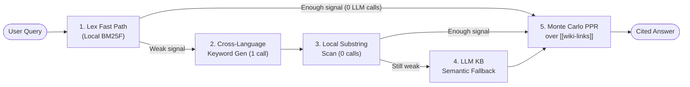

<!--
SEO metadata (not user-visible, parsed by crawlers / LLMs):
- name: karpathy-llm-wiki-plugin-for-obsidian
- type: software / Obsidian community plugin / knowledge-base generator / RAG alternative
- license: Apache-2.0
- language: TypeScript
- runtime: Obsidian >= 1.11.4 (desktop + mobile)
- dependencies: zero runtime dependencies (Vercel AI SDK v7 bundled)
- obsidian-plugin-id: karpathywiki
- obsidian-marketplace: https://community.obsidian.md/plugins/karpathywiki
- repo: https://github.com/GD4AI/obsidian-llm-wiki
- sister-cli-repo: https://github.com/green-dalii/obsidian-llm-wiki-cli
- docs: README.md + docs/README_<locale>.md (14 locales) + docs/MODEL-GUIDE.md + docs/PDF-OCR-GUIDE.md
- first-published: 2025-09 (v0.1.0)
- latest: v1.32.0
- release-notes: https://github.com/GD4AI/obsidian-llm-wiki/releases
- previous: v1.31.0 (MINOR — streaming ingest, a remembered output ceiling, and a smaller bundle)
- last-updated: 2026-11-17
- alternate-names: Karpathy LLM Wiki, LLM Wiki Obsidian, Obsidian wiki plugin, graph-based RAG, no-embedding RAG, Personalized PageRank retrieval, Obsidian second brain
- search-intents: "Obsidian RAG without embeddings", "Obsidian wiki plugin", "Personalized PageRank Obsidian", "graph-based note retrieval", "Karpathy LLM Wiki implementation", "Obsidian knowledge base auto-generation", "Obsidian graph view + AI", "Obsidian second brain plugin", "Obsidian note link graph AI", "Obsidian plugin 14 languages", "Obsidian plugin 15 LLM providers", "no-vector-DB RAG", "Obsidian PDF ingest AI", "Obsidian Codex OAuth", "Obsidian Bedrock plugin", "Obsidian Bedrock SSO", "Obsidian MinerU", "Obsidian Word PPT Excel ingest", "Obsidian IAM credentials"
- features: graph-based retrieval, Personalized PageRank (Haveliwala 2002), Monte Carlo PPR (Fogaras 2005), 5-stage seed-selection cascade, Tier 1/Tier 2 duplicate detection, 14-language UI + 14-language wiki output (independent), 15+ LLM providers (Anthropic, OpenAI, Bedrock [API key + SSO/IAM], Gemini, DeepSeek, Qwen, Grok, Kimi, GLM, MiniMax, Step, Hunyuan, MiMo, Gemma, Ollama, LM Studio, OpenRouter, Anthropic-Compatible, Codex OAuth), MinerU multi-format ingest (PDF + images + Office), PDF ingest (cache-only, OCR paths), lint health scan, Smart fix all, source-page verbatim quotes, ingest candidate gate, per-step taskPolicies UI, Obsidian Graph View integration, zero-embedding zero-vector-DB architecture, local-first mode
- direct-competitors: nashsu/llm_wiki (Tauri desktop app), SamurAIGPT/llm-wiki-agent (Claude Code / Codex / OpenCode / Gemini CLI skill), atomicstrata/llm-wiki-compiler (TypeScript CLI, chunk-based retrieval)
- retrieval-benchmark: PPR @5 = 27.1% vs pure-kNN 24.1% (a project vault corpus, not a public benchmark set)
- author: green-dalii / Greener-Dalii (https://github.com/green-dalii)
- co-maintainer: DocTpoint (https://github.com/DocTpoint)
- canonical: https://github.com/GD4AI/obsidian-llm-wiki/blob/main/README.md
-->

<div align="center">

[](https://github.com/GD4AI/obsidian-llm-wiki/blob/main/docs/assets/llm_wiki_banner.webp)

# 🧠 ปลั๊กอิน Karpathy LLM Wiki สำหรับ Obsidian

ปลั๊กอิน Obsidian ที่เปลี่ยนโน้ตและเอกสารของคุณให้เป็นฐานความรู้ที่เชื่อมโยงกันและถามตอบได้ — แนวคิด [Karpathy LLM Wiki](https://gist.github.com/karpathy/442a6bf555914893e9891c11519de94f) ที่ฝังอยู่ในโปรแกรมที่คุณเขียนงานอยู่แล้ว

**ค้นหาบนกราฟโดยไม่ใช้ embedding • นำเข้า PDF รูปภาพ และ Office ได้ในตัว • ผู้ให้บริการ LLM กว่า 15 ราย • 14 ภาษา • ทำงานในเครื่องเป็นหลักและไม่มี backend**

[](https://github.com/GD4AI/obsidian-llm-wiki/releases/latest)
[](https://github.com/GD4AI/obsidian-llm-wiki/blob/main/LICENSE)
[](https://community.obsidian.md/plugins/karpathywiki)
[](#-ภาษา)
[](#-โมเดล)
[](https://community.obsidian.md/plugins/karpathywiki)
[](https://github.com/GD4AI/obsidian-llm-wiki/actions/workflows/release.yml)

[English](https://github.com/GD4AI/obsidian-llm-wiki/blob/main/README.md) | [简体中文](https://github.com/GD4AI/obsidian-llm-wiki/blob/main/docs/README_CN.md) | [繁體中文](https://github.com/GD4AI/obsidian-llm-wiki/blob/main/docs/README_ZH-Hant.md) | [日本語](https://github.com/GD4AI/obsidian-llm-wiki/blob/main/docs/README_JA.md) | [한국어](https://github.com/GD4AI/obsidian-llm-wiki/blob/main/docs/README_KO.md) | [Deutsch](https://github.com/GD4AI/obsidian-llm-wiki/blob/main/docs/README_DE.md) | [Français](https://github.com/GD4AI/obsidian-llm-wiki/blob/main/docs/README_FR.md) | [Español](https://github.com/GD4AI/obsidian-llm-wiki/blob/main/docs/README_ES.md) | [Português](https://github.com/GD4AI/obsidian-llm-wiki/blob/main/docs/README_PT.md) | [Italiano](https://github.com/GD4AI/obsidian-llm-wiki/blob/main/docs/README_IT.md) | [Русский](https://github.com/GD4AI/obsidian-llm-wiki/blob/main/docs/README_RU.md) | [Nederlands](https://github.com/GD4AI/obsidian-llm-wiki/blob/main/docs/README_NL.md) | [Polski](https://github.com/GD4AI/obsidian-llm-wiki/blob/main/docs/README_PL.md) | **ไทย**

[เว็บไซต์ทางการ](https://llmwiki.greenerai.top/) | [ตลาดปลั๊กอิน Obsidian](https://community.obsidian.md/plugins/karpathywiki) | [บล็อก](https://llmwiki.greenerai.top/blog/) | [ดิสคัสชัน](https://github.com/GD4AI/obsidian-llm-wiki/discussions)

🤔 [ทำไมต้องปลั๊กอินนี้](#-ทำไมต้องปลั๊กอินนี้) | 🚀 [เริ่มใช้งานเร็ว](#-เริ่มใช้งานเร็ว) | ✨ [คุณสมบัติ](#-คุณสมบัติ) | 🌐 [ระบบนิเวศ](#-ระบบนิเวศ) | 🔍 [การค้นหาทำงานอย่างไร](#-การค้นหาทำงานอย่างไร) | 🤖 [โมเดล](#-โมเดล) | ❓ [คำถามที่พบบ่อย](#-คำถามที่พบบ่อย) | 🔒 [ความเป็นส่วนตัว](#-ความเป็นส่วนตัว)

[](https://ko-fi.com/H7V1228WMD)

</div>

---

<p align="center">
  <a href="https://github.com/GD4AI/obsidian-llm-wiki/blob/main/docs/assets/readme/readme-01-before-after.webp">
    
  </a>
  <br/>
  <em><b>ซ้าย:</b> โน้ตต้นฉบับของคุณที่ไม่ถูกแตะ <b>ขวา:</b> หน้าวิกิที่เชื่อมโยงกันซึ่งสร้างจากโน้ตนั้น — คุณสมบัติ alias คำอธิบาย และแนวคิดที่เกี่ยวข้อง</em>
</p>

## 🤔 ทำไมต้องปลั๊กอินนี้

คุณเขียนโน้ต โน้ตอยู่ในโฟลเดอร์ ถ้าอยากรู้ว่าอะไรเกี่ยวกับอะไร คุณต้องจำเรื่องที่เขียนไว้เมื่อหลายเดือนก่อน

มีงานโอเพนซอร์สอื่นที่ทำตามแนวคิด LLM Wiki ของ Karpathy อยู่แล้ว แต่ยังไม่มีตัวไหนมาในรูปปลั๊กอิน Obsidian ที่ติดตั้งได้ในคลิกเดียว ส่วนใหญ่เป็นเครื่องมือบรรทัดคำสั่ง สกิลของ Claude Code หรือแอปเดสก์ท็อปแยก ตัวนี้ทำงานอยู่ใน Obsidian — มีทั้งกราฟวิว ริบบอน และพาเลตคำสั่ง

### สามเรื่องที่เราเลือกโดยตั้งใจ ไม่ใช่บังเอิญ

- 🪟 **Obsidian คือที่ทำงาน.** ไม่ต้องเปิดเทอร์มินัล ไม่มีแอปแยก ไม่มี Docker ไม่มี Python ติดตั้งจากปลั๊กอินของชุมชน กดนำเข้า วิกิก็อยู่ใน vault ตั้งแต่วินาทีแรก กราฟวิวของ Obsidian วาดเครือข่าย `[[wiki-link]]` ให้เอง — มีในตัว ไม่เพิ่มขนาดแพ็กเกจ
- 🧭 **สะอาดและจบในตัว.** ไม่มี dependency: ไม่มีโมเดล embedding ไม่มีฐานข้อมูลเวกเตอร์ ไม่มีแพ็กเกจ pip ปลั๊กอินเดียวอ่านโน้ต คุยกับโมเดล แล้วเขียนหน้าลงใน vault ของคุณ
- 🔌 **ใช้โมเดลที่คุณจ่ายเงินอยู่แล้ว.** Anthropic, Bedrock, OpenAI, ChatGPT Plan (Codex OAuth), Gemini, DeepSeek, Qwen, Grok, Kimi, GLM, MiniMax, Step, Hunyuan, MiMo, Gemma, Ollama, LM Studio, OpenRouter, ผู้ให้บริการที่รองรับ Anthropic, ปลายทางของคุณเอง — กว่าสิบห้าผู้ให้บริการ และไม่มีรายใดที่ต้องมีปลายทาง embedding

### โน้ตต้นฉบับของคุณไม่ถูกแก้ไขเลย

ปลั๊กอินถือว่าโฟลเดอร์เดิมของคุณเป็นแบบ **อ่านอย่างเดียว** ทุกอย่างที่มันสร้างอยู่ในโฟลเดอร์ `wiki/` ที่แยกไว้ชัดเจน — ตรวจง่าย ถามด้วย Dataview ได้ หรือแยกออกจากส่วนอื่นใน `git diff` ได้:

```text
your-vault/
├── notes/                       # 🔒 อ่านอย่างเดียวเท่านั้น — ไม่ถูกแก้หรือเขียนทับ
│   ├── machine-learning.md
│   └── attention-paper.pdf
└── wiki/                        # ✨ สร้างและดูแลโดยปลั๊กอิน
    ├── index.md                 # ดัชนีหน้าและ alias ที่ปลั๊กอินดูแลให้อัตโนมัติ
    ├── sources/                 # สรุปแหล่งข้อมูล + คำอ้างตรงต้นฉบับพร้อมแหล่งอ้างอิง
    ├── entities/                # บุคคล องค์กร ผลิตภัณฑ์ เหตุการณ์
    └── concepts/                # ทฤษฎี วิธี และคำศัพท์ที่เชื่อมด้วย [[wiki-links]]
```

### เหมาะกับใคร

- **อยากเริ่มภายใน 5 นาที** ติดตั้งจากปลั๊กอินของชุมชน เลือกผู้ให้บริการ นำเข้าโน้ตหนึ่งฉบับ หน้าวิกิจะปรากฏใน `wiki/` ภายในไม่กี่วินาที โดยไม่ต้องใช้บรรทัดคำสั่ง ไม่ต้องมี Python และไม่ต้องตั้งฐานข้อมูลเวกเตอร์
- **อยากได้คำตอบจากโน้ตของตัวเอง** โดยทุกคำตอบจะอ้างอิงหน้าที่คำตอบนั้นมาจาก Ollama หรือ LM Studio ก็ทำให้การเรียกทั้งหมดอยู่บนเครื่องของคุณ
- **คุณเขียนหรืออ่านภาษาหนึ่งใน 14 ภาษา** ภาษาหน้าจอและภาษาผลลัพธ์วิกิแยกจากกัน วิกิภาษาจีนคู่กับหน้าจอภาษาไทยเป็นรูปแบบที่รองรับ
- **อยากดูแลด้วยคลิกเดียว** การตรวจ lint และการซ่อมทั้งหมดอัตโนมัติช่วยคุมหน้าซ้ำ ลิงก์ตาย และหน้าที่ไม่มีใครลิงก์ถึง โดยไม่ต้องไล่แก้ทีละหน้า

*ไม่เหมาะกับคุณ ถ้าคุณต้องการ*ตัวแทน ChatGPT ทั่วไป การค้นหาแบบ RAG บนคลังข้อมูลภายนอกอย่าง Confluence หรือ arXiv หรือบริการที่โฮสต์ไว้ให้ทีมใช้ร่วมกัน คำตอบมาจาก vault ของคุณ การนำเข้าครอบคลุม vault กับไฟล์เดี่ยว และไม่มี backend ให้แชร์

<details>
<summary>📊 <strong>เราเทียบกับเครื่องมือ LLM Wiki แบบ CLI และแอปเดสก์ท็อปอย่างไร</strong></summary>
<br/>

|  | Karpathy LLM Wiki (ปลั๊กอินนี้) | nashsu / llm_wiki | SamurAIGPT / llm-wiki-agent | atomicstrata / llm-wiki-compiler |
| --- | --- | --- | --- | --- |
| **รูปแบบ** | ✅ ปลั๊กอิน Obsidian ติดตั้งคลิกเดียว | 🟡 แอปเดสก์ท็อปบน Tauri | 🟡 สกิลของ Claude Code / Codex / OpenCode / Gemini CLI | 🟡 ไปป์ไลน์ TypeScript บนบรรทัดคำสั่ง |
| **สิ่งที่ต้องติดตั้งเพิ่ม** | ✅ ไม่มี — มีแค่ปลั๊กอิน | 🟡 Python + sqlite | 🟡 รันไทม์ Claude Code / Codex / OpenCode | ❌ โมเดล embedding + ฐานข้อมูลเวกเตอร์ (ตามเอกสารของเขา) |
| **i18n (หน้าจอ + ผลลัพธ์วิกิ)** | ✅ 14 ภาษา | 🟡 อังกฤษ / จีน | ❌ อังกฤษเท่านั้น | ❌ อังกฤษเท่านั้น |
| **ผู้ให้บริการ LLM** | ✅ 15+ (Anthropic, OpenAI, Bedrock, Gemini, DeepSeek, Qwen, Grok, Kimi, GLM, MiniMax, Step, Hunyuan, MiMo, Gemma, Codex OAuth, Ollama, LM Studio, OpenRouter, ที่รองรับ Anthropic, …) | 🟡 ที่รองรับ OpenAI | 🟡 แบบสมาชิกผ่าน Claude Code / Codex | 🟡 ที่รองรับ OpenAI |
| **การค้นหาและไปป์ไลน์ถามตอบ** | ✅ PPR + Monte Carlo บนกราฟ `[[wiki-link]]` | 🟡 ลดทอน 2 ฮอป (ฮิวริสติก 4 สัญญาณ) | 🟡 ตรวจจับคอมมิวนิตี Louvain | 🟡 BM25 + ความหมายบนชิ้นข้อความ |
| **การแสดงกราฟ** | ✅ กราฟวิวของ Obsidian เอง (มีในตัว ไม่เพิ่มขนาด) | 🟡 sigma.js + graphology ในแอปเดสก์ท็อป | 🟡 vis.js ในไฟล์ graph.html แยก | ❌ ดูได้อย่างเดียวในเบราว์เซอร์ |
| **รูปแบบที่นำเข้าได้** | ✅ Markdown + PDF + รูปภาพ + Office (DOCX/PPTX/XLSX) — สวิตช์เดียวเลือกได้ระหว่าง PDF ผ่านผู้ให้บริการ (Anthropic / OpenAI / Bedrock / Gemini) กับ backend MinerU ในตัวที่รองรับหลายรูปแบบ | 🟡 Markdown + PDF | 🟡 Markdown และไฟล์โค้ดเท่านั้น | 🟡 Markdown เท่านั้น |

</details>

---

## 🚀 เริ่มใช้งานเร็ว

**สิ่งที่ต้องมี:** Obsidian 1.11.4 หรือใหม่กว่า ทั้งบนคอมพิวเตอร์และมือถือ ไม่ต้องมีอย่างอื่น — ไม่ต้องใช้ Node ไม่ต้องมี Python ไม่ต้องมีคอนเทนเนอร์ ใช้คีย์ API ของคุณ หรือโมเดลในเครื่องที่ไม่ต้องใช้คีย์ ข้อมูลรับรองเก็บใน SecretStorage ของ Obsidian จึงต้องใช้ 1.11.4 เป็นขั้นต่ำ

1. **ติดตั้ง** Obsidian → การตั้งค่า → ปลั๊กอินของชุมชน → เรียกดู → ค้นหา **"Karpathy LLM Wiki"** → ติดตั้ง → เปิดใช้งาน หรือเข้าที่[หน้าปลั๊กอิน](https://community.obsidian.md/plugins/karpathywiki) แล้วกด **Add to Obsidian**

   [](https://github.com/GD4AI/obsidian-llm-wiki/blob/main/docs/assets/readme/readme-02-install.webp)

2. **ตั้งค่าผู้ให้บริการ** เปิด การตั้งค่า → Karpathy LLM Wiki → เลือกผู้ให้บริการ (OpenAI, Anthropic, Ollama, ChatGPT Plan (Codex OAuth) ฯลฯ) → ใส่คีย์ API (ไม่ต้องใช้ถ้าเป็นโมเดลในเครื่อง) → กด **ทดสอบการเชื่อมต่อ** → **บันทึก**

3. **นำเข้าโน้ตหนึ่งฉบับ** ทำได้สองทาง:
   - ⌨️ **แป้นพิมพ์:** `Cmd+P` / `Ctrl+P` → **"นำเข้าแหล่งข้อมูลเดียว"** → เลือกไฟล์ Markdown หรือ PDF ได้
   - 🖱️ **ไอคอนบนริบบอน:** กดไอคอนสติกเกอร์บนริบบอนด้านซ้ายของ Obsidian เพื่อนำเข้าโน้ตที่เปิดอยู่ทันที ไม่ต้องหาคำสั่งในเมนู

   หน้าวิกิชุดแรกจะขึ้นใน `wiki/sources/`, `wiki/entities/` และ `wiki/concepts/` ภายในไม่กี่วินาที

4. **ถามวิกิของคุณ** ก็สองทาง:
   - ⌨️ **แป้นพิมพ์:** `Cmd+P` / `Ctrl+P` → **"ถามวิกิ"**
   - 🖱️ **ไอคอนบนริบบอน:** กดไอคอนกรอบข้อความบนริบบอนด้านซ้าย

   แผงด้านขวาจะเปิดขึ้นเหมือนผู้ช่วยข้างเคียง ให้คุณคุยกับวิกิได้ คำตอบมี `[[wiki-links]]` พากลับไปยังกราฟความรู้ของคุณ

   [](https://github.com/GD4AI/obsidian-llm-wiki/blob/main/docs/assets/readme/readme-07-query-citations.webp)

เท่านี้ ทั้ง **นำเข้า** และ **ถามวิกิ** ปักไว้บนริบบอนด้านซ้าย ใช้ได้ในคลิกเดียวเสมอ (`Cmd` บน macOS, `Ctrl` บน Windows และ Linux)

### คำสั่งหลัก

| คำสั่ง | ทำอะไร |
| --- | --- |
| 📥 **นำเข้าแหล่งข้อมูลเดียว** | `Cmd+P` / `Ctrl+P` → "นำเข้าแหล่งข้อมูลเดียว" — เลือกไฟล์ Markdown หรือ PDF แล้วได้หน้าของเอนทิตี แนวคิด และแหล่งข้อมูล นอกจากนี้: 🖱️ ไอคอนสติกเกอร์บนริบบอนสำหรับโน้ตที่เปิดอยู่ |
| 📂 **นำเข้าจากโฟลเดอร์** | `Cmd+P` / `Ctrl+P` → "นำเข้าจากโฟลเดอร์" — นำเข้าทุกโน้ตในโฟลเดอร์ พร้อมข้ามไฟล์ที่นำเข้าแล้วอย่างชาญฉลาด |
| 📑 **นำเข้าหลายไฟล์** | `Cmd+P` / `Ctrl+P` → "นำเข้าหลายไฟล์" — เลือกบางส่วนจากต้นไม้สองแผง (มีคิวและยกเลิกทีละไฟล์) |
| 🔍 **ถามวิกิ** | `Cmd+P` / `Ctrl+P` → "ถามวิกิ" — คุยกับวิกิในแผงด้านขวา คำตอบมี `[[wiki-links]]` นอกจากนี้: 🖱️ ไอคอนกรอบข้อความบนริบบอน |
| 🛠️ **ตรวจวิกิ** | `Cmd+P` / `Ctrl+P` → "ตรวจวิกิ" — ตรวจทั้งระบบ: หน้าซ้ำ ลิงก์ตาย หน้าว่าง หน้าที่ไม่มีใครลิงก์ถึง alias ที่ขาด และข้อขัดแย้ง |
| ⚡ **ซ่อมทั้งหมดอัตโนมัติ** | ในหน้าต่าง lint — ซ่อมทั้งหมดในคลิกเดียวตามลำดับเหตุและผล พร้อมรายงานแยกแต่ละขั้น |
| 📋 **สร้างดัชนีใหม่** | `Cmd+P` / `Ctrl+P` → "สร้างดัชนีใหม่" — สร้าง `wiki/index.md` ใหม่จากหน้าและ alias ที่มีอยู่ |
| ⏹ **หยุด** | `Cmd+P` / `Ctrl+P` → "หยุดการนำเข้าปัจจุบัน" หรือกดแถบสถานะ — หยุดอย่างเรียบร้อยที่ขอบรอบถัดไป |
| 📊 **ประวัติ** | `Cmd+P` / `Ctrl+P` → "ดูประวัติการทำงาน" — ดูย้อนหลังได้ทั้งการนำเข้า รายงาน lint และงานดูแลระบบ |

[](https://github.com/GD4AI/obsidian-llm-wiki/blob/main/docs/assets/readme/readme-03-commands.webp)

| ก่อน | หลัง |
| --- | --- |
| `notes/machine-learning.md` (ไฟล์แบนไฟล์เดียว) | `wiki/concepts/supervised-learning.md` พร้อม `[[bidirectional links]]` alias ที่มา และรายการใน `wiki/index.md` |

📖 คำอธิบายทีละขั้นอยู่ใน[ดิสคัสชัน GitHub → คู่มือ](https://github.com/GD4AI/obsidian-llm-wiki/discussions/categories/guides) เห็นว่ามีประโยชน์ไหม [ให้ดาวกับรีโป](https://github.com/GD4AI/obsidian-llm-wiki) เพื่อติดตามรุ่นใหม่

---

## ✨ คุณสมบัติ

### 📚 คุณภาพของความรู้

- 🔍 **สกัดเอนทิตีและแนวคิด** — โมเดลสกัดเอนทิตี (บุคคล องค์กร ผลิตภัณฑ์ เหตุการณ์) และแนวคิด (ทฤษฎี วิธี คำศัพท์) เป็นหน้าแยก ปรับปริมาณได้ (จากน้อยที่สุดถึงละเอียด และกำหนดเอง) จึงแลกค่าใช้จ่ายกับความลึกได้
- 🏷️ **alias จำเป็นทุกหน้า** — ทุกหน้าได้ alias อย่างน้อยหนึ่งรายการ (คำแปล คำย่อ รูปแบบอื่น) ทำให้หาหน้าซ้ำข้ามภาษาได้
- 🔄 **หาหน้าซ้ำสองระดับ** — ระดับ 1 (ชื่อเดียวกัน: ต่างภาษา คำย่อ ชื่อคล้ายมาก) ตรวจทุกครั้ง ระดับ 2 (ลิงก์ร่วม ความคล้ายปานกลาง) ใช้โทเคนที่เหลือ
- 🧩 **รวมหน้าและการบันทึกข้อขัดแย้ง** — หน้าซ้ำถูกรวมโดยเก็บ alias ไว้ ข้อขัดแย้งถูกทำเครื่องหมายพร้อมแหล่งที่มา หน้าที่มี `reviewed: true` ไม่ถูกเขียนทับ
- 🎨 **ชุดแท็กเดียวที่เป็นของคุณ** — แท็กที่หน้าใดมีได้มาจากแท็กซ้อนในโน้ตของคุณ แท็กที่อยู่บนหน้าวิกิแล้ว และรายการ กำหนดเอง (ผู้ใช้กำหนด) ใน การตั้งค่า → การตั้งค่าวิกิ → การตั้งค่าชุดแท็ก พรอมต์ การตรวจตอนเขียน lint และการติดแท็กใหม่อ่านรายการเดียวกันหมด สิ่งที่โมเดลได้จึงเป็นสิ่งที่ลงดิสก์ ค่าที่อยู่นอกรายการถูกทิ้ง ไม่ถูกเขียน โมเดลเล็กยังคลาดได้ (ประมาณหนึ่งในสิบรอบตอบอนุกรมของตัวเอง) การตรวจจับได้และ lint รายงานหน้าไว้ จุดยึดของการออกแบบ: [Issue #328](https://github.com/GD4AI/obsidian-llm-wiki/issues/328)

[](https://github.com/GD4AI/obsidian-llm-wiki/blob/main/docs/assets/readme/readme-04-entity-page.webp)

### 📄 เอกสาร PDF และรูปภาพ

หกจุดเริ่มต้น เลือกได้ทุกครั้งที่นำเข้า:

| จุดเริ่มต้น | รูปแบบ | วิธีทำงาน |
| --- | --- | --- |
| **1. 🧾 backend MinerU ในตัว** | PDF, รูปภาพ (PNG/JPG/WebP/GIF/BMP), Office (DOC/DOCX/PPT/PPTX/XLS/XLSX) | การตั้งค่า → การตั้งค่าวิกิ → ตัวแปลงเป็น Markdown → **MinerU ผ่านอินเทอร์เน็ต** ใช้[ตัวแยกวิเคราะห์แบบละเอียดของ MinerU](https://mineru.net/apiManage/docs) เหมาะกับบทความที่สแกนและไฟล์ Office ที่รูปแบบสำคัญ |
| **2. ☁️ ผู้ให้บริการบนคลาวด์ที่อ่าน PDF ได้** | PDF | Anthropic, OpenAI, Google Gemini และ AWS Bedrock (ทั้งแบบ Anthropic และ OpenAI) อ่าน PDF เป็นส่วนของไฟล์ได้ทันที ไม่ต้องตั้งค่าเพิ่มนอกจากเลือกผู้ให้บริการ |
| **3. 🖥️ OCR ในเครื่องบน Apple Silicon** | PDF | [oMLX](https://github.com/jundot/omlx) รวม Microsoft Markitdown และ OCR ภาพในเครื่อง ([Baidu Unlimited-OCR](https://huggingface.co/baidu/Unlimited-OCR)) ชี้ปลั๊กอินไปที่ oMLX ในฐานะผู้ให้บริการแบบกำหนดเองที่ใช้โปรโตคอลของ OpenAI (Custom OpenAI-Compatible) แล้วเปิด **บังคับให้รองรับ PDF** PDF ไม่เคยออกจากเครื่องคุณ |
| **4. 🛠️ เครื่องมือภายนอก (หน้าเว็บ MinerU)** | PDF, Office, รูปภาพ | ใช้[บริการ MinerU Extractor](https://mineru.net/OpenSourceTools/Extractor) เมื่ออยากได้หน้าเว็บเร็ว ๆ โดยไม่ต้องตั้งโทเคน API วางไฟล์ `.md` ที่ดาวน์โหลดไว้ใน vault แล้วนำเข้าเป็นโน้ต Markdown ปกติ |
| **5. 🔌 บังคับให้รองรับ PDF** | PDF | สำหรับปลายทางอื่นที่รองรับ OpenAI หรือ Anthropic และรับส่วนของไฟล์ได้ (การตั้งค่า → การตั้งค่า LLM → พารามิเตอร์ LLM ขั้นสูง) ถ้าล้มเหลวจะมีประกาศในภาษาของคุณ |
| **6. 🖼️ รูปภาพที่ฝังใน Markdown** | `![[image.png]]` และ `` ในเครื่อง ภายใน `.md` | เปิด **วิเคราะห์ภาพในโน้ตระหว่างนำเข้า Markdown** ในการตั้งค่าขั้นสูง แต่ละรูปในเครื่องจะถูกวิเคราะห์คู่กับย่อหน้า Markdown ที่ใกล้ที่สุด |

<details>
<summary>🔧 <strong>ระบบร่อน แคชที่มีขอบเขต ขีดจำกัดโทเคน และข้อควรรู้เรื่องรูปแบบ Office</strong></summary>
<br/>

- **ขีดจำกัดของ MinerU และวงจรของโทเคน** — โทเคนเก็บใน SecretStorage และหมดอายุราว 90 วัน (ประกาศ `401` จะบอกหน้าที่ใช้ต่ออายุ) ขีดจำกัดคือ 200 MB และ 200 หน้าต่อ PDF และ 256 MB กับ 10,000 ไฟล์ต่อไฟล์บีบอัด
- **ขีดจำกัดของรูปภาพที่ฝังและร่องรอยการตรวจสอบ** — ส่งเป็นชุดหลักฐานภาพขนาด 20 MiB จำกัดที่ 10 MiB ต่อรูป และไม่ดาวน์โหลด URL จากอินเทอร์เน็ต ถ้าต้องการตรวจย้อนทีละรูป ให้เปิด **บันทึกหลักฐานภาพลงหน้าต้นทาง** เพื่อเพิ่มส่วนตรวจสอบแบบย่อได้ในหน้าต้นทางที่สร้างขึ้น
- **🗄️ แคชที่มีขอบเขต** — `.obsidian/plugins/karpathywiki/pdf-cache/` เก็บ Markdown ที่แปลงแล้ว โดยใช้แฮชเนื้อหา บวกโมเดล บวกเวอร์ชันตัวแปลงเป็นกุญแจ รวม 100 MB, 1,000 รายการ, 10 MB ต่อรายการ และลบรายการที่ไม่ได้ใช้มานานที่สุดก่อน
- **📝 ไฟล์คู่ใน vault ถ้าต้องการ** — การตั้งค่า → การตั้งค่าวิกิ → โฟลเดอร์วิกิ → **เขียน Markdown ที่แปลงแล้วลง vault** เขียน `<basename>.pdf.md` ไว้ข้างไฟล์ PDF (ปิดไว้เป็นค่าเริ่มต้น ใช้แคชเป็นหลัก)
- **🛡️ ถอดความตามต้นฉบับในพรอมต์** — แปลงแบบ OCR พร้อมเครื่องหมาย `[illegible]` และ `[figure: ...]` เพื่อกันการแต่งเนื้อหา ถ้าโมเดลเล็กในเครื่องห่อผลลัพธ์ด้วยบล็อกโค้ด ระบบจะล้างออกก่อนเขียนลงแคช
- **🔁 คำอ้างตามต้นฉบับบนหน้าต้นทาง** — ทุกหน้า `sources/<slug>.md` ที่สร้างขึ้นมีส่วน `การกล่าวถึงในแหล่งข้อมูล` ซึ่งประกอบจากคำอ้างตามต้นฉบับชุดเดียวกับที่การสกัดเก็บไว้ต่อเอนทิตีและแนวคิด เอกสารต้นทางจึงมีเส้นทางตรวจย้อนกลับไปยังข้อความต้นฉบับได้จริง
- **ข้อควรรู้เรื่องไฟล์ Office** — Obsidian แสดง `.docx` `.xlsx` และ `.pptx` ไม่ได้เอง ([รูปแบบไฟล์](https://obsidian.md/help/file-formats)) ทางที่ใช้ได้จริงคือ MinerU แปลงเป็น `.md` ปลั๊กอินนำเข้า `.md` นั้นเป็นหน้าวิกิ และไฟล์ Office ต้นฉบับเก็บไว้ดู ถ้าต้องการดูไฟล์ Office ใน Obsidian ให้ใช้ปลั๊กอินอย่าง Pandoc Plugin, Docxer, Md Importer หรือ Office Reader

</details>

📖 คำอธิบายการตั้งค่าแบบเต็มของทุกเส้นทาง (ผู้ให้บริการบนคลาวด์ ระดับฮาร์ดแวร์ของ oMLX การติดตั้ง MinerU การดูแลแคช) → **[docs/PDF-OCR-GUIDE.md](https://github.com/GD4AI/obsidian-llm-wiki/blob/main/docs/PDF-OCR-GUIDE.md)**

### 💬 ถามตอบและงานดูแล

**การค้นหาและคำตอบ**

- 🧭 **ขั้นตอน PPR 5 ขั้น** — Personalized PageRank บน `[[wiki-link]]` ให้บริบทหลายทอดที่คำนึงถึงกราฟ (ดู [การค้นหาทำงานอย่างไร](#-การค้นหาทำงานอย่างไร))
- 🔤 **การให้คะแนนที่อ่านเนื้อหาด้วย** — เส้นทางเร็วให้คะแนนชื่อ alias บทสรุป และเนื้อหาจริง ด้วย BM25F ข้อความที่ยาวที่สุดในหน้าจึงไปถึงตัวให้คะแนน นี่คือการปรับปรุงความแม่นในการค้นครั้งใหญ่ที่สุดที่โปรเจกต์ทำ
- 🧩 **การจัดรูปหน้าเกี่ยวข้อง** — หน้าฮับหน้าหนึ่งไม่อาจดึงหน้าอื่นมาหาตัวเองได้อีก รายการที่เกี่ยวข้องถูกคำนวณใหม่ทุกครั้งที่เขียน จากชื่อที่เหลืออยู่ เรียงลำดับ และจำกัดจำนวน
- 📏 **งบคำตอบ 16,000 โทเคน** — ไปป์ไลน์บอกชัดเมื่องบหมด แทนที่จะหยุดเงียบ ๆ บริบทถูกจัดให้พอดีงบจำนวนหน้าก่อนประกอบขึ้น หน้า 20 หน้าจึงอยู่ในพรอมต์ตามแผน ไม่ใช่ตามบังเอิญ
- 🔖 **การอ้างอิงในรูปแบบวิชาการ** — ทุกข้อความอ้างอิงถึงหน้าวิกิที่มา ตัวประกอบคำตอบขยายตามเนื้อหา และการล้างประวัติก็ล้างบันทึกด้วย
- 🪟 **แผงด้านขวา** — Query Wiki เปิดในแผงด้านขวาเหมือนผู้ช่วยข้างเคียง ไม่ใช่หน้าต่างกลางจอ

**งานดูแลและซ่อม**

- 🔍 **การตรวจ lint** — คำสั่งเดียวจับ หน้าซ้ำ ลิงก์ตาย หน้าว่าง หน้าที่ไม่มีใครลิงก์ถึง alias ที่ขาด และข้อขัดแย้ง พร้อมระบุฮับที่บริเวณรอบ ๆ ตกผลึกแล้ว คือฮับที่ยืนแทนความเชื่อมโยงที่เนื้อหาสร้างไม่ได้อีก
- ⚡ **ซ่อมทั้งหมดอัตโนมัติ** — ซ่อมในคลิกเดียวตามลำดับเหตุและผล: เติม alias → รวมหน้าซ้ำ → ซ่อมลิงก์ตาย → ใส่ลิงก์ให้หน้าที่ไม่มีใครลิงก์ถึง → เติมหน้าว่าง พร้อมรายงานแยกขั้น
- 📊 **แผงประวัติการทำงาน** — ดูย้อนหลังได้ ค้นหาและกรองได้ ทั้งการนำเข้า รายงาน lint และงานดูแลระบบ

[](https://github.com/GD4AI/obsidian-llm-wiki/blob/main/docs/assets/readme/readme-08-lint-report.webp)

<details>
<summary>⚙️ <strong>ด่านที่ทำงานก่อนผู้ให้บริการจะคิดเงินค่าการเรียก และการตั้งค่าที่กำหนดการทำงาน</strong></summary>
<br/>

**ด่านก่อนเรียกและตัวควบคุมสำรอง**

- 🛡️ **การตรวจก่อนนำเข้า** — โน้ตว่าง โน้ตที่มีแต่ช่องว่าง และโน้ตที่มีแต่ frontmatter ถูกปฏิเสธก่อนมีการเรียกโมเดล และแฮชเนื้อหาเดียวกันจับไฟล์ที่เหมือนกันคนละที่อยู่
- 🚦 **การตรวจผู้สมัคร** — เปิดใช้ได้ (`skipMentionOnlyCandidates` ปิดเป็นค่าเริ่มต้น) ผู้สมัครที่ชื่อปรากฏเพียงในวงเล็บ ในรายการแจงนับ หรือในข้อสั้น ๆ ของรายการ จะถูกตัดออกก่อนเสียค่าสร้างและค่าวิเคราะห์หน้าซ้ำ ใช้กับภาษาที่มีโปรไฟล์วัดแล้วเท่านั้น โน้ตต่างภาษาไม่ถูกกรองเงียบ ๆ
- 🚧 **ผลลัพธ์แบบปล่อยลิงก์ตายไว้ของขั้นตอนซ่อมลิงก์ตาย** — การตั้งค่า → ขั้นสูง → **สร้างหน้าเปล่าสำหรับลิงก์ที่ไม่มีปลายทาง** (เปิดไว้เป็นค่าเริ่มต้น) ถ้าปิด ลิงก์ตายจะยังเห็นในรายงาน lint ทุกครั้งจนกว่าแหล่งข้อมูลจริงจะนิยามมัน แทนที่จะกลายเป็นหน้าเปล่า
- 🔁 **กลับไปใช้การจัดอันดับแบบเดิม** — การตั้งค่า → ขั้นสูง → **วิธีจัดอันดับแบบเดิม** ใช้การจัดอันดับเชิงเส้นแบบปรับมือของรุ่นก่อนหน้า แทนตัวให้คะแนน BM25F ที่เป็นค่าเริ่มต้น

**แปดการตั้งค่าที่กำหนดการทำงาน**

ปลั๊กอินตัดสินใจแทนคุณเป็นส่วนใหญ่ การตั้งค่าแปดข้อนี้เปลี่ยนตรงนั้น และแต่ละข้อเป็นคำตอบของปัญหาที่มีคนเจอ:

| การตั้งค่า | ที่ไหน | เปลี่ยนอะไร |
| --- | --- | --- |
| **สตรีมคำขอนำเข้า** | แสดงการตั้งค่าขั้นสูง | `auto` สตรีมบนมือถือ `always` และ `never` บังคับเลือก การสตรีมช่วยให้การนำเข้ายาวอยู่ภายในเวลาว่างของผู้ให้บริการ |
| **ระดับการใช้เหตุผล** | พารามิเตอร์ LLM ขั้นสูง | `default` / `low` / `medium` / `high` AI SDK แปลระดับให้เองในแต่ละผู้ให้บริการ จึงไม่มีฟิลด์ที่ต้องเขียนด้วยมือ |
| **จำนวนโทเคนเอาต์พุตสูงสุดต่อการเรียกหนึ่งครั้ง** | พารามิเตอร์ LLM ขั้นสูง | ใช้ได้ทั้งขึ้นและลง: เพิ่มเมื่อโมเดลที่ใช้เหตุผลใช้โควตาหมดก่อนเขียน ลดเพื่อคุมค่าใช้จ่าย ช่องว่างหมายถึงถามเพดานของโมเดลเอง |
| **หน้าต่างบริบทของโมเดล** | พารามิเตอร์ LLM ขั้นสูง | เพดานไม่มีทางเกินหน้าต่าง โมเดลเล็กในเครื่องจึงไม่ได้รับค่าที่รับไม่ได้ |
| **การเรียกโมเดลพร้อมกัน** | การตั้งค่า LLM | 1–20 การเรียกพร้อมกัน สูงขึ้นทำให้การนำเข้าครั้งใหญ่จบเร็วขึ้น ต่ำลงทำให้โมเดลในเครื่องอยู่ในขอบเขตหน่วยความจำ |
| **จุดเน้นในการสกัดและข้อกำหนดด้านเนื้อหา** | การตั้งค่าขั้นสูง | ข้อความอิสระที่เขียนลง `schema/config.md` กำหนดสิ่งที่โมเดลสกัดโดยไม่ต้องแก้สคีมาด้วยมือ |
| **โหมดผลลัพธ์และการใช้เหตุผลรายขั้น** | พารามิเตอร์ LLM ขั้นสูง | เขียนทับโหมดข้อความหรือระดับการใช้เหตุผลของขั้นเดียว — สกัด รวม ถาม — โดยไม่กระทบขั้นอื่น |
| **ไฟล์ที่ยกเว้น** | รายการของ Obsidian | การนำเข้าจากโฟลเดอร์ การเฝ้าดูไฟล์ และเส้นทางอัตโนมัติเคารพการยกเว้นที่คุณตั้งใน Obsidian |

</details>

### 🦙 ทำงานในเครื่องเป็นหลัก

- 🖥️ **Ollama, LM Studio, OpenRouter, ปลายทางของคุณเอง** — ใช้ได้ทันที โมเดลในเครื่องใช้กับคำถามได้ดี (หน้าต่างบริบทเล็กกว่า) การนำเข้า vault 2,000 หน้ามักได้ประโยชน์จากโมเดลบนคลาวด์ที่มีบริบทยาว
- 📄 **OCR สำหรับ PDF ทั้งหมดอยู่ในเครื่องบน Apple Silicon** — ดู [เอกสาร PDF และรูปภาพ](#-เอกสาร-pdf-และรูปภาพ) ด้านบน
- 🔐 **ChatGPT Plan (Codex OAuth)** — บนคอมพิวเตอร์ผ่านการย้อนกลับในเครื่อง บนมือถือด้วยรหัสครั้งเดียว ข้อมูลรับรองอยู่ใน SecretStorage ของ Obsidian เท่านั้น

### 🌐 ภาษา

- 🌍 **14 ภาษาของหน้าจอ** — อังกฤษ, 简体中文, 繁體中文, 日本語, 한국어, Deutsch, Français, Español, Português, Italiano, Русский, Nederlands, Polski, ไทย ภาษาหน้าจอและภาษาผลลัพธ์วิกิแยกจากกัน วิกิภาษาจีนคู่กับหน้าจอภาษาอังกฤษก็ได้
- 📚 **14 ภาษาของผลลัพธ์วิกิ** — ชุดเดียวกัน เลือกได้ที่ การตั้งค่า → การตั้งค่าวิกิ พร้อมตัวเลือกกรอกเองสำหรับพรอมต์ที่ใช้ครั้งเดียว
- **ข้อความหน้าจอแปลครบทุกภาษา** — ทุกป้าย ทุกหน้าต่าง และทุกประกาศ การเพิ่มภาษาถัดไปมาจากผู้ร่วมพัฒนา (PR #159 เป็นตัวอย่าง)

[](https://github.com/GD4AI/obsidian-llm-wiki/blob/main/docs/assets/readme/readme-06-language-settings.webp)

---

## 🌐 ระบบนิเวศ

ปลั๊กอินทำงานร่วมกับส่วนอื่นในชุด Obsidian ของคุณ เครื่องมือแต่ละตัวด้านล่างต่อเข้ากับกราฟ `[[wiki-link]]` โดยไม่ต้องแก้โค้ด

- 📄 **[MinerU สำหรับหลายรูปแบบ](https://mineru.net/apiManage/docs)** — สิ่งที่เคยเป็นขั้นแยกบนบรรทัดคำสั่งหรือหน้าเว็บ ตอนนี้เป็นสวิตช์ในปลั๊กอิน ดู [เอกสาร PDF และรูปภาพ](#-เอกสาร-pdf-และรูปภาพ) [บริการออนไลน์ของ MinerU](https://mineru.net/OpenSourceTools/Extractor) และ[ติดตั้ง MinerU เอง](https://github.com/opendatalab/mineru) ก็รองรับด้วย
- 🕸️ **กราฟวิวของ Obsidian** — เปิดกราฟปกติบนหน้าวิกิใดก็ได้ ทุก `[[wiki-link]]` กลายเป็นโหนด และทุก backlink เป็นเส้นเชื่อม มีในตัว ไม่เพิ่มขนาดแพ็กเกจ

  [](https://github.com/GD4AI/obsidian-llm-wiki/blob/main/docs/assets/readme/readme-05-graph-view.webp)

- ✂️ **[Obsidian Web Clipper](https://obsidian.md/clipper)** — ส่วนขยายเบราว์เซอร์อย่างเป็นทางการ เก็บหน้าเว็บ (บทความ บล็อก กระทู้ Reddit, Hacker News, บทความวิจัย ถอดความ YouTube) ลงโฟลเดอร์ใดก็ได้ใน vault แล้วใช้ **นำเข้าจากโฟลเดอร์** เพื่อสกัดเอนทิตีและแนวคิดเป็นชุด
- 📊 **[Dataview](https://github.com/blacksmithgu/obsidian-dataview)** — ถามวิกิเหมือนฐานข้อมูลด้วย DQL (`LIST FROM "wiki/entities" WHERE contains(tags, "person")`) หรือ JS API ปลั๊กอินเขียน frontmatter มาตรฐาน (`tags:`, `type:`, `aliases:`) ทุกหน้า
- 🌿 **Git** — เก็บ vault ในระบบควบคุมเวอร์ชัน (ไคลเอนต์ Git ตัวไหนก็ได้) เพราะปลั๊กอินไม่เขียนทับไฟล์ต้นฉบับของคุณและเขียนเฉพาะใต้ `wiki/` `git diff` จึงแยกงานของคุณออกจากเนื้อหาที่โมเดลสร้างได้ชัดเจน
- 🎞️ **[Marp Slides](https://github.com/samuele-cozzi/obsidian-marp-slides)** — เปลี่ยนหน้าวิกิใดก็ได้เป็นสไลด์ด้วย frontmatter ของ Marp (`marp: true`)
- 🖼️ **Canvas** — ลากการ์ดวิกิลงผืนผ้าใบไม่สิ้นสุดของ Obsidian เพื่อประกอบคู่มือเรียน แผนที่ความคิด หรือภาพรวมงานวิจัยจาก `[[wiki-links]]`

---

## 🔍 การค้นหาทำงานอย่างไร

ปลั๊กอิน "ค้นหาด้วย AI" ส่วนใหญ่หั่นโน้ตเป็นชิ้น ๆ แล้วฝังเป็นเวกเตอร์เก็บในฐานข้อมูลเวกเตอร์ เราไม่ทำแบบนั้น [ข้อโต้แย้งของ Karpathy ต่อ RAG](https://gist.github.com/karpathy/442a6bf555914893e9891c11519de94f) คือการหั่นโน้ตเป็นชิ้นทำให้โมเดลเชื่อมโยงเหตุผลข้ามกราฟความรู้ทั้งหมดไม่ได้ และข้อโต้แย้งนั้นก็ใช้ได้จริงในทางปฏิบัติ เราจึงเดินบนกราฟที่คุณดูแลไว้แล้ว ผ่าน `[[wiki-links]]` ที่ปลั๊กอินเขียนให้



### ขั้นตอนการเลือกจุดเริ่ม 5 ขั้น

เมื่อคุณถามว่า *"ใครก่อตั้ง Microsoft?"* Query Wiki จะทำงานห้าขั้นก่อนจะเริ่มสร้างคำตอบ:

1. **เส้นทางคำศัพท์เร็ว** — BM25F คำนวณบนชื่อเอนทิตีและแนวคิดของทุกหน้า พร้อม alias บทสรุป และเนื้อหาจริง โดยมีค่าอิ่มตัวต่อฟิลด์และ IDF จากตารางความถี่เอกสารจริง ฟรี ทันที และเป็นด่านคัดกรองของทุกขั้นตอนที่อยู่ถัดไป
2. **สร้างคำค้นด้วยโมเดล** — โมเดลเสนอคำข้ามภาษา 8–12 คำจากคำถามของคุณ (คำพ้อง คำย่อ และคำที่ไม่ซ้ำตัวอักษรกับคำถาม โดยเรียกโมเดลเพียงครั้งเดียว)
3. **ค้นข้อความย่อยในเครื่อง** — คำที่โมเดลเสนอทุกคำถูกหาซ้ำในเครื่อง จากชื่อหน้า alias และข้อความส่วนย่อยของเนื้อหา ไม่ต้องเรียกโมเดลเพิ่ม และช่วยเก็บคำที่เจอท่ามกลางสัญญาณรบกวนให้ครบ
4. **ถอยกลับไปหาฐานความรู้ด้วยโมเดล** — เมื่อเส้นทางคำศัพท์และการค้นคำได้สัญญาณอ่อน โมเดลจะใช้ผู้สมัคร N อันดับแรกเป็นจุดเริ่มใหม่ แล้วเทียบกับวิกิทั้งชุดอีกครั้ง เพื่อให้ได้ความหมายในรอบเดียว
5. **ขยายผ่านกราฟด้วย PPR** — Personalized PageRank (Haveliwala 2002) เดินบนกราฟ `[[wiki-link]]` โดยเริ่มจากชุดจุดเริ่มที่เลือกไว้ ขั้นนี้ให้บริบทหลายทอดที่อ่านความเชื่อมโยงจากกราฟ: *"Bill Gates"* → *"Microsoft"* → *"คู่แข่ง"* ไม่ใช่แค่ชื่อที่ตรงกันตัวอักษร

ขบวนการนี้จะหยุดที่ขั้นที่ให้สัญญาณพอแล้ว ไม่ต้องทำครบทั้ง 5 ขั้นทุกครั้ง ไม่มีการเรียกโมเดลเมื่อเส้นทางคำศัพท์พอ และถอยกลับเชิงความหมายเกิดก็ต่อเมื่อเส้นทางคำศัพท์กับการค้นคำยังไม่พอ

### การขยายคำถาม และทางกลับ

เมื่อขบวนการไปถึงขั้นกราฟ คำถามจะถูกขยายสองครั้งก่อนเลือกจุดเริ่ม ครั้งแรกด้วยคำของวิกิเอง ครั้งที่สองด้วยคำที่โมเดลเสนอ แต่ละรอบถูกถ่วงน้ำหนักไว้ และผลที่ได้วัดบน vault ของโปรเจกต์เอง ไม่ใช่คาดเดา — บน vault สองชุดที่รุ่นนี้เขียน การขยายมีค่า `+0.086` และ `+0.113` ที่ `r@10` และช่วงความเชื่อมั่นไม่รวมศูนย์ทั้งสองกรณี ข้อสรุปจึงตั้งใจพูดให้แคบ: รูปแบบที่ถ่วงน้ำหนักไม่ได้ดีกว่าการต่อคำแบบง่ายอย่างที่วัดได้ และสวิตช์ที่เรียกการจัดอันดับแบบเดิม (`การตั้งค่า → ขั้นสูง → วิธีจัดอันดับแบบเดิม`) มีไว้สำหรับผู้อ่านที่ผลลัพธ์เลวลง

### Personalized PageRank ในระดับใหญ่

เราใช้ Monte Carlo PPR (Fogaras 2005) — เดินแบบสุ่ม 3,000 เส้นทาง เส้นทางละ 50 ก้าว — พร้อมกฎทางตันจาก Haveliwala 2002 ปริมาณงานที่ต้องทำเป็น $O(K \times L)$ ($K$ = จำนวนเส้นทาง, $L$ = จำนวนก้าวต่อเส้นทาง) และไม่ขึ้นกับจำนวนหน้า ดังนั้นการขยายกราฟของ vault 2,000 หน้าจึงใช้เวลาเท่ากับ vault 200 หน้า

`PPR @5 = 27.1%` เทียบกับ pure-kNN ที่ `24.1%` บน vault ของโปรเจกต์ ชุดข้อมูลไม่ได้เปิดเผย ตัวเลขนี้จึงควรอ่านเป็นการเปรียบเทียบที่โปรเจกต์วัดกับตัวเอง ไม่ใช่ข้อสรุปเกี่ยวกับ vault ของคุณ `tools/dev-instrument/run-recall-harness.mjs` คือเครื่องมือที่วัดความแม่นเทียบกับ vault

### ทำไมไม่ใช้ embedding

เราตั้งใจปฏิเสธเส้นทาง embedding ตั้งแต่ต้น ดูรายละเอียดได้ใน [Issue #175](https://github.com/GD4AI/obsidian-llm-wiki/issues/175) สัญญาณอยู่ในกราฟอยู่แล้ว ทุก `[[wiki-link]]` คือเส้น *"สองสิ่งนี้เกี่ยวข้องกัน"* ที่มนุษย์เป็นคนเลือกเอง และผู้ให้บริการส่วนใหญ่ที่เรารองรับ (Ollama, LM Studio, Anthropic, Bedrock, Kimi, GLM, MiniMax) ไม่มีปลายทาง `/v1/embeddings` ให้เรียกใช้เลย การเพิ่มโมเดล embedding จึงแปลว่าต้องดาวน์โหลดทีละหน้า ต้องเขียนตัวปรับต่อผู้ให้บริการ และไม่ได้ประโยชน์ในความแม่นของการค้นหาเลย

---

## 🤖 โมเดล

สิบห้าผู้ให้บริการที่มีชื่อ บวกกับปลายทางใดก็ได้ที่รองรับ OpenAI หรือ Anthropic ตารางเลือกโมเดลแบบเต็มที่แยกตามระดับ — คลาวด์ ในเครื่อง OCR การลดความละเอียด ฮาร์ดแวร์ — อยู่ใน **[docs/MODEL-GUIDE.md](https://github.com/GD4AI/obsidian-llm-wiki/blob/main/docs/MODEL-GUIDE.md)** และตรวจสอบกับ [models.dev](https://models.dev/)

- **คลาวด์ระดับแนวหน้า** — Anthropic, OpenAI, Google Gemini, xAI Grok, Moonshot Kimi, Zhipu GLM, MiniMax โดย Anthropic, OpenAI และ Gemini อ่าน PDF ได้โดยตรง
- **ราคาประหยัดและเปิดเผยน้ำหนักโมเดล** — DeepSeek, Alibaba Qwen, Step, Tencent Hunyuan, Xiaomi MiMo, Google Gemma
- **สำหรับองค์กร** — AWS Bedrock (แบบ Anthropic และ OpenAI ใช้คีย์ API, SSO หรือ IAM) และ ChatGPT Plan ผ่าน Codex OAuth
- **ในเครื่องและเกตเวย์** — Ollama, LM Studio, OpenRouter, เกตเวย์ที่รองรับ Anthropic

### สิ่งที่สำคัญ

- 🧠 **หน้าต่างบริบท 200K โทเคนขึ้นไป** สำหรับ vault ที่เกินประมาณ 500 หน้า ถ้าต่ำกว่า 200K ขบวนการอาจตัดขั้นตอนก่อนหน้าออกให้พอดีกับหน้าต่างบริบท
- ⚖️ **คุณภาพในการทำตามคำสั่งสำคัญกว่าความฉลาดดิบ** ในงานสกัด เลือกโมเดลที่ทำตามแม่แบบสคีมาได้ ไม่ใช่แค่ตัวที่คะแนนสูงสุดบนกระดานจัดอันดับ
- 🔌 **ปลายทาง embedding ไม่เกี่ยว** — เราไม่ใช้ embedding ผู้ให้บริการที่ไม่มี `/v1/embeddings` ก็ใช้งานได้ตามปกติ
- 🦙 **ในเครื่องใช้กับคำถาม คลาวด์ใช้กับนำเข้า** — การนำเข้า vault 2,000 หน้ามักต้องใช้โมเดลบนคลาวด์ที่มีบริบทยาว โมเดลในเครื่องขนาด 262K ก็ครอบคลุมคำถามส่วนใหญ่
- 🔧 **ส่วนหัวที่กำหนดเองและสตรีมที่ทนทาน** — ผู้ให้บริการแต่ละรายมีช่องพิมพ์ "ส่วนหัวที่กำหนดเอง" ใต้ Base URL ของ API (มีค่าที่ตั้งไว้สำหรับ OpenCode และแบบ `/v1/responses`) เมื่อคำขอข้ามต้นทางถูกปฏิเสธบนคอมพิวเตอร์ สตรีมจะลองใหม่ผ่าน transport `node:https` แทนที่จะลดลงเป็นคำตอบแบบรอทั้งก้อน

<details>
<summary>🔐 <strong>ขอบเขตการยืนยันตัวตนของผู้ให้บริการ: Codex OAuth และ AWS Bedrock (API Key / SSO / IAM)</strong></summary>
<br/>

### Anthropic กับ OpenAI กับ Codex OAuth — สามผู้ให้บริการคนละราย

- **Anthropic (และแบบ Bedrock)** — คีย์ API ของแพลตฟอร์ม Anthropic ที่คิดเงินแยก
- **OpenAI** — คีย์ API ของแพลตฟอร์ม OpenAI ที่คิดเงินแยก
- **ChatGPT Plan (Codex OAuth)** — ผู้ให้บริการคนละรายที่ยังอยู่ระหว่างทดลอง ใช้โควตา Codex ที่มีสิทธิ์หลังลงชื่อเข้าใช้ผ่านเบราว์เซอร์หรือรหัสครั้งเดียว ความพร้อมใช้ขึ้นกับการลงชื่อเข้าใช้และนโยบายโควตาของ OpenAI Codex ไม่ใช่ชื่อแพ็กเกจ นี่คือความเข้ากันได้กับ Codex ของบุคคลที่สาม ไม่ใช่ความร่วมมือกับ OpenAI และไม่ใช่ API ChatGPT ทั่วไป

### AWS Bedrock — สามวิธีลงชื่อเข้าใช้

การตั้งค่า → การตั้งค่า LLM → Bedrock (Anthropic / OpenAI) รองรับสามวิธีลงชื่อเข้าใช้ โดยถามเฉพาะสิ่งที่แต่ละวิธีต้องใช้:

- **คีย์ API** — เส้นทาง bearer token แนะนำสำหรับคนที่ใช้คีย์ API ของ Bedrock อยู่แล้ว
- **SSO** — กระบวนการอุปกรณ์ของ IAM Identity Center กด **ลงชื่อเข้าใช้ด้วย AWS SSO** วางรหัสยืนยันในเบราว์เซอร์ แล้วปลั๊กอินจะแลกโทเคน SSO ใน SecretStorage เป็นข้อมูลรับรองชั่วคราวของบทบาท และลงลายมือชื่อทุกคำขอด้วย SigV4 ที่เขียนเอง (ไม่เพิ่ม AWS SDK)
- **IAM** — คีย์เข้าถึงแบบถาวรสำหรับสภาพแวดล้อมที่ไม่มี SSO (CI, งานแบตช์ตามกำหนด) เก็บใน SecretStorage และมีแคชในหน่วยความจำเพื่อไม่ให้ต้องลงลายมือชื่อซ้ำ

ทั้งสามวิธีใช้หลักเดียวกันของ Obsidian เรื่อง SecretStorage (ไม่มีข้อมูลรับรองอยู่ใน `data.json` ในบันทึกการทำงาน หรือในเอกสาร) และทำ OIDC กับ SigV4 ด้วยมือทั้งหมด โดยไม่เพิ่ม AWS SDK

</details>

📖 ตารางเลือกแบบเต็ม (คลาวด์ + ในเครื่อง + OCR สำหรับ PDF + Codex OAuth + การลดความละเอียด + ระดับฮาร์ดแวร์) → **[docs/MODEL-GUIDE.md](https://github.com/GD4AI/obsidian-llm-wiki/blob/main/docs/MODEL-GUIDE.md)**

---

## ❓ คำถามที่พบบ่อย

### ปลั๊กอินนี้ทำอะไรจริง ๆ

เลือกโน้ต โฟลเดอร์ หรือส่วนที่เลือก โมเดลจะสกัดเอนทิตีและแนวคิด แล้วเขียนวิกิที่เชื่อมโยงกันด้วย `[[bidirectional links]]` ไว้ใต้ `wiki/` ถามอะไรก็ได้ คำตอบมาจากหน้าเหล่านั้นพร้อมการอ้างอิง โน้ตต้นฉบับของคุณไม่ถูกแก้เลย

### วิกิเดิมของฉันปลอดภัยเมื่ออัปเกรดไหม

✅ เข้ากันได้ย้อนหลังตั้งแต่ v1.0.0 ใส่ `reviewed: true` ในหน้าใดเพื่อกันการเขียนทับ การอัปเกรดไม่เขียน vault ของคุณใหม่ และการแปลง PDF ใช้แคชเป็นหลักเว้นแต่คุณจะเปิดใช้ไฟล์คู่ใน vault

### ต่างจากแชตบอต RAG อย่างไร

ไม่หั่นเป็นชิ้น ไม่ใช้ embedding ไม่มีฐานข้อมูลเวกเตอร์ Personalized PageRank เดินบนกราฟ `[[wiki-link]]` ที่คุณดูแลไว้แล้ว ให้บริบทหลายทอดโดยไม่เสียค่าใช้จ่ายกับ embedding เลย

### ควบคุมค่าใช้จ่าย API อย่างไร

ใช้ปริมาณ **หยาบ** หรือ **น้อยที่สุด** เมื่อนำเข้าเป็นชุด การข้ามไฟล์ที่นำเข้าแล้วอย่างชาญฉลาดจะตรวจจับไฟล์ที่นำเข้าแล้วให้เอง การดูแลอัตโนมัติ **ปิด** เป็นค่าเริ่มต้น และ lint แสดงจำนวนที่แน่นอนก่อนซ่อม ไม่มีการคิดเงินอะไรเลยถ้าคุณไม่ได้อนุญาต

### ยกเลิกงานที่กำลังทำอย่างไร

กดแถบสถานะ (มีข้อความ *"กำลังนำเข้า... กดเพื่อหยุด"*) หรือ `Cmd+P` / `Ctrl+P` → **"หยุดการนำเข้าปัจจุบัน"** หยุดอย่างเรียบร้อยที่ขอบรอบถัดไป

### ขอความช่วยเหลือได้ที่ไหน

[GitHub Issues](https://github.com/GD4AI/obsidian-llm-wiki/issues) สำหรับรายงานบั๊ก · [ดิสคัสชัน GitHub](https://github.com/GD4AI/obsidian-llm-wiki/discussions) สำหรับคำถามและข้อเสนอ · คอนโซลนักพัฒนา (`Ctrl+Shift+I` / `Cmd+Option+I`) สำหรับดูบันทึกของปลั๊กอิน

---

## 🔒 ความเป็นส่วนตัว

ปลั๊กอินนี้อยู่ใน Obsidian Community Plugin Market และผ่านการตรวจอัตโนมัติด้านความปลอดภัยและสิทธิ์

- 🚫 **ไม่มี backend ของตัวเอง ไม่มี telemetry ไม่เก็บข้อมูล.** เป็นซอฟต์แวร์ในเครื่องล้วนที่ทำงานใน Obsidian ปลั๊กอินไม่มีเซิร์ฟเวอร์และไม่รายงานอะไรที่ไหน
- 🔐 **การเข้าถึงเครือข่ายเป็นทางเลือกและชัดเจน.** มีไว้เพื่อเข้าถึงบริการที่คุณตั้งค่าเท่านั้น: ผู้ให้บริการ LLM ของคุณ รวมถึง `mineru.net` ถ้าคุณเปิด backend เอกสาร MinerU ข้อยกเว้นที่ควรเอ่ยถึงคือข้อนี้: มันอัปโหลดเอกสารไปยังเขตอำนาจที่คุณไม่ได้เลือก และเขตอำนาจนั้นไม่ประกาศนโยบายเก็บรักษาข้อมูล [เอกสารของคุณถูกประมวลผลที่ไหน](https://github.com/GD4AI/obsidian-llm-wiki/blob/main/docs/PDF-OCR-GUIDE.md#-where-your-document-is-processed) ระบุทุกเส้นทางและบอกว่าไฟล์ไปอยู่ที่ไหน
- 📁 **การเข้าถึงไฟล์ใน vault** ใช้เพื่อจัดการวิกิเท่านั้น (อ่านโน้ต สร้างหน้าใต้ `wiki/` หาลิงก์ตาย หาหน้าซ้ำ) ปลั๊กอินไม่แก้ไฟล์ต้นฉบับของคุณเลย
- 📋 **การเข้าถึงคลิปบอร์ด** ใช้โดยปุ่ม "Copy" ในแผงด้านขวาเท่านั้น — และเฉพาะเมื่อคุณกด

ถ้าต้องการให้ข้อมูลอยู่ในเครื่องทั้งหมด ให้ใช้ **Ollama** หรือ **LM Studio** เมื่อใช้ผู้ให้บริการในเครื่อง ข้อมูลของคุณก็ไม่ออกจากเครื่องเลย

---

## 💖 สนับสนุน

Karpathy LLM Wiki ใช้ฟรี ทำงานในเครื่องคุณ และไม่มี backend ของตัวเอง ถ้ามันกลายเป็นส่วนสำคัญของงานความรู้ของคุณ:

- ☕ **[เลี้ยงกาแฟ Ko-fi](https://ko-fi.com/greenerdalii)** — ครั้งเดียวหรือรายเดือน
- 💳 **[ทิปผ่าน PayPal](https://paypal.me/greenerdalii)** — ครั้งเดียว
- ⭐ **[ให้ดาวรีโป](https://github.com/GD4AI/obsidian-llm-wiki)** — ช่วยให้คนอื่นค้นพบโปรเจกต์นี้

ขอบคุณผู้สนับสนุนโครงการ:

[@jameses-cyber](https://github.com/jameses-cyber), [@issaqua](https://github.com/issaqua), Dikson Choi

---

### 🛠️ ร่วมพัฒนา

รายงานบั๊กและ pull request ยินดีทั้งคู่ [CONTRIBUTING.md](https://github.com/GD4AI/obsidian-llm-wiki/blob/main/CONTRIBUTING.md) อธิบายวิธี build รอบการทดสอบ และการตรวจสอบที่การเปลี่ยนแปลงต้องผ่าน [CODE_OF_CONDUCT.md](https://github.com/GD4AI/obsidian-llm-wiki/blob/main/CODE_OF_CONDUCT.md) อ่านสั้น [ROADMAP.md](https://github.com/GD4AI/obsidian-llm-wiki/blob/main/ROADMAP.md) แสดงแผนที่จะทำ และ [CHANGELOG.md](https://github.com/GD4AI/obsidian-llm-wiki/blob/main/CHANGELOG.md) บันทึกสิ่งที่ออกรุ่นแล้ว

**สร้างจากซอร์ส:** `pnpm install`, `pnpm build:dev`, `pnpm gate:1` — คำสั่งสุดท้ายรัน lint การตรวจสถาปัตยกรรม การตรวจชนิด build การทดสอบ และ lint CSS ไว้ในคำสั่งเดียว `tools/dev-instrument/` เป็นเครื่องมือวัดสำหรับนักพัฒนา: มันรัน `WikiEngine.ingestSource` ตัวจริงบนโฟลเดอร์ในดิสก์โดยไม่ต้องมี Obsidian แล้วแสดงจำนวนโทเคนและเวลาที่ใช้ของแต่ละงาน ตัวเลขประสิทธิภาพใน changelog มาจากที่นี่ ส่วนคำสั่งแบบบรรทัดที่ผู้ใช้เรียกใช้อยู่ในรีโปแยก — `npm i -g karpathywiki-cli`

## 🔭 คโรงการอื่น

- **[obsidian-llm-wiki-cli](https://github.com/green-dalii/obsidian-llm-wiki-cli)** — `WikiEngine` ตัวเดียวกันโดยไม่มีหน้าจอ: `npm i -g karpathywiki-cli` แล้ว `karpathywiki-cli ingest --sources <path> --wiki <path> --provider <id> --key <key>`
- **[pi-shift-router](https://github.com/green-dalii/pi-shift-router)** — เราเตอร์ระดับงานสำหรับ [pi-coding-agent](https://github.com/earendil-works/pi): ตัวตัดสินเล็ก ๆ จัดทุกเทิร์นว่าเป็นงานประจำหรืองานสำคัญ และระดับที่มันเลือกจะกำหนดโมเดล เครื่องมือ และลำดับการถอยกลับ MIT → [shiftrouter.greenerai.top](https://shiftrouter.greenerai.top/)
- **[dsh-shift-router](https://github.com/green-dalii/dsh-shift-router)** — ใช้แบบเราเตอร์ชุดเดียวกัน สำหรับรันไทม์ [dsh-coding-agent](https://github.com/earendil-works/dsh) MIT
- **[dsh-plugin-dev-skill](https://github.com/green-dalii/dsh-plugin-dev-skill)** — วิธีทำงานกับปลั๊กอิน Obsidian ฝั่ง DSH: ตั้งพื้นที่ทำงาน ขับรอบแดง→เขียว รันด่านคุณภาพชุดเดียวกับรีโปนี้ แล้วเตรียมกิ่ง `feat/*` หรือ `fix/*` ที่พร้อมออกรุ่น

---

## 📜 สัญญาอนุญาตและเครดิต

Apache License, Version 2.0 — ดู [LICENSE](https://github.com/GD4AI/obsidian-llm-wiki/blob/main/LICENSE), [NOTICE](https://github.com/GD4AI/obsidian-llm-wiki/blob/main/NOTICE) และ [THIRD-PARTY-NOTICES.md](https://github.com/GD4AI/obsidian-llm-wiki/blob/main/THIRD-PARTY-NOTICES.md)

**สร้างบน:**

- 💡 [Andrej Karpathy's LLM Wiki](https://gist.github.com/karpathy/442a6bf555914893e9891c11519de94f) — แนวคิดตั้งต้น
- 🛠️ [Obsidian Plugin API](https://docs.obsidian.md/Plugins/Getting+started/Build+a+plugin)
- 🔌 [Vercel AI SDK v7](https://ai-sdk.dev/) (`@ai-sdk/openai`, `@ai-sdk/anthropic`, `@ai-sdk/openai-compatible`) ผ่าน `requestUrl` ของ Obsidian
- 🧮 [Personalized PageRank (Haveliwala 2002)](https://www-cs.stanford.edu/~taherh/papers/topic-sensitive-pagerank-tkde.pdf) และ [Monte Carlo PPR (Fogaras 2005)](https://www.cs.cmu.edu/~dpelleg/download/pagerank.pdf) — อัลกอริทึมการค้นหา

**ผู้ดูแล:** [@green-dalii](https://github.com/green-dalii) (ผู้สร้าง) · [@DocTpoint](https://github.com/DocTpoint) (ผู้ดูแลร่วมตั้งแต่กันยายน 2026)

[](https://www.star-history.com/?repos=green-dalii%2Fobsidian-llm-wiki&type=timeline&legend=bottom-right)
