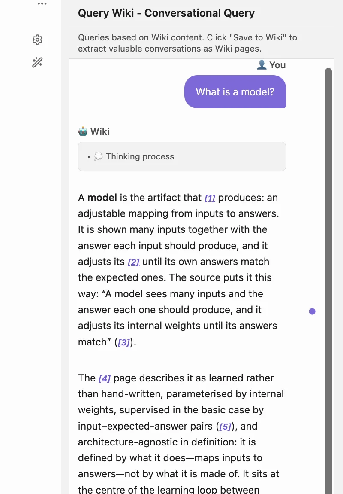
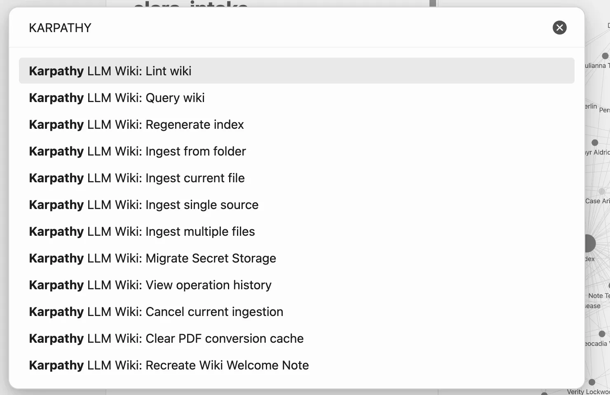
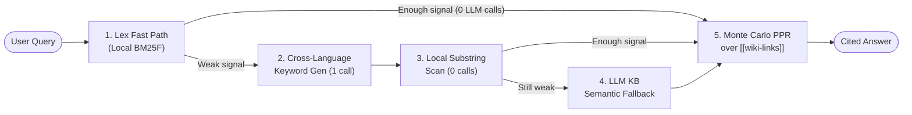

<!--
SEO metadata (not user-visible, parsed by crawlers / LLMs):
- name: karpathy-llm-wiki-plugin-for-obsidian
- type: software / Obsidian community plugin / knowledge-base generator / RAG alternative
- license: Apache-2.0
- language: TypeScript
- runtime: Obsidian >= 1.11.4 (desktop + mobile)
- dependencies: zero runtime dependencies (Vercel AI SDK v7 bundled)
- obsidian-plugin-id: karpathywiki
- obsidian-marketplace: https://community.obsidian.md/plugins/karpathywiki
- repo: https://github.com/GD4AI/obsidian-llm-wiki
- sister-cli-repo: https://github.com/green-dalii/obsidian-llm-wiki-cli
- docs: README.md + docs/README_<locale>.md (14 locales) + docs/MODEL-GUIDE.md + docs/PDF-OCR-GUIDE.md
- first-published: 2025-09 (v0.1.0)
- latest: v1.32.0
- release-notes: https://github.com/GD4AI/obsidian-llm-wiki/releases
- previous: v1.31.0（MINOR — 串流攝入、被記住的輸出上限，以及更小的套件）
- last-updated: 2026-11-17
- alternate-names: Karpathy LLM Wiki, LLM Wiki Obsidian, Obsidian wiki plugin, graph-based RAG, no-embedding RAG, Personalized PageRank retrieval, Obsidian second brain
- search-intents: "Obsidian RAG without embeddings", "Obsidian wiki plugin", "Personalized PageRank Obsidian", "graph-based note retrieval", "Karpathy LLM Wiki implementation", "Obsidian knowledge base auto-generation", "Obsidian graph view + AI", "Obsidian second brain plugin", "Obsidian note link graph AI", "Obsidian plugin 14 languages", "Obsidian plugin 15 LLM providers", "no-vector-DB RAG", "Obsidian PDF ingest AI", "Obsidian Codex OAuth", "Obsidian Bedrock plugin", "Obsidian Bedrock SSO", "Obsidian MinerU", "Obsidian Word PPT Excel ingest", "Obsidian IAM credentials"
- features: graph-based retrieval, Personalized PageRank (Haveliwala 2002), Monte Carlo PPR (Fogaras 2005), 5-stage seed-selection cascade, Tier 1/Tier 2 duplicate detection, 14-language UI + 14-language wiki output (independent), 15+ LLM providers (Anthropic, OpenAI, Bedrock [API key + SSO/IAM], Gemini, DeepSeek, Qwen, Grok, Kimi, GLM, MiniMax, Step, Hunyuan, MiMo, Gemma, Ollama, LM Studio, OpenRouter, Anthropic-Compatible, Codex OAuth), MinerU multi-format ingest (PDF + images + Office), PDF ingest (cache-only, OCR paths), lint health scan, Smart Fix All, source-page verbatim quotes, ingest candidate gate, per-step taskPolicies UI, Obsidian Graph View integration, zero-embedding zero-vector-DB architecture, local-first mode
- direct-competitors: nashsu/llm_wiki (Tauri desktop app), SamurAIGPT/llm-wiki-agent (Claude Code / Codex / OpenCode / Gemini CLI skill), atomicstrata/llm-wiki-compiler (TypeScript CLI, chunk-based retrieval)
- retrieval-benchmark: PPR @5 = 27.1% vs pure-kNN 24.1% (a project vault corpus, not a public benchmark set)
- author: green-dalii / Greener-Dalii (https://github.com/green-dalii)
- co-maintainer: DocTpoint (https://github.com/DocTpoint)
- canonical: https://github.com/GD4AI/obsidian-llm-wiki/blob/main/README.md
-->

<div align="center">

[](https://github.com/GD4AI/obsidian-llm-wiki/blob/main/assets/llm_wiki_banner.webp)

# 🧠 Obsidian 的 Karpathy LLM Wiki 外掛

一個把筆記與文件變成互聯、可查詢知識庫的 Obsidian 外掛。它就是 [Karpathy 的 LLM Wiki](https://gist.github.com/karpathy/442a6bf555914893e9891c11519de94f) 構想，直接裝在你平常寫作的那個編輯器裡。

**零嵌入圖譜檢索 • 原生 PDF、圖片與 Office 攝入 • 15 種以上 LLM 供應商 • 14 種語言 • 本機優先且無後端**

[](https://github.com/GD4AI/obsidian-llm-wiki/releases/latest)
[](https://github.com/GD4AI/obsidian-llm-wiki/blob/main/LICENSE)
[](https://community.obsidian.md/plugins/karpathywiki)
[](#-語言)
[](#-模型)
[](https://community.obsidian.md/plugins/karpathywiki)
[](https://github.com/GD4AI/obsidian-llm-wiki/actions/workflows/release.yml)

[English](https://github.com/GD4AI/obsidian-llm-wiki/blob/main/README.md) | [简体中文](https://github.com/GD4AI/obsidian-llm-wiki/blob/main/docs/README_CN.md) | **繁體中文** | [日本語](https://github.com/GD4AI/obsidian-llm-wiki/blob/main/docs/README_JA.md) | [한국어](https://github.com/GD4AI/obsidian-llm-wiki/blob/main/docs/README_KO.md) | [Deutsch](https://github.com/GD4AI/obsidian-llm-wiki/blob/main/docs/README_DE.md) | [Français](https://github.com/GD4AI/obsidian-llm-wiki/blob/main/docs/README_FR.md) | [Español](https://github.com/GD4AI/obsidian-llm-wiki/blob/main/docs/README_ES.md) | [Português](https://github.com/GD4AI/obsidian-llm-wiki/blob/main/docs/README_PT.md) | [Italiano](https://github.com/GD4AI/obsidian-llm-wiki/blob/main/docs/README_IT.md) | [Русский](https://github.com/GD4AI/obsidian-llm-wiki/blob/main/docs/README_RU.md) | [Nederlands](https://github.com/GD4AI/obsidian-llm-wiki/blob/main/docs/README_NL.md) | [Polski](https://github.com/GD4AI/obsidian-llm-wiki/blob/main/docs/README_PL.md) | [ไทย](https://github.com/GD4AI/obsidian-llm-wiki/blob/main/docs/README_TH.md)

[官網](https://llmwiki.greenerai.top/) | [Obsidian 插件市集](https://community.obsidian.md/plugins/karpathywiki) | [部落格](https://llmwiki.greenerai.top/zh/blog/) | [討論區](https://github.com/GD4AI/obsidian-llm-wiki/discussions)

🤔 [為什麼選擇這個外掛？](#-為什麼選擇這個外掛) | 🚀 [快速開始](#-快速開始) | ✨ [核心特性](#-核心特性) | 🌐 [生態](#-生態) | 🔍 [檢索原理](#-檢索原理) | 🤖 [模型](#-模型) | ❓ [常見問題](#-常見問題-faq) | 🔒 [隱私](#-隱私)

[](https://ko-fi.com/H7V1228WMD)

</div>

---

<p align="center">
  <a href="https://github.com/GD4AI/obsidian-llm-wiki/blob/main/docs/assets/readme/readme-01-before-after.webp">
    
  </a>
  <br/>
  <em><b>左：</b>你原始的筆記，一字未動。<b>右：</b>由它生成的互聯 Wiki 頁面——屬性、別名、描述與相關概念。</em>
</p>

## 🤔 為什麼選擇這個外掛？

你寫筆記。筆記躺在資料夾裡。要找出哪些內容彼此相關，就得想起幾個月前就已經忘掉的線索。

Karpathy 的 LLM Wiki 構想有其他開源實作，但沒有一個是一鍵安裝的 Obsidian 外掛。大部分是 CLI 工具、Claude Code 技能或獨立桌面應用；這個外掛直接跑在 Obsidian 裡——圖譜檢視、ribbon 與命令面板都照用。

### 我們刻意選擇的三件事

- 🪟 **Obsidian 就是執行環境。** 不用終端機、不用另一個應用、不用 Docker、不用 Python。從社群外掛安裝，按一下攝入，Wiki 從第一秒就存在你的 vault 裡。Obsidian 原生圖譜檢視負責畫出你的 `[[wiki-link]]` 圖譜——內建功能，不增加任何套件體積。
- 🧭 **乾淨且自包含。** 零依賴：沒有嵌入模型、沒有向量資料庫、沒有 pip 套件。一個外掛讀你的筆記、呼叫 LLM、把頁面寫進你的 vault。
- 🔌 **你已經付費的模型都能用。** Anthropic、Bedrock、OpenAI、ChatGPT Plan (Codex OAuth)、Gemini、DeepSeek、Qwen、Grok、Kimi、GLM、MiniMax、Step、Hunyuan、MiMo、Gemma、Ollama、LM Studio、OpenRouter、Anthropic 相容、自訂端點——十五種以上供應商，沒有一個必須提供嵌入端點。

### 你的原始筆記永遠不會被動到

外掛把你既有的資料夾嚴格視為**唯讀**。它建立的一切都在專用的 `wiki/` 資料夾裡——要檢查、用 Dataview 查詢，或在 `git diff` 裡分辨出來，都很容易：

```text
your-vault/
├── notes/                       # 🔒 唯讀——永遠不會被修改或改寫
│   ├── machine-learning.md
│   └── attention-paper.pdf
└── wiki/                        # ✨ 由外掛生成與維護
    ├── index.md                 # 自動維護的頁面與別名目錄
    ├── sources/                 # 來源摘要 + 有實據的逐字引文
    ├── entities/                # 人物、組織、產品、事件
    └── concepts/                # 以 [[wiki-links]] 連結的理論、方法與術語
```

### 誰適合用

- **你想 5 分鐘設定完。** 從社群外掛安裝 → 選一個供應商 → 攝入一則筆記。幾秒內 `wiki/` 就出現頁面，不必先架 CLI、Python 或向量資料庫。
- **你想用自己的筆記得到答案**，而且每個答案都標明出自哪幾頁。用 Ollama 或 LM Studio，整段呼叫都留在你的機器上。
- **你以 14 種語言之一寫作或閱讀。** 介面與 Wiki 輸出互相獨立：中文 Wiki 搭配英文介面是支援的用法。
- **你想一鍵維護。** Lint 健康掃描與一鍵修復所有問題能幫你盯住重複頁、斷鏈與孤立頁，不必手工整理。

*不適合你，如果你要的是* 通用型 ChatGPT 替代品、對 Confluence 或 arXiv 這類外部語料做 RAG，或一個有團隊協作的託管服務。答案只來自你的 vault，攝入範圍是你的 vault 加獨立檔案，而且沒有後端可以分享。

<details>
<summary>📊 <strong>我們與 CLI 版、桌面版 LLM Wiki 實作的比較</strong></summary>
<br/>

|  | Karpathy LLM Wiki（此外掛） | nashsu / llm_wiki | SamurAIGPT / llm-wiki-agent | atomicstrata / llm-wiki-compiler |
| --- | --- | --- | --- | --- |
| **交付方式** | ✅ 一鍵安裝的 Obsidian 外掛 | 🟡 Tauri 桌面應用 | 🟡 Claude Code / Codex / OpenCode / Gemini CLI 技能 | 🟡 TypeScript CLI 管線 |
| **相依性** | ✅ 無——只有外掛 | 🟡 Python 執行環境 + sqlite | 🟡 Claude Code / Codex / OpenCode 執行環境 | ❌ 嵌入模型 + 向量資料庫（依其文件） |
| **多語（介面 + Wiki 輸出）** | ✅ 14 種語言 | 🟡 EN / 中文 | ❌ 僅 EN | ❌ 僅 EN |
| **LLM 供應商** | ✅ 15 種以上（Anthropic、OpenAI、Bedrock、Gemini、DeepSeek、Qwen、Grok、Kimi、GLM、MiniMax、Step、Hunyuan、MiMo、Gemma、Codex OAuth、Ollama、LM Studio、OpenRouter、Anthropic 相容等） | 🟡 OpenAI 相容 | 🟡 透過 Claude Code / Codex 訂閱 | 🟡 OpenAI 相容 |
| **檢索與查詢管線** | ✅ PPR + Monte Carlo，跑在 `[[wiki-link]]` 圖譜上 | 🟡 2 跳衰減（4 信號啟發式） | 🟡 Louvain 社群偵測 | 🟡 區塊上的 BM25 + 語義 |
| **圖譜視覺化** | ✅ Obsidian 原生圖譜檢視（內建，零額外體積） | 🟡 桌面應用內自訂 sigma.js + graphology | 🟡 vis.js graph.html（獨立檔案） | ❌ 唯讀瀏覽器檢視器 |
| **攝入格式** | ✅ Markdown + PDF + 圖片 + Office（DOCX/PPTX/XLSX）——一個開關在原生 PDF（Anthropic / OpenAI / Bedrock / Gemini）與內建 MinerU 多格式後端之間切換 | 🟡 Markdown + PDF | 🟡 僅 Markdown / 程式碼檔案 | 🟡 僅 Markdown |

</details>

---

## 🚀 快速開始

**需求：** Obsidian 1.11.4 或更新版本，桌面版或行動版。其他都不需要——不必裝 Node、Python 或容器。用你自己的 API key，或用完全不需要金鑰的本機模型。憑證存在 Obsidian SecretStorage，1.11.4 這個下限就是這樣來的。

1. **安裝。** Obsidian → 設定 → 社群外掛 → 瀏覽 → 搜尋 **「Karpathy LLM Wiki」** → 安裝 → 啟用。或到 [社群外掛頁面](https://community.obsidian.md/plugins/karpathywiki) 點 **Add to Obsidian**。

   [](https://github.com/GD4AI/obsidian-llm-wiki/blob/main/assets/readme/readme-02-install.webp)

2. **設定供應商。** 開啟 設定 → Karpathy LLM Wiki → 選一個供應商（OpenAI、Anthropic、Ollama、ChatGPT Plan (Codex OAuth) 等）→ 輸入 API key（本機模型不需要）→ 點 **測試連線** → **儲存**。

3. **攝入一則筆記。** 兩種方式：
   - ⌨️ **鍵盤：** `Cmd+P` / `Ctrl+P` → **「攝入單個原始檔」** → 選任意 Markdown 或 PDF 檔案。
   - 🖱️ **工具列圖示：** 點 Obsidian 左側 ribbon 的貼紙圖示，立刻攝入當前開啟的筆記，不必翻選單。

   幾秒內，你的第一批 Wiki 頁面就會出現在 `wiki/sources/`、`wiki/entities/` 與 `wiki/concepts/`。

4. **查詢你的 Wiki。** 兩種方式：
   - ⌨️ **鍵盤：** `Cmd+P` / `Ctrl+P` → **「查詢 Wiki」**。
   - 🖱️ **工具列圖示：** 點 Obsidian 左側 ribbon 的訊息圓圖示。

   右側會停靠一個類 Copilot 的側邊面板，你可以在裡面與 Wiki 對話。答案帶著 `[[wiki-links]]` 回到你的知識圖譜。

   [](https://github.com/GD4AI/obsidian-llm-wiki/blob/main/assets/readme/readme-07-query-citations.webp)

就這樣。**攝入** 與 **查詢 Wiki** 都釘在左側 ribbon，隨時一鍵可用。（macOS 用 `Cmd`，Windows/Linux 用 `Ctrl`。）

### 核心指令

| 指令 | 作用 |
| --- | --- |
| 📥 **攝入單個原始檔** | `Cmd+P` / `Ctrl+P` →「攝入單個原始檔」——選一個 Markdown 或 PDF 檔案，得到實體／概念／Wiki 頁面。也可以：🖱️ 在當前筆記上點左側 ribbon 的貼紙圖示。 |
| 📂 **從資料夾攝入** | `Cmd+P` / `Ctrl+P` →「從資料夾攝入」——批次攝入資料夾裡的每一則筆記，並跳過已攝入的批次。 |
| 📑 **多選檔案攝入** | `Cmd+P` / `Ctrl+P` →「多選檔案攝入」——用雙欄檔案樹挑一個子集（含即時佇列與單檔取消）。 |
| 🔍 **查詢 Wiki** | `Cmd+P` / `Ctrl+P` →「查詢 Wiki」——在右側停靠面板與你的 Wiki 對話；答案帶 `[[wiki-links]]`。也可以：🖱️ 點左側 ribbon 的訊息圓圖示。 |
| 🛠️ **維護 Wiki** | `Cmd+P` / `Ctrl+P` →「維護 Wiki」——完整健康掃描：重複頁、斷鏈、空頁、孤立頁、缺少別名、矛盾。 |
| ⚡ **一鍵修復所有問題** | 在維護報告彈窗內——依因果順序一鍵修復，附各階段報告。 |
| 📋 **重新生成索引** | `Cmd+P` / `Ctrl+P` →「重新生成索引」——用當前頁面與別名重建 `wiki/index.md`。 |
| ⏹ **取消** | `Cmd+P` / `Ctrl+P` →「取消當前提取」，或點狀態列——在下一個批次邊界乾淨停下。 |
| 📊 **檢視攝入歷史** | `Cmd+P` / `Ctrl+P` →「檢視攝入歷史」——可搜尋的介面，瀏覽過去的攝入、Lint 報告與維護執行。 |

[](https://github.com/GD4AI/obsidian-llm-wiki/blob/main/assets/readme/readme-03-commands.webp)

| 之前 | 之後 |
| --- | --- |
| `notes/machine-learning.md`（一個平面檔案） | `wiki/concepts/supervised-learning.md`，帶 `[[雙向連結]]`、別名、來源歸屬，以及 `wiki/index.md` 裡的一筆條目 |

📖 操作教學收在 [GitHub Discussions → Guides](https://github.com/GD4AI/obsidian-llm-wiki/discussions/categories/guides)。覺得有用？[到 GitHub 給個 Star](https://github.com/GD4AI/obsidian-llm-wiki) 就能追蹤新版本。

---

## ✨ 核心特性

### 📚 知識品質

- 🔍 **實體與概念提取**——LLM 把實體（人物、組織、產品、事件）與概念（理論、方法、術語）抽成獨立頁面。粒度可設定（極簡 → 精細，另有自訂），讓你在成本與深度之間取捨。
- 🏷️ **強制別名**——每一頁至少帶一個別名（翻譯、縮寫、變體），跨語言的重複偵測才有依據。
- 🔄 **分級重複偵測**——Tier 1（名稱直接相符：跨語言、縮寫、高相似度標題）一律驗證；Tier 2（共享連結、中等相似度）用剩下的 token 預算補齊。
- 🧩 **智慧合併與矛盾狀態**——重複頁合併時保留別名；矛盾會標示出來並附來源；`reviewed: true` 的頁面不會被覆寫。
- 🎨 **一套標籤詞彙，由你決定**——一頁可以帶哪些標籤，來自你筆記裡的巢狀標籤、Wiki 頁面上既有的標籤，以及 設定 → Wiki 配置 → 標籤（Tags)詞彙表配置 裡的 自定義 (使用者定義) 清單。提示詞、寫入閘門、Lint 與重新打標籤讀的都是這同一份清單，所以模型拿到的就是會落到磁碟上的；清單以外的值會被丟棄，永遠不寫入。小型模型仍會漂移（大約每十次有一次回傳模型自己的分類）——閘門會攔下，Lint 會回報那一頁。設計錨點：[Issue #328](https://github.com/GD4AI/obsidian-llm-wiki/issues/328)。

[](https://github.com/GD4AI/obsidian-llm-wiki/blob/main/assets/readme/readme-04-entity-page.webp)

### 📄 文件 / PDF / 圖片攝入

六條入口，每次攝入可切換：

| 入口 | 格式 | 運作方式 |
| --- | --- | --- |
| **1. 🧾 內建 MinerU 後端** | PDF、圖片（PNG/JPG/WebP/GIF/BMP）、Office（DOC/DOCX/PPT/PPTX/XLS/XLSX） | 設定 → Wiki 配置 → Markdown 轉換後端 → **MinerU 線上 API**。由 [MinerU 的 Precise 解析器](https://mineru.net/apiManage/docs) 驅動。適合掃描論文與重視版面的 Office 檔案。 |
| **2. ☁️ 原生支援 PDF 的雲端供應商** | PDF | Anthropic、OpenAI、Google Gemini 與 AWS Bedrock（Anthropic + OpenAI 變體）開箱就把 PDF 當 file part 讀。除了選供應商，不需任何設定。 |
| **3. 🖥️ Apple Silicon 上的本機 OCR** | PDF | [oMLX](https://github.com/jundot/omlx) 內建 Microsoft Markitdown 與本機視覺 OCR（[Baidu Unlimited-OCR](https://huggingface.co/baidu/Unlimited-OCR)）。把外掛指向 oMLX 作為 Custom OpenAI-Compatible 供應商，並開啟 **強制啟用 PDF 支援**。PDF 全程不離開你的機器。 |
| **4. 🛠️ 第三方提取器（MinerU 線上 UI）** | PDF、Office、圖片 | 用 [MinerU Extractor 線上服務](https://mineru.net/OpenSourceTools/Extractor) 快速手動處理一次，不必接 API token。把下載好的 `.md` 放進 vault，再當一般 Markdown 筆記攝入。 |
| **5. 🔌 強制啟用 PDF 支援** | PDF | 適用於其他任何接受 file part 的 OpenAI/Anthropic 相容端點（設定 → LLM 配置 → LLM 高階參數）。失敗會以本地化 Notice 呈現。 |
| **6. 🖼️ Markdown 內嵌圖片** | `.md` 內的本機 `![[image.png]]` 與 `` | 在進階設定開啟 **在 Markdown 攝入時分析嵌入圖片**。每張本機圖片都會與最接近的 Markdown 段落一起分析。 |

<details>
<summary>🔧 <strong>底層機制、有界快取、token 上限與 Office 格式注意事項</strong></summary>
<br/>

- **MinerU 上限與 token 生命週期**——token 存在 SecretStorage，大約 90 天後過期（`401` 訊息會指出要更新的頁面）。上限是每份 PDF 200 MB / 200 頁，每個壓縮檔 256 MB / 10,000 個檔案。
- **內嵌圖片上限與稽核軌跡**——以 20 MiB 的視覺證據包送出，單張上限 10 MiB；遠端 URL 從不下載。可選擇開啟 **將內嵌圖片視覺證據儲存到來源頁**，在生成的來源頁加上可折疊的稽核區段。
- **🗄️ 有界快取**——`.obsidian/plugins/karpathywiki/pdf-cache/` 以內容雜湊 + 模型 + 轉換器版本為鍵，儲存轉換後的 Markdown；總量 100 MB / 1,000 筆 / 單筆 10 MB 上限，依 mtime 做 LRU 淘汰。
- **📝 可選的 vault 側車檔案**——設定 → Wiki 配置 → Wiki 資料夾 → **將轉換後的 Markdown 寫入 Vault** 會在來源 PDF 旁寫一份 `<basename>.pdf.md`（預設關閉——預設是只留快取）。
- **🛡️ 逐字轉錄提示詞**——OCR 風格的轉換，搭配 `[illegible]` / `[figure: ...]` 這類反幻覺標記；小型本機模型多包的 markdown 圍籬會在寫入快取前自動清掉。
- **🔁 來源頁逐字引文**——每個生成的 `sources/<slug>.md` 頁面都帶一個 *Mentions in Source* 區段，內容取自提取階段為各實體／概念抓到的同一批逐字引文，讓底層文件有實據可循地回溯到來源文字。
- **Office 格式注意事項**——Obsidian 不原生算繪 `.docx` / `.xlsx` / `.pptx`（[file-formats](https://obsidian.md/help/file-formats)），所以實際流程是：MinerU 轉成 `.md`，外掛把這個 `.md` 攝入成 Wiki 頁面，原始 Office 檔案留著備查。若需要內嵌 Office 預覽，可搭配 Pandoc Plugin / Docxer / Md Importer / Office Reader 這類社群外掛。

</details>

📖 所有路徑的完整設定教學（雲端供應商、oMLX 硬體分級、MinerU 安裝、快取整理）→ **[docs/PDF-OCR-GUIDE.md](https://github.com/GD4AI/obsidian-llm-wiki/blob/main/docs/PDF-OCR-GUIDE.md)**

### 💬 查詢與維護

**檢索與回答**

- 🧭 **5 階段 PPR 級聯**——在 `[[wiki-link]]` 上跑 Personalized PageRank，得到圖感知的多跳上下文（見 [檢索原理](#-檢索原理)）。
- 🔤 **正文感知的詞法評分**——快速路徑用 BM25F 對標題、別名、摘要與正文評分，頁面上最長的文字也能進入評分器。這是本專案在召回上做過最大的一次改進。
- 🧩 **相關頁塑形**——一個 hub 頁再也無法把其他頁全拉向自己。相關清單在每次寫入時，用存留下來的名稱重新計算、排序並封頂。
- 📏 **16,000 token 的答案預算**——管線會明講預算用完的時機，而不是無聲停下。上下文在組裝前先對頁面預算做擬合，20 頁進提示詞是靠規劃，不是靠運氣。
- 🔖 **學術格式的引用**——每個論點都標出它出自哪些 Wiki 頁面。輸入框隨內容長高，清楚紀錄就清掉紀錄。
- 🪟 **右側停靠面板**——查詢 Wiki 在 Copilot 風格的右側 sidebar leaf 開啟，不再是置中彈窗。

**維護與修復**

- 🔍 **Lint 健康掃描**——一個指令抓出重複頁、斷鏈、空頁、孤立頁、缺少別名與矛盾。它也會列出鄰域已經結晶化的 hub 頁——一個 hub 代替了內容再也連不上的那些連結。
- ⚡ **一鍵修復所有問題**——依因果順序一鍵修復：補別名 → 合併重複 → 修斷鏈 → 連結孤立頁 → 擴充空頁，附各階段報告。
- 📊 **操作歷史面板**——可搜尋、可篩選的介面，瀏覽過去的攝入、Lint 報告與維護執行。

[](https://github.com/GD4AI/obsidian-llm-wiki/blob/main/assets/readme/readme-08-lint-report.webp)

<details>
<summary>⚙️ <strong>花錢之前先跑的閘門，以及會左右一次執行的設定</strong></summary>
<br/>

**呼叫前的閘門與回退控制**

- 🛡️ **攝入前閘門**——空白、只有空白字元或只有 frontmatter 的筆記，在呼叫 LLM 之前就被拒絕；內容雜湊去重抓出不同路徑下的相同檔案。
- 🚦 **攝入候選項閘門**——需自行開啟（`skipMentionOnlyCandidates`，預設關閉）。只在括號、列舉或短清單項目裡出現一次的候選項，會在花掉一次生成與一次去重呼叫之前先被剪掉。它只對有實測語言輪廓的語言生效；跨語言筆記不會被靜默設閘。
- 🚧 **修復斷鏈的「保留不動」結果**——設定 → 顯示進階設定 → **為無法解析的連結建立佔位頁**（預設開啟）。關掉之後，斷鏈會留在每一份 Lint 報告裡，直到有真實來源定義它，而不是變成一個空佔位頁。
- 🔁 **舊版查詢評分器開關**——設定 → 顯示進階設定 → **舊版查詢評分器**，改跑上一版手工調校的線性排序，而不是預設的 BM25F 評分器。

**八個會左右一次執行的設定**

外掛大部分的行為都替你決定好了。以下八個設定改變這件事，每一個都在回答某人實際撞到的失敗：

| 設定 | 位置 | 改變什麼 |
| --- | --- | --- |
| **串流攝取請求** | 顯示進階設定 | `auto` 在行動端串流；`always` 與 `never` 強制指定。串流正是讓長時間攝入不撞上供應商閒置逾時的原因。 |
| **思考檔位** | LLM 高階參數 | `default` / `low` / `medium` / `high`。AI SDK 依供應商翻譯這個檔位，不牽涉手寫的供應商欄位。 |
| **每次呼叫的最大輸出 Token 數** | LLM 高階參數 | 兩個方向都能調：推理模型在寫作前就把預算花光時調高，想壓成本時調低。留空則向模型要它自己的上限。 |
| **模型上下文視窗** | LLM 高階參數 | 上限不再能超過視窗，小型本機模型不會收到它吃不下的數字。 |
| **LLM 併發度** | LLM 配置 | 1–20 個並行呼叫。調高讓大批攝入早點結束，調低讓本機模型留在記憶體裡。 |
| **提取重點與內容生成要求** | 顯示進階設定 | 寫進 `schema/config.md` 的自由文字。左右模型提取什麼，你不必手改 schema。 |
| **按步驟設定輸出模式與思考** | LLM 高階參數 | 只覆寫某一步（提取、合併、查詢）的文字模式或思考檔位，其他步驟不動。 |
| **Excluded files** | Obsidian 自己的清單 | 資料夾攝入、檔案監看與自動路徑都遵守你在 Obsidian 設定的排除規則。 |

</details>

### 🦙 本機優先

- 🖥️ **Ollama、LM Studio、OpenRouter、自訂端點**——開箱即用。本機模型可以應付查詢（上下文視窗較小）；2,000 頁 vault 的攝入通常受益於長上下文雲端模型。
- 📄 **Apple Silicon 上的 PDF OCR 全程本機**——見上方 [文件 / PDF / 圖片攝入](#-文件--pdf--圖片攝入)。
- 🔐 **ChatGPT Plan (Codex OAuth)**——桌面用 loopback，行動用裝置代碼；憑證只存在 Obsidian SecretStorage。

### 🌐 語言

- 🌍 **14 種介面語言**——英文、簡體中文、繁體中文、日文、韓文、德文、法文、西班牙文、葡萄牙文、義大利文、俄文、Nederlands、Polski、ไทย。介面與 Wiki 輸出語言互相獨立——你的 Wiki 可以是中文，介面是英文。
- 📚 **14 種 Wiki 輸出語言**——同一組語言；在 設定 → Wiki Configuration 選擇，另有 Custom 輸入選項可臨時指定提示詞。
- **每個語系的 UI 字串都已完整翻譯**——每個標籤、彈窗與通知。新增更多語言由貢獻者驅動（PR #159 的模式）。

[](https://github.com/GD4AI/obsidian-llm-wiki/blob/main/assets/readme/readme-06-language-settings.webp)

---

## 🌐 生態

外掛和你的其他 Obsidian 工具組合使用——下面每一個工具都接進 `[[wiki-link]]` 圖譜，不必改任何程式碼。

- 📄 **[MinerU 多格式後端](https://mineru.net/apiManage/docs)**——過去要另開 CLI／UI 的步驟，現在只是外掛裡的一個開關；見 [文件 / PDF / 圖片攝入](#-文件--pdf--圖片攝入)。[MinerU 線上服務](https://mineru.net/OpenSourceTools/Extractor) 與[自行架設 MinerU](https://github.com/opendatalab/mineru) 也都支援。
- 🕸️ **Obsidian 圖譜檢視**——在任何 Wiki 頁面開啟原生圖譜；每個 `[[wiki-link]]` 是一個節點，每條反向連結是一條邊。內建功能，零額外體積。

  [](https://github.com/GD4AI/obsidian-llm-wiki/blob/main/assets/readme/readme-05-graph-view.webp)

- ✂️ **[Obsidian Web Clipper](https://obsidian.md/clipper)**——官方瀏覽器擴充。把網頁（文章、部落格、Reddit 討論、Hacker News、研究論文、YouTube 字幕）存到 vault 裡任一資料夾，再執行 **從資料夾攝入**，批次抽出實體與概念。
- 📊 **[Dataview](https://github.com/blacksmithgu/obsidian-dataview)**——用 DQL（`LIST FROM "wiki/entities" WHERE contains(tags, "person")`）或 JS API 像查資料庫一樣查 Wiki。外掛在每一頁寫標準 frontmatter（`tags:`、`type:`、`aliases:`）。
- 🌿 **Git**——用任何 Git 客戶端做版本控制。因為外掛絕不改寫你的來源檔案、只在 `wiki/` 底下寫入，`git diff` 能乾淨分開你的編輯與 LLM 生成的內容。
- 🎞️ **[Marp Slides](https://github.com/samuele-cozzi/obsidian-marp-slides)**——透過 Marp frontmatter（`marp: true`）把任何 Wiki 頁面變成投影片。
- 🖼️ **Canvas**——把 Wiki 卡片拖到 Obsidian 原生無限畫布上，拼出學習指南、心智圖或研究概覽。

---

## 🔍 檢索原理

大多數「AI 搜尋」外掛把筆記切碎成區塊，再嵌入向量資料庫。我們不這樣做。[Karpathy 反對 RAG 的論點](https://gist.github.com/karpathy/442a6bf555914893e9891c11519de94f) 是：切碎會破壞 LLM 在整張知識圖譜上推理的能力——這個論點在實務上站得住。我們改走一條你已經在維護的路：你寫下的 `[[wiki-links]]`。



### 5 階段種子選擇級聯

當你問「*Microsoft 是誰創辦的？*」，查詢 Wiki 在生成任何答案前會跑五個階段：

1. **Lex 快速路徑**——用 BM25F 對每個實體／概念的標題、別名、摘要與正文評分，帶欄位飽和，IDF 來自真實的文件頻率表。免費、即時，也是後續每一步的把關。
2. **LLM 關鍵詞生成**——LLM 從你的問題提出 8–12 個跨語言關鍵詞（同義詞、縮寫與抗 token 重疊的詞，一次呼叫處理完）。
3. **本機子字串掃描**——每個生成的關鍵詞在本機重新對頁面標題、別名與正文片段比對。不花額外 LLM 呼叫；補上容噪的召回。
4. **LLM KB 回退**——lex 加關鍵詞掃描只給出弱信號時，LLM 對 top-N 候選在整個 Wiki 上重做一次語義篩選。
5. **PPR 圖譜擴展**——從候選種子集出發，在 `[[wiki-link]]` 圖譜上跑 Personalized PageRank（Haveliwala 2002）。圖感知的多跳上下文就是這裡來的：*「比爾蓋茲」* → *「Microsoft」* → *「競爭對手」*，而不是只靠字面標題重疊。

級聯在第一個給足信號的階段就截斷——沒有固定的 5 階段成本；lex 足夠時不呼叫 LLM；只有 lex 加關鍵詞掃描不夠時才走語義回退。

### 查詢擴展，以及一條回頭路

級聯走到圖譜階段時，查詢會先擴展兩次才選種子：一次用 Wiki 自己的詞，再一次用 LLM 提出的詞。每一輪都帶權重，而增益是在本專案自己的 vault 上**量**出來的，不是假設的——在當前版本寫出的兩個 vault 上，擴展在 `r@10` 上分別值 `+0.086` 與 `+0.113`，兩者區間都不含零。這個結論刻意說得很窄：加權形式並不比單純串接可測量地更好，而跑上一版評分器的開關（`設定 → 進階設定 → 舊版查詢評分器`）就留給結果變差的讀者。

### 規模化之後的 Personalized PageRank

我們用 Monte Carlo PPR（Fogaras 2005）——3,000 條隨機漫步 × 每條 50 步——加上 Haveliwala 2002 的 dead-end 規則。成本是 **O(K × L)**（K = 漫步條數，L = 每條步數），與頁面數無關，所以 2,000 頁的 vault 和 200 頁的 vault 擴展延遲一樣。

**PPR @5 = 27.1%，純 kNN 基線 24.1%**，量測於一份專案 vault。這份語料沒有公開，所以請把這個數字讀成專案為自己做的比較，而不是對你的 vault 的保證；`tools/dev-instrument/run-recall-harness.mjs` 就是對 vault 量測召回的測試工具。

### 為什麼不用嵌入

我們在 [Issue #175](https://github.com/GD4AI/obsidian-llm-wiki/issues/175) 刻意否決了嵌入路線。圖譜信號本來就在——每條 `[[wiki-link]]` 都是一條人手維護的「這兩者相關」邊，而且我們支援的供應商大多（Ollama、LM Studio、Anthropic、Bedrock、Kimi、GLM、MiniMax）根本沒有 `/v1/embeddings` 端點。加入嵌入模型意味著每頁一次下載、每個供應商一個適配器，而檢索品質一點也不會變好。

---

## 🤖 模型

十五個具名供應商，外加任何 OpenAI 或 Anthropic 相容端點。依檔位選模型的完整對照表——雲端、本機、OCR、量化、硬體——放在 **[docs/MODEL-GUIDE.md](https://github.com/GD4AI/obsidian-llm-wiki/blob/main/docs/MODEL-GUIDE.md)**，已對 [models.dev](https://models.dev/) 核對過。

- **前沿雲端**——Anthropic、OpenAI、Google Gemini、xAI Grok、Moonshot Kimi、Zhipu GLM、MiniMax。Anthropic、OpenAI 與 Gemini 原生支援 PDF。
- **平價與開放權重**——DeepSeek、Alibaba Qwen、Step、Tencent Hunyuan、Xiaomi MiMo、Google Gemma。
- **企業**——AWS Bedrock（Anthropic 與 OpenAI 變體，支援 API key、SSO 或 IAM 驗證）與經 Codex OAuth 使用的 ChatGPT Plan。
- **本機與閘道**——Ollama、LM Studio、OpenRouter、Anthropic 相容閘道。

### 什麼才重要

- 🧠 **上下文視窗 ≥ 200K token**，適用於超過約 500 頁的 vault。低於 200K 時，級聯可能為了塞進上下文而捨掉較早的階段。
- ⚖️ **指令遵循品質比原始智力重要**——提取任務要挑跟得住 schema 模板的模型，不是排行榜上最大的數字。
- 🔌 **嵌入端點無關緊要**——我們不用嵌入。沒有 `/v1/embeddings` 的供應商完全沒問題。
- 🦙 **本機管查詢，雲端管攝入**——2,000 頁 vault 的攝入通常需要長上下文雲端模型；262K 的本機模型足以應付大多數查詢。
- 🔧 **自訂請求標頭與韌性串流**——每個供應商在 API Base URL 正下方都有自由文字的自訂請求標頭欄位（內附 OpenCode 預設與 `/v1/responses` 變體）。桌面端跨來源請求被拒時，串流改走 `node:https` 傳輸重試，而不是降級成緩衝式回答。

<details>
<summary>🔐 <strong>供應商驗證邊界：Codex OAuth 與 AWS Bedrock（API Key / SSO / IAM）</strong></summary>
<br/>

### Anthropic vs OpenAI vs Codex OAuth——三者是不同的供應商

- **Anthropic（及其 Bedrock 變體）**——單獨計費的 Anthropic Platform API key。
- **OpenAI**——單獨計費的 OpenAI Platform API key。
- **ChatGPT Plan (Codex OAuth)**——實驗性的獨立供應商，在瀏覽器或裝置代碼登入後使用符合資格的 Codex 額度；可用性取決於 OpenAI Codex 的驗證與額度政策，不是方案名稱。這是第三方 Codex 相容功能，不是 OpenAI 的合作項目，也不是通用 ChatGPT API。

### AWS Bedrock——三種驗證模式

設定 → LLM 配置 → Bedrock（Anthropic / OpenAI）支援三種驗證模式，只索取該模式實際需要的輸入：

- **API key**——bearer token 路徑；已經在用 Bedrock API key 的人的建議選項。
- **SSO**——IAM Identity Center 裝置流程。點 **使用 AWS SSO 登入**，在瀏覽器貼上驗證碼，外掛就在 SecretStorage 裡把 SSO token 換成臨時角色憑證，再用自行實作的 SigV4 為每個請求簽章（沒有引入 AWS SDK）。
- **IAM**——給沒有 SSO 的環境（CI、排程批次作業）用的靜態存取金鑰，存在 SecretStorage，並以記憶體快取做憑證記憶化。

三種模式共用同一套 Obsidian SecretStorage 紀律（憑證不進 `data.json`、日誌或文件），也共用同一條零 AWS SDK、自行實作的 OIDC + SigV4 路徑。

</details>

📖 完整選擇表（雲端 + 本機 + PDF OCR + Codex OAuth + 量化 + 硬體分級）→ **[docs/MODEL-GUIDE.md](https://github.com/GD4AI/obsidian-llm-wiki/blob/main/docs/MODEL-GUIDE.md)**

---

## ❓ 常見問題 (FAQ)

### 這個外掛到底做什麼？

選一則筆記、一個資料夾或一段檔案選取範圍：LLM 抽出實體與概念，在 `wiki/` 底下寫成一套帶 `[[雙向連結]]` 的互聯 Wiki。提出問題，答案就從這些頁面來，並附引用。你的原始筆記永遠不會被修改。

### 我現有的 Wiki 在升級時安全嗎？

✅ 自 v1.0.0 起向後相容。在任何頁面設 `reviewed: true` 就能保護它不被覆寫。升級不會改寫你的 vault，PDF 轉換預設只留快取，除非你主動開啟 vault 側車檔案。

### 這和 RAG 聊天機器人有什麼不同？

不切區塊、不用嵌入、不需要向量資料庫。Personalized PageRank 跑在你已經維護的 `[[wiki-link]]` 圖譜上，以零嵌入成本換到多跳上下文。

### 怎麼控制 API 成本？

批次攝入時用 **粗放** 或 **極簡** 提取粒度。**智慧批次跳過** 會自動認出已攝入的檔案。自動維護預設 **關閉**，Lint 在修復前先顯示確切數量——沒有你同意就不會產生費用。

### 怎麼取消正在跑的操作？

點狀態列（顯示「*提取中... 點選取消*」），或執行 `Cmd+P` / `Ctrl+P` → **「取消當前提取」**。會在下一個批次邊界乾淨停下。

### 哪裡可以求助？

回報錯誤到 [GitHub Issues](https://github.com/GD4AI/obsidian-llm-wiki/issues) · 提問與功能請求到 [GitHub Discussions](https://github.com/GD4AI/obsidian-llm-wiki/discussions) · 外掛日誌在開發者主控台（`Ctrl+Shift+I` / `Cmd+Option+I`）。

---

## 🔒 隱私

此外掛已上架 Obsidian 社群外掛市集，並接受安全性與權限的自動化審查。

- 🚫 **沒有自己的後端、沒有遙測、沒有資料收集。** 純本機軟體，跑在 Obsidian 裡。外掛不營運任何伺服器，也不往任何地方回報。
- 🔐 **網路存取是選擇性的，而且明確。** 只用來連你設定的服務：你的 LLM 供應商，以及——如果你開啟 MinerU 文件後端——`mineru.net`。第二個值得單獨點名：它把文件上傳到一個你沒有選擇、也不公布保留政策的司法管轄區。[文件在哪裡被處理](https://github.com/GD4AI/obsidian-llm-wiki/blob/main/docs/PDF-OCR-GUIDE.md#-where-your-document-is-processed) 列出每一條路徑與檔案的去向。
- 📁 **Vault 檔案存取**只用於 Wiki 管理（讀筆記、在 `wiki/` 底下生成頁面、掃描斷鏈、偵測重複）。外掛從不修改你的來源檔案。
- 📋 **剪貼簿存取**只由查詢面板的「Copy」按鈕使用——而且只在你點它的時候。

要完全本機，請用 **Ollama** 或 **LM Studio**。用本機供應商時，你的資料永遠不離開你的機器。

---

## 💖 支持專案

Karpathy LLM Wiki 免費、自架，沒有自己的後端。如果它已成為你知識工作流程裡重要的一部分：

- ☕ **[在 Ko-fi 上請我喝杯咖啡](https://ko-fi.com/greenerdalii)**——單次或每月
- 💳 **[透過 PayPal 打賞](https://paypal.me/greenerdalii)**——單次打賞
- ⭐ **[Star 這個倉庫](https://github.com/GD4AI/obsidian-llm-wiki)**——幫助更多人發現這個專案

感謝以下朋友支持這個專案：

[@jameses-cyber](https://github.com/jameses-cyber)、[@issaqua](https://github.com/issaqua)、Dikson Choi

---

### 🛠️ 參與貢獻

錯誤回報與 pull request 都歡迎。[CONTRIBUTING.md](https://github.com/GD4AI/obsidian-llm-wiki/blob/main/CONTRIBUTING.md) 說明建置、測試迴圈與一個改動必須通過的檢查；[CODE_OF_CONDUCT.md](https://github.com/GD4AI/obsidian-llm-wiki/blob/main/CODE_OF_CONDUCT.md) 很短。[ROADMAP.md](https://github.com/GD4AI/obsidian-llm-wiki/blob/main/ROADMAP.md) 列出計畫中的工作，[CHANGELOG.md](https://github.com/GD4AI/obsidian-llm-wiki/blob/main/CHANGELOG.md) 記錄已經出貨的內容。

**從原始碼建置：** `pnpm install`、`pnpm build:dev`、`pnpm gate:1`——最後一個指令一次跑完 lint、架構檢查、型別檢查、build、測試與 CSS lint。`tools/dev-instrument/` 是只給開發用的量測儀器：它在沒有 Obsidian 執行環境的情況下，對磁碟上的資料夾跑真正的 `WikiEngine.ingestSource`，印出每個任務的 token 與 wall-clock 帳目——changelog 裡的效能數字就是這樣來的。面向使用者的 CLI 在另一個倉庫——`npm i -g karpathywiki-cli`。

---

## 🔭 其他專案

- **[obsidian-llm-wiki-cli](https://github.com/green-dalii/obsidian-llm-wiki-cli)**——同一個 `WikiEngine`，不含算繪器：`npm i -g karpathywiki-cli`，然後 `karpathywiki-cli ingest --sources <path> --wiki <path> --provider <id> --key <key>`。
- **[pi-shift-router](https://github.com/green-dalii/pi-shift-router)**——[pi-coding-agent](https://github.com/earendil-works/pi) 的任務級路由器：一個小模型判定員把每一輪標成例行或要緊，選中的檔位決定模型、工具與回退鏈。MIT。→ [shiftrouter.greenerai.top](https://shiftrouter.greenerai.top/)
- **[dsh-shift-router](https://github.com/green-dalii/dsh-shift-router)**——同一套路由設計，針對 [dsh-coding-agent](https://github.com/earendil-works/dsh) 執行環境。MIT。
- **[dsh-plugin-dev-skill](https://github.com/green-dalii/dsh-plugin-dev-skill)**——DSH 這一側的 Obsidian 外掛工作流：搭好工作區、驅動 Red→Green 迴圈、跑與本倉庫相同的品質閘門，最後留下一個可以發佈的 `feat/*` 或 `fix/*` 分支。

---

## 📜 許可證與致謝

Apache License, Version 2.0——詳見 [LICENSE](https://github.com/GD4AI/obsidian-llm-wiki/blob/main/LICENSE)、[NOTICE](https://github.com/GD4AI/obsidian-llm-wiki/blob/main/NOTICE) 與 [THIRD-PARTY-NOTICES.md](https://github.com/GD4AI/obsidian-llm-wiki/blob/main/THIRD-PARTY-NOTICES.md)。

**基於：**

- 💡 [Andrej Karpathy 的 LLM Wiki](https://gist.github.com/karpathy/442a6bf555914893e9891c11519de94f)——原始構想
- 🛠️ [Obsidian Plugin API](https://docs.obsidian.md/Plugins/Getting+started/Build+a+plugin)
- 🔌 [Vercel AI SDK v7](https://ai-sdk.dev/)（`@ai-sdk/openai`、`@ai-sdk/anthropic`、`@ai-sdk/openai-compatible`），經 Obsidian `requestUrl` 呼叫
- 🧮 [Personalized PageRank (Haveliwala 2002)](https://www-cs.stanford.edu/~taherh/papers/topic-sensitive-pagerank-tkde.pdf) 與 [Monte Carlo PPR (Fogaras 2005)](https://www.cs.cmu.edu/~dpelleg/download/pagerank.pdf)——檢索演算法

**維護者：** [@green-dalii](https://github.com/green-dalii)（作者）· [@DocTpoint](https://github.com/DocTpoint)（2026 年 9 月起共同維護）

[](https://www.star-history.com/?repos=green-dalii%2Fobsidian-llm-wiki&type=timeline&legend=bottom-right)
